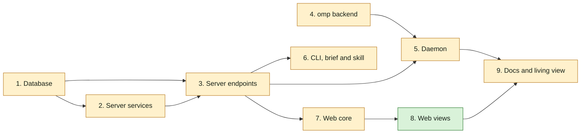

## At a glance

Not a journey change: no journey steps. Team Backend (Joeri) owns groups 1 to 6 and 9; groups 7 and 8 are the frontend part Skuddy's hand-off keeps in this change. Groups 1 and 4 can start at once.

| Kind | Name | Change | Path |
|---|---|---|---|
| Group | Database | changed | `server/migrations/`, `server/pkg/db/queries/` |
| Group | Server services | changed | `server/internal/service/`, `server/cmd/server/activity_listeners.go` |
| Group | Server endpoints | changed | `server/internal/handler/`, `server/cmd/server/router.go`, `server/pkg/protocol/` |
| Group | omp backend | changed | `server/pkg/agent/` |
| Group | Daemon | changed | `server/internal/daemon/` |
| Group | CLI, brief and skill | changed | `server/cmd/multica/`, `server/internal/daemon/execenv/`, `server/internal/service/builtin_skills/multica-platform/` |
| Group | Web core | changed | `packages/core/` |
| Group | Web views | new | `packages/views/` |
| Group | Docs and living view | changed | `apps/docs/content/docs/`, `specs/docs/system-design.md` |

## 1. Database

- [x] 1.1 `server/migrations/720_task_supplement_items.up.sql`, `.down.sql` -- add `item_kind TEXT NOT NULL DEFAULT 'comment' CHECK (item_kind IN ('comment','comment_edit','answer','issue_change'))`, `item_id UUID`, `content TEXT`, `seen_at TIMESTAMPTZ`, `handled_at TIMESTAMPTZ`; backfill `item_id = comment_id`; set `item_id NOT NULL`. Down attaches `task_supplement_comment_task_uidx` (rebuilt by 721 down) as `task_supplement_pkey` with `PRIMARY KEY USING INDEX`, then drops the columns -- design decision 1, Migration Plan.
- [x] 1.2 `server/migrations/721_task_supplement_item_task_index.up.sql`, `.down.sql` -- up: `CREATE UNIQUE INDEX CONCURRENTLY task_supplement_item_task_key ON task_supplement (item_id, task_id)`; down: `CREATE UNIQUE INDEX CONCURRENTLY IF NOT EXISTS task_supplement_comment_task_uidx ON task_supplement (comment_id, task_id)`; add the up entry to `concurrentIndexCleanups` and the down entry to the down-cleanup map beside `548` in `server/cmd/migrate/main.go` -- AGENTS.md index rule, Migration Plan.
- [x] 1.3 `server/migrations/722_task_supplement_item_task_primary_key.up.sql`, `.down.sql` -- up: swap the primary key to `(item_id, task_id)` using the index of 1.2, then `ALTER COLUMN comment_id DROP NOT NULL`; down: delete non-comment rows (`item_kind <> 'comment'`), drop `task_supplement_pkey`, `ALTER COLUMN comment_id SET NOT NULL`. 721 down and 720 down restore the old key -- Migration Plan.
- [x] 1.4 `server/pkg/db/queries/supplement.sql` -- `CreateRunInputSupplement` (kind, item, content, comment id nullable, `client_request_id = item_id`, `ON CONFLICT (item_id, task_id) DO NOTHING`); `ListRunningSupplementTasksForIssues` (running tasks with `task-supplement-v1` on the given issues, minus an agent and a task list); claim returns `item_kind`, `item_id`, `content`; `MarkRunInputSeen` and `MarkRunInputHandled` (`COALESCE`, only `status = 'delivered'`, returning the row); `ListRunInputMarksByItems` for answers and activity rows; switch every `comment_id`-keyed lookup the handlers use to `item_id`.
- [x] 1.5 `server/pkg/db/queries/comment.sql:351-407` (`ListReconcilableCommentsForIssueSince`) -- also take comments with a receipt of the completing task; drop a comment only when its newest `comment`/`comment_edit` receipt for a task of this agent has `handled_at` -- design decision 7.
- [x] 1.6 `server/pkg/db/queries/question.sql:200-223` and the claim-input query behind `loadClaimQuestionAnswers` -- leave out answers whose latest `answered`/`answer_edited` event has a receipt with `handled_at` for a task of the same agent -- ADR-0020.
- [x] 1.7 `server/pkg/db/generated/` -- regenerate with `make sqlc`.
- [x] 1.8 `server/pkg/db/queries/supplement_test.go` (or the package's existing query test file) -- tests: a delivered comment without ✅ replays and one with ✅ does not; a ✅ comment whose newer edit has no ✅ replays; an edit of a comment older than the run replays without ✅; a ✅ answer drops from the unseen count, an answer edited after ✅ counts again; marking twice keeps the first time; a mark on a `pending` receipt changes nothing.

## 2. Server services

- [x] 2.1 `server/internal/service/run_input.go` -- `RunInputService.Deliver(ctx, issueIDs, actor, item, excludeTaskIDs)`: every running task with `task-supplement-v1` on those issues, minus the actor's agent and `excludeTaskIDs`; one `pending` receipt per task in the lock order of `CreateTaskSupplement`; `NotifyTaskSupplementAvailable` per runtime; returns the task ids it reached; logs and breadcrumbs per the project's conventions -- design decision 2.
- [x] 2.2 `server/internal/service/question.go:597-634` and the edit and ask-back paths -- after the `question_event` commits, render the content ("Brian answered Thomas's question "…": …", "Brian changed the answer …", "Brian asks back: …") and call `Deliver` for every issue the question links to -- live-run-input "An answer reaches the running runs on the question's issues".
- [x] 2.3 `server/cmd/server/activity_listeners.go:63-280` -- after each issue-change `activity_log` insert, render "<actor> changed the <field> from <old> to <new>" (the description in full) and call `Deliver` for the issue -- live-run-input "An issue change reaches every running run on the issue".
- [x] 2.4 `server/cmd/server/activity_listeners.go` -- subscribe `issue_labels:changed`, `issue_attachments:changed` (only with `attachment_id`) and the parent changes of `issue:created`/`issue:updated`; record `label_added`, `label_removed`, `attachment_added`, `attachment_removed`, `sub_issue_added`, `sub_issue_removed` (sub-issue rows on the parent, with the child's id, key and title); publish the activity event and call `Deliver` as 2.3 -- design decision 9.
- [x] 2.5 `server/internal/handler/label.go:487`, `559` -- add `label` (id, name) and `change` to the `issue_labels:changed` payload.
- [x] 2.6 `server/internal/handler/file.go:611`, `1499` -- add `attachment_id`, `filename` and `change` to `issue_attachments:changed` when the file is on the issue itself, not on a comment.
- [x] 2.7 `server/internal/handler/issue.go:4144` (`UpdateIssue`) and the batch update publish near `issue.go:4984` -- add `parent_changed` and `prev_parent_issue_id` to `issue:updated`.
- [x] 2.8 `server/internal/service/run_input_test.go` and `server/cmd/server/activity_listeners_test.go` (or the package's existing listener test) -- tests: the actor's own run gets no receipt; a queued task gets none; a task without `task-supplement-v1` gets none; an excluded task gets none; an answer to Skuddy's question reaches Thomas's running task; an issue change reaches every running task on the issue; adding a label, a file and a sub-issue each writes its activity row and a receipt.

## 3. Server endpoints

- [x] 3.1 `server/internal/handler/task_supplement.go:140-184` -- `steerCommentAgentTriggers`: call `Deliver` for every running run on the issue; without `steer_task_ids`, every triggered running recipient is steered (taken out of the enqueue list) for any author type; with the list, a triggered running recipient not in it goes in `excludeTaskIDs` and keeps today's handling; files no longer block steering; the content lists the comment's files with their ids -- design decision 3, 5.
- [x] 3.2 `server/internal/handler/comment.go:1494-1498`, `1774` -- tell a missing `steer_task_ids` from an empty list in the request decode.
- [x] 3.3 `server/internal/handler/run_input.go` -- `ReactToRunInput` for `POST /api/tasks/{taskId}/inputs/{itemId}/reactions`: agent auth, the token's task is `taskId`, emoji `👀` or `✅` else 400 "react takes 👀 or ✅", no delivered receipt 404 "this run did not receive that item"; publishes `run_input:reacted` -- design decision 6.
- [x] 3.4 `server/cmd/server/router.go` -- route 3.3 under the agent-auth group.
- [x] 3.5 `server/pkg/protocol/messages.go`, `events.go` -- claim response `item_kind`, `item_id`, `content`; event `run_input:reacted` with issue, item kind, item id, agent, `seen_at`, `handled_at`.
- [x] 3.6 `server/internal/handler/task_supplement.go` (`ClaimTaskSupplement`, `CommentSupplementResponse`) -- return the new claim fields; add `item_kind`, `seen_at` and `handled_at` to comment receipts.
- [x] 3.7 `server/internal/handler/question.go`, `server/internal/handler/activity.go:156-260` (`ListTimeline`, `mergeTimeline`) -- add `run_marks` to answers and to issue-change timeline entries from `ListRunInputMarksByItems` -- design decision 10.
- [x] 3.8 `server/internal/handler/daemon.go:5129-5156` -- `failTask` calls `reconcileCommentsOnCompletion` after a transition -- design decision 7.
- [x] 3.9 `server/internal/handler/run_input_test.go` and `server/internal/handler/comment_thread_queue_test.go` -- tests: react from another run 404s; react outside a run 401s; another emoji 400s; a CLI comment by Skuddy steers Thomas's running task; a reply in Skuddy's thread reaches Thomas's running task and queues nothing for him at its end; a composer comment with `steer_task_ids: []` does not reach a triggered recipient; a text-changing edit reaches the running task as a `comment_edit`; a comment for Thomas received without ✅ queues one follow-up at completion and at failure; one with ✅ queues none.
- [x] 3.10 `server/internal/handler/comment.go:3603-3618` (`retriggerEditedComment`) -- on a text-changing edit, deliver a `comment_edit` item with a new id and the edited text through the same path as 3.1.

## 4. omp backend

- [x] 4.1 `server/pkg/agent/pi.go:352-755`, `995-1030` -- for the `omp` identity: start `omp --mode rpc --no-ui --session <path>`, send `{"type":"set_interrupt_mode","mode":"wait"}` then the prompt as one `{"type":"prompt"}` frame, keep stdin open, map `agent_start`/`message_*`/`tool_*`/`agent_end` as print mode does, skip `response` and `prompt_result`, close stdin on `session_settled`; `Session.Supplement` writes `{"type":"steer","message":…}` and `SupplementReady` closes after `agent_start` -- design decision 4.
- [x] 4.2 `server/pkg/agent/version.go:114-134` -- `SupportsTaskSupplement("omp", v)` true from `18.10.1`.
- [x] 4.3 `server/pkg/agent/pi_test.go` -- tests with a fake omp script: RPC frames produce the same messages and result as print mode; a supplement written after `agent_start` reaches stdin as one `steer` line; stdin closes on `session_settled`; pi still runs print mode.

## 5. Daemon

- [x] 5.1 `server/internal/daemon/client.go` -- decode the claim fields of 3.5.
- [x] 5.2 `server/internal/daemon/task_supplement.go:90` -- `formatTaskSupplementInstruction` writes a notice: kind, author, issue key, thread, item id, content, files with download commands, and the two `multica issue react` commands for when it is relevant; the issue key is the run's own `task.IssueIdentifier`, passed from `executeAndDrain` into `runTaskSupplementLoop` -- design decision 5.
- [x] 5.3 `server/internal/daemon/task_supplement_test.go` -- tests: each kind's text names its item id and the react commands; an answer, an edit and an issue change are delivered through the same loop as a comment.

## 6. CLI, brief and skill

- [x] 6.1 `server/cmd/multica/cmd_issue.go` -- `multica issue react <item> <emoji>`: needs `MULTICA_TASK_ID`, else "react works only inside an agent's run"; posts to 3.3; prints the server's message on failure.
- [x] 6.2 `server/cmd/multica/cmd_issue_test.go` -- test: no task id fails before any request.
- [x] 6.3 `server/internal/daemon/execenv/runtime_config_sections.go` -- "While you run" section only for tasks started with `task-supplement-v1`: notices arrive with an id, 👀 when it saw one and handles it, ✅ once handled, leave one that is not relevant, an item for it without ✅ is handled again after the run -- design decision 11.
- [x] 6.4 `server/internal/daemon/execenv/runtime_config_test.go` -- test: the section is present with the capability and absent without.
- [x] 6.5 `server/internal/service/builtin_skills/multica-platform/` -- document `multica issue react` in the issues reference.

## 7. Web core

- [x] 7.1 `packages/core/issues/run-steering.ts` -- `steerByDefault: true` for every running steerable recipient, in every thread; `canSteer` no longer depends on files -- live-run-input "The composer adds a comment to a running run by default".
- [x] 7.2 `packages/views/issues/components/comment-input.tsx:172-193` -- always send `steer_task_ids`, also empty; drop the files notice (`steer_attachment_notice`).
- [ ] 7.3 `packages/core/types/`, `packages/core/api/schemas.ts` -- `item_kind`, `seen_at`, `handled_at` on comment receipts; `run_marks` on answers and activity entries; the six new activity actions.
- [ ] 7.4 `packages/core/realtime/use-realtime-sync.ts:1088-1345` -- on `run_input:reacted`, invalidate the issue's timeline and question queries.
- [ ] 7.5 `packages/core/issues/run-steering.test.ts` -- update the default-action cases.

## 8. Web views

- [ ] 8.1 `packages/views/issues/components/run-input-marks.tsx` -- `RunInputMarks`: 👀 and ✅ with the agent's name per run, an edit's marks labelled "edit"; `en` and the other locale files under `packages/views/locales/`.
- [ ] 8.2 `packages/views/issues/components/comment-card.tsx:680`, `1063` -- show `RunInputMarks` from the comment's receipts.
- [ ] 8.3 `packages/views/questions/question-card.tsx:134-149` -- show `RunInputMarks` on each answer.
- [ ] 8.4 `packages/views/issues/components/issue-detail.tsx:336-500`, `853` -- `formatActivity` texts for `label_added`, `label_removed`, `attachment_added`, `attachment_removed`, `sub_issue_added`, `sub_issue_removed` with locale strings; show `RunInputMarks` beside the text of issue-change entries.

## 9. Docs and living view

- [ ] 9.1 `apps/docs/content/docs/comments.mdx`, `cli.mdx` -- comments, edits, answers and issue changes reach running agents as notices, the 👀 and ✅ marks, `multica issue react`.
- [ ] 9.2 `specs/docs/system-design.md` -- add `RunInputService`, the react endpoint, the omp RPC path and the receipt columns to the Go server, daemon and models views.

## Implementation Notes

- Database 1.1: added `server/migrations/720_task_supplement_items.up.sql` and `.down.sql`. Existing receipts become `comment` items keyed by their comment id; content and mark timestamps remain nullable. The approved reverse migration attaches the concurrently rebuilt comment/task index before dropping the item columns. Migration execution is left to the main agent's verification.
- Database 1.2: added the single-statement concurrent item-index migration and concurrent comment-index rollback (`721` up/down); registered both invalid-index cleanup hooks in `server/cmd/migrate/main.go`. `IF NOT EXISTS` follows the existing restartable concurrent-index convention.
- Database 1.3: added `722` up/down to attach the prebuilt item/task index and allow receipts without comments. Rollback intentionally discards non-comment items before restoring comment nullability; it restores the old primary key across `722`, `721`, then `720`, as the amended Migration Plan specifies.
- Database 1.4: `server/pkg/db/queries/supplement.sql` now creates and claims all item kinds, lists running capable targets with actor/task exclusions, marks only delivered items idempotently, and lists marks by item. Item-scoped get/ack/retry queries take `item_id`; comment-scoped list/delete/lock operations retain `comment_id` to cover all edits. Existing comment creation paths set `item_id`; capability negotiation now includes omp. Claim content prefers the receipt snapshot and falls back to the comment text for original comments, with member or agent author names.
- Database 1.5: `server/pkg/db/queries/comment.sql` takes the completing `task_id` and includes its received comments across thread/time filters, so an older comment's edit can replay. Only the newest comment/edit receipt for this agent suppresses replay when handled; pending, failed, delivered-but-unhandled, and seen-only receipts do not.
- Database 1.6: `server/pkg/db/queries/question.sql` applies the same handled-event exclusion to both unseen counts and claim-input answers. Latest events are selected per question and answerer, preventing one answerer's handled receipt from hiding another's answer; edits supersede the earlier handled event. Existing claim/retry cutoff semantics and ask-back counting remain unchanged.
- Database 1.7: regenerated `server/pkg/db/generated/{models.go,supplement.sql.go,comment.sql.go,question.sql.go}` with `make sqlc` (successful). As Joeri directed, mechanically updated existing receipt-query callers in `server/internal/handler/task_supplement.go` and its tests to pass item ids, and `daemon.go` to pass the completing task id; endpoint behavior remains assigned to group 3. No language server is configured, so caller discovery used the repository search tools.
- Database 1.8: added `server/pkg/db/queries/supplement_test.go` with real PostgreSQL fixtures covering delivered/seen-only/handled comments, newer edits and older-comment edits, answer count/claim parity before and after handling/editing, separate answerers, idempotent marks, rejection of pending marks, and claim/deduplication for every item kind. The package requires `DATABASE_URL`; an explicitly configured but unreachable database fails rather than silently skipping. Updated the existing handler completion matrix in `task_supplement_test.go` to expect replay unless handled, including merge into an existing queued task. These regression tests are authored but have not been executed by this builder.
- Database verification: `make sqlc` succeeded. After all database code and test edits, Crabbox run `run_dfce3b3a85c848e02d41f4acd910605d` ran `go -C server build ./... && go -C server vet ./...` through `/work/crabbox/bin/slot` and exited 0. No migration or regression-test execution was requested of this builder; the main agent should apply migrations to an isolated database, run the new query tests and the updated handler completion matrix, and exercise the full-batch rollback.
- Server services 2.1: added `server/internal/service/run_input.go`. The shared service snapshots all item kinds, selects only running capable recipients in the workspace, excludes the actor's agent and explicit tasks, and lets the existing SQL own task-row-before-receipt locking against settlement. It notifies only after each committed receipt; repeated delivery returns the existing exact-run receipt without inserting twice. Structured per-receipt debug breadcrumbs and an info summary use the repository's `slog` convention (there is no separate breadcrumb SDK). No checks run by this builder; group 2 regression tests follow in 2.8.
- Server services 2.2: updated `server/internal/service/question.go`, `server/internal/handler/handler.go` and `server/cmd/server/router.go`. Answers, edits and ask-backs snapshot the authenticated member's name, the asking agent, question prompt, rendered answer and note (or ask-back text) under the question transaction, then deliver only after its event commits. Delivery uses all direct issue-bearing links through the existing `CardIssueIDs` projection, not ancestor pages, and never enqueues. The handler shares one service with questions and updates its notifier to the relay-aware daemon notifier at router composition. Post-commit delivery failures are logged without reporting the already-committed answer as failed.
- Server services 2.3: `server/cmd/server/activity_listeners.go` consumes its persisted `activity:created` publications synchronously to deliver each supported field change with that activity id. Descriptions now store both full values; assignees resolve to member, agent or squad names, and status/priority values are readable. Duplicate-mark rows that replace a status row carry the same status change for delivery. `server/cmd/server/main.go` supplies the relay-aware notifier; existing registrations in `activity_listeners_test.go` and `integration_test.go` pass the service explicitly. No tests, builds, formatters or linters were run.
- Server services 2.4: `activity_listeners.go` now records and delivers the six relation actions. Label details are `label_id`/`label_name`; file details are `attachment_id`/`filename`; sub-issue details are `sub_issue_id`/`sub_issue_identifier`/`sub_issue_title`, on the parent. Moves write removal on the previous parent and addition on the next; unparenting only removes. File notices include the download command only for an added file, and snapshot-only attachment events are ignored. `subscriber_listeners.go`'s existing issue-map normalizer now also extracts title, identifier and parent so service/autopilot creates keep the same behavior as HTTP creates. Event producers are completed in tasks 2.5–2.7.
- Server services 2.5: `server/internal/handler/label.go` publishes `label: {id, name}` and `change: added|removed` only when the existing attach/detach write reports a real change. Actor attribution now uses the existing authenticated actor resolver instead of assuming member identity, so an agent's label change is excluded from its own notices.
- Server services 2.6: `server/internal/handler/file.go` adds `attachment_id`, `filename` and `change` to successful issue-file upload/delete events. Existing revision-only events retain their shape for comment files and do not create an issue-change receipt. Deletes resolve the authenticated actor; upload events already use the resolved uploader.
- Server services 2.7: `server/internal/handler/issue.go` publishes the persisted parent comparison and previous parent id in both single and batch update events. The batch payload also carries its previous status, priority and assignee, which the existing activity listener needs to render accurate old/new notices rather than blank old values. No queue, reconciliation or parent-write rules changed.
- Server services 2.8: added `server/internal/service/run_input_test.go` and extended `server/cmd/server/activity_listeners_test.go` with real PostgreSQL fixture coverage for actor/queued/starting/capability/task exclusions, multiple issues, idempotence, exact runtime notifications, comment/edit identities, workspace isolation, answers/edits/ask-backs from Brian to Skuddy reaching Thomas on every linked issue without queuing, all seven field changes with full descriptions and resolved assignees, all six relation actions and their published rows/receipts, snapshot-only file events, own-agent exclusions, and moves notifying both parents. The listener also uses the existing status catalog resolver for custom status names. No tests, builds, linters or formatters were executed by this builder; the main agent must format the touched Go files and run the service and server listener suites against an isolated database with migrations 720–722 applied.
- Server services verification/risk: implementation used the generated group-1 query API and existing event/fixture conventions; no language server is configured. Delivery follows the approved post-commit design, not an outbox: errors are logged and the original question/activity remains committed. Member/agent changes are covered; system-authored events without an actor id cannot create a receipt under the existing non-null `author_id` constraint (no system-author schema change was specified).
- Server endpoints 3.1: `task_supplement.go` calls the shared delivery service for every capable running run, including non-recipients and agent-authored comments. Explicit composer choices exclude triggered tasks before delivery; only successfully reached recipients leave the enqueue list. `comment.go` retains suppressed targets for that exclusion, removes the attachment steering block, and hydrates all returned receipts. File names, ids and download commands are snapshotted in notice content. Checks are reserved for the main agent.
- Server endpoints 3.2: `CreateCommentRequest` keeps JSON's nil-versus-empty slice distinction across UUID parsing. Missing (or null) uses default steering; an explicit empty array excludes triggered running recipients. Existing UUID validation is unchanged.
- Server endpoints 3.3: added `run_input.go` with task-token-only reactions, exact task/agent/workspace binding, delivered-only SQL marks, stable error responses and structured failure/debug logging. A mismatched run is a non-disclosing 404; a human credential is 401. Successful marks publish the receipt identity and timestamps. No checks run.
- Server endpoints 3.4: `router.go` registers the reaction endpoint beside task routes under the shared authenticated, workspace-scoped API group. Its handler requires the server-stamped task-token identity; daemon and human credentials cannot mark inputs.
- Server endpoints 3.5: `protocol/messages.go` defines `TaskSupplementClaimResponse` for all input kinds; `events.go` owns `EventRunInputReacted` and its typed payload. `run_input.go` publishes that contract with per-run identity and nullable timestamps. No language server is configured; existing symbol searches supplied the declaration/caller context.
- Server endpoints 3.6: `task_supplement.go` returns the typed claim with item kind/id and snapshotted content, while retaining the comment id for comment notices. Comment receipts expose item identities and seen/handled timestamps, including the direct additional-message response. Non-comment acknowledgements no longer attempt comment hydration. No checks run.
- Server endpoints 3.7: `run_input.go` batches receipt-mark reads by workspace and item. `activity.go` hydrates timeline activity entries in one query. `question.go` adds handler-owned answer projections to all aggregate read/mutation responses, selecting each answerer's latest answered/edit event (matching the unseen query), so earlier handled versions do not mark a newer edit. Question creation has no answers and keeps its existing response. Service/domain DTOs are intentionally unchanged; marks remain read-side metadata. No checks run.
- Server endpoints 3.8: `daemon.go` reconciles unhandled comments only after an actual failure transition, before notifying the runtime of available work. An existing auto-retry absorbs comment replays through the normal pending-task merge; duplicate failure callbacks do not reconcile twice.
- Server endpoints 3.9: added `run_input_test.go` for run-scoped authorization, delivered-only/idempotent marks and reaction events, comment timeline marks, all-kind claims/acks, edited comment item identities and no-op edits, and latest-answer-event marks. Extended `comment_thread_queue_test.go` for agent-authored default steering and own-item exclusion, other-thread notices without follow-ups, explicit-empty composer choices, and handled/seen-only completion/failure callbacks including duplicate callbacks. Updated two `comment_steer_test.go` completion assertions to mark the steered input handled rather than treating delivery alone as suppression. Tests are authored, not executed; the edited-comment regression is completed by task 3.10.
- Server endpoints 3.10: `comment.go` shares its trigger/delivery path between original comments and text-changing edits; each edit gets a fresh UUIDv7, `comment_edit`, the edited snapshot and the authenticated editor as actor. Unchanged text creates no item. `task_supplement.go` renders files and thread identity into the snapshot with a string builder and uses reached-task sets for recipient removal. Edit responses include every version's receipts. Existing `/note` human-only behavior and the normal enqueue path for non-capable/non-running recipients stay unchanged. No tests, builds, linters or formatters run by this builder.
- Server endpoints edit cutover: removed `UpdateComment`'s blanket rejection of any comment with a receipt. That guard made the required received-comment edit scenario unreachable; normal author/admin authorization, optimistic revision checks, task cancellation and attachment transactions still apply.
- Server endpoints additional regression coverage: `run_input_test.go` exercises comments with files and activity-row marks, and the other-thread queue test checks the notice's root id and owning agent's name. File/thread context is snapshotted before delivery so the daemon can render it without extra API calls.
- Server endpoints documentation: `admission.go` describes `DispatchSteered` as receipt-driven input, including default steering rather than only an explicit author request. User-facing feature documentation remains assigned to group 9.
- omp backend 4.1: `server/pkg/agent/pi.go` selects headless RPC only for the omp identity; Pi retains print/JSON with prompt EOF. The wait-mode command precedes one JSON-encoded prompt, stdin remains open through yields and is closed at `session_settled`, and the shared stream mapper retains its text/tool/usage/error handling while ignoring RPC responses/results. Negotiated sessions expose serialized `steer` writes and readiness only after `agent_start`, cleared at `agent_end`, settlement or cancellation. Cancellation of a blocked/partial input closes the unusable JSONL pipe. Updated all `buildPiArgs` test callers and the two existing omp execution fixtures in `pi_test.go`/`omp_test.go` for the selected dialect. No language server is configured; repository searches supplied callers. No checks run; group 4 regression additions follow in 4.3.
- omp backend 4.2: `server/pkg/agent/version.go` enables task-supplement negotiation for omp from `18.10.1`; older and unknown versions remain fail-closed and Pi stays unsupported. `version_test.go` adds exact-floor, higher patch/major, lower patch/minor and missing/development-version cases. Tests are authored, not run.
- omp backend 4.3: `server/pkg/agent/pi_test.go` adds POSIX fake-CLI tests comparing identical Pi print-mode and omp RPC event streams, including text/thinking/tools/usage/results, exact argv, multiline/quoted prompt framing, wait-before-prompt order and child-observed EOF. A negotiated omp test sends two concurrent multiline 128-KiB notices, verifies one intact `steer` line each, accepts neither pre-cancelled nor post-settlement input, and carries a yielded/non-settled run into a later run before final EOF. Existing omp fixtures now consume two RPC commands rather than waiting for initial EOF. No real-agent CLI is resolved or executed. Tests, builds, linters and formatters were not run by this builder; main should run the agent package tests (including race detection) after integration. Feature docs and the living system view remain assigned to group 9.
- Daemon 5.1: `server/internal/daemon/client.go` decodes `item_kind` and `item_id` and uses the item id, not nullable `comment_id`, to distinguish a notice from an empty claim. Updated the existing loop fixture in `task_supplement_test.go` to carry the claim contract. Content remains the server's full snapshot. No checks run; all-kind coverage follows in 5.3.
- Daemon 5.2: `task_supplement.go` renders each input as a kind-labelled notice with the author, issue key, item id, unchanged content snapshot (including thread and file download commands), and both relevance-scoped reactions. Claims and success/failure acknowledgements use the item id, including edits and non-comment items; failure logs name that item and kind. As Joeri resolved the missing issue-key contract, `daemon.go` passes `task.IssueIdentifier` through both initial and fresh-retry `executeAndDrain` calls to the supplement loop without changing the server response. Migrated all existing execution-test callers in the daemon, Cursor watchdog/boundary, task call-id/timing, supplement, and tool-preview test files to the explicit issue-key argument. No builds, tests, linters or formatters run.
- Daemon 5.3: `task_supplement_test.go` tests all four kind labels, author normalization, full multiline content/thread/file snapshots, item ids and both relevance-scoped reactions. A negotiated `executeAndDrain` session receives an ordered comment, its separately identified edit, an answer without `comment_id`, and an issue change without `comment_id`; assertions cover the threaded run issue key, one injection per item and item-keyed acknowledgement before the next claim. The empty-claim test uses the handler's actual `{}` response; existing readiness, timeout acknowledgement and negotiation tests remain. Tests are authored, not executed. Main should run daemon package tests (including race detection) and format/check the mechanically migrated execution callers after all groups integrate.
- CLI 6.1: `cmd_issue.go` adds `multica issue react <item-id> <emoji>` (exactly two arguments). It reads `MULTICA_TASK_ID` before building the API client, so outside a run it fails with "react works only inside an agent's run" without any request; inside a run it posts `{"emoji": …}` to `/api/tasks/{MULTICA_TASK_ID}/inputs/{item}/reactions` and prints the server's receipt as JSON (stderr confirms the mark). The server owns every rule (emoji, receiving run), so the CLI does not validate the emoji itself. Surprise: the CLI's top-level `FormatError` replaces 401/404 bodies with generic copy, which would hide "this run did not receive that item"; `server/internal/cli/errors.go` therefore gains `ServerErrorMessage(err)`, and the command wraps any server refusal with `cli.WithUserMessage` so the server's own sentence is printed while exit codes still follow the HTTP status.
- CLI 6.2: `cmd_issue_test.go` adds `TestRunIssueReactRequiresTaskID` (empty `MULTICA_TASK_ID`: the printed message is exactly "react works only inside an agent's run" and the test server sees zero requests), plus `TestRunIssueReactPostsToTheRunsInput` (path, body and printed receipt) and `TestRunIssueReactPrintsTheServersMessage` (404, 400 and 401 bodies surface verbatim through `cli.FormatError`). The run environment is injected like the daemon does, with a temporary `HOME`, so no owner config leaks in.
- Brief 6.3: `runtime_config_sections.go` adds `WhileYouRunSection` and `writeWhileYouRunSection`, written right after the Questions section for every task kind, gated only on the new `TaskContextForEnv.TaskSupplementNegotiated` (`execenv.go`); the brief's Section × Kind matrix lists it as data-driven. The section names the `[Multica notice]` prefix and item id the daemon's notice uses, `multica issue react <item> 👀` and `✅` with when to use each, leaving irrelevant items unmarked, and that an item for the agent without ✅ is handled again after the run. Wiring: `daemon.go` sets `taskCtx.TaskSupplementNegotiated` from the `StartTask` result, which already returns before `InjectRuntimeConfig` writes the brief, so the section follows what the server accepted rather than what the daemon offered. The flag is fixed for the run, so the brief stays byte-stable across a run's resumes.
- Brief 6.4: `runtime_config_test.go` adds `TestWhileYouRunSectionOnlyWithTaskSupplement` over assignment and comment omp briefs: with the capability the exact section and its five anchors (item id, both react commands, leave unmarked, handled again after the run) are present; without it neither the heading, `multica issue react` nor `[Multica notice]` appears anywhere in the brief (the "A run that cannot take input" scenario).
- Skill 6.5: `references/issues.md` gains "Items that reach you while you run" (with its table-of-contents entry), after "Who else is running right now". It applies only when the brief has a "While you run" section, so a run without mid-run input is told it does not apply rather than given a second, skill-only gate; no ADR-0005-style skill variant was made because the change specifies none. It documents both react commands, leaving irrelevant items unmarked, where people see the marks, run-end handling of items without ✅, edits as items of their own, idempotent marks, and the three refusals. `server/internal/service/builtin_skills_test.go` pins four anchors in `TestPlatformSkillCoversPlatformContracts` so the brief's pointer to the command cannot dangle.
- Group 6 verification: on Crabbox (Go 1.26.6) the touched Go files are `gofmt`-clean (`gofmt -l` also lists about 20 untouched files on that toolchain, which predate this group), `go build ./...` and `go vet` of `cmd/multica`, `internal/cli`, `internal/daemon` and `internal/daemon/execenv` passed, and `go test` passed for `TestRunIssueReact*`, `TestRunIssueComment*` and `TestRunAttachment*` in `cmd/multica`, all of `internal/cli`, `TestWhileYouRun*`, `TestQuestionsSection*`, `TestBrief*`, `TestSubIssue*` and `TestInjectRuntimeConfig*` in `internal/daemon/execenv`, and `TestPlatformSkill*` and `TestLegacyRedirects*` in `internal/service`. The full daemon package suite was not run.
- Web core 7.1: `run-steering.ts` keeps `steerByDefault` and `canSteer` as booleans and documents them: `canSteer` is false only while editing, and the default steers every running turn that takes input in every thread. The thread logic lived in the views, so `use-recipient-actions.ts` drops its per-task `steerByDefault` callback and its files condition (`canSteer: allowSteer`), with its callers following: `comment-input.tsx` loses `steerTopLevelByDefault`, `reply-input.tsx` its `steerByDefault` prop, and `comment-card.tsx` `steerThreadRunByDefault` and `NEVER_STEER`. The member's "When replying to a running agent" preference stays as the only thing that turns the default off: it is the member's own explicit setting, not a thread rule. `comment-composers.test.tsx` drops the removed prop and adds a top-level comment steering a run another thread started.
- Web core 7.2: both `comment-input.tsx` and `reply-input.tsx` pass the exact steering list, including `[]`; `packages/core/api/client.ts` preserves the missing-versus-empty distinction in JSON so an explicit after-run/skip choice cannot become default steering. Removed `hasAttachments`/`attachmentsBlockSteer` from the recipient hook and both composers, deleted `steer-attachment-notice.tsx`, removed its key from all five issue locales and removed the obsolete “Text only” menu copy. Composer tests now expect explicit empty lists and cover a file-bearing comment joining a run from another thread; the API test covers missing, empty and populated lists. The existing mutations and timeline submission hooks already pass lists through unchanged. No checks run.

## Plan Change Log

- 2026-10-15, plan gate: Brian passed the plan with three answers that replace the plan's defaults. Every running agent on the issue gets every comment, answer and change as a notice that does not interrupt it, and 👀 is optional for items not relevant to it (decision 2, 4, 5; live-run-input; ADR-0019). Edited comments reach running runs as `comment_edit` items (decision 1, 7; tasks 3.10, 1.5). Labels, files and sub-issues count as issue changes and get activity rows (decision 9; tasks 2.4 to 2.7, 8.4). Comments with files now join a running run with their file ids (decision 3, 5).
