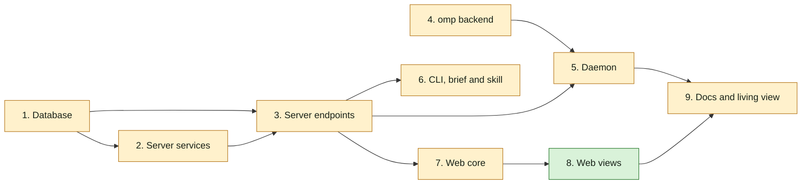

## At a glance

Not a journey change: no journey steps. Team Backend (Joeri) owns groups 1 to 6 and 9; groups 7 and 8 are the frontend part Skuddy's hand-off keeps in this change. Groups 1 and 4 can start at once.

| Kind | Name | Change | Path |
|---|---|---|---|
| Group | Database | changed | `server/migrations/`, `server/pkg/db/queries/` |
| Group | Server services | changed | `server/internal/service/`, `server/cmd/server/activity_listeners.go` |
| Group | Server endpoints | changed | `server/internal/handler/`, `server/cmd/server/router.go`, `server/pkg/protocol/` |
| Group | omp backend | changed | `server/pkg/agent/` |
| Group | Daemon | changed | `server/internal/daemon/` |
| Group | CLI, brief and skill | changed | `server/cmd/multica/`, `server/internal/daemon/execenv/`, `server/internal/service/builtin_skills/multica-platform/` |
| Group | Web core | changed | `packages/core/` |
| Group | Web views | new | `packages/views/` |
| Group | Docs and living view | changed | `apps/docs/content/docs/`, `specs/docs/system-design.md` |

## 1. Database

- [ ] 1.1 `server/migrations/720_task_supplement_items.up.sql`, `.down.sql` -- add `item_kind TEXT NOT NULL DEFAULT 'comment' CHECK (item_kind IN ('comment','answer','issue_change'))`, `item_id UUID`, `content TEXT`, `seen_at TIMESTAMPTZ`, `handled_at TIMESTAMPTZ`; backfill `item_id = comment_id`; set `item_id NOT NULL`. Down deletes non-comment rows and drops the columns -- design decision 1.
- [ ] 1.2 `server/migrations/721_task_supplement_item_task_index.up.sql`, `.down.sql` -- `CREATE UNIQUE INDEX CONCURRENTLY task_supplement_item_task_key ON task_supplement (item_id, task_id)`; add its entry to `concurrentIndexCleanups` in `server/cmd/migrate/main.go` -- AGENTS.md index rule.
- [ ] 1.3 `server/migrations/722_task_supplement_item_task_primary_key.up.sql`, `.down.sql` -- swap the primary key to `(item_id, task_id)` using the index of 1.2, then `ALTER COLUMN comment_id DROP NOT NULL`; down restores the `(comment_id, task_id)` key as `549` built it.
- [ ] 1.4 `server/pkg/db/queries/supplement.sql` -- `CreateRunInputSupplement` (kind, item, content, comment id nullable, `ON CONFLICT (item_id, task_id) DO NOTHING`); claim returns `item_kind`, `item_id`, `content`; `MarkRunInputSeen` and `MarkRunInputHandled` (`COALESCE`, only `status = 'delivered'`, returning the row); `ListRunInputMarksByItems` for answers and activity rows; switch every `comment_id`-keyed lookup the handlers use to `item_id`.
- [ ] 1.5 `server/pkg/db/queries/comment.sql:375-400` -- the steered-comment `NOT EXISTS` keeps only receipts with `handled_at IS NOT NULL` -- design decision 7.
- [ ] 1.6 `server/pkg/db/queries/question.sql:200-223` and the claim-input query behind `loadClaimQuestionAnswers` -- leave out answers whose latest `answered`/`answer_edited` event has a receipt with `handled_at` for a task of the same agent -- ADR-0020.
- [ ] 1.7 `server/pkg/db/generated/` -- regenerate with `make sqlc`.
- [ ] 1.8 `server/pkg/db/queries/supplement_test.go` (or the package's existing query test file) -- tests: a delivered comment without ✅ replays and one with ✅ does not; a ✅ answer drops from the unseen count, an answer edited after ✅ counts again; marking twice keeps the first time; a mark on a `pending` receipt changes nothing.

## 2. Server services

- [ ] 2.1 `server/internal/service/run_input.go` -- `RunInputService.Deliver(ctx, issueID, actor, item, agentIDs)`: running tasks with `task-supplement-v1` of those agents on the issue, minus the actor's agent; one `pending` receipt per task in the lock order of `CreateTaskSupplement`; `NotifyTaskSupplementAvailable` per runtime; logs and breadcrumbs per the project's conventions -- design decision 2.
- [ ] 2.2 `server/internal/service/question.go:597-634` and the edit and ask-back paths -- after the `question_event` commits, render the content ("Brian answered Thomas's question "…": …", "Brian changed the answer …", "Brian asks back: …") and call `Deliver` for the asking agent -- live-run-input "An answer reaches the asking agent's running run".
- [ ] 2.3 `server/cmd/server/activity_listeners.go:63-280` -- after each issue-change `activity_log` insert, render "<actor> changed the <field> from <old> to <new>" (the description in full) and call `Deliver` for every agent with a running task on the issue -- live-run-input "An issue change reaches every running run on the issue".
- [ ] 2.4 `server/internal/service/run_input_test.go` -- tests: the actor's own run gets no receipt; a queued task gets none; a task without `task-supplement-v1` gets none; an answer reaches only the asker's running task; an issue change reaches every running task on the issue.

## 3. Server endpoints

- [ ] 3.1 `server/internal/handler/task_supplement.go:140-184` -- `steerCommentAgentTriggers`: without `steer_task_ids`, steer every running supplement-capable recipient for any author type through `RunInputService`; with the list, follow it as today; a comment with attachments is never steered -- design decision 3.
- [ ] 3.2 `server/internal/handler/comment.go:1494-1498`, `1774` -- tell a missing `steer_task_ids` from an empty list in the request decode.
- [ ] 3.3 `server/internal/handler/run_input.go` -- `ReactToRunInput` for `POST /api/tasks/{taskId}/inputs/{itemId}/reactions`: agent auth, the token's task is `taskId`, emoji `👀` or `✅` else 400 "react takes 👀 or ✅", no delivered receipt 404 "this run did not receive that item"; publishes `run_input:reacted` -- design decision 6.
- [ ] 3.4 `server/cmd/server/router.go` -- route 3.3 under the agent-auth group.
- [ ] 3.5 `server/pkg/protocol/messages.go`, `events.go` -- claim response `item_kind`, `item_id`, `content`; event `run_input:reacted` with issue, item kind, item id, agent, `seen_at`, `handled_at`.
- [ ] 3.6 `server/internal/handler/task_supplement.go` (`ClaimTaskSupplement`, `CommentSupplementResponse`) -- return the new claim fields; add `seen_at` and `handled_at` to comment receipts.
- [ ] 3.7 `server/internal/handler/question.go`, `server/internal/handler/activity.go:156-260` (`ListTimeline`, `mergeTimeline`) -- add `run_marks` to answers and to issue-change timeline entries from `ListRunInputMarksByItems` -- design decision 9.
- [ ] 3.8 `server/internal/handler/daemon.go:5129-5156` -- `failTask` calls `reconcileCommentsOnCompletion` after a transition -- design decision 7.
- [ ] 3.9 `server/internal/handler/run_input_test.go` and `server/internal/handler/comment_thread_queue_test.go` -- tests: react from another run 404s; react outside a run 401s; another emoji 400s; a CLI comment by Skuddy steers Thomas's running task; a composer comment with `steer_task_ids: []` does not; a comment received without ✅ queues one follow-up at completion and at failure; one with ✅ queues none.

## 4. omp backend

- [ ] 4.1 `server/pkg/agent/pi.go:352-755`, `995-1030` -- for the `omp` identity: start `omp --mode rpc --no-ui --session <path>`, send the prompt as one `{"type":"prompt"}` frame, keep stdin open, map `agent_start`/`message_*`/`tool_*`/`agent_end` as print mode does, skip `response` and `prompt_result`, close stdin on `session_settled`; `Session.Supplement` writes `{"type":"steer","message":…}` and `SupplementReady` closes after `agent_start` -- design decision 4.
- [ ] 4.2 `server/pkg/agent/version.go:114-134` -- `SupportsTaskSupplement("omp", v)` true from `18.10.1`.
- [ ] 4.3 `server/pkg/agent/pi_test.go` -- tests with a fake omp script: RPC frames produce the same messages and result as print mode; a supplement written after `agent_start` reaches stdin as one `steer` line; stdin closes on `session_settled`; pi still runs print mode.

## 5. Daemon

- [ ] 5.1 `server/internal/daemon/client.go` -- decode the claim fields of 3.5.
- [ ] 5.2 `server/internal/daemon/task_supplement.go:90` -- `formatTaskSupplementInstruction` writes kind, author, issue key, item id, content and the two `multica issue react` commands -- design decision 5.
- [ ] 5.3 `server/internal/daemon/task_supplement_test.go` -- tests: each kind's text names its item id and the react commands; an answer and an issue change are delivered through the same loop as a comment.

## 6. CLI, brief and skill

- [ ] 6.1 `server/cmd/multica/cmd_issue.go` -- `multica issue react <item> <emoji>`: needs `MULTICA_TASK_ID`, else "react works only inside an agent's run"; posts to 3.3; prints the server's message on failure.
- [ ] 6.2 `server/cmd/multica/cmd_issue_test.go` -- test: no task id fails before any request.
- [ ] 6.3 `server/internal/daemon/execenv/runtime_config_sections.go` -- "While you run" section only for tasks started with `task-supplement-v1`: items arrive with an id, 👀 when seen, ✅ once handled, an item without ✅ is handled again after the run -- design decision 10.
- [ ] 6.4 `server/internal/daemon/execenv/runtime_config_test.go` -- test: the section is present with the capability and absent without.
- [ ] 6.5 `server/internal/service/builtin_skills/multica-platform/` -- document `multica issue react` in the issues reference.

## 7. Web core

- [ ] 7.1 `packages/core/issues/run-steering.ts` -- `steerByDefault: true` for every running steerable recipient, in every thread -- live-run-input "The composer adds a comment to a running run by default".
- [ ] 7.2 `packages/views/issues/components/comment-input.tsx:172-193` -- always send `steer_task_ids`, also empty.
- [ ] 7.3 `packages/core/types/`, `packages/core/api/schemas.ts` -- `seen_at`, `handled_at` on comment receipts; `run_marks` on answers and activity entries.
- [ ] 7.4 `packages/core/realtime/use-realtime-sync.ts:1088-1345` -- on `run_input:reacted`, invalidate the issue's timeline and question queries.
- [ ] 7.5 `packages/core/issues/run-steering.test.ts` -- update the default-action cases.

## 8. Web views

- [ ] 8.1 `packages/views/issues/components/run-input-marks.tsx` -- `RunInputMarks`: 👀 and ✅ with the agent's name per run; `en` and the other locale files under `packages/views/locales/`.
- [ ] 8.2 `packages/views/issues/components/comment-card.tsx:680`, `1063` -- show `RunInputMarks` from the comment's receipts.
- [ ] 8.3 `packages/views/questions/question-card.tsx:134-149` -- show `RunInputMarks` on each answer.
- [ ] 8.4 `packages/views/issues/components/issue-detail.tsx:853` -- show `RunInputMarks` beside the `formatActivity` text of issue-change entries.

## 9. Docs and living view

- [ ] 9.1 `apps/docs/content/docs/comments.mdx`, `cli.mdx` -- comments reach running agents, the 👀 and ✅ marks, `multica issue react`.
- [ ] 9.2 `specs/docs/system-design.md` -- add `RunInputService`, the react endpoint, the omp RPC path and the receipt columns to the Go server, daemon and models views.

## Implementation Notes

## Plan Change Log
