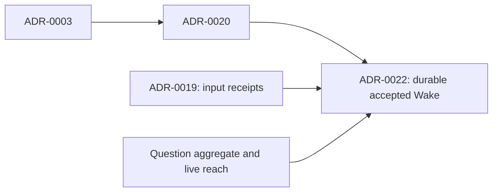

## At a glance

| Kind | Name | Change | Path |
|---|---|---|---|
| Decision | Durable accepted wake | new | `adr/0022-an-accepted-wake-waits-durably-for-the-agent.md` |
| Manifest | Change ADR review | new | `specs/openspec/changes/deliver-question-answers-after-active-run/adr.md` |

## ADR Review Manifest

- Status: completed
- Review date: 2026-10-16

## Review Summary

The change retains question ownership, live scope, explicit Wake and handled receipts. ADR-0022 supersedes ADR-0020 to bind the lifetime of accepted wake intent and its input boundary across retries; the prior accepted file is unchanged. No stack, UI, daemon-protocol or generic retry-policy decision is introduced.

The pre-change ADR walker reports duplicate sequence IDs 0004, 0005, 0006, 0007 and 0021, plus existing field-format findings. Its number-only graph therefore omits distinct records that share IDs. The review treats full filenames as identity for these records rather than treating a different file with the same ID as superseded. Renumbering or rewriting accepted records is outside this change.

## In-Force ADRs Reviewed

Paths below are relative to `adr/`.

| File | Constraint on this change |
|---|---|
| `0001-runtime-machine-files-are-read-by-the-daemon.md` | Runtime-machine file ownership unchanged |
| `0002-questions-are-their-own-aggregate.md` | Waiting intent belongs to the question domain, not comments |
| `0004-question-sets-group-questions-open-is-per-question.md` | Per-question status and answer-policy behavior unchanged |
| `0005-project-status-and-dates-stay-stored-but-unseen.md` | No project-state change |
| `0005-whether-a-run-may-ask-is-decided-at-claim.md` | No asking-permission change |
| `0006-questions-are-listed-per-viewer-through-one-row-list.md` | Keep the existing row-list path and server-derived counts |
| `0006-repositories-hold-worklanes.md` | No repository/worklane ownership change |
| `0007-a-question-reaches-its-parents-at-read-time.md` | Compute Wake scope from the live tree, not copied ancestry |
| `0007-worktrees-are-made-by-the-daemon-and-recorded-by-the-server.md` | No worktree provisioning change |
| `0009-the-server-keeps-worklane-and-issue-worktree-folders-apart.md` | No folder-layout change |
| `0010-the-server-keeps-each-repositorys-release-line.md` | No release change |
| `0011-a-worklane-shows-repository-activity-from-its-creation-on.md` | No worklane activity-boundary change |
| `0012-the-server-holds-the-issue-templates-and-a-type-is-set-once.md` | No template or issue-type change |
| `0013-an-issue-is-placed-in-a-worklane-and-a-release-under-the-repositorys-lock.md` | No issue-placement change |
| `0014-a-worklanes-issues-work-in-its-worktree-on-their-own-branch.md` | Continue the existing bug branch and worktree |
| `0015-the-database-keeps-an-issues-done-date.md` | No issue done-date change |
| `0016-the-worklanes-and-releases-pages-are-built-from-the-workspaces-lists.md` | No list-page change |
| `0017-a-client-account-is-refused-outside-the-session-list.md` | Keep current membership and runtime authorization |
| `0019-input-reaches-a-running-run-as-a-receipt.md` | Keep one receipt store and `handled_at` as the handling signal |
| `0020-only-wake-turns-answers-into-a-run-and-a-checked-answer-is-seen.md` | Superseded by ADR-0022 for accepted-wake lifetime and retained input boundary |
| `0021-a-member-asks-on-an-issue-and-wakes-no-agent.md` | Member questions still create no run input or Wake |
| `0021-client-memberships-hold-organisation-sets.md` | No client membership change |

Superseded context: `0003-only-wake-turns-answers-into-a-run.md` by ADR-0020; `0004-organisations-hold-projects.md` by `0006-repositories-hold-worklanes.md`; `0008-worklane-activity-is-kept-in-the-activity-log.md` by ADR-0011. Neither question-related record sharing those numbers is superseded by an unrelated repository decision.

## New Durable ADRs Created

- [ADR-0022](../../../../adr/0022-an-accepted-wake-waits-durably-for-the-agent.md): accepted Wake persists until it can be consumed atomically, and intervening retries cannot silently discard its input.
