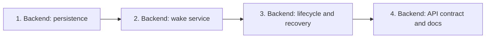

## At a glance

| Kind | Name | Change | Path |
|---|---|---|---|
| Team | Backend, lead Joeri | changed | `server/` |
| Contract | Existing wake response parser | changed | `packages/core/api/schemas.ts`, `packages/core/types/question.ts` |
| Plan | One bug-fix pull request, four dependent groups | new | `specs/openspec/changes/deliver-question-answers-after-active-run/tasks.md` |

All groups belong to Backend and ship together on the existing branch `deliver-question-answers-after-active-run`, based on `main`. Services and API workers implement the groups; no journey passes, separate model PR or frontend screen work is needed. Behavior is in the [agent-wake](specs/agent-wake/spec.md) and [live-run-input](specs/live-run-input/spec.md) deltas; technical decisions are in [design.md](design.md) and [ADR-0022](../../../../adr/0022-an-accepted-wake-waits-durably-for-the-agent.md).

## 1. Backend: persistence

- [x] 1.1 `server/migrations/745_question_wake_pending.up.sql`, `server/migrations/745_question_wake_pending.down.sql` - create/drop `question_wake_pending` with the composite workspace/issue/agent primary key, first actor/source, answer anchor and creation time; no foreign keys or backfill - accepted intent must survive a restart without creating an agent task.
- [x] 1.2 `server/pkg/db/queries/question_wake_pending.sql`, `server/pkg/db/queries/question_reach.sql` - add transactional read/upsert/delete and bounded recovery-list queries; retain the first request's attribution and earliest anchor; define wake blockers including active statuses and deferred retries, and identify current-wait failed tail tasks with no materialized child or later successor - coalescing and retry settlement must share one durable identity.
- [x] 1.3 `server/pkg/db/queries/question.sql`, `server/pkg/db/queries/agent.sql` - use the design's single effective answer cutoff in answer count/list and ask-back queries, subtract handled ask-back receipts, and merge `question_wake_anchor` into task context without overwriting `head_sha` or other keys; retain retry-context copying and add parent locking/child lookup needed by retry settlement - a blind retry must not discard input or create duplicate deferred children.
- [x] 1.4 `server/pkg/db/generated/`, `server/pkg/db/queries/supplement_test.go` - regenerate bindings with the repository's sqlc command and extend real-DB coverage for retained anchors, handled current events, later answer edits and already-claimed question-wake input - counts and claim selection must agree at the boundary.

## 2. Backend: wake service

- [x] 2.1 `server/internal/service/question.go`, `server/internal/service/question_audience.go`, `server/internal/service/question_wake_pending.go` - make Wake accept and coalesce active-task requests, implement the shared issue-locked drain, use current scope and one effective cutoff, return an empty task ID only for an accepted wait, and write task/activity/event plus intent deletion atomically; preserve unchecked answers and member-question behavior - Answer with Wake, explicit Wake and ask-back must reach the same scheduling path.
- [x] 2.2 `server/internal/service/task.go` - carry the retained anchor through existing task context, settle only retry-eligible failed tails of the current wait using `MaybeRetryFailedTask`, and serialize parent/child retry arbitration without replaying historical or superseded failures - deferred and post-commit retries retain their place ahead of the waiting wake.
- [x] 2.3 `server/internal/service/question_test.go`, `server/internal/service/question_wake_pending_test.go` - replace active-task refusal expectations with acceptance and durable-wait assertions; cover one run for concurrent wakes, first-waker attribution, handled-input suppression, no-Wake input, ask-back parity, unavailable agents, transaction rollback and repeated drains - prove the consumer-visible transitions rather than function forwarding.

## 3. Backend: lifecycle and recovery

- [x] 3.1 `server/internal/service/task.go`, `server/internal/handler/handler.go` - wire the narrow question-wake drainer in existing composition and call it from single/bulk finished notifications after retry/comment reconciliation, deduplicated per agent/issue pair - completion, failure, cancellation and orphan recovery must release waits without per-handler scheduling forks.
- [x] 3.2 `server/internal/handler/daemon.go`, `server/internal/handler/daemon_question_wake_test.go` - hydrate waiting-wake tasks using their context anchor and fresh input, excluding their retry lineage from the cutoff; exercise answer-with-Wake and manual Wake through terminal APIs and the next claim - the run must receive the actual latest answer, not just a new queue row.
- [x] 3.3 `server/cmd/server/question_wake_reconciler.go`, `server/cmd/server/main.go`, `server/internal/service/question_wake_pending_test.go` - add an initial and 30-second bounded sweep using `runPeriodicSweep` and the same drain; cover a new service instance reading persisted waits, a missed terminal callback, and a concurrent retry-settlement gap - restarting the server must require no further member action.
- [x] 3.4 `server/internal/handler/fail_task_successor_test.go`, `server/internal/handler/daemon_question_wake_test.go` - cover queued/deferred retry blocking, failure through the retry chain with an unseen answer, an already-queued question-wake that claims all input, and input arriving after that claim - prevent both lost answers and duplicate follow-up runs at the claim/finish boundary.

## 4. Backend: API contract and docs

- [x] 4.1 `packages/core/types/question.ts`, `packages/core/api/schemas.ts`, `packages/core/api/schemas.test.ts`, `server/internal/handler/question_test.go` - document `task_id: ""` as accepted but not queued, accept it in the existing parser, and cover HTTP 202 for a waiting Wake while preserving immediate-task and authorization behavior - do not convert accepted deferral into a malformed-response fallback or invent a fake task ID.
- [x] 4.2 `CLI_AND_DAEMON.md`, `specs/docs/system-design.md` - update the existing Wake explanation and affected service/data relations for durable intent, terminal drain, recovery and task-context anchor - keep the shipped contract and living structure accurate without changing card visibility or daemon protocol.

## Implementation Notes

- Crabbox real-PostgreSQL coverage passes for question/supplement queries, question services and task retries, and question/terminal/claim handlers. The deleted-issue assertion accounts for the existing task cascade; collision coverage promotes a pre-existing deferred task so it exercises pending-slot contention without blocking on the issue foreign key.
- A freshly built server passes authenticated HTTP smoke scenarios for answer-with-Wake and explicit Wake independently: one task before completion, one waiting intent, no early wake activity, and one next claim carrying the edited answer "per total".
- `go vet` and the server build pass. The shared response-schema suite passes 255 tests; core TypeScript checking and scoped ESLint pass.
- The empty accepted task ID changes no daemon field or card visibility. Migration 745 adds the durable intent and shared SQL cutoff without a backfill.

## Plan Change Log

No plan changes.
