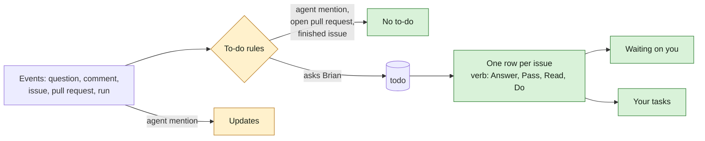

## At a glance

| Kind | Name | Change | Path |
|---|---|---|---|
| Logic | To-do open and close rules: review, mention, assigned, agent and question to-dos | changed | `server/cmd/server/todo_listeners.go` |
| Query | Inbox number counts rows, one per issue | changed | `server/pkg/db/queries/todo.sql` |
| Migration | Closes open to-dos the new rules close or never open | new | `server/migrations/` |
| Helper | Groups to-dos per issue, picks verb and section | new | `packages/views/inbox/components/` |
| Page | Inbox rows with verb label, two sections, grouped detail and Mark done | changed | `packages/views/inbox/components/inbox-page.tsx`, `packages/views/inbox/components/todo-list-item.tsx` |
| Copy | Verbs and section names in every locale | changed | `packages/views/locales/*/inbox.json` |

## Why

Brian's Inbox holds 25 items and only about a third need him. Rows name their kind (review, assigned, mention) instead of what he does, code reviews that belong to Quality reach him, one issue shows as several rows, mentions that ask nothing sit beside decisions, and to-dos on finished issues or withdrawn questions stay open (WORK-1694).

Success signal: after the local release Brian opens Inbox and every row starts with Answer, Pass, Read or Do. WORK-1675, WORK-1676, WORK-1196, WORK-1352, WORK-1658 and WORK-1385 have no row, WORK-1655 and WORK-1432 have one row each, WORK-974 stands under Your tasks, and the Inbox number equals the number of rows.

## What Changes

- Each row shows a verb per to-do kind: Answer, Pass, Read or Do, followed by the kind. A row of several to-dos shows the strongest verb, in the order Answer, Pass, Read, Do.
- The Inbox has two sections: Waiting on you first, then Your tasks for issues assigned to the member in Todo or Blocked.
- One row per issue. Its detail opens the strongest to-do and lists the issue's other to-dos. Mark done on a row closes each of its to-dos that allows Mark done.
- The Inbox number counts rows instead of to-dos.
- An issue with an open linked pull request gives its creator no review to-do. Linking a pull request closes it; unlinking an unmerged one reopens it.
- A mention written by an agent opens no to-do. The member sees that comment in Updates.
- A finished issue (Done or Closed category) closes its mention, assigned, review, agent blocked and run failed to-dos, and opens none of them later.
- Withdrawing the member's last open question on an In Review issue closes their review and assigned to-dos on it.
- At release, open to-dos these rules close or never open are closed as handled.

## Capabilities

### Modified Capabilities

- `todo-inbox`: a verb per to-do, two sections, one row per issue, a row count, no review to-do while a pull request is open, no to-do from an agent mention, no issue work to-dos on a finished issue, a withdrawn last question closes the member's Pass, and a cleanup of today's to-dos.

## Impact

- Server: to-do listeners, the open count query and one data migration. `ListOpenTodos`, `GET /api/todos` and the `todo:opened` and `todo:closed` events keep their shape, so installed desktop apps keep working.
- Clients: web and desktop Inbox page, row, detail pane and copy in en, fr, ja, ko and zh-Hans.
- The passed approach lists Updates as not touched because a mention makes the member a subscriber. That holds for issue descriptions only: a comment mention adds no subscriber today, so an agent's comment mention on an issue the member does not follow reaches Updates only after design closes that gap.
- The passed approach's migration lists to-dos the new rules would never open. The spec also closes to-dos the new rules would have closed, so WORK-1385, whose questions were withdrawn before release, leaves as the issue asks.

## Constraints

- The to-do list API and its events keep their response shape; grouping happens in the client (AGENTS.md "API Compatibility").
- Questions and checks keep their own life cycle and do not close when their issue finishes, because a check of merged work comes after Done.
- Check and instruction change to-dos close only through their answer, also when Mark done is used on their row.
- Brian sees a pull request only at his gate: the approval question on its issue.

## Non-goals

- The Updates page and its notices beyond agent mentions reaching it.
- The mobile app, which has no to-do Inbox.
- The MadSpec skills, which already send everything Brian passes, answers or does as a question on his name or an issue assigned to him.
- New to-do kinds or new close actions.

## Sources

- Issue WORK-1694 "Inbox shows what Brian has to do": its wanted behavior and the comment "Approach for your pass".
- [Inbox shows what Brian has to do](anytype://object?objectId=bafyreifhfhs7afhwbpdp4bqeowfjaneu4sx5sjuhbqbrrsqfuvxpjpbpa4): the passed Approach, with its per-file plan for design.
- The `plx search context` exports attached to WORK-1694.
- `specs/openspec/specs/todo-inbox/spec.md` and `specs/openspec/specs/check-todos/spec.md`.
