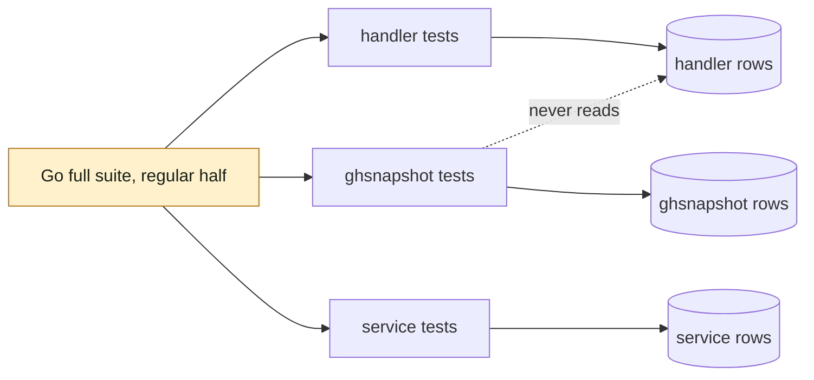

## At a glance

| Kind | Name | Change | Path |
|---|---|---|---|
| Test suite | Go full suite, regular half | changed | `scripts/test-go.sh`, `server/**/*_test.go` |

Which runner settings, helpers, fixtures or tests change is `design.md`'s, settled at technical design.

## Why

The fork's full Go suite (`make test`, `-race`) fails two tests on `main` (`14718e67327e4097daffc9fc532ee84e4c074232`), while each passes alone with `-race -count=3`. `scripts/test-go.sh` runs every package outside `pkg/agent` in one `go test` call, so packages run side by side against one test database:

- `TestListStaleUndecidedGitHubPRsExcludesDecidedAndRotatesCursor` (`ghsnapshot`) sweeps `github_pull_request` across all workspaces and gets the row `multica-ai/multica#999320` that `handler/comment_duplicate_enqueue_race_test.go` inserts.
- `TestTurnedOffChildDoneRuleLeavesARequeuedRun` (`service`) fails only when other packages run with it.

Every fork pull request's full check carries these two failures, and the verifier proves each time that they are not the pull request's. The success signal: on `main`, `make test` passes with no failing test, and no test's result depends on rows another package's tests wrote.

## What Changes

- The Go tests of one package no longer see the rows that tests of another package write during the full suite.
- `TestListStaleUndecidedGitHubPRsExcludesDecidedAndRotatesCursor` and `TestTurnedOffChildDoneRuleLeavesARequeuedRun` pass in the full suite, as they already do alone.
- The cause of the `service` failure is found and named before it is fixed: shared rows, or another cause the full suite exposes.

## Capabilities

### New Capabilities

None. The change touches only the Go test suite and its runner; the product's behaviour stays as it is, so the change has no spec delta.

### Modified Capabilities

None.

## Impact

Go test code under `server/` (test helpers and fixtures in `server/internal/testutil` and per-package test helpers), and `scripts/test-go.sh` with the `make test` target that calls it. No production code, migration, API, UI or dependency change.

## Constraints

- No test reads or asserts on rows that another package's tests wrote: a test that queries across workspaces gets only its own rows.
- `make test`, `make check` and Crabbox runs keep using the worktree's own test database from `.env.worktree`; the production stack's database (`.env`, Docker Compose project `multica`) is never touched, as AGENTS.md "Fork" says.
- Each of the two tests keeps asserting the behaviour it covers now: the fix never weakens or deletes an assertion to get a pass.
- DB-backed tests keep the `server/internal/testutil` fixtures, as AGENTS.md "Testing" says.

## Non-goals

- Fixing other flaky or slow tests the full suite does not show failing on `main`.
- Changing the `pkg/agent` half of the suite or its throttling.
- Changing the production query `ListStaleUndecidedGitHubPRs` or the wakeup service.
- Restoring remote CI pipelines.

## Sources

- WORK-1280, "Go full suite fails 2 tests when packages share one test database".
- WORK-1201, Sarkout's full-check comment `01a147ae-f348-7763-aac0-d4df4b6da989` on PR #80.
- `scripts/test-go.sh`, `Makefile` target `test`.
- AGENTS.md, "Fork" and "Testing".
