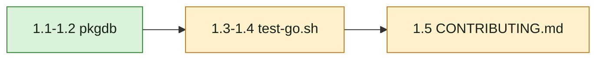

## At a glance

Not a journey: the change has no passes or journey steps. It has one group, for the Infra team (Tortolero), built as one pull request.

| Kind | Name | Change | Path |
|---|---|---|---|
| Test tool | `pkgdb`: template database and per-package clones | new | `server/internal/testutil/pkgdb/main.go` |
| Test | `pkgdb` clone, exit status and cleanup | new | `server/internal/testutil/pkgdb/main_test.go` |
| Runner | Go suite runner, regular half on per-package databases | changed | `scripts/test-go.sh` |
| Runner test | Runner call order and cleanup | changed | `scripts/test-go.test.sh` |
| Docs | Go test database note | changed | `CONTRIBUTING.md` |

## 1. Per-package test databases (Infra)

- [ ] 1.1 `server/internal/testutil/pkgdb/main.go` - add the `main` package with `create`, `run` and `drop` as `design.md` Decision 3 says. Connect with `pgx` to the `postgres` database of `DATABASE_URL`'s server for `CREATE DATABASE` and `DROP DATABASE … WITH (FORCE)`. Name the template `multica_test_<8 hex>` and each clone `<template>_<8 hex>`, from `crypto/rand`. `create` prints the template URL, and prints nothing with exit 0 when `DATABASE_URL` is unset or the server is unreachable. `run` clones from `MULTICA_TEST_TEMPLATE_URL`, starts the binary with its arguments, its working directory and `DATABASE_URL` set to the clone, forwards SIGINT and SIGTERM, drops the clone and exits with the binary's status; without `MULTICA_TEST_TEMPLATE_URL` it runs the binary unchanged. `drop` removes the template and every database whose name starts with `<template>_`. Log each create and drop with `slog` as the server's tools do; errors go to stderr with a non-zero exit. Rationale: one database per package binary without code in the 24 DB-backed packages.
- [ ] 1.2 `server/internal/testutil/pkgdb/main_test.go` - test against `DATABASE_URL`, skipping without a reachable server as `server/internal/taskusagebackfill/hook_test.go` does: a clone has the template's tables and rows; a row written to one clone is absent from the template and from a second clone; `run` returns the binary's non-zero status and drops the clone after it; `drop` removes the template and a left-behind clone; the names stay within 63 bytes. Use a throwaway helper binary built in `t.TempDir()`, and clean up every database the test makes with `t.Cleanup`.
- [ ] 1.3 `scripts/test-go.sh` - for the regular half: build `pkgdb` once into a temporary directory, run `pkgdb create`, migrate the printed template with `go run ./cmd/migrate up` and `DATABASE_URL` set to it, then run the regular `go test` call with `-exec "<pkgdb> run"` and `MULTICA_TEST_TEMPLATE_URL` exported. A trap on EXIT, INT and TERM runs `pkgdb drop` and removes the temporary directory, and the script keeps the `go test` exit status. When `create` prints nothing, run the regular call as today. Leave the `pkg/agent` call, `--race`, `--only` and the guard script as they are. Update the header comment to say the regular half runs each package on its own clone.
- [ ] 1.4 `scripts/test-go.test.sh` - extend the fake `go` to record `build` and `run` calls and the fake `pkgdb` it builds; assert the order build, create, migrate with the template URL, regular `go test` with `-exec` and the template exported, agent call, drop; assert drop also runs when the fake regular `go test` fails and that the script returns that failure; assert the regular call has no `-exec` when `create` prints nothing; keep the existing usage and `--only` cases.
- [ ] 1.5 `CONTRIBUTING.md` - in "Testing" Notes, say that the Go suite gives each test package its own database cloned from a freshly migrated template and drops them afterwards, and that `go test` run by hand uses the database `DATABASE_URL` names.
