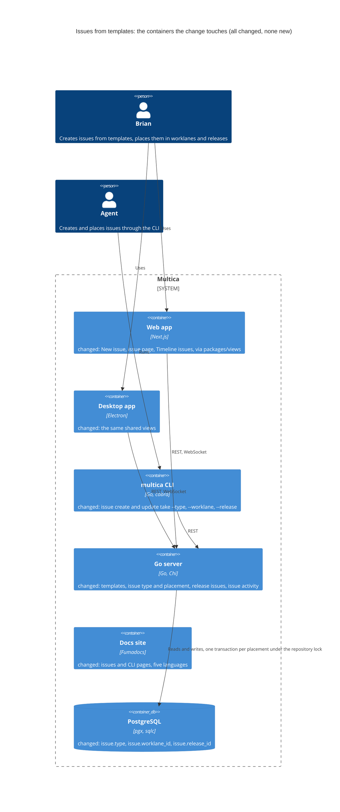
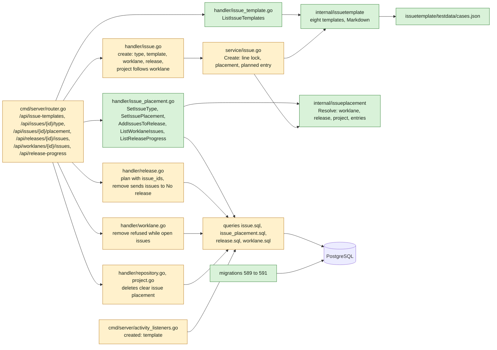
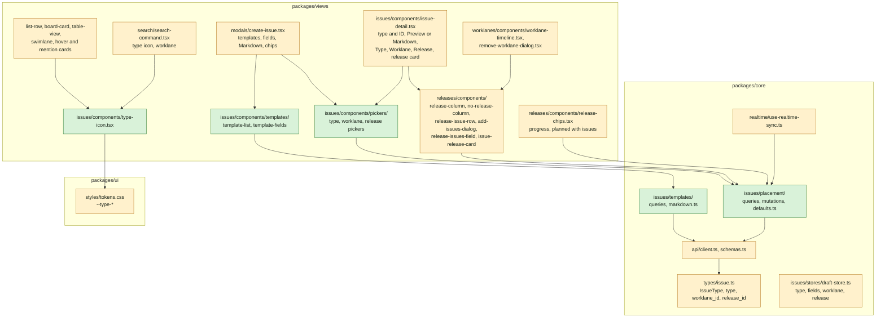
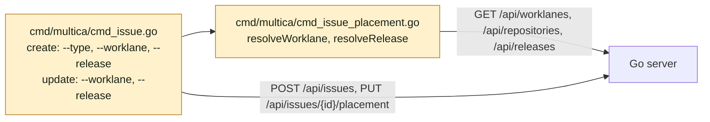
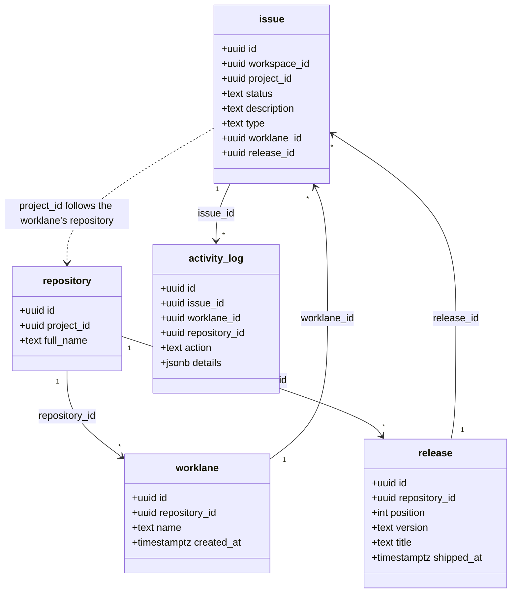
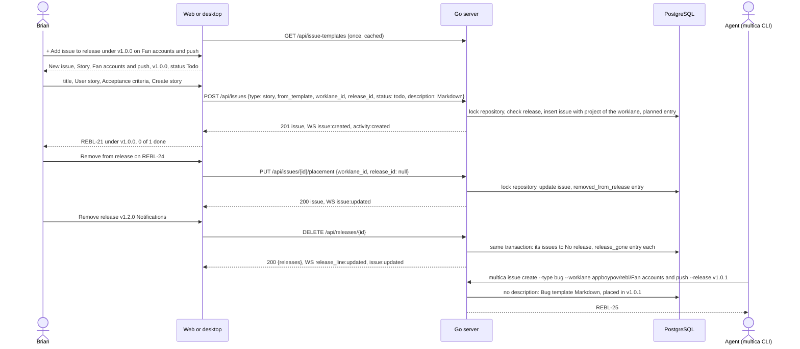

## At a glance

The delta of this change on the living system design, `specs/docs/system-design.md`, on top of UJ-4 `release-line-of-a-repository` (DAS-455). Every container it touches already exists, and the change adds no container. The daemon does not change: the CLI is its binary, and only the `multica issue` commands change. Mobile does not change: the issue response only gains fields, which its own schemas ignore, and the PRD keeps mobile out of scope.



Go server component map, delta:



Web and desktop component map, delta:



CLI component map, delta:



Models:



`issue.type`, `issue.worklane_id` and `issue.release_id` are new nullable columns. An issue's release is a release of its worklane's repository. Its project is its worklane's repository's project. The one exception is a closed issue of a removed worklane, which keeps its release under "No worklane".

Journey sequence and data flow:



| Kind | Name | Change | Path |
|---|---|---|---|
| Migration | `issue.type`, `issue.worklane_id`, `issue.release_id` | new | `server/migrations/589_issue_type_and_placement.up.sql`, `.down.sql` |
| Migration | Issues of a worklane | new | `server/migrations/590_issue_worklane_index.up.sql`, `.down.sql` |
| Migration | Issues of a release | new | `server/migrations/591_issue_release_index.up.sql`, `.down.sql` |
| Migrator | Cleanups for the two concurrent indexes | changed | `server/cmd/migrate/main.go` |
| Queries | Issue columns in create, list, search, open issues | changed | `server/pkg/db/queries/issue.sql`, `server/internal/handler/issue_table_query.go` |
| Queries | Type, placement, worklane issues, release progress, open issues of a worklane, placement clean-up | new | `server/pkg/db/queries/issue_placement.sql` |
| Queries | Issues of a release sent to No release | changed | `server/pkg/db/queries/release.sql` |
| Generated | sqlc output | changed | `server/pkg/db/generated/` |
| Package | The eight templates and their Markdown | new | `server/internal/issuetemplate/` |
| Package | Placement rules | new | `server/internal/issueplacement/` |
| Handler | Templates, type, placement, release issues, worklane issues, release progress | new | `server/internal/handler/issue_template.go`, `issue_placement.go` |
| Handler | Create with type, template, worklane and release, project follows worklane | changed | `server/internal/handler/issue.go`, `server/internal/service/issue.go` |
| Handler | Plan release with issues, Remove release sends issues to No release | changed | `server/internal/handler/release.go` |
| Handler | Remove worklane refused while open issues, closed issues to No worklane | changed | `server/internal/handler/worklane.go`, `worklane_request.go` |
| Handler | Repository and project deletes clear issue placement | changed | `server/internal/handler/repository.go`, `project.go` |
| Listener | Created entry names the template | changed | `server/cmd/server/activity_listeners.go` |
| Routes | The new endpoints | changed | `server/cmd/server/router.go` |
| CLI | `--type`, `--worklane`, `--release` | changed | `server/cmd/multica/cmd_issue.go`, `cmd_issue_placement.go` |
| Type | Issue type and placement, templates, issue activity details | changed | `packages/core/types/issue.ts`, `issue-template.ts`, `activity.ts` |
| Schema and client | Issue fields, templates, placement, progress | changed | `packages/core/api/schemas.ts`, `client.ts` |
| Feature | Template queries and Markdown | new | `packages/core/issues/templates/` |
| Feature | Placement queries, mutations and New issue defaults | new | `packages/core/issues/placement/` |
| Store | New issue draft | changed | `packages/core/issues/stores/draft-store.ts` |
| Realtime | Worklane issues and progress | changed | `packages/core/realtime/use-realtime-sync.ts`, `packages/core/issues/ws-updaters.ts` |
| Tokens | Eight type colours | changed | `packages/ui/styles/tokens.css` |
| Dialog | New issue from a template | changed | `packages/views/modals/create-issue.tsx`, `packages/views/issues/components/templates/` |
| Icon | Eight type icons and No type | new | `packages/views/issues/components/type-icon.tsx` |
| Pickers | Type (once), Worklane, Release | new | `packages/views/issues/components/pickers/` |
| Page | Issue page: type and ID, Preview or Markdown, Type, Worklane, Release, release card, activity | changed | `packages/views/issues/components/issue-detail.tsx` |
| Rows | Type icon on Issues, cards, hover and mention cards, sub-issues, search | changed | `packages/views/issues/components/`, `packages/views/search/search-command.tsx` |
| Section | Timeline issues, progress, No release, + Add issue to release, Remove from release | changed | `packages/views/releases/components/`, `packages/views/worklanes/components/worklane-timeline.tsx` |
| Dialog | Plan release Issues, Add issue to release | changed | `packages/views/releases/components/release-dialog.tsx`, `add-issues-dialog.tsx`, `release-issues-field.tsx` |
| Row | Worklane rows: next release's progress, planned releases with issues | changed | `packages/views/releases/components/release-chips.tsx` |
| Dialog | Remove worklane refusal naming open issues | changed | `packages/views/worklanes/components/remove-worklane-dialog.tsx` |
| Copy | `issues`, `modals`, `releases`, `worklanes`, `search` | changed | `packages/views/locales/{en,zh-Hans,ko,ja,fr}/` |
| Docs | Issues and CLI pages | changed | `apps/docs/content/docs/issues*.mdx`, `cli*.mdx` |
| Component | Type icons with No type, release card, No release column, issue row menu, Type, Worklane and Release rows | changed | `designs/systems/multica.lib.pen` |
| Design | Screens of this journey | changed | `designs/screens/steer-all-work.pen`, `designs/exports/`, `designs/creation-flows.md` |
| Prototype | Data-flow prototype | new | `prototypes/web/issues-from-templates/data-flow/` |
| Prototype | Live prototype | changed | `prototypes/web/src/components/generated/` |
| E2E | Journey acceptance test | new | `e2e/issues-from-templates.spec.ts` |
| ADR | The server holds the issue templates, and a type is set once | new | `adr/0012-the-server-holds-the-issue-templates-and-a-type-is-set-once.md` |
| ADR | An issue is placed in a worklane and a release under the repository's lock | new | `adr/0013-an-issue-is-placed-in-a-worklane-and-a-release-under-the-repositorys-lock.md` |

## Context

Journey UJ-5 of [PRD: Multica: steer projects, repositories, worklanes and releases](anytype://object?objectId=bafyreiew63xw2dncss52jdx4qk4o6aktkklhqroclvs3cvjxcyztx7h5um), F5 with FR-42 to FR-52, FR-76 to FR-78, FR-33, FR-41, FR-2 and FR-28. It builds on UJ-4 `release-line-of-a-repository` (DAS-455, branch `das-455-uj-4-brian-plans-edits-and-moves-releases`):

- the `release` table with `position`, `version`, `bump` and `shipped_at`, `GET /api/releases` and the release writes that lock the repository row with `LockRepositoryForLine` and answer with the whole line (ADR-0010);
- `server/internal/releaseline` and its TypeScript port `packages/core/releases/line.ts`, whose `lineStates` names the next release;
- `worklane-timeline.tsx` with `release-column.tsx`, which says "No issues of this worklane" until this change, `release-menu.tsx`, `release-dialog.tsx` and `release-chips.tsx`;
- `release_line:updated`, and the repository-wide entries in `activity_log` (ADR-0008, ADR-0011);
- migrations 587 and 588. This change's migrations start at 589.

UJ-4 builds on UJ-3 `worklanes-of-a-repository` (DAS-452): the `worklane` table, the worklane page, `RemoveWorklane` with its remove request run by the daemon, worklane activity in `activity_log`, the worklane rows and migrations 583 to 586. UJ-3 builds on UJ-2 `repositories-of-a-project` (DAS-451): the `repository` table, worklane `main`, `GET /api/repositories` and `GET /api/worklanes`, and migrations 575 to 582. UJ-2 builds on UJ-1 `projects-by-organisation` (DAS-450).

The later changes build on this one:

- `worklane-board-and-list` (UJ-6) shows the worklane's issues on Board and List with the type icon and release chip, adds a Type filter and the issue preview, and opens New issue from a Board column in its status.
- `worklanes-and-releases-pages` (UJ-7) lists every line with the progress from `GET /api/release-progress`.
- `release-ships` (UJ-8) sets `shipped_at`, which this change already refuses to add issues to, and keeps issues leaving a shipped release.

**Journey steps.** The investigation finds nothing for two steps, and no `Keep:` Request names them. Each gets its `Skip:` Request once the journey exists in the brain:

- `Skip: J1` Project structure: no new container, app or workspace package. The new folders sit in existing ones: `server/internal/issuetemplate/`, `server/internal/issueplacement/`, `packages/core/issues/templates/` and `packages/core/issues/placement/`.
- `Skip: J4` Design system: `designs/systems/multica.lib.pen` already holds the eight `--type-*` tokens (`designs/exports/library-foundations.png`, "Issue types"), the Issue row and Board card with the type icon, the Release column, Create from template, the creation forms' tick list and the release menu with Add issue to release.

J2, J3, J5, J6, J7, J8, J9, J10 and J11 have work:

- J5 has work because the library has no No type icon, no release card for the issue page, no "No release" column, no issue row menu with Remove from release, and no Type, Worklane and Release property rows.
- J6 has work because screen 5 keeps "Fill example" and lacks Multica's other properties of a new issue, and no screen shows the issue page, the "No release" column, Remove from release, Add issue to release's list, the worklane rows' progress or Remove worklane's refusal.
- J7 has work for the same reasons in the prototype.
- J10 has work because `multica issue create` and `multica issue update` gain flags. UJ-4 skipped J10 because no CLI command plans or changes a release.

**Code map.**

- Issues: `server/pkg/db/queries/issue.sql` `CreateIssue` and `CreateIssueWithOrigin` (L180, L405) list their columns. `ListIssues` (L1), `ListOpenIssues` and the dynamic `issue_table_query.go` select named columns, so each gains the three new ones. `issueToResponse`, `issueListRowToResponse` and `openIssueRowToResponse` in `handler/issue.go` build `IssueResponse`.
- Create: `handler/issue.go` `CreateIssue` (L3181) defaults `status` to `todo` (L3206) and calls `IssueService.Create` (`service/issue.go` L237), which runs one transaction (`TxStarter.Begin`, `Queries.WithTx`). The `created` entry is written by the `issue:created` listener in `cmd/server/activity_listeners.go` L24 from the event payload.
- Update: `UpdateIssue` (L3731) runs `updateIssueAtomically` over the `UpdateIssue` SQL with its candidate CTE and `revision = revision + 1`. `BatchUpdateIssues` (L4485) can change `project_id` too. `publishIssueSnapshots` (L4450) publishes `issue:updated` for a list of issues.
- Progress: `ChildIssueProgress` counts `terminal_status_keys` as done (`issue.sql` L710). Release progress reuses that rule.
- New issue: `packages/views/modals/create-issue.tsx`, `ManualCreatePanel` (L199) with `TitleEditor`, `ContentEditor`, `StatusPicker`, `PriorityPicker`, `ProjectPicker` (L953 to L1059), submitting through `useCreateIssue` (L517). Its draft is `IssueCreateManual` in `packages/core/issues/stores/draft-store.ts`.
- Issue page: `packages/views/issues/components/issue-detail.tsx`. `PropRow`s from L2678, the description `ContentEditor` at L3467 saving with `description_base`, the activity sentences in `formatActivity` (L318).
- Search: `handler/issue.go` `SearchIssues` (L1121) and `packages/views/search/search-command.tsx`.
- CLI: `server/cmd/multica/cmd_issue.go` `runIssueCreate` (L1419) and `runIssueUpdate` (L1650). Flags resolve names client-side, as `resolveAssignee` (L3284) does.
- Prototype to port: `TEMPLATES`, `templateInputs` and `templateMarkdown` in `prototypes/web/src/components/generated/model.ts` L381 to L805 (without `example`, a prototype aid). `NewIssueDialog` L2165, `IssuePage` L2016, `IssueDescription` L1877, `ReleaseColumn` L1692, `ReleaseActions` L1623 and `ReleaseChain` L566 in `MulticaSteerAllWorkPrototype.tsx`. `TypeIcon` and `TYPE_ICON` in `ui.tsx` L18, the colours in `MulticaSteerAllWorkPrototype.css` L28 to L35.

**What must not change.** "Create with agent" in New issue. The status the server gives an issue created without `status` (`todo`), so the CLI keeps its behaviour. The descriptions of issues already in Multica. Issues, My Issues, Inbox and their filters and views, apart from the type icon on rows. Quick create, autopilot and comment sub-issue creation, which create issues without a type. The issue `PATCH` and its `UpdateIssue` SQL, apart from the refusal in decision 5.

**Living system design.** `specs/docs/system-design.md` matches `main` at `10a1307d1`. It changes when this change's code merges, as with UJ-1 to UJ-4.

## Goals / Non-Goals

**Goals:**

- New issue creates an issue only from one of eight templates, whose fields fill one Markdown description, and places it in a worklane and a release with the status that follows.
- An issue has a type that is set once, shown by its icon wherever the issue shows, and "No type" until then.
- The issue page shows the type, the ID, the description as Preview or Markdown, Worklane and Release pickers and the release card.
- The Timeline shows each release's issues of the worklane with their progress, and "No release". Plan release and Add issue to release tick issues in, and Remove from release takes one out.
- Issues follow their release when it moves, and go to "No release" when it is removed.
- Worklane rows show the next release's progress and the planned releases that hold the worklane's issues.
- Remove worklane is refused while an open issue is in it.
- The CLI creates issues with or without a type, and places them.
- One model for type and placement that UJ-6 to UJ-8 read without reworking.

**Non-Goals:**

- Board, List, the Type filter and the issue preview (UJ-6). New issue from a Board column (UJ-6).
- The Worklanes and Releases pages (UJ-7). Shipping, and the disabled "Shipped" states in New issue and Add issue to release (UJ-8).
- "Fill example", changing "Create with agent", changing the CLI's status for an issue created without `--status`.
- Changing a type once set, or setting a type from the CLI after creation. Rewriting or typing existing issues in bulk.
- The worktree an agent works in for an issue in a worklane (UJ-6).
- Mobile, Squads, dark mode.

**Always:**

- No foreign keys or cascades. Each concurrent index is its own migration file.
- UI-consumed JSON goes through zod with `parseWithFallback`, with malformed-response tests.
- Every write that sets or clears an issue's release locks the repository row first, in the same transaction as the release writes of UJ-4.
- New issue, the pickers and Add issue to release await the server.

**Never:**

- A field for implementation details, code or technical design in New issue or on the issue page.
- A refusal of a description the CLI or an agent sends.
- An issue in a release of another repository than its worklane's, or in a release without a worklane, through any write.
- A type changed once set.

## Decisions

### 1. The model (ADR-0013)

Migration 589:

```sql
ALTER TABLE issue
  ADD COLUMN type text CHECK (type IN ('epic', 'journey', 'story', 'bug', 'enhancement', 'refactor', 'chore', 'spike')),
  ADD COLUMN worklane_id uuid,
  ADD COLUMN release_id uuid;
```

Migrations 590 and 591, each its own file: `CREATE INDEX CONCURRENTLY idx_issue_worklane ON issue (worklane_id) WHERE worklane_id IS NOT NULL` and `CREATE INDEX CONCURRENTLY idx_issue_release ON issue (release_id) WHERE release_id IS NOT NULL`. Every read also filters by `workspace_id`.

- `type` NULL is "No type". Existing issues keep NULL and their description.
- `release_id` points at the release row, never at a version, so an issue follows its release through every move and renumbering of UJ-4 without a write (FR-78).
- `project_id` stays the issue's project. A write that sets a worklane sets `project_id` to the worklane's repository's project in the same statement.
- The down migration of 589 deletes the `activity_log` rows with the actions of decision 6, then drops the three columns.

`IssueResponse` gains `type` (string or null), `worklane_id` and `release_id` (string or null). In zod, `type` outside the eight falls back to `null`, and both ids default to `null`.

### 2. Endpoints

| Method and path | Body | Answer |
|---|---|---|
| `GET /api/issue-templates` | none | `{templates}`, the eight in order |
| `POST /api/issues` | gains `type`, `from_template`, `worklane_id`, `release_id` | 201 the issue |
| `PUT /api/issues/{id}/type` | `{type}` | 200 the issue |
| `PUT /api/issues/{id}/placement` | `{worklane_id, release_id}`, both required, each nullable | 200 the issue |
| `POST /api/releases/{id}/issues` | `{issue_ids}` | 200 `{issues}` |
| `POST /api/repositories/{id}/releases` | gains `issue_ids` | 201 `{releases}` |
| `GET /api/worklanes/{id}/issues` | none | `{issues}` of the worklane, every status, by `created_at`, `id` |
| `GET /api/release-progress` | none | `{rows: [{worklane_id, release_id, done, total}]}` of the workspace |

Refusals, checked in this order inside the transaction, before anything is written:

| Check | Answer |
|---|---|
| Issue, worklane or release not in the workspace | 404 |
| `type` not one of the eight | 400 `type_invalid` with the eight |
| `from_template` without `type` | 400 `type_invalid` |
| Type already set | 409 `type_fixed` |
| A release without a worklane | 400 `release_needs_worklane` |
| A release of another repository than the worklane's | 409 `release_not_of_repository` with `{version, repository}` |
| A shipped release | 409 `release_shipped` with `{version, title}` |
| Add or plan: an issue whose worklane is not of the release's repository | 409 `issue_not_in_repository` with `{issues: [{id, identifier}]}` |
| Add or plan: an issue already in a release | 409 `issue_in_release` with `{issues: [{id, identifier}]}` |

A placement that changes nothing answers 200 and writes nothing. Issue writes publish `issue:updated` (or `issue:created`) and `activity:created` after commit. `POST /api/releases/{id}/issues` and a plan with `issue_ids` also publish `release_line:updated`, as every release write does.

### 3. The templates (ADR-0012)

`server/internal/issuetemplate` holds the eight templates as Go data, ported from the prototype's `TEMPLATES` without `name`, `hint` and `example`. A template is `{type, sections: [{heading, question, field}]}`, where a field is `{key, label, required, placeholder, rows, format}` and `format` is `text`, `bullets`, `checks` or `scenarios`. The package has no database or HTTP imports.

- `Markdown(t, fields)` is the prototype's `templateMarkdown`: each section is its heading and its question as a `> ` quote. A filled text field follows as written, `bullets` one `- {item}` per line, `checks` one `- [ ] {item}` per line, and `scenarios` one `### 👤 {line}` section per line with the per-scenario sections under it. Leading list marks typed by Brian are stripped before the mark is added. A section without a field or with an empty field keeps its heading and question. Sections are joined by a blank line.
- `testdata/cases.json` holds one case per template and format: `{template, fields, want}`. The Go test and `packages/core/issues/templates/markdown.test.ts` both run every case, as UJ-4's `releaseline` cases are run.
- `GET /api/issue-templates` serves the templates. The client caches them with `staleTime: Infinity` under an account-level key. In zod, an unknown `format` falls back to `text` and an unknown `type` drops the template.
- The section headings, questions, field labels and placeholders are the template's text. They become the issue's Markdown, which agents read, so they stay as written in every language. The type names, the hints, "Required", "Optional", the tabs, the button and the notes are UI copy in `issues` and `modals`.

The Story template with User story and Acceptance criteria filled starts:

```md
## 🔗 Dependencies
> Which issues must be completed first?

## 👤 User Story
> Who benefits and what do they want to achieve?

- As a fan, I want to change my display name, so that friends recognise me in guest lists.
```

### 4. Creating an issue

`CreateIssueRequest` gains `type`, `from_template`, `worklane_id` and `release_id`. `IssueService.Create` runs, inside its transaction:

1. With a `worklane_id`: `LockRepositoryForLine` on the worklane's repository, then `issueplacement.Resolve` (decision 5) for the worklane and release. The issue's `project_id` becomes the worklane's project, whatever the request sent.
2. With a `type` and an empty or missing description: the description is `issuetemplate.Markdown(t, nil)` (FR-51). A description that was sent is kept as written (FR-50).
3. Insert with `type`, `worklane_id` and `release_id`.
4. With a release: one `planned_in_release` entry (decision 6).

The `issue:created` payload gains `from_template`. The `created` listener adds `{type, template: true}` to the entry's details when it is set, so the page says "Brian created this story from the Story template". Without `status` the server still answers `todo`. New issue sends its status explicitly: the one Brian picked, else `todo` with a release and `backlog` without (`defaultStatus` in `packages/core/issues/placement/defaults.ts`).

### 5. Placement rules (ADR-0013)

`server/internal/issueplacement` is pure. `Resolve(current, want, worklane, release)` takes the issue's current worklane and release, the wanted ones, and the looked-up worklane `{id, repository_id, project_id, name}` and release `{id, repository_id, version, title, shipped}`. It returns the new placement, the project, the activity entries, or a refusal of decision 2:

- No worklane: the release must be none. The project stays.
- A worklane: the project becomes its project. A release must be of the worklane's repository and not shipped.
- `PUT /api/issues/{id}/placement` sends both values. The issue page's Worklane picker sends the new worklane with the release kept when the worklane is of the same repository, else with none (spec "Worklane and Release on the issue page follow New issue's rules").
- Taking an issue out of a shipped release is allowed (FR-41).

`handler/issue_placement.go` `SetIssuePlacement` locks the issue's current repository and the new one, in id order when they differ, then resolves, updates with `UpdateIssuePlacement` (`worklane_id`, `release_id`, `project_id`, `revision = revision + 1`) and writes the entries, in one transaction. `SetIssueType` updates with `SetIssueTypeOnce` (`WHERE type IS NULL`) and answers 409 `type_fixed` when no row changed.

`UpdateIssue` and `BatchUpdateIssues` refuse a `project_id` other than the worklane's project for an issue in a worklane: 409 `project_follows_worklane`. On the issue page the Project row is read-only while the issue has a worklane, with "Follows its worklane". The `UpdateIssue` SQL does not change.

### 6. Issue activity

Each placement write adds `activity_log` rows with `issue_id` set, in the write's transaction, with the actor from `resolveActor`. Details keep names and versions as they were:

| Action | Details | Sentence |
|---|---|---|
| `created` | gains `{type, template: true}` | "Brian created this story from the Story template" |
| `planned_in_release` | `{release_id, version, title, worklane_id, worklane_name}` | "Brian planned it in v1.0.0 First production release on Fan accounts and push" |
| `type_set` | `{type}` | "Brian set the type to Bug" |
| `added_to_release` | `{release_id, version, title}` | "Brian added this to v1.1.0 Account and profile" |
| `removed_from_release` | `{release_id, version, title}` | "Brian removed this from v1.1.0 Account and profile" |
| `worklane_changed` | `{worklane_id, worklane_name}`, null for No worklane | "Brian moved this to Agenda and publication" |
| `release_gone` | `{release_id, version, title}` | "v1.2.0 Notifications was removed, this went back to No release" |

A worklane change that also clears the release writes `worklane_changed` and then `removed_from_release`. `formatActivity` in `issue-detail.tsx` renders the seven. An unknown action keeps rendering as today.

### 7. Release writes of UJ-4

- Plan release takes `issue_ids`. After the release is inserted, each issue is checked (decision 2), its `release_id` set and one `added_to_release` entry written, in the plan's transaction.
- `POST /api/releases/{id}/issues` does the same for an existing unshipped release.
- Remove release, in its transaction, sets `release_id` NULL on every issue of the release with `ClearReleaseOfIssues ... RETURNING id`, keeping worklane and status, and writes one `release_gone` entry per issue. After commit it publishes `issue:updated` for them through `publishIssueSnapshots`.
- Move, edit and renumber write nothing on issues (decision 1).

### 8. Removing a worklane, a repository or a project

- `RemoveWorklane` (UJ-3) first lists the worklane's open issues, whose status category is neither done nor closed, with `ListOpenIssuesOfWorklane`. Any: 409 `worklane_has_open_issues` with `{issues: [{id, identifier, title}]}` and no remove request. The remove dialog shows "{worklane} still has the open issues {identifiers}" and removes nothing.
- When the daemon reports `removed`, the same transaction that deletes the worklane checks again. An issue opened in the meantime marks the request `refused` with that reason, and the worklane stays. Otherwise `ClearWorklaneOfIssues` sets `worklane_id` NULL on its closed issues and keeps their release.
- `DeleteRepository` (UJ-2) and the project delete clear `worklane_id` and `release_id` on the issues of their worklanes, in the transaction that deletes the worklanes and releases.

### 9. Reads for the Timeline, the rows and the page

- `ListWorklaneIssues` returns the list row columns of the worklane's issues. The Timeline groups them by `release_id` along the line from `releaseKeys.list(wsId)`, and puts the rest under "No release". A release without them says "No issues of this worklane".
- `ListReleaseProgress` groups the workspace's issues with a worklane and a release by `(worklane_id, release_id)`: `total` is every issue, `done` those in `terminal_status_keys`, as sub-issue progress counts. The Timeline counts from the worklane's issues the same way, so both agree.
- Worklane rows (`release-chips.tsx`) show the next release with "{done}/{total}", or no progress when it holds none of the worklane's issues, then up to two planned releases after it that hold the worklane's issues, in line order.
- The issue page's release card reads the release from the line cache and its progress from `ListReleaseProgress` for the issue's worklane.
- Search results gain `type` and `worklane_id`. `search-command.tsx` shows the type icon and the worklane's name, or "No worklane".

### 10. The CLI

- `multica issue create` gains `--type` (one of the eight, else it fails naming them), `--worklane` and `--release`. `multica issue update` gains `--worklane` and `--release`, and sends `PUT /api/issues/{id}/placement` with the issue's other value kept.
- `--worklane` takes a worklane id, `{owner/name}/{worklane name}` such as `appboypov/rebl/Fan accounts and push`, or a bare name that only one worklane of the workspace has. A bare name more worklanes have fails naming their repositories. `none` clears it on update.
- `--release` takes a release id or a version with or without `v`, looked up on the worklane's repository line. `none` clears it on update. A release without a worklane fails before any request: "a release needs a worklane".
- Resolution reads `GET /api/worklanes`, `GET /api/repositories` and `GET /api/releases`, in `cmd_issue_placement.go`. A server refusal is printed with its code's message, and nothing is created or changed.
- Without `--status` the CLI sends no status, so the server's `todo` stays.

### 11. Web and desktop

- `packages/core/issues/templates/`: `issueTemplateKeys`, `issueTemplatesOptions`, `templateMarkdown(t, fields)` and `requiredFilled(t, title, fields)`.
- `packages/core/issues/placement/`: `worklaneIssueKeys.list(wsId, worklaneId)`, `releaseProgressKeys.list(wsId)`, `useSetIssueType`, `useSetIssuePlacement`, `useAddIssuesToRelease`, each awaiting the server and invalidating the issue, the worklane issues and the progress on settle. `defaults.ts`: `nextRelease(line)`, the first unshipped release, `openedFrom({worklane} | {project} | {})` for New issue's worklane and release, and `defaultStatus(release, picked)`.
- `use-realtime-sync.ts`: `issue:created`, `issue:updated`, `issue:deleted` and `release_line:updated` invalidate the worklane issues and the progress of the workspace.
- New issue (`create-issue.tsx`) gains the template list on the left with Story picked, the fields with Required or Optional, and the Fields and Markdown tabs, the Markdown tab showing `templateMarkdown` read-only. The `ContentEditor` description gives way to the fields. Attachments upload as today, and their links follow the template's Markdown. The chips row adds Type (from the template), Worklane and Release next to Status, Priority, Assignee, Labels, dates, Parent and Project. Project is read-only while a worklane is picked. Create stays disabled until `requiredFilled`. The draft store keeps `type`, `fields`, `worklaneId`, `releaseId` and `statusPicked` instead of the description. `CreateIssueModal` takes `worklane_id` and `release_id` in `data`. A project's New issue passes the project, and `openedFrom` picks `main` of its first repository by `full_name`.
- `type-icon.tsx` draws the eight lucide icons of the prototype in `--type-*`, and `CircleDashed` in `--faint-foreground` for No type. It goes beside the identifier in `list-row.tsx`, `board-card.tsx`, `table-view.tsx`, `swimlane-view.tsx`, `issue-hover-card.tsx`, `issue-mention-card.tsx`, the sub-issue rows and parent link of `issue-detail.tsx` and `search-command.tsx`.
- The issue page puts "{Type} {identifier}" above the title, a Preview and Markdown switch on the description with "Code and technical design go in the change, not in the issue." under it, and Type, Worklane and Release rows after Status, Priority and Assignee. Preview is the existing `ContentEditor`. Markdown is a plain textarea of the same text, saved through the same description update. Type without a value offers the eight once (`type-picker.tsx`). With a release, `issue-release-card.tsx` shows the release's version and state, title, description, worklane, repository and "{done} of {total} done", and Open timeline.
- The Timeline: `release-column.tsx` lists the release's issues of this worklane (`release-issue-row.tsx`: status icon, type icon, ID, title, menu with Remove from release), its progress, and "+ Add issue to release" for an unshipped release, which opens New issue in it. `no-release-column.tsx` follows the line with "No release", its count and issues. The release menu gains Add issue to release (`add-issues-dialog.tsx`). It and Plan release use `release-issues-field.tsx`: this worklane's issues in no release to tick, or "Every issue of this worklane is in a release." Plan release adds "Add issues later from the timeline." to that.
- Tokens: `--type-epic` to `--type-spike` in `packages/ui/styles/tokens.css` with the library's values, light mode only.

## Risks / Trade-offs

- **Template text in two places.** The server's data and the client's Markdown function must agree. The shared cases run in both test suites, and the client renders from the server's templates, so only the formatting function is ported.
- **Lock order.** A move to a worklane of another repository locks two repository rows. Locking in id order keeps two such moves from deadlocking.
- **English template text.** A Chinese UI shows English field labels and headings, because they are the Markdown the issue keeps.
- **Large worklanes.** `GET /api/worklanes/{id}/issues` has no paging. A worklane is one line of work, and UJ-6's Board uses Multica's paged issue reads.
- **A closed issue of a removed worklane keeps a release without a worklane.** Its next placement write follows the rules again.
- **Migration numbers.** 589 to 591 can be taken on `main` before J2. The builder then takes the next free numbers and renames the cleanup entries with them.

## Migration Plan

1. Release UJ-4 (UJ-4 Migration Plan).
2. Apply migrations 589 to 591. Existing issues have no type, no worklane and no release.
3. Release with `make local-release`. Rollback is the down migrations: 591 and 590 drop the indexes, and 589 deletes the issue entries of decision 6 and drops the columns.
