## At a glance

```mermaid
flowchart LR
  classDef work fill:#d9f2d9,stroke:#2e7d32,color:#172117
  classDef skip fill:#eeeeee,stroke:#9e9e9e,color:#424242
  P5[P5 Technical design] --> J1
  J1[J1 Project structure<br/>Skip: J1]:::skip --> J2
  J2[J2 Data models<br/>groups 1-3]:::work --> J3
  J3[J3 Data-flow prototype<br/>group 4]:::work --> J4
  J4[J4 Design system<br/>Skip: J4]:::skip --> J5
  J5[J5 Components<br/>group 5]:::work --> J6
  J6[J6 Screens<br/>group 6]:::work --> J7
  J7[J7 Live prototype<br/>group 7]:::work --> J8
  J8[J8 Backend and agent tooling<br/>groups 8-9]:::work --> J9
  J9[J9 Frontend<br/>groups 10-13]:::work --> J10
  J10[J10 Agent tooling for UI<br/>group 14]:::work --> J11
  J11[J11 Acceptance test and archive<br/>group 15]:::work
```

| Step | Groups | Builder |
|---|---|---|
| J1 Project structure | none: `Skip: J1` | - |
| J2 Data models | 1 model change, 2 DTO, 3 action names | `madspec-model-builder`, `madspec-dto-builder` |
| J3 Data-flow prototype | 4 | `madspec-prototype-builder` |
| J4 Design system | none: `Skip: J4` | - |
| J5 Components | 5 | `madspec-design-system-designer` |
| J6 Screens | 6 | `madspec-screen-designer` |
| J7 Live prototype | 7 | `madspec-prototype-builder` |
| J8 Backend and agent tooling | 8 util, 9 endpoint | `madspec-util-builder`, `madspec-api-builder` |
| J9 Frontend | 10 style, 11 flow, 12 component, 13 screen | `madspec-style-builder`, `madspec-api-builder`, `madspec-component-builder`, `madspec-view-builder` |
| J10 Agent tooling for UI | 14 command | `madspec-command-builder` |
| J11 Acceptance test and archive | 15 | Sarkout |

This change builds on UJ-4 (`release-line-of-a-repository`, DAS-455), which builds on UJ-3 (`worklanes-of-a-repository`, DAS-452) and UJ-2 (`repositories-of-a-project`, DAS-451). It uses:

- from UJ-4: the `release` table, `LockRepositoryForLine`, `handler/release.go` with Plan and Remove release, `GET /api/releases`, `releaseKeys.list(wsId)` and `lineStates` in `packages/core/releases/`, `release-column.tsx`, `release-menu.tsx`, `release-dialog.tsx`, `release-chips.tsx` and `release_line:updated`;
- from UJ-3: `handler/worklane.go` `RemoveWorklane` and its remove request, `remove-worklane-dialog.tsx` and `worklane-timeline.tsx`;
- from UJ-2: `GET /api/repositories`, `GET /api/worklanes`, `DeleteRepository` and `worklaneKeys.list(wsId)`.

Its J2 starts once UJ-4's J2 is merged.

## 1. J2 Data models: model change

- [x] 1.1 `server/migrations/589_issue_type_and_placement.up.sql`, `.down.sql` -- `issue.type` with the check of the eight, `issue.worklane_id`, `issue.release_id`, all nullable, without foreign keys -- design.md decision 1. The down migration deletes the `activity_log` rows with the actions `planned_in_release`, `type_set`, `added_to_release`, `removed_from_release`, `worklane_changed` and `release_gone`, then drops the columns.
- [x] 1.2 `server/migrations/590_issue_worklane_index.up.sql`, `.down.sql` -- `CREATE INDEX CONCURRENTLY idx_issue_worklane ON issue (worklane_id) WHERE worklane_id IS NOT NULL`.
- [x] 1.3 `server/migrations/591_issue_release_index.up.sql`, `.down.sql` -- `CREATE INDEX CONCURRENTLY idx_issue_release ON issue (release_id) WHERE release_id IS NOT NULL`.
- [x] 1.4 `server/cmd/migrate/main.go` -- add 590 and 591 to the concurrent index cleanups that `TestEveryConcurrentUpBuildHasCleanup` requires. When `main` has taken 589 to 591, take the next free numbers and rename every reference.
- [x] 1.5 `server/pkg/db/queries/issue.sql` -- `CreateIssue` and `CreateIssueWithOrigin` take `type`, `worklane_id` and `release_id` as nullable args. `ListIssues`, `ListOpenIssues` and every other query that names issue columns for a response select `type`, `worklane_id` and `release_id`.
- [x] 1.6 `server/pkg/db/queries/issue_placement.sql` -- `SetIssueTypeOnce` (`WHERE type IS NULL`, `revision = revision + 1`, `RETURNING *`), `UpdateIssuePlacement` (`worklane_id`, `release_id`, `project_id`, `revision = revision + 1`), `ListWorklaneIssues` (the list row columns, by `created_at`, `id`), `ListReleaseProgress` (by `worklane_id` and `release_id`, `total` and `done` over `terminal_status_keys`), `ListIssuesForRelease` (`id`, `identifier`, `worklane_id`, `release_id` by ids, `FOR UPDATE`), `SetReleaseOfIssues`, `ClearReleaseOfIssues` (`RETURNING id`), `ListOpenIssuesOfWorklane` (status keys not terminal, `id`, number, title), `ClearWorklaneOfIssues`, `ClearPlacementOfRepositoryIssues` and `ClearPlacementOfProjectIssues`, each filtered by `workspace_id`.
- [x] 1.7 `server/internal/handler/issue_table_query.go` -- select `type`, `worklane_id` and `release_id` in the dynamic issue reads and in `SearchIssues`.
- [x] 1.8 `server/pkg/db/generated/` -- run `make sqlc` and commit the output.

## 2. J2 Data models: DTO

- [x] 2.1 `packages/core/types/issue.ts` -- `IssueType` (the eight), `ISSUE_TYPES`, and `type: IssueType | null`, `worklane_id: string | null`, `release_id: string | null` on `Issue` -- design.md decision 1.
- [x] 2.2 `packages/core/types/issue-template.ts`, `index.ts` -- `IssueTemplate`, `IssueTemplateSection`, `IssueTemplateField`, `IssueTemplateFieldFormat`, `SetIssuePlacementRequest`, `AddIssuesToReleaseRequest`, `ReleaseProgressRow` and the placement refusal codes of design.md decision 2.
- [x] 2.3 `packages/core/types/activity.ts` -- the details of the seven issue actions of design.md decision 6.
- [x] 2.4 `packages/core/api/schemas.ts` -- `IssueSchema` gains `type` (outside the eight falls back to `null`), `worklane_id` and `release_id` (default `null`). `IssueTemplatesResponseSchema` (unknown `format` falls back to `text`, unknown `type` drops the template), `WorklaneIssuesResponseSchema`, `ReleaseProgressResponseSchema` (`rows` defaulting to `[]`) and the refusal body with `issues` defaulting to `[]` -- AGENTS.md "API Compatibility".
- [ ] 2.5 `packages/core/api/schemas.test.ts` -- malformed-response cases: an issue without the three fields, an unknown type, a template with an unknown format and one with an unknown type, a progress answer without `rows`, a refusal with an unknown code.

## 3. J2 Data models: action names

- [x] 3.1 `server/internal/handler/issue_placement.go` -- the constants `issueActionPlannedInRelease`, `issueActionTypeSet`, `issueActionAddedToRelease`, `issueActionRemovedFromRelease`, `issueActionWorklaneChanged` and `issueActionReleaseGone`, and the refusal codes of design.md decision 2.
- [x] 3.2 `server/pkg/protocol/events.go` -- document `from_template` in the `issue:created` payload. No new event: placement and type publish `issue:updated`.

## 4. J3 Data-flow prototype: data-flow prototype

- [ ] 4.1 `prototypes/web/issues-from-templates/data-flow/` -- an interactive prototype without UI that runs design.md "Journey sequence and data flow". It covers:
  - New issue opened from the sidebar, a project and a worklane, and from + Add issue to release: the worklane, release and status it fills in, "Pick a worklane first", "This worklane has no releases planned", a worklane of another repository.
  - Each template's Markdown from its fields, with the formats `text`, `bullets`, `checks` and `scenarios`, and Create disabled until the title and required fields are filled.
  - Creation with and without a worklane, release and status, the project following the worklane, and the `created` and `planned_in_release` entries.
  - The CLI: `--type` with and without a description, `--worklane` by id, by `owner/name/worklane` and by bare name, `--release` of another repository, `--release none`.
  - The issue page pickers, Set type once and `type_fixed`, Plan release with issues, Add issue to release, Remove from release, a release moved, a release removed, each with its entries.
  - Remove worklane refused with open issues, and its closed issues under "No worklane" with their release.
  - The repository lock serialising a placement and a release removal on one line.
- [ ] 4.2 `prototypes/web/issues-from-templates/data-flow/README.md`, PNG exports -- how to run it, and one PNG per step -- J3's contract.

## 5. J5 Components: component design

- [ ] 5.1 `designs/systems/multica.lib.pen` -- built from the library's existing tokens -- J5's contract:
  - `Type icon/*`: the eight icons in `--type-*` and `Type icon/No type`.
  - `Release card`: version with state, title, description, worklane, repository, "{done} of {total} done" and Open timeline.
  - `Release column/No release`: "No release", its count and issue rows.
  - `Issue row/With menu`: status icon, type icon, ID, title and a menu with Remove from release.
  - `Property row/Type`, `/Worklane` and `/Release`, with the No type picker and "No worklane" and "No release" values.
- [ ] 5.2 `designs/exports/library-components.png` -- the refreshed components export.

## 6. J6 Screens: screen design

- [ ] 6.1 `designs/screens/steer-all-work.pen` -- the screens of the journey's states, built from the library's components and tokens -- J6's contract:
  - Screen 5 New issue without "Fill example", with Multica's other properties next to Type, Worklane, Release and Priority, the Markdown tab, the Release chip saying "Pick a worklane first" and "This worklane has no releases planned", and Create disabled.
  - Screen 3 Worklane timeline with each release's issues and "{done} of {total} done", "No issues of this worklane", "+ Add issue to release", "No release" with its issues, and an issue row menu with Remove from release.
  - Screen 3b the release menu with Add issue to release and its dialog, with "Every issue of this worklane is in a release."
  - Screen 8 Plan release with its Issues list, and its "Every issue of this worklane is in a release. Add issues later from the timeline."
  - A new screen 9 Issue page: "Story REBL-21" above the title, Preview and Markdown with "Code and technical design go in the change, not in the issue.", Type, Worklane and Release, the release card, the activity entries, and the No type picker on an older issue.
  - Screens 1, 2 and 4b worklane rows with the next release's progress and the planned releases that hold the worklane's issues.
  - Remove worklane refused, naming the open issues.
- [ ] 6.2 `designs/creation-flows.md` -- "New issue" brought in line with the spec deltas and the screens: the templates, fields and Markdown, the chips and what they fill in, the status that follows, and the issue page. Add an At a glance flowchart where each arrow names its action -- J6's contract.
- [ ] 6.3 `designs/exports/` -- one PNG per new or changed screen -- J6's contract.

## 7. J7 Live prototype: prototype change

- [ ] 7.1 `prototypes/web/src/components/generated/` -- bring the issue parts in line with group 6's screens, as the live prototype of the journey:
  - `NewIssueDialog` without Fill example, with Multica's other properties, and the status that follows the release.
  - `IssuePage` with Worklane and Release pickers following New issue's rules, the release card, the No type picker and the activity entries.
  - `ReleaseColumn` with "No release", `ReleaseActions` with Add issue to release, and Remove from release on issue rows.
  - Remove worklane refused with open issues.
- [ ] 7.2 `prototypes/web/` -- one PNG per changed prototype screen, beside the existing exports -- J7's contract.

## 8. J8 Backend and agent tooling: util

- [x] 8.1 `server/internal/issuetemplate/templates.go` -- the eight templates ported from `TEMPLATES` in `prototypes/web/src/components/generated/model.ts` L381 to L745, without `name`, `hint` and `example` -- design.md decision 3.
- [x] 8.2 `server/internal/issuetemplate/markdown.go` -- `Markdown(t, fields)` as the prototype's `templateMarkdown` (L755 to L805), and `ByType(type)`.
- [ ] 8.3 `server/internal/issuetemplate/testdata/cases.json`, `markdown_test.go` -- one case per template with every field empty, and cases for each format with list marks typed in, empty lines and several scenarios. The test runs every case.
- [x] 8.4 `server/internal/issueplacement/placement.go` -- `Resolve(current, want, worklane, release)` returning the placement, the project, the entries or a refusal -- design.md decision 5.
- [ ] 8.5 `server/internal/issueplacement/placement_test.go` -- table tests: no worklane with a release, a release of another repository, a shipped release, leaving a shipped release, a worklane of the same repository keeping the release, a worklane of another repository with the release cleared by the caller, No worklane, a placement that changes nothing, and the entries each writes.

## 9. J8 Backend and agent tooling: endpoint

- [x] 9.1 `server/internal/handler/issue_template.go` -- `ListIssueTemplates` answering `{templates}` -- design.md decision 3.
- [x] 9.2 `server/internal/handler/issue.go`, `server/internal/service/issue.go` -- `CreateIssueRequest` takes `type`, `from_template`, `worklane_id` and `release_id`. `IssueService.Create` locks the worklane's repository, resolves the placement, sets the project from the worklane, fills an empty description of a typed issue with `issuetemplate.Markdown`, and writes `planned_in_release`. The `issue:created` payload carries `from_template`. `issueToResponse` and the list row responses carry the three fields. `UpdateIssue` and `BatchUpdateIssues` refuse `project_follows_worklane` -- design.md decisions 4 and 5.
- [x] 9.3 `server/cmd/server/activity_listeners.go` -- the `created` entry adds `{type, template: true}` when the payload has `from_template` -- design.md decision 6.
- [x] 9.4 `server/internal/handler/issue_placement.go` -- `SetIssueType`, `SetIssuePlacement` (locks in id order, resolves, updates, writes entries), `AddIssuesToRelease`, `ListWorklaneIssues` and `ListReleaseProgress`, each publishing `issue:updated` and `activity:created` after commit -- design.md decisions 2, 5, 6 and 9.
- [x] 9.5 `server/internal/handler/release.go` -- Plan release takes `issue_ids` and places them in its transaction. Remove release sends its issues to No release with one `release_gone` entry each and publishes them through `publishIssueSnapshots` -- design.md decision 7.
- [x] 9.6 `server/internal/handler/worklane.go`, `worklane_request.go` -- `RemoveWorklane` refuses 409 `worklane_has_open_issues` with the issues. On `removed`, re-check, refuse the request when an issue opened, else clear the worklane of its closed issues in the delete's transaction -- design.md decision 8.
- [x] 9.7 `server/internal/handler/repository.go`, `project.go` -- `DeleteRepository` and the project delete clear the placement of their issues in their transactions -- design.md decision 8.
- [x] 9.8 `server/internal/handler/issue.go` `SearchIssues` -- results carry `type` and `worklane_id` -- design.md decision 9.
- [x] 9.9 `server/cmd/server/router.go` -- `GET /api/issue-templates`, `PUT /api/issues/{id}/type`, `PUT /api/issues/{id}/placement`, `POST /api/releases/{id}/issues`, `GET /api/worklanes/{id}/issues` and `GET /api/release-progress` behind the workspace member gate.
- [ ] 9.10 Handler tests beside the code, with `testutil` fixtures and `testutil.Call`:
  - Each refusal code of decision 2, and nothing written on a refusal.
  - Create from a template in a release: project, status, type, the two entries. Create with a type and no description over the CLI path, and with a description without headings kept as written.
  - Type set once, then `type_fixed`.
  - Placement moves within a repository and to another one, with their entries. Leaving a shipped release.
  - Plan release with issues, Add issue to release, Remove release sending issues to No release with `release_gone`, a moved release keeping its issues.
  - Remove worklane refused with open issues, and its closed issues under No worklane with their release.
  - `project_follows_worklane` on `PATCH` and batch update.
  - A placement and a release removal on one line landing in order.
  - `ListReleaseProgress` and `ListWorklaneIssues` counting done over terminal statuses.

## 10. J9 Frontend: style

- [x] 10.1 `packages/ui/styles/tokens.css` -- `--type-epic`, `--type-journey`, `--type-story`, `--type-bug`, `--type-enhancement`, `--type-refactor`, `--type-chore` and `--type-spike` with the library's values (`#864ad2`, `#4d53d9`, `#05893e`, `#dc2627`, `#0076cc`, `#008888`, `#686774`, `#d37900`), light mode only -- design.md decision 11.

## 11. J9 Frontend: flow

- [x] 11.1 `packages/core/api/client.ts` -- `listIssueTemplates`, `setIssueType`, `setIssuePlacement`, `addIssuesToRelease`, `listWorklaneIssues`, `listReleaseProgress`, and the new fields on `createIssue` and `planRelease`, each through `parseWithFallback`.
- [x] 11.2 `packages/core/issues/templates/` (`queries.ts`, `markdown.ts`, `index.ts`) -- `issueTemplateKeys`, `issueTemplatesOptions` (account-level, `staleTime: Infinity`), `templateMarkdown(t, fields)` and `requiredFilled(t, title, fields)` -- design.md decisions 3 and 11.
- [ ] 11.3 `packages/core/issues/templates/markdown.test.ts` (`// @vitest-environment node`) -- runs every case of `server/internal/issuetemplate/testdata/cases.json`, and `requiredFilled` with spaces-only fields.
- [x] 11.4 `packages/core/issues/placement/` (`queries.ts`, `mutations.ts`, `defaults.ts`, `index.ts`) -- `worklaneIssueKeys`, `releaseProgressKeys`, `useSetIssueType`, `useSetIssuePlacement`, `useAddIssuesToRelease`, `nextRelease`, `openedFrom` and `defaultStatus` -- design.md decision 11.
- [ ] 11.5 `packages/core/issues/placement/defaults.test.ts` (`// @vitest-environment node`) -- New issue from the sidebar, a project with and without repositories, a worklane without releases, + Add issue to release, and the status with and without a release or a picked status.
- [x] 11.6 `packages/core/issues/mutations.ts`, `packages/core/releases/mutations.ts` -- `useCreateIssue` sends `type`, `from_template`, `worklane_id` and `release_id`. `usePlanRelease` sends `issue_ids`. Both invalidate the worklane issues and the progress on settle.
- [x] 11.7 `packages/core/issues/stores/draft-store.ts` -- the manual draft keeps `type`, `fields`, `worklaneId`, `releaseId` and `statusPicked` instead of the description.
- [x] 11.8 `packages/core/realtime/use-realtime-sync.ts`, `packages/core/issues/ws-updaters.ts` -- `issue:created`, `issue:updated`, `issue:deleted` and `release_line:updated` invalidate `worklaneIssueKeys` and `releaseProgressKeys` of the workspace.

## 12. J9 Frontend: component

- [x] 12.1 `packages/views/issues/components/type-icon.tsx` -- `TypeIcon` with the eight lucide icons of the prototype's `TYPE_ICON` in `--type-*`, and No type, each with its type name as accessible name.
- [x] 12.2 `packages/views/issues/components/templates/template-list.tsx`, `template-fields.tsx` -- the eight templates with icon, name and hint as a radio group, and the fields with Required or Optional, from `issueTemplatesOptions`.
- [x] 12.3 `packages/views/issues/components/pickers/type-picker.tsx`, `worklane-picker.tsx`, `release-picker.tsx` -- Type offering the eight once. Worklane grouped by organisation, project and repository, with "No worklane". Release with the worklane's repository's unshipped releases by version and title, "No release", "Pick a worklane first" and "This worklane has no releases planned" -- the `new-issue-placement` and `issue-page-worklane-and-release` spec deltas.
- [x] 12.4 `packages/views/releases/components/issue-release-card.tsx` -- the release card of design.md decision 11.
- [x] 12.5 `packages/views/releases/components/release-issue-row.tsx`, `no-release-column.tsx` -- the Timeline's issue row with Remove from release for an issue in a release, and the "No release" column with its count.
- [x] 12.6 `packages/views/releases/components/release-issues-field.tsx`, `add-issues-dialog.tsx` -- this worklane's issues in no release to tick, the empty states, and Add issue to release awaiting the server.
- [ ] 12.7 Component tests beside them: the picker states, the type picker refusing after a set, the release card's progress, Remove from release, and the tick list's empty state.

## 13. J9 Frontend: screen

- [x] 13.1 `packages/views/modals/create-issue.tsx` -- New issue from a template as design.md decision 11 sets out: the template list, the fields and Markdown tabs, "These fields fill the {template} template's Markdown. The issue keeps only that Markdown as its description; code and technical design go in the change.", the chips with Type, Worklane, Release and Priority beside Multica's other properties, Project read-only with a worklane, the status that follows, and "Create {type}" disabled until `requiredFilled` -- the `issue-templates` and `new-issue-placement` spec deltas. "Create with agent" stays as it is.
- [x] 13.2 `packages/views/issues/components/issue-detail.tsx` -- "{Type} {identifier}" above the title, Preview and Markdown with the note, Type, Worklane and Release rows linking to the worklane's Timeline, the release card, Project read-only with a worklane, and the seven activity sentences in `formatActivity` -- the `issue-types`, `issue-page-worklane-and-release` and `issue-activity-entries` spec deltas.
- [x] 13.3 `packages/views/issues/components/list-row.tsx`, `board-card.tsx`, `table-view.tsx`, `swimlane-view.tsx`, `issue-hover-card.tsx`, `issue-mention-card.tsx` -- `TypeIcon` beside the identifier -- the `issue-types` spec delta.
- [x] 13.4 `packages/views/search/search-command.tsx` -- the type icon, and the worklane's name or "No worklane" on each issue result.
- [x] 13.5 `packages/views/releases/components/release-column.tsx`, `release-menu.tsx`, `release-dialog.tsx`, `packages/views/worklanes/components/worklane-timeline.tsx` -- each release's issues of this worklane with "{done} of {total} done", "+ Add issue to release" opening New issue in it, Add issue to release in the menu, Issues in Plan release, and "No release" after the line, also for a repository that does not release -- the `release-issues-on-timeline`, `plan-release-issues` and `add-issue-to-release` spec deltas.
- [x] 13.6 `packages/views/releases/components/release-chips.tsx` -- the next release's progress and up to two planned releases that hold the worklane's issues -- the `worklane-release-progress` spec delta.
- [x] 13.7 `packages/views/worklanes/components/remove-worklane-dialog.tsx` -- the refusal naming the open issues -- the `worklane-open-issues` spec delta.
- [x] 13.8 `packages/views/locales/{en,zh-Hans,ko,ja,fr}/` -- `issues` (type names and hints, No type, the page note, the rows, the activity sentences), `modals` (New issue), `releases` (No release, progress, Add issue to release, Remove from release, the empty states), `worklanes` (the refusal) and `search` (No worklane). `locales/parity.test.ts` stays green.
- [ ] 13.9 `packages/views/modals/create-issue.test.tsx`, `packages/views/issues/components/issue-detail.test.tsx`, `packages/views/worklanes/components/worklane-timeline.test.tsx` -- the scenarios that belong to pages: New issue from the sidebar, a project and a worklane with No template picked, Create disabled, the Markdown tab; the issue page's type, pickers and release card; the Timeline's issues, No release and Remove from release.
- [x] 13.10 `apps/docs/content/docs/issues.mdx`, `issues.zh.mdx`, `issues.ko.mdx`, `issues.ja.mdx`, `issues.fr.mdx` -- templates and types, worklane and release on an issue, issues in releases on the Timeline.

## 14. J10 Agent tooling for UI: command

- [x] 14.1 `server/cmd/multica/cmd_issue_placement.go` -- `resolveWorklane` (id, `owner/name/worklane`, unique bare name, `none`) and `resolveRelease` (id or version with or without `v` on the worklane's repository, `none`, "a release needs a worklane", "{version} is not a release of {owner/name}") over `GET /api/worklanes`, `GET /api/repositories` and `GET /api/releases` -- design.md decision 10.
- [x] 14.2 `server/cmd/multica/cmd_issue.go` -- `issue create` gains `--type` (failing on an unknown value, naming the eight), `--worklane` and `--release`. `issue update` gains `--worklane` and `--release` and sends `PUT /api/issues/{id}/placement` with the other value kept. A refusal prints its message and changes nothing. Without `--status`, no status is sent -- the `cli-issue-type-and-placement` spec delta.
- [ ] 14.3 `server/cmd/multica/cmd_issue_placement_test.go`, `cmd_issue_test.go` -- resolution by each form, ambiguous and unknown names, a version of another repository, an unknown type, and the request bodies sent.
- [x] 14.4 `apps/docs/content/docs/cli.mdx`, `cli.zh.mdx`, `cli.ko.mdx`, `cli.ja.mdx`, `cli.fr.mdx` -- `--type`, `--worklane` and `--release` on `multica issue create` and `update`.

## 15. J11 Acceptance test and archive: acceptance test and archive

- [ ] 15.1 `e2e/issues-from-templates.spec.ts` -- the journey's acceptance test through `TestApiClient`, on appboypov/rebl with worklanes `main`, Fan accounts and push and Agenda and publication, and the releases v1.0.0 First production release, v1.0.1 Membership hardening, v1.1.0 Account and profile and v1.2.0 Notifications:
  - From the Timeline of Fan accounts and push, Brian creates "A fan changes their display name" from the Story template under v1.0.0. It shows as REBL-21 in Todo under v1.0.0 with "0 of 1 done". Its page shows Story, the Markdown with what he typed, links to Fan accounts and push and v1.0.0, and "Brian created this story from the Story template".
  - He adds REBL-24 to v1.1.0 from the release menu and takes it out with Remove from release. It shows under "No release".
  - He removes v1.2.0, and REBL-30 goes to "No release" with its entry.
  - An agent creates a bug with `multica issue create --type bug` and no description, and it gets the Bug template's Markdown.
  - Remove worklane on Fan accounts and push is refused, naming its open issues.
- [ ] 15.2 The issues on Brian's Mac -- on the local release, create a story from the Story template on the Timeline of Fan accounts and push in v1.0.0, then record its page and the Timeline in the J11 pull request -- the PRD's success signal.
- [ ] 15.3 `specs/openspec/changes/issues-from-templates/` -- run `openspec validate issues-from-templates --type change --strict`, sync the specs and archive the change -- the journey closes on its J11 pull request.

## Implementation Notes

## Plan Change Log
