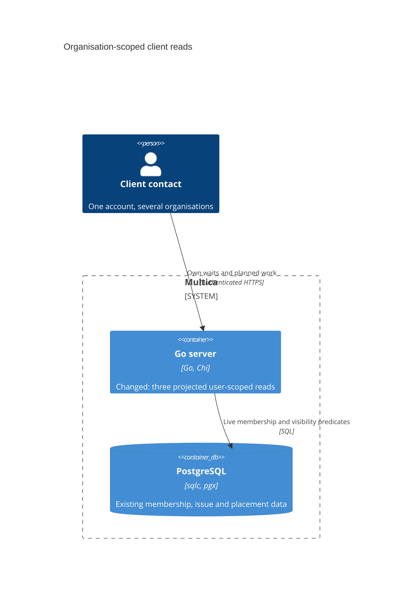
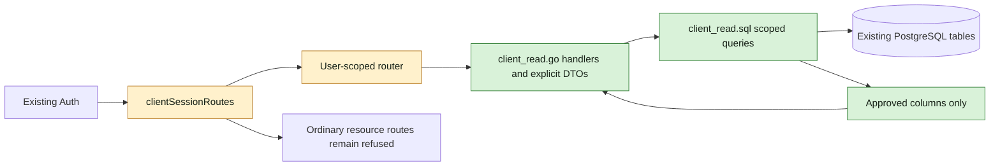
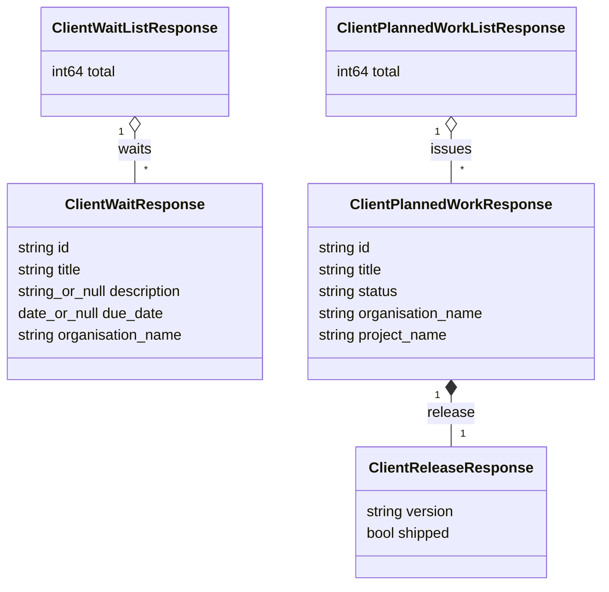
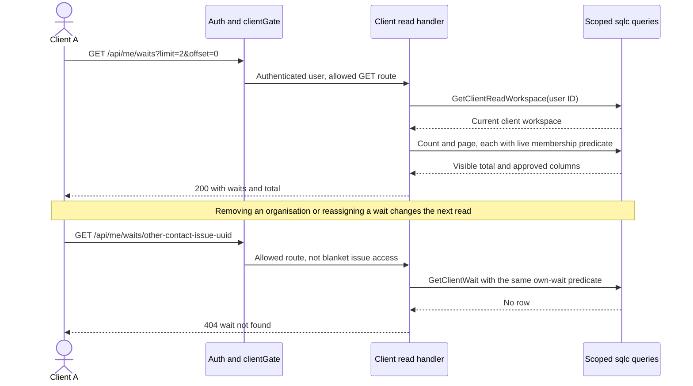

## At a glance

Delta against `specs/docs/system-design.md`. No new container or stored model. This story changes only the Go server; WORK-1073 consumes the contract below in web and desktop.



### Server components and data flow



### Response models



### Request sequence



| Kind | Name | Change | Path |
|---|---|---|---|
| Queries | Client workspace, scoped wait list/count/detail, planned list/count | new | `server/pkg/db/queries/client_read.sql` |
| Generated queries | sqlc client-read rows and methods | new | `server/pkg/db/generated/client_read.sql.go` |
| API | Dedicated client handlers and response structs | new | `server/internal/handler/client_read.go` |
| Routes | Three user-scoped GET routes | changed | `server/cmd/server/router.go` |
| Gate | Three method/path session-list entries | changed | `server/internal/middleware/client_gate.go` |
| Behaviour coverage | Visibility, projection, counts, pages, live changes | new | `server/internal/handler/client_read_test.go` |
| Gate coverage | Exact allowed paths and refused variants | changed | `server/internal/middleware/client_gate_test.go` |
| Router coverage | Real authentication, allow-list walk and staff isolation | changed | `server/cmd/server/client_gate_test.go` |
| System view | Implemented client-read components and response models | changed | `specs/docs/system-design.md` |

The inventory describes the implementation, not changes already present in this planning commit. Regenerate any additional sqlc-owned outputs the generator changes; do not edit generated files by hand.

## Context

WORK-1071 is the server story under parent story WORK-1059, not an epic. The approved proposal and spec deltas are the behaviour contract. The approved mock, `designs/screens/client-access.md:101-130`, establishes open waits, due-date ordering and non-opening planned rows. All implementation groups belong to the roster's Backend team, lead Joeri, worker `madspec-api-builder`, in one server pull request. There is no separate models, frontend, CLI or infrastructure deliverable.

Code map and continuity:

- `server/cmd/server/router.go:1648-1663` mounts `Auth` and the user-scoped `/api/me/memberships`. The workspace resource group uses staff-oriented workspace middleware. Add reads beside memberships, not inside that group.
- `server/internal/middleware/client_gate.go:12-64` evaluates `IsClientAccount` on authenticated user requests and permits only `clientSessionRoutes`. It does not supply organisation scope. Keep `Auth`, `DaemonAuth`, task/runtime permissions and WebSocket refusal unchanged.
- `server/pkg/db/queries/member.sql:48-65` provides live account and membership discovery. WORK-1139's `organisation_ids` arrays are authoritative; joins to surviving same-workspace organisations supply display names. No singular organisation binding remains.
- `server/internal/handler/membership.go:26-49` is the existing user-scoped discovery pattern. `requireUserID`, `writeJSON`, `writeError`, `textToPtr` and `dateToPtr` are the existing boundary helpers. Do not use `resolveWorkspaceID`, `loadIssueForUser`, `GetIssue`, `ListIssues` or `IssueResponse` for this projection.
- `server/internal/handler/issue.go:1479-1493` is the ordinary bounded offset-list convention; its general filters, hydration and response builders are deliberately not reused.
- `server/pkg/db/queries/issue_label.sql:1-12` distinguishes issue labels from agent/skill labels with `resource_type`. `issue_to_label` is a soft junction, so use an existence predicate rather than multiplying result rows.
- `server/internal/handler/issue_status.go:45-52` provides `terminalIssueStatusKeys`; `server/pkg/db/queries/issue.sql:525-527` filters its expanded terminal keys without a per-row status function. This includes custom/archived terminal statuses and preserves the status index.
- `server/cmd/server/client_gate_test.go` contains `newClientGateFixture`, the independent `routerClientSession` table, a complete Chi route walk and actual JWT/PAT session calls. Handler fixtures use `server/internal/testutil`, `dbfx.Issue`, `dbfx.Insert` and `testutil.Call`.
- The archived membership/default-deny and organisation-set changes preserve the one-client-membership invariant and soft-reference survivor projection. ADR-0017 and ADR-0021 remain in force. ADR-0010 and ADR-0013 keep release identity on `issue.release_id`, not a version string or an inferred next release.

Runtime-owned `AGENTS.md` injection is preserved. Work stays on the existing `work-1071` main-lane checkout. Planning changes no product code.

## Goals / Non-Goals

**Always:** derive the user and workspace from the authenticated client membership; enforce organisation, row and column visibility in SQL; count only visible rows before paging; return each row's organisation name; make hidden and missing detail IDs indistinguishable; retain staff response shapes.

**Never:** open ordinary issue/project/release/member endpoints, add a planned-work detail route, expose full joined entities, allow client writes or live updates, change the picker/invitation controls, implement WORK-1073/WORK-1074, add a CLI, change the database schema, install or release this work.

## Decisions

### Published HTTP contract for WORK-1073

Use the existing authenticated user-scoped route family. `/api/me` expresses session-derived identity and avoids a new workspace selector or a client branch in staff handlers. A separate `/api/client` prefix would work but adds a second convention without changing the security boundary.

| Method and path | Handler | Success body |
|---|---|---|
| `GET /api/me/waits` | `ListClientWaits` | `ClientWaitListResponse`: `{ "waits": ClientWaitResponse[], "total": number }` |
| `GET /api/me/waits/{id}` | `GetClientWait` | One `ClientWaitResponse`, no wrapper |
| `GET /api/me/planned-work` | `ListClientPlannedWork` | `ClientPlannedWorkListResponse`: `{ "issues": ClientPlannedWorkResponse[], "total": number }` |

List parameters are only `limit` and `offset`, following the ordinary issue-list convention: default limit 100, maximum 100, default offset 0. Positive limits above 100 clamp to 100; malformed/non-positive limits use the default. Offset is a non-negative integer; invalid or out-of-range values use 0. Parse within the sqlc parameter range before conversion, so huge input cannot wrap. No count/paging inputs select records by owner, organisation, project, status or release. Ignore other query parameters and `X-Workspace-ID` for scope, including valid foreign IDs, `open_only`, `group_by`, `fields`, `include` and ordinary table-query options.

Both lists return 200 and a non-null array, including when empty or offset is beyond the final page. `total` is the whole visible set, not page length. Lists provide no cursor, per-project/release records or separate count endpoint.

| Response | Exact fields and JSON types |
|---|---|
| `ClientWaitResponse` | `id: string` (issue UUID), `title: string`, `description: string \| null`, `due_date: string \| null` (`YYYY-MM-DD`), `organisation_name: string` |
| `ClientPlannedWorkResponse` | `id: string` (issue UUID), `title: string`, `status: string` (status display name), `organisation_name: string`, `project_name: string`, `release: ClientReleaseResponse` |
| `ClientReleaseResponse` | `version: string` (stored version without `v`), `shipped: boolean` (`shipped_at IS NOT NULL`) |

All listed keys are present; nullable wait fields are explicit null, not omitted. `project_name` comes from `project.title`. No organisation/project/release UUID, key, slug, release title/description/date, issue status metadata, member, assignee or other field is included. Planned work never returns a description or due date, even for the caller's own wait. `status` is the same-workspace catalogue name, falling back to the stored key only when no catalogue row exists; join `issue_status` by workspace and key, including archived entries. This story does not open the workspace status catalogue. WORK-1073 parses these as new narrow schemas, displays the returned status and uses a neutral icon for an unrecognised name, not the ordinary issue schema with fabricated empty private fields.

Golden payloads (sample values only):

```json
{"waits":[{"id":"01900000-0000-7000-8000-000000000001","title":"Send the rent roll","description":"Upload the signed document.","due_date":"2026-10-20","organisation_name":"IVGA Vastgoed"}],"total":1}
```

```json
{"issues":[{"id":"01900000-0000-7000-8000-000000000002","title":"Prepare the report","status":"In Progress","organisation_name":"IVGA Vastgoed","project_name":"Client portal","release":{"version":"1.2.0","shipped":false}}],"total":1}
```

### Authentication and failure contract

Mount all three routes in the main `Auth` group before `RequireWorkspaceMember`. Add exactly GET `/api/me/waits`, GET `/api/me/waits/*` and GET `/api/me/planned-work` to `clientSessionRoutes`. `path.Match`'s `*` matches one path segment, not a descendant route. No method wildcard or `/api/me/*` wildcard. The independent middleware/router security tests must preserve this exact boundary; the route-walk session count changes from 9 to 12.

Each handler calls a small shared local `requireClientReadWorkspace`: `requireUserID`, then new sqlc `GetClientReadWorkspace(user_id)`, selecting the workspace of the current `role = 'client'` membership. It takes no caller workspace. The existing one-membership invariant makes the lookup unambiguous. A client with no surviving organisations still has a client membership; lists return empty and detail is not found.

- Missing authentication: existing Auth 401. A missing user principal never reaches client queries.
- An authenticated principal without a current client membership, including staff: 403 `{ "error": "client membership required" }`. Ordinary staff handlers remain the full staff surface.
- Wait detail: parse only a UUID, not a human issue key. Malformed UUID, absent UUID, another contact's wait, terminal wait, wrong type/label, outside-organisation wait and planned-only issue all return the same 404 `{ "error": "wait not found" }`. Check membership before this classification.
- Database failures return the existing generic 500 error format, never 404 or an empty success. Log failures with the project's structured logging convention; never log issue descriptions or private payloads.

### SQL-owned visibility

Add one query file, `server/pkg/db/queries/client_read.sql`, generated with `make sqlc`. Queries: `GetClientReadWorkspace`, `ListClientWaits`, `CountClientWaits`, `GetClientWait`, `ListClientPlannedWork`, `CountClientPlannedWork`.

Every row/count query binds authenticated `user_id` and the guard's `workspace_id`; joins `member` again with both IDs and `role = 'client'`; joins `issue -> project -> organisation`, requiring each row's `workspace_id` to match the bound workspace and `organisation.id = ANY(member.organisation_ids)`. This intersects live arrays with live same-workspace organisations at the data read, rather than trusting a session cache, caller IDs or a previously loaded organisation array. Missing or stale project/organisation references grant no access.

Own waits add all of:

1. `issue.type = 'chore'`.
2. `issue.assignee_type = 'member'` and `issue.assignee_id = user_id`, never `member.id`.
3. An `EXISTS` joining `issue_to_label` to `issue_label` for this issue, same workspace, `resource_type = 'issue'`, and `LOWER(name) = 'client wait'`, matching the existing case-insensitive label identity.
4. `NOT (issue.status = ANY(terminal_status_keys))`. Resolve those keys once per request with `terminalIssueStatusKeys` and pass the same set to wait count/list/detail queries. It includes built-in and custom/archived done/closed categories, even in an unseeded workspace. Do not call `issue_effective_status` per row or hardcode only `done`/`cancelled`; a stopped/blocked wait is still open.

No release predicate applies to waits. `GetClientWait` adds only the bound issue UUID to the same predicate and selects the same approved columns. The existence of a release never makes another contact's wait details visible.

Planned work adds an inner join from `issue.release_id` to the existing `release` and its `repository`. Require that repository to belong to the issue's project and workspace. A non-null dangling release ID or a foreign-project release does not qualify. Do not require a surviving worklane: ADR-0013 permits closed issues of a removed worklane to retain a release. Do not filter by issue type, assignee, lifecycle category or release shipment state. Project only approved columns and compute `shipped` in SQL; never hydrate a full release/project/issue record or fall back to general issue reads.

Use `ANY` and label `EXISTS`, not unnested arrays or label joins that multiply rows. Wait order is `due_date ASC NULLS LAST, created_at ASC, id ASC`, as the mock requires with deterministic ties. Planned order is organisation name/id, project title/id, release repository ID/position/ID, issue position/ID, ascending. IDs and positions used only to stabilise ordering are not response fields. Never post-filter a fetched page.

Count queries repeat their list's complete visibility predicate and have no limit/offset. Count separately so an empty beyond-last page still returns the correct total; a window count on page rows alone cannot do that. Return no successful list if either query fails. Separate count/page statements follow the existing list convention; no snapshot or cross-request paging stability is promised during concurrent edits. Every new request evaluates live membership and placement again.

### Scope and implementation shape

Keep response structs and simple handlers together in `client_read.go`, following the repository's handler-local `*Response` convention. No new service abstraction, generic projection framework, persistence cache or second authorisation store. Only this new route family uses these DTOs. Existing staff schemas, APIs, filters and tests retain their behaviour.

No migrations or indexes are required to express the queries. Existing workspace/project/assignee, label-junction and release indexes support the bounded path; no speculative schema work. Update only the implemented client-read portion of `specs/docs/system-design.md` in the eventual build, not the unchanged containers or unrelated maps in this plan.

## Risks / Trade-offs

- A label query without workspace/resource-type guards could match an unrelated soft label: enforce all three label conditions and exercise a wrong-namespace label in the matrix.
- Custom terminal statuses could leak completed waits: use the existing effective-status/category semantics rather than literal status comparisons; include a custom done and closed status in coverage.
- Count/list predicates can drift: seed hidden rows before and between visible rows, assert exact visible IDs and totals on every page and beyond the last page, for both lists.
- Permitting the route is not authorisation: each handler guards live membership and SQL repeats it; route tests retain refusal on ordinary issue/project/release details and all writes.
- Offset pages can shift when staff edits data between requests: deterministic ordering handles an unchanged dataset; no new snapshot token or cache is introduced.
- Display-only names can coincide across projects/repositories: the approved projection intentionally gives no extra identity fields. WORK-1073 groups using the published display context, without requesting full workspace records.

## Migration Plan

No schema migration, configuration or runtime protocol change. The three GET routes and their allow-list entries ship atomically with handlers and queries. Joeri's server pull request carries implementation and behaviour coverage; WORK-1073 starts on that published server contract. Removing this server change closes the added reads without rewriting stored data. Installation and local release are outside this planning story.
