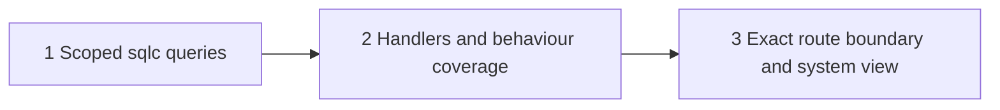

## At a glance

| Group | Team / builder | Depends on | Outcome |
|---|---|---|---|
| 1 | Backend / `madspec-api-builder` | Merged WORK-1139 | Live-membership queries and narrow generated rows |
| 2 | Backend / `madspec-api-builder` | 1 | Published DTOs, list/detail consistency and visibility regressions |
| 3 | Backend / `madspec-api-builder` | 2 | Three reachable GETs, every other client route still closed |

One server pull request owned by Joeri. No journey passes, frontend work, migrations or new infrastructure. `design.md` is the exact HTTP contract published for WORK-1073; the proposal and spec deltas define behaviour.

| Kind | Name | Change | Path |
|---|---|---|---|
| Queries | Six scoped client-read methods | new | `server/pkg/db/queries/client_read.sql`, `server/pkg/db/generated/client_read.sql.go` |
| API | Handlers and explicit response structs | new | `server/internal/handler/client_read.go` |
| Behaviour coverage | Client visibility matrix | new | `server/internal/handler/client_read_test.go` |
| Routes and gate | Three user-scoped GETs and exact session-list entries | changed | `server/cmd/server/router.go`, `server/internal/middleware/client_gate.go` |
| Security coverage | Session boundary, real credentials, ordinary-route refusal | changed | `server/internal/middleware/client_gate_test.go`, `server/cmd/server/client_gate_test.go` |
| System view | Implemented components and response models | changed | `specs/docs/system-design.md` |

## 1. Backend queries

- [ ] 1.1 `server/pkg/db/queries/client_read.sql` - add `GetClientReadWorkspace`, `ListClientWaits`, `CountClientWaits`, `GetClientWait`, `ListClientPlannedWork` and `CountClientPlannedWork` with the exact joins, approved SELECT columns and deterministic ordering in `design.md`; each row/count query rechecks live client membership, same-workspace project/organisation joins and `ANY(organisation_ids)`, and waits add member-assignee/type/issue-label/non-terminal predicates - visibility must precede pagination and counts, without multiplying rows or exposing full entities. Handler matrix coverage in 2.2 owns these SQL behaviours.
- [ ] 1.2 `server/pkg/db/generated/client_read.sql.go` and any other generator-owned outputs - regenerate from the SQL with `make sqlc`, keeping the narrow row types and explicit paging/status-key parameters - generated queries must be the only database entry point for this route family; compile them with the consuming handlers, not handwritten generated edits.

## 2. Backend handlers and behaviour coverage

- [ ] 2.1 `server/internal/handler/client_read.go` - implement `ListClientWaits`, `GetClientWait`, `ListClientPlannedWork`, the local client-workspace guard and the five response structs from `design.md`; reuse `requireUserID`, error/JSON/date/text helpers and `terminalIssueStatusKeys`, ignore caller scope/filter fields, bind the live guard identity into all queries, produce non-null list arrays and complete visible totals even past the last page, and return identical detail 404s without loading `IssueResponse` - both record and column privacy must be enforced on the server. Database failures return 500 with proportionate structured error logging, not a successful empty result. The assertions in 2.2 prove the contract.
- [ ] 2.2 `server/internal/handler/client_read_test.go` - add fixture-backed behavioural cases using `server/internal/testutil`, `dbfx.Issue`, `dbfx.Insert` and `testutil.Call`: A in organisations 1/2, another contact in 1, B in 3; released/unreleased own waits, another contact's released wait, released story with private sentinels, unreleased story, no-organisation project, wrong type/label/assignee type and terminal/custom-terminal waits; assert exact IDs, exact top-level/nested JSON key sets, nullable wait fields, display status, shipped/version and absence of private values - consumer-visible privacy must hold in both list and UUID detail. Cover list/detail parity after reassignment, completion and removal of organisation 2, and planned rows after release removal; live soft references must not widen access. Page both lists across hidden rows with ties/null due dates, assert due-date order, no duplicate/omitted visible IDs, correct totals and beyond-last empty pages. Forge scope headers and organisation/project/assignee/release/issue parameters; compare forbidden/malformed/unknown detail status and error bodies. Use planned fixtures with genuine repository/release/project ownership; include a mismatched or dangling release reference to prove no foreign release context is exposed. Do not assert source text, copied helper defaults or full staff schema snapshots.

## 3. Backend route boundary and documentation

- [ ] 3.1 `server/cmd/server/router.go`, `server/internal/middleware/client_gate.go` - mount only GET `/api/me/waits`, GET `/api/me/waits/{id}` and GET `/api/me/planned-work` beside memberships in the existing Auth group, and add only their three method/path patterns to `clientSessionRoutes` - the narrow handlers must be reachable without entering staff workspace middleware or opening any generic resource route. Middleware/router tests in 3.2 and 3.3 prove the boundary.
- [ ] 3.2 `server/internal/middleware/client_gate_test.go` - extend allowed-path cases for those GETs and retain refusal for wrong methods, descendant/suffix variants, ordinary issue/project/release list/detail/query variants, attachments and all unrelated routes - an allow-list edit must not widen the session boundary.
- [ ] 3.3 `server/cmd/server/client_gate_test.go` - update the independent `routerClientSession` table and route-walk session count to 12; exercise the new paths with actual client JWT and PAT plus forged `X-Workspace-ID`/caller identity inputs; keep the complete default-deny walk and ordinary direct-ID refusals, including a released own wait. Show staff can still read that issue's full private description and properties through the ordinary issue route while staff cannot use client reads; keep runtime/task credential coverage intact - routing, credential handling and staff isolation must match the handler contract without duplicating 2.2's data matrix.
- [ ] 3.4 `specs/docs/system-design.md` - update only the Go server component map and response-model relationships affected by the implemented client-read handlers/queries - the living view must describe shipped code, not this plan's intended state. Keep unrelated app, daemon, question and persistence models unchanged.

## Implementation Notes

The Backend lead integrates the three groups, runs their targeted handler/middleware/router coverage with disposable PostgreSQL, and exercises actual HTTP JSON through client authentication for the issue's Verify matrix. Use test credentials and development data, never the production stack or a real agent executable. Record observed results in the build handoff. These are build acceptance obligations, not a separate verification deliverable; the verifier checks the resulting pull request once.

No implementation exists in this planning commit. Do not mark a task complete from this document or OpenSpec validation alone. Keep WORK-1072's organisation-aware assignee picker and WORK-1073's frontend schema/route wiring outside these groups.

## Plan Change Log

- 2026-10-16: Planned WORK-1071 from Mitchel's proposal and approved multi-organisation requirements. Fixed three `/api/me` reads, strict DTO projections, live membership SQL, indexed terminal-status expansion and visible-only pagination/counts. No product approval or unresolved product question remains.
