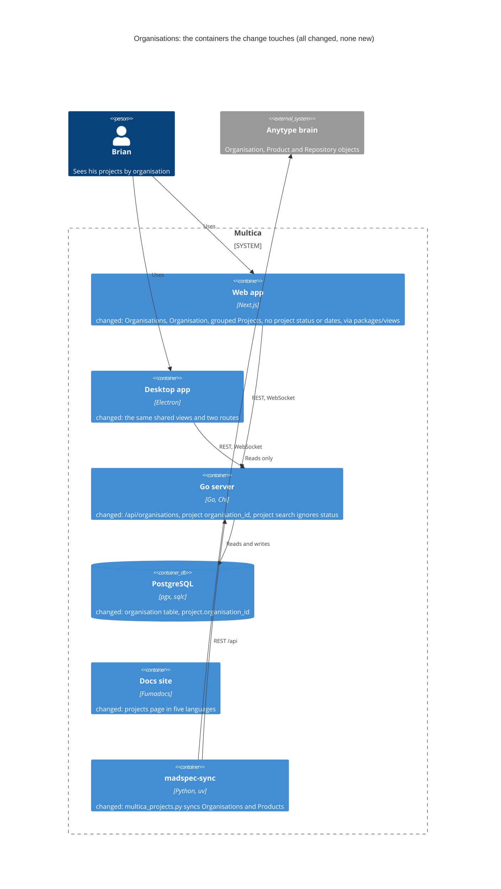
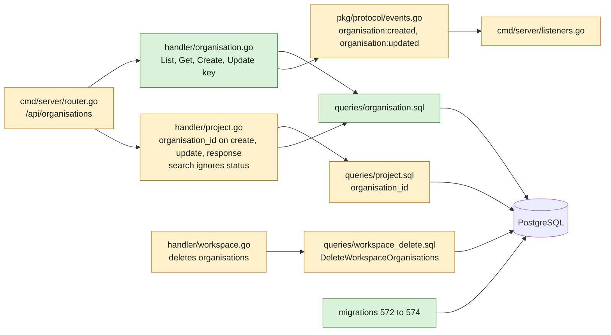
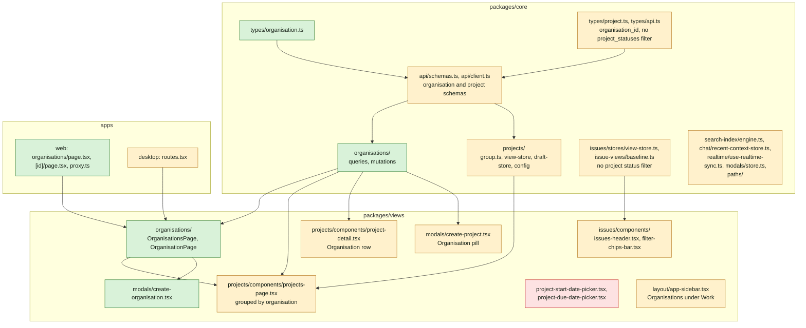
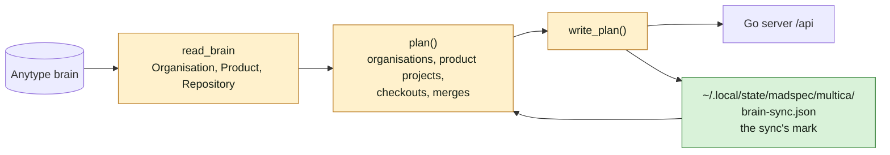
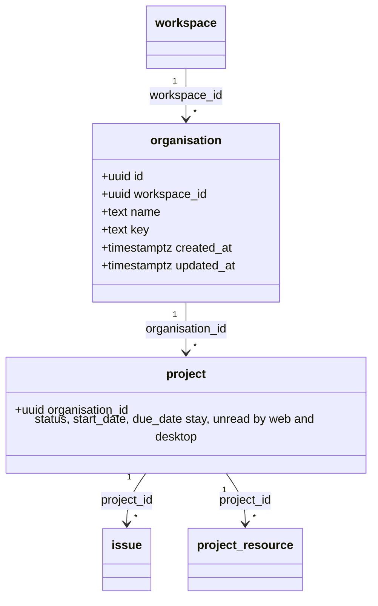
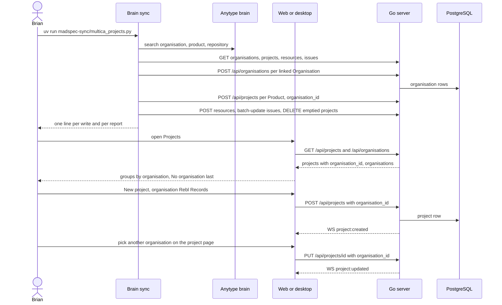

## At a glance

The delta of this change on the living system design, `specs/docs/system-design.md`. Every container it touches already exists; the change adds no container.

Go server component map, delta:

Web and desktop component map, delta:

Brain sync, delta:

Models:

Journey sequence and data flow:

| Kind | Name | Change | Path |
|---|---|---|---|
| Migration | `organisation` table, `project.organisation_id` | new | `server/migrations/572_organisation.up.sql`, `.down.sql` |
| Migration | Unique name per workspace ignoring case, one `CONCURRENTLY` index | new | `server/migrations/573_organisation_name_index.up.sql`, `.down.sql` |
| Migration | Unique key per workspace, one `CONCURRENTLY` index | new | `server/migrations/574_organisation_key_index.up.sql`, `.down.sql` |
| Migrator | Cleanups for the two concurrent indexes | changed | `server/cmd/migrate/main.go` |
| Queries | Organisation queries | new | `server/pkg/db/queries/organisation.sql` |
| Queries | `organisation_id` on create and update | changed | `server/pkg/db/queries/project.sql` |
| Queries | Workspace delete sweeps organisations | changed | `server/pkg/db/queries/workspace_delete.sql` |
| Generated | sqlc output | changed | `server/pkg/db/generated/` |
| Handler | Organisation endpoints | new | `server/internal/handler/organisation.go` |
| Handler | Project `organisation_id`, search without status | changed | `server/internal/handler/project.go` |
| Handler | Workspace delete step and manifest | changed | `server/internal/handler/workspace.go`, `server/internal/handler/workspace_delete_manifest_test.go` |
| Routes | `/api/organisations` | changed | `server/cmd/server/router.go` |
| Events | `organisation:created`, `organisation:updated` | changed | `server/pkg/protocol/events.go`, `server/cmd/server/listeners.go` |
| Reserved slug | `organisations` | changed | `server/internal/handler/reserved_slugs.json`, `packages/core/paths/reserved-slugs.ts` |
| Tool | Brain sync for Organisations and Products | changed | `madspec-sync/multica_projects.py`, `madspec-sync/tests/test_multica_projects.py` |
| Tool spec | The sync's rules | changed | `madspec-sync/specs/multica-projects.md`, `madspec-sync/README.md` |
| Type | Organisation; project gains `organisation_id` | new, changed | `packages/core/types/organisation.ts`, `packages/core/types/project.ts`, `packages/core/types/api.ts` |
| Schema and client | Organisation and project schemas, API methods | changed | `packages/core/api/schemas.ts`, `packages/core/api/client.ts` |
| Feature | Organisation queries and mutations | new | `packages/core/organisations/` |
| Feature | Grouping, view store, draft store, config | changed | `packages/core/projects/` |
| Feature | Project status filter removed | changed | `packages/core/issues/stores/view-store.ts`, `packages/core/issue-views/baseline.ts` |
| Feature | Search, chat context, realtime, modals, paths | changed | `packages/core/search-index/engine.ts`, `packages/core/search/cancelled-rank.ts`, `packages/core/chat/recent-context-store.ts`, `packages/core/realtime/use-realtime-sync.ts`, `packages/core/modals/store.ts`, `packages/core/paths/` |
| Screen | Organisations and Organisation | new | `packages/views/organisations/` |
| Dialog | New organisation | new | `packages/views/modals/create-organisation.tsx` |
| Screen | Projects grouped by organisation | changed | `packages/views/projects/components/projects-page.tsx` |
| Screen | Project page Organisation row, no status or dates | changed | `packages/views/projects/components/project-detail.tsx` |
| Dialog | New project with organisation, no status or dates | changed | `packages/views/modals/create-project.tsx` |
| Component | Project date pickers | removed | `packages/views/projects/components/project-start-date-picker.tsx`, `project-due-date-picker.tsx` |
| Filter | Issues project status filter | removed | `packages/views/issues/components/issues-header.tsx`, `filter-chips-bar.tsx`, `packages/views/issues/surface/`, `packages/views/issues/utils/filter.ts` |
| Sidebar | Organisations under Work | changed | `packages/views/layout/app-sidebar.tsx` |
| Copy | `organisations` namespace, project and issue keys | new, changed | `packages/views/locales/` |
| Routes | Organisations pages | new, changed | `apps/web/app/[workspaceSlug]/(dashboard)/organisations/`, `apps/web/proxy.ts`, `apps/desktop/src/renderer/src/routes.tsx` |
| Docs | Projects page | changed | `apps/docs/content/docs/projects*.mdx` |
| Design | Screens of this journey | changed | `designs/screens/steer-all-work.pen`, `designs/exports/` |
| Prototype | Data-flow prototype | new | `prototypes/web/projects-by-organisation/data-flow/` |
| Prototype | Live prototype | changed | `prototypes/web/src/components/generated/` |
| E2E | Journey acceptance test | new | `e2e/organisations.spec.ts` |
| ADR | Organisations hold projects and name worktree folders | new | `adr/0004-organisations-hold-projects.md` |
| ADR | Project status and dates stay stored but unseen | new | `adr/0005-project-status-and-dates-stay-stored-but-unseen.md` |

## Context

Journey UJ-1 of [PRD: Multica: steer projects, repositories, worklanes and releases](anytype://object?objectId=bafyreiew63xw2dncss52jdx4qk4o6aktkklhqroclvs3cvjxcyztx7h5um), the first of eight. The later changes build on its model: `repositories-of-a-project` (UJ-2) gives a project repositories and uses the organisation key for worktree folders, `worklanes-of-a-repository` (UJ-3), `release-line-of-a-repository` (UJ-4), `issues-from-templates` (UJ-5), `worklane-board-and-list` (UJ-6), `worklanes-and-releases-pages` (UJ-7) and `release-ships` (UJ-8).

**Journey steps.** The investigation finds nothing for four steps, and no `Keep:` Request names them. Each gets its `Skip:` Request once the journey exists in the brain:

- `Skip: J1` Project structure: no new container, app or package. Every new module sits in an existing Go package or workspace package (`packages/core/organisations/`, `packages/views/organisations/`).
- `Skip: J4` Design system: no token or colour changes. `designs/systems/multica.lib.pen` already holds the foundations of this design.
- `Skip: J5` Components: the library already has what the screens need. It has the projects tree, the tree row for an organisation, the project hero without status or dates, the sidebar with Organisations, the dialog, inputs with an error state, and the select (`designs/exports/library-*.png`). The New organisation dialog and the organisation picker are made from these parts.
- `Skip: J10` Agent tooling for UI: organisations are for people. The `multica` CLI stays as it is (proposal Non-goals).

J2, J3, J6, J7, J8, J9 and J11 have work. The design decision `bafyreiabhj65ebgmwryymqz3nxvkfhlgdlsiqdeh547yd2yhhkag2oxuve` assigns J6 the screens for New organisation and for changing a project's organisation.

**Code map.**

- Server, projects:
  - `server/migrations/034_projects.up.sql` creates `project` with the `status` CHECK and a foreign key to `workspace`. `035` adds `priority` and `166` adds `start_date` and `due_date`.
  - The highest migration on `main` is `571`.
  - `server/pkg/db/queries/project.sql`: `CreateProject` (10 positional params) and `UpdateProject`. In `UpdateProject`, `description`, `icon`, lead and dates use `sqlc.narg` without `COALESCE`, so the handler passes the current value when a key is absent. `ListProjects` filters by `status`.
  - `server/internal/handler/project.go`:
    - `ProjectResponse` at L24 and `projectToResponse` at L49.
    - `CreateProjectRequest` at L101 and `UpdateProjectRequest` at L124.
    - The `status` and date validation is at L228 to L323 and L518 to L587.
    - Events are published at L391, L596 and L669.
    - `buildProjectSearchQuery` drops `completed` and `cancelled` without `include_closed` (L736) and ranks `cancelled` last (L772).
  - Projects routes are at `server/cmd/server/router.go` L2124 to L2137.
- Server, patterns to copy:
  - Labels for a name that is unique ignoring case and for 409 on a unique violation: migration `167_resource_label_namespace_index.up.sql`, `queries/issue_label.sql`, `handler/label.go` L192 to L228, routes at `router.go` L2101, `label:*` in `protocol/events.go` L107, and `label_test.go` L14 to L49.
  - Every `CREATE INDEX CONCURRENTLY` migration is registered in `concurrentIndexCleanups` in `server/cmd/migrate/main.go` (`TestEveryConcurrentUpBuildHasCleanup`).
  - Workspace delete is the step list in `handler/workspace.go` `DeleteWorkspace` (projects at L1320, through `DeleteWorkspaceRuntimesAndProjects` in `workspace_delete.sql` L696). `workspace_delete_manifest_test.go` classifies every table.
- Server, other readers of project status that this change leaves alone:
  - The issue table's `project_statuses` (`issue_table_query.go` L91 and L608 to L623).
  - The `multica project` CLI (`cmd/multica/cmd_project.go`).
  - The `multica-platform` skill reference `builtin_skills/multica-platform/references/projects.md`.
  - The mobile app (`apps/mobile/components/project/`, `data/schemas.ts`).
- Core:
  - `types/project.ts` holds `ProjectStatus`, `status`, `start_date` and `due_date`.
  - `api/client.ts` L4051 to L4077: project CRUD with a plain `fetch`. Only `searchProjects` (L1241) uses `parseWithFallback`.
  - `api/schemas.ts` `ProjectSchema` is at L1404. The pattern for list parsing is `SquadSchema` at L2262 and `listSquads` at L4535, with tests at `schemas.test.ts` L1077.
  - `projects/`:
    - `config.ts`: `PROJECT_STATUS_ORDER` and `PROJECT_STATUS_CONFIG`.
    - `draft-store.ts`: status and dates.
    - `stores/view-store.ts`: `status` sort, `statuses` filter, and a persisted `merge` at L130.
    - `mutations.ts` L54 to L60: status invalidates the issue table.
  - `issues/stores/view-store.ts`: `projectStatusFilters` at L130, L255, L374, L470, L520, L541, L677 and L796. `issue-views/baseline.ts` L85. `types/api.ts` L312.
  - `chat/recent-context-store.ts` L19 and L51: `projectStatus`.
  - `search-index/engine.ts` L211, L396 and L417: it mirrors the server's project search. `search/cancelled-rank.ts` L164 demotes a cancelled project in aggregated results, for views and mobile.
  - The mobile app imports `Project` and `ProjectStatus` from `@multica/core/types` (`apps/mobile/components/ui/project-status-icon.tsx`, `components/project/`), but nothing from `@multica/core/projects`.
  - `realtime/use-realtime-sync.ts` L826: `project:` invalidates projects and issue tables.
  - `modals/store.ts` L5: `ModalType`.
  - `paths/paths.ts` L32, `paths/route-icons.ts` L88, `paths/tab-subject.ts` L83 and `paths/consistency.test.ts` L16.
- Views:
  - `projects/components/projects-page.tsx`: `ListGrid` table and card grid, status column, sort and filter. `project-detail.tsx`: status and date rows at L293 to L413. `project-badge.tsx`: `ProjectStatusBadge`. `labels.ts`: status labels.
  - `modals/create-project.tsx`: status and date pills.
  - `issues/components/issues-header.tsx` (L606, L1771) and `filter-chips-bar.tsx` (L41, L186, L343 to L476). `issues/surface/use-issue-surface-controller.ts` L496 and `use-issue-surface-data.ts` L192. `issues/utils/filter.ts`.
  - `search/search-command.tsx` L189, `editor/extensions/mention-suggestion.tsx` L599 and `chat/use-chat-context-items.ts` L44: status icons and labels.
  - `layout/app-sidebar.tsx` `workNav` at L153.
  - `modals/registry.tsx`, and the squads page with `create-squad` as the closest list, detail and create pattern.
  - `editor/utils/link-handler.ts` L23: `WORKSPACE_ROUTE_SEGMENTS`.
  - `i18n/resources-types.ts` registers each namespace. Locales are `en`, `zh-Hans`, `ko`, `ja` and `fr`, and `locales/parity.test.ts` checks the keys.
- Apps: thin route files `apps/web/app/[workspaceSlug]/(dashboard)/squads/page.tsx`, the segment list in `apps/web/proxy.ts`, and desktop `routes.tsx` L141 and L217.
- Brain sync:
  - `madspec-sync/multica_projects.py`:
    - `plan()` is a pure function, covered by `tests/test_multica_projects.py` with `Workspace` and `FakeMultica`.
    - The marker is the `local_directory` resource label `madspec:<owner/name>`.
    - `read_repositories` uses `team_state.brain.search(key, "repository", fields=["github_key"])`.
    - The lock is `projects.lock`.
  - The brain types are `organisation` (Linear key, Relationship), `product` (Organisation) and `repository` (Product, GitHub key). `brain.search` returns the requested link properties.
- Docs:
  - `apps/docs/content/docs/projects.mdx` and its four translations: the status table and dates at L17 to L36.
  - The CLI reference stays.

**What must not change.**

- The `project` columns `status`, `start_date` and `due_date`, the API fields that carry them, the CLI, the issue table's server filter and mobile all stay (ADR-0005).
- Project name, icon, description, lead, priority, pin and delete stay as they are.
- The other columns, sorts and filters of the Projects table stay.

## Goals / Non-Goals

**Goals:**

- A workspace-scoped `organisation` with a unique name, ignoring case, and a unique key that is a folder name. A project points to at most one organisation.
- Projects grouped by organisation on Projects, an Organisations page, an Organisation page, and New organisation. The project page and New project show and set the organisation.
- No project status, start date or due date anywhere in the web and desktop apps, the Issues filter included.
- The brain sync fills organisations and one project per Product, and merges the repository project of each Product with one repository into it.
- A model that UJ-2 to UJ-8 extend with repositories, worklanes and releases without reworking it (ADR-0004).

**Non-Goals:**

- Renaming or removing an organisation. There is no endpoint, button or sync write for either.
- Repositories, worklanes, releases and their counts or tree rows (UJ-2, UJ-3, UJ-4 and UJ-7).
- The mobile app, the `multica project` CLI and the public API.
- Squads.

**Always:**

- No foreign keys or cascades. Each concurrent index is in its own migration file.
- The server is the authority on uniqueness. The dialogs check the loaded list first, so the message comes at once.
- UI-consumed JSON goes through zod with `parseWithFallback`.
- Shared logic lives in `packages/core` and shared screens in `packages/views`, wired into web and desktop.
- Creating an organisation or a project, and changing a key, await the server.

**Never:**

- The sync never renames anything and never writes to the brain.
- The sync never overrides an organisation set in Multica, and never deletes a project other than a repository project it emptied.
- A server write never accepts an `organisation_id` from another workspace.

## Decisions

### 1. `organisation` is a table of its own; `project.organisation_id` is a nullable soft reference

`organisation(id, workspace_id, name, key, created_at, updated_at)`. `key` has `CHECK (key ~ '^[a-z0-9][a-z0-9-]*$')`, the folder-name rule of the spec. `project.organisation_id uuid NULL` has no foreign key (AGENTS.md).

- Uniqueness: `UNIQUE (workspace_id, LOWER(name))` (573) and `UNIQUE (workspace_id, key)` (574), each `CONCURRENTLY` in its own file. The constraint names (`organisation_workspace_name_unique`, `organisation_workspace_key_unique`) let the handler tell the two 409s apart.
- No index on `project.organisation_id`: nothing queries by it. The web reads every project of the workspace and groups them, as the counts on Organisations need.
- Workspace delete deletes the workspace's organisations in the step that deletes projects.

The model the later journeys extend is in ADR-0004. A repository belongs to a project, and worklanes and releases belong to a repository. The organisation is reached through the project, and its `key` is the first folder of a worktree path. Alternatives that were rejected:

- An organisation as a Multica workspace. Brian works across organisations in one workspace.
- An organisation as a label. There is no key and no uniqueness.

### 2. Organisation endpoints

| Method and path | Body | Answer |
|---|---|---|
| `GET /api/organisations` | none | `{organisations, total}`, by name |
| `GET /api/organisations/{id}` | none | the organisation, or 404 |
| `POST /api/organisations` | `{name, key}` | 201 and the organisation |
| `PUT /api/organisations/{id}` | `{key}` | the organisation |

Validation:

- `name` is trimmed and required.
- `key` is required and matches the folder rule, else 400 "key must be lowercase letters, digits and dashes, starting with a letter or digit".
- A unique violation returns 409 "organisation name is taken" or "organisation key is taken", told apart by the constraint name.
- `PUT` takes only `key`, because renaming is a non-goal.
- Membership gates the endpoints as it gates projects.
- Each write publishes `organisation:created` or `organisation:updated` with `{organisation_id}`.

Project endpoints:

- `organisation_id` joins `ProjectResponse` as nullable, and `CreateProjectRequest` and `UpdateProjectRequest` as optional.
- The handler loads the organisation with `GetOrganisationInWorkspace`. An unknown id or one from another workspace returns 400 "organisation not found".
- When the key is absent, `UpdateProject` keeps the current value, as it does for `description`.
- The server accepts a project without an organisation, because the CLI and the sync's repository projects create them. Requiring an organisation is New project's rule.

### 3. Status and dates stay stored; web and desktop stop reading them

ADR-0005 records this decision. The columns, the API fields and the `status` filter of `ListProjects` stay, because the CLI and the mobile app read them. The wire types in `packages/core/types/project.ts` and `ProjectSchema` keep `status`, `start_date` and `due_date`, because they describe what the server sends and mobile imports them.

The web and desktop apps drop every reader of them:

- The draft store, the view store, `config.ts`, `labels.ts`, the badge and the two date pickers.
- The project status filter on Issues, and `project_statuses` in `IssueTableFilters`, which only that filter sets.
- The status icon in search, mentions and chat context.

Search no longer hides or demotes a project by status: on the server (`buildProjectSearchQuery`), in the client index (`search-index/engine.ts`) and in the aggregation (`search/cancelled-rank.ts`, which keeps demoting cancelled issues). The three mirror each other. Without this, a project the old sync set to `completed` would vanish from search for a reason nobody can see. Mobile's search gets the same rule through the server and `cancelled-rank.ts`.

The persisted stores drop stale state on load:

- The project view store's `merge` drops `filters.statuses`, and turns a persisted `status` sort into the default sort.
- The issue view store's hydrate and `baselineFromQuery` ignore `projectStatusFilters`.

### 4. Grouping is one pure function in core

`packages/core/projects/group.ts` exports `groupProjectsByOrganisation(projects, organisations)`. It returns `{organisation | null, projects}[]` in this order:

- Organisations by name, ignoring case, with the `localeCompare` base sensitivity.
- Groups without projects left out.
- The `null` group ("No organisation") last, and only when it has projects.

The projects in a group keep the order of the input, so the page's sort applies inside each group. Projects calls it after the existing search and filters, so an organisation whose projects are all filtered out disappears. Organisations counts projects per `organisation_id` from the same list.

The Projects page keeps its compact table and card views, with their other columns, sorts and filters. A group row goes above each group, with a chevron, the organisation's name linking to its page, and the project count. The fold state is a durable layout preference, so it is persisted: `collapsedOrganisations: string[]` in the project view store, with `"none"` for No organisation. The table body is a component that the Organisation page reuses with the projects of one organisation and no group rows.

### 5. Organisations UI

- **Organisations** (`/organisations`):
  - `CollectionPageHeader` with the count and New organisation.
  - A `ListGrid` with the name and "N projects", sorted by name.
  - A row opens the organisation.
- **Organisation** (`/organisations/{id}`):
  - A breadcrumb from Organisations.
  - The name, "N projects", and the key as an inline field. Enter saves, and Escape restores the key.
  - A wrong or taken key shows its message beside the field and keeps the saved key.
  - New project opens `create-project` with `{organisationId}`.
  - The project table follows.
  - A 404 shows the page's not-found state.
- **New organisation** (`create-organisation` modal):
  - Name and key fields.
  - It checks first that neither is empty, then the key rule, then a taken name (ignoring case) and a taken key against the loaded list.
  - Create stays disabled until the checks pass. It awaits the server, then closes, and the organisation shows on Organisations through the `organisation:created` invalidation.
- **New project:**
  - An Organisation pill (a dropdown of organisations) is required, and Create stays disabled without it.
  - The pill is preset from modal data or the draft.
  - The status and date pills, and the overflow menu entries for dates, go.
- **Project page:**
  - An Organisation property row is a dropdown of organisations, showing "No organisation" when none is set.
  - Picking one calls `useUpdateProject` with `organisation_id`, which is optimistic under the AGENTS.md rules: the result is predictable and failure is rare.
  - The status, start date and due date rows go.
- **Sidebar:** Organisations goes under Work, after Projects, with the `Building2` icon, the same as the prototype.
- **Routes:**
  - Web gets `organisations/page.tsx` and `organisations/[id]/page.tsx`.
  - Desktop gets sibling routes in `routes.tsx`.
  - `paths.organisations()` and `paths.organisationDetail(id)` are added.
  - `WORKSPACE_PAGES.organisations`, a tab subject `organisation`, and `organisations` in `WORKSPACE_ROUTE_SEGMENTS` and `proxy.ts` are added.
  - `organisations` becomes a reserved slug.

### 6. The brain sync: organisations, product projects and merges

`multica_projects.py` keeps its read, plan and write shape, its lock and its rules for checkouts. The plan's input is now:

- From the brain: Organisations (`linear_key`), Products (`organisation`) and Repositories (`github_key`, `product`).
- From GitHub: whether each repository is archived.
- From this Mac: the checkouts.
- From Multica: organisations, projects, their resources, and the issue ids of each project to merge.
- The sync's mark file.

The mark is `~/.local/state/madspec/multica/brain-sync.json`, keyed by server and workspace. It maps the brain id of each Organisation and Product the sync placed to its Multica id, and under `repository_projects` the brain id of each Repository whose repository project the sync keeps (step 4) to that project's Multica id. The checkout resource label `madspec:<owner/name>` stays the mark of a checkout, and so of a repository project. A product project must keep its identity when its Product is renamed (spec "A Product renamed in the brain") or has no repository, and Multica has no field for a brain id. A mark held by the sync, next to its fallback overlays, keeps Multica's schema free of brain concepts. When the file is lost, the take-over rules rebuild it.

The plan, in order:

1. **Organisations.** Every Organisation that a Product links:
   - Its mark is followed when the marked organisation still exists.
   - Otherwise an organisation with its name, ignoring case, is taken over.
   - Otherwise one is created, with the key from the Linear key in lowercase, or the table `KEYS = {"Marvelous K": "mk", "Mens & Maatwerk": "mnm", "InclusiTalent": "incl", "Buttler": "btlr", "Whitebird": "wb"}`.
   - An Organisation with neither is reported "has no key" and its Products are reported with it.
2. **Product projects.** Every Product:
   - Its mark is followed when the marked project still exists.
   - Otherwise a project titled exactly with the Product's name that carries no checkout mark is taken over.
   - Otherwise a project is created with that title and the organisation.
   - A taken-over or marked project without an organisation gets the Product's organisation. One with an organisation keeps it.
3. **Checkouts.** A Product's repositories are the Repository objects that link it in the brain, archived ones and ones without a checkout included. A project holds one `local_directory` resource per daemon (`findLocalDirectoryConflict` in `server/internal/handler/project_resource.go`, since MUL-2618), and the daemon picks a task's checkout by its runtime. So:
   - The only repository of a Product, when it counts (today's definition), gets its marked `local_directory` resource on its Product's project, created or updated in place as today.
   - The project of a Product with several repositories gets no checkout. Its repositories' checkouts stay on their repository projects as they are, and a repository of it without a repository project gets none. UJ-2 gives a project several repositories.
   - A repository without a Product is reported "has no Product" and its project is left alone.
4. **Merges.** A project that carries the checkout mark of a repository with a Product, and is not that Product's project, is a repository project:
   - When the Product has one repository, the project's issues move to the Product's project with `POST /api/issues/batch-update` (`{issue_ids, updates: {project_id}}`), in pages of 100. It is deleted only after every move succeeded and a fresh `GET /api/projects/{id}` reads `issue_count` 0. Deleting it removes its resources.
   - When the Product has several repositories, the project is left as it is, with its issues and its checkout, and prints "{project} stays for {Product}, which has {N} repositories" on every run. Its Multica id goes into the mark file under `repository_projects`, keyed by the Repository's brain id, so UJ-2's sync can still find it after UJ-2's migrations drop the checkout resources and their labels.
5. Nothing changes a project's or organisation's title, name, key, description, icon, lead, priority or status. A Product or Organisation that is gone from the brain is printed and left alone.

Writes run in that order. After each successful create or take-over, the mark file is written atomically: a temp file, then a rename.

The read guards stay: a failed read of the brain, GitHub or Multica writes nothing. So does a brain answer with no Product object. A second run without changes sends no write. `madspec-sync/specs/multica-projects.md` is rewritten to these rules, and its status requirements go.

## Risks / Trade-offs

- **Migration numbers.** The 572 to 574 numbers can be taken on `main` by a merge before J2. The builder takes the next free numbers and renames the cleanup entries with them.
- **One checkout per runtime on a project.** MadSpec (3 repositories) and SuperMarty (12) keep their repository projects under No organisation, and their Product projects stay empty, until UJ-2's sync adds their repositories and merges the projects recorded under `repository_projects`. Agents on those issues keep working in the right checkout meanwhile.
- **A lost mark file** makes the next run take over by exact title. A product project Brian renamed in Multica, with a Product that has no repository, would then be created again. The checkouts and issues of every other project are unaffected. The `repository_projects` entries are written again from the checkout labels, as long as UJ-2 has not dropped them.
- **Mobile still shows status and dates.** It is out of scope. The server still serves them, so nothing breaks.
- **The server's `include_closed` parameter** stays and no longer changes project results. Issue results still use it.
- **Saved issue views** that hold a project status filter lose it silently when loaded. Nothing else filters by it.

## Migration Plan

1. Apply the migrations 572 to 574. Existing projects have `organisation_id` NULL and show under No organisation until the sync runs.
2. Release with `make local-release`.
3. Run `uv run madspec-sync/multica_projects.py` once by hand. It creates the 14 organisations, makes one project per Product, merges the repository project of each Product with one repository, and records and prints each repository project it keeps for a Product with several. It prints every write.

Rollback is the down migrations. Merged issues stay in their Product's project, because the sync never undoes a move.
