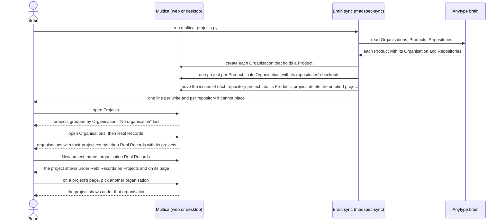

## At a glance

| Kind | Name | Change | Path |
|---|---|---|---|
| Concept | Organisation: a name unique in the workspace and a key, holding projects | new | `packages/core/types/` |
| Concept | Project: one organisation or none; no status, start date or due date | changed | `packages/core/types/project.ts` |
| Sidebar | Organisations under Work, after Projects | changed | `packages/views/layout/app-sidebar.tsx` |
| Page | Organisations: each organisation with its number of projects | new | `packages/views/organisations/` |
| Dialog | New organisation: name and key | new | `packages/views/modals/` |
| Page | Organisation: its name, its key, changeable, number of projects, and its projects | new | `packages/views/organisations/` |
| Page | Projects: projects grouped by organisation, "No organisation" last; no status, start date or due date | changed | `packages/views/projects/components/projects-page.tsx` |
| Dialog | New project: name and organisation; no status, start date or due date | changed | `packages/views/modals/create-project.tsx` |
| Page | Project: its organisation, changeable; no status, start date or due date | changed | `packages/views/projects/components/project-detail.tsx` |
| Filter | Issues: no project status filter | changed | `packages/views/issues/components/filter-chips-bar.tsx`, `packages/views/issues/components/issues-header.tsx` |
| Tool | Brain sync: organisations and one project per Product, merging today's repository projects | changed | `madspec-sync/multica_projects.py`, `madspec-sync/specs/multica-projects.md`, `madspec-sync/README.md` |

The tree's repository, worklane and release rows on Projects and on an organisation's page, and the repository and worklane counts on Organisations and an organisation's page, come with the journeys that create those things: UJ-2, UJ-3, UJ-4 and UJ-7.

## Why

Brian runs his own work and that of other organisations, each with its products, and Multica shows them as 32 projects, one per repository, without the organisation they belong to and with a status and dates he does not use. He has lost the overview of what he and his agents do per organisation.

Success signal: after one brain sync run, Projects shows the brain's 33 products as projects under their 14 organisations, MadSpec as one project holding the issues of its repositories' former projects, and the projects of the 4 repositories without a Product under "No organisation"; Brian creates a project in Rebl Records and sees it under Rebl Records on Projects and on Rebl Records' page, with no status or date anywhere.

## What Changes

- Organisations: a workspace holds organisations, each with a name and a key; Organisations lists them with their number of projects, New organisation asks for a name and a key, and an organisation's page shows its projects and changes its key. The key names the organisation's folder under `~/Worktrees` (UJ-2).
- Every project belongs to one organisation; Projects groups projects by organisation, with projects that have none under "No organisation".
- New project asks for a name and an organisation; a project's page shows its organisation and changes it.
- **BREAKING** No page, dialog or filter shows or asks for a project status, start date or due date, the Issues page's project status filter included.
- **BREAKING** The brain sync makes one project per Product instead of one per Repository, creates the organisations that hold Products, and merges today's repository projects into their Product's project, deleting the emptied ones. It no longer moves a project to `completed` and back when its repository leaves and returns.

## Capabilities

### New Capabilities

- `organisations`: lets Brian create organisations with a name and a key, see each with its number of projects, open one to see its projects, and change its key.
- `projects-by-organisation`: lets Brian give every project one organisation, see projects grouped by it, and work with projects without a status, start date or due date.
- `brain-project-sync`: lets Brian fill Multica's organisations and projects from the brain's Organisation and Product objects with one sync run.

### Modified Capabilities

None: no existing capability in `specs/openspec/specs/` covers projects or the brain sync.

## Impact

- Web and desktop: the sidebar, Projects, the project page, New project, the Issues filters, and the new Organisations and organisation pages and New organisation dialog.
- Shared packages: project and organisation types, the API client and its schemas, project queries and the project view store's status and date columns, sorts and filters.
- Server: organisations and a project's organisation in the API and the database; project status and dates leave the responses the web and desktop apps read.
- `madspec-sync/`: `multica_projects.py`, its spec `madspec-sync/specs/multica-projects.md`, its tests and the README.
- Copy in every supported language and the project docs in `apps/docs`.

## Constraints

- A project has at most one organisation; New project requires one.
- An organisation's name is unique in its workspace, ignoring case; its key is unique, lowercase letters, digits and dashes.
- The brain sync never changes an organisation's key once it exists in Multica.
- The brain sync writes nothing to the brain, never renames an organisation or project, and never overrides an organisation set in Multica.
- The brain sync deletes only a repository project whose issues it moved into its Product's project.
- AGENTS.md: no foreign keys or cascades, `CREATE INDEX CONCURRENTLY` in its own migration, zod schemas with `parseWithFallback` and malformed-response tests for the new responses, no compatibility shims, every check local.

## Non-goals

- Repositories, worklanes and releases in the tree, and their counts: UJ-2, UJ-3, UJ-4 and UJ-7.
- Renaming or removing an organisation.
- Project status and dates in the CLI (`multica project`), which is upstream's Go CLI.
- Changing a project's other fields and actions: name, icon, description, lead, priority, pin and delete stay as they are.
- Squads: the sidebar's Squads item stays under AI Team.
- The mobile app and dark mode.

## Sources

- Intent: [Steer projects, repositories, worklanes and releases in Multica](anytype://object?objectId=bafyreib727ukptyvcfbkud627gjb3cu2lmwsh3u4cjbu4kisjofa25km3u) and its Requests.
- PRD: [Multica: steer projects, repositories, worklanes and releases](anytype://object?objectId=bafyreiew63xw2dncss52jdx4qk4o6aktkklhqroclvs3cvjxcyztx7h5um): UJ-1, F1 with FR-1 to FR-9, the glossary, non-goals and the Addendum.
- Brief: [Multica: steer projects, repositories, worklanes and releases](anytype://object?objectId=bafyreicccdj6bucv5d65bxvkz4gy7jf7etplsswmwfggupqbakc6rudpmi).
- Design: [Steer all work screens](anytype://object?objectId=bafyreiauxfhf7w74hwn5je7ljakzxfgo2qv4noid2oshvtqjwkos2v5oiq), screens 1 Projects, 2 Project, 4 Organisations and 4b Organisation in `designs/screens/steer-all-work.pen`, exports in `designs/exports/`; [component library](anytype://object?objectId=bafyreiamoqycfo735krrpmzn3ujhdardv6uixsrdzkadzlodwpr7aenwee); `designs/creation-flows.md` "The model".
- Prototype: [Steer all work prototype](anytype://object?objectId=bafyreieck7zsmzslnfe5asszexojznfbnsnwcg62eqbesqqeigkkzgoclm), revision `460535099583266816`, code in `prototypes/web/src/components/generated/`.
- Brian's answers in the P4 session of 13 October 2026: today's repository projects merge into their Product's project; the brain sync stays and nothing is written to the brain; a Product or Organisation deleted from the brain leaves Multica as it is; organisation names are unique. In the UJ-2 session of the same day: every organisation has a key, editable on its page, which the sync fills from the Organisation's Linear key in lowercase or, without one, as Marvelous K `mk`, Mens & Maatwerk `mnm`, InclusiTalent `incl`, Buttler `btlr`, Whitebird `wb` (logged on the [UJ-2 Task](anytype://object?objectId=bafyreidtcw5ftbcaufzpiwkq3gdajdd2rug5a72eoy2j7mnhz6edkjpdwi)).
- The brain sync's passed spec `madspec-sync/specs/multica-projects.md`, whose rules this change keeps where it does not replace them: a marked project is the sync's own, a same-named hand-made one is taken over, a value Brian set in Multica stays (its "A status Brian set stays", which this change applies to the organisation), the sync never changes a project's title, a repository it cannot place is reported and left alone, a failed read writes nothing.
