## At a glance

```mermaid
flowchart LR
  classDef work fill:#d9f2d9,stroke:#2e7d32,color:#172117
  classDef skip fill:#eeeeee,stroke:#9e9e9e,color:#424242
  P5[P5 Technical design] --> J1
  J1[J1 Project structure<br/>Skip: J1]:::skip --> J2
  J2[J2 Data models<br/>groups 1-3]:::work --> J3
  J3[J3 Data-flow prototype<br/>group 4]:::work --> J4
  J4[J4 Design system<br/>Skip: J4]:::skip --> J5
  J5[J5 Components<br/>Skip: J5]:::skip --> J6
  J6[J6 Screens<br/>group 5]:::work --> J7
  J7[J7 Live prototype<br/>group 6]:::work --> J8
  J8[J8 Backend and agent tooling<br/>groups 7-8]:::work --> J9
  J9[J9 Frontend<br/>groups 9-11]:::work --> J10
  J10[J10 Agent tooling for UI<br/>Skip: J10]:::skip --> J11
  J11[J11 Acceptance test and archive<br/>group 12]:::work
```

| Step | Groups | Builder |
|---|---|---|
| J1 Project structure | none: `Skip: J1` | — |
| J2 Data models | 1 new model, 2 model change, 3 action names | `madspec-model-builder`, `madspec-dto-builder` |
| J3 Data-flow prototype | 4 | `madspec-prototype-builder` |
| J4 Design system | none: `Skip: J4` | — |
| J5 Components | none: `Skip: J5` | — |
| J6 Screens | 5 | `madspec-screen-designer` |
| J7 Live prototype | 6 | `madspec-prototype-builder` |
| J8 Backend and agent tooling | 7 endpoint, 8 integration | `madspec-api-builder` |
| J9 Frontend | 9 flow, 10 component change, 11 screen | `madspec-api-builder`, `madspec-component-builder`, `madspec-view-builder` |
| J10 Agent tooling for UI | none: `Skip: J10` | — |
| J11 Acceptance test and archive | 12 | Sarkout |

## 1. J2 Data models: new model

- [x] 1.1 `server/migrations/572_organisation.up.sql`, `.down.sql` -- create `organisation (id uuid PK default gen_random_uuid(), workspace_id uuid NOT NULL, name text NOT NULL, key text NOT NULL CHECK (key ~ '^[a-z0-9][a-z0-9-]*$'), created_at, updated_at)` without foreign keys, and `ALTER TABLE project ADD COLUMN organisation_id uuid NULL`. The down migration drops both -- design.md decision 1.
- [x] 1.2 `server/migrations/573_organisation_name_index.up.sql`, `.down.sql` -- `CREATE UNIQUE INDEX CONCURRENTLY organisation_workspace_name_unique ON organisation (workspace_id, LOWER(name))` -- a name is unique in its workspace, ignoring case.
- [x] 1.3 `server/migrations/574_organisation_key_index.up.sql`, `.down.sql` -- `CREATE UNIQUE INDEX CONCURRENTLY organisation_workspace_key_unique ON organisation (workspace_id, key)` -- a key is unique in its workspace.
- [x] 1.4 `server/cmd/migrate/main.go` -- add `573` and `574` to `concurrentIndexCleanups` -- `TestEveryConcurrentUpBuildHasCleanup` requires it.
- [x] 1.5 `server/pkg/db/queries/organisation.sql` -- `ListOrganisations` (by `LOWER(name)`), `GetOrganisationInWorkspace`, `CreateOrganisation`, `UpdateOrganisationKey`, each filtered by `workspace_id` -- the organisation reads and writes of decision 2.
- [x] 1.6 `server/pkg/db/queries/workspace_delete.sql` -- `DeleteWorkspaceOrganisations` -- workspace delete removes organisations, since there are no cascades.
- [x] 1.7 `server/pkg/db/generated/` -- run `make sqlc` and commit the output -- the generated code stays in step with the queries.
- [x] 1.8 `server/internal/handler/workspace.go`, `server/internal/handler/workspace_delete_manifest_test.go` -- call `DeleteWorkspaceOrganisations` in the step that deletes projects, and classify `organisation` as deleted with the workspace -- no orphan rows without cascades, and the table 1.1 adds leaves `TestWorkspaceDeletionManifestCoversPublicSchema` green on `main`.

## 2. J2 Data models: model change

- [x] 2.1 `server/pkg/db/queries/project.sql`, `server/internal/handler/project.go` -- `CreateProject` takes `organisation_id`, and `UpdateProject` sets `organisation_id` from `sqlc.narg('organisation_id')`, the way it sets `description`, with the handler's `UpdateProjectParams` seeded from `prevProject.OrganisationID` as `Description` is, so an update keeps the column -- a project points to at most one organisation. Then run `make sqlc`.
- [x] 2.2 `packages/core/types/organisation.ts`, `packages/core/types/index.ts` -- `Organisation`, `CreateOrganisationRequest {name, key}`, `UpdateOrganisationRequest {key}` and `ListOrganisationsResponse`, exported -- one client contract for web and desktop.
- [x] 2.3 `packages/core/types/project.ts` -- add `organisation_id: string | null` to `Project`, and `organisation_id?` to the create and update requests -- a project points to at most one organisation. Status and dates stay in the types until group 9, so J2 leaves `main` compiling.
- [x] 2.4 `packages/core/api/schemas.ts` -- `OrganisationSchema` and `ListOrganisationsResponseSchema` with defaults, and `organisation_id` on `ProjectSchema` (nullable, default `null`) -- AGENTS.md "API Compatibility".
- [x] 2.5 `packages/core/api/schemas.test.ts` -- malformed-response cases: a missing `organisations` array, an organisation without `key`, and a project without `organisation_id` -- AGENTS.md requires them for every new or changed response.

## 3. J2 Data models: action names

- [x] 3.1 `server/pkg/protocol/events.go` -- `EventOrganisationCreated = "organisation:created"` and `EventOrganisationUpdated = "organisation:updated"`, with payload `{organisation_id}` -- the names the server, listeners and clients share.
- [x] 3.2 `packages/core/modals/store.ts` -- add `"create-organisation"` to `ModalType` -- the dialog's one name.

## 4. J3 Data-flow prototype: data-flow prototype

- [ ] 4.1 `prototypes/web/projects-by-organisation/data-flow/` -- an interactive prototype without UI that runs the journey as design.md "Journey sequence and data flow" draws it: the sync run's reads, organisation and project creates, checkout resources, issue moves and deletes, then Projects grouped, New project in Rebl Records, and moving a project. Each step shows its input, output and store, from the brain's real Organisation, Product and Repository counts -- J3's contract.
- [ ] 4.2 `prototypes/web/projects-by-organisation/data-flow/README.md`, PNG exports -- how to run it, and one PNG per step -- J3's contract.

## 5. J6 Screens: screen design

- [ ] 5.1 `designs/screens/steer-all-work.pen` -- a New organisation dialog in the empty, filled, name taken, key taken and key not a folder name states. An Organisation row and picker on the project page, with No organisation. The Organisation pill in New project. The Organisation page's key field with its error. All built from the library's existing components and tokens -- the screens decision `bafyreiabhj65ebgmwryymqz3nxvkfhlgdlsiqdeh547yd2yhhkag2oxuve` gives J6.
- [ ] 5.2 `designs/creation-flows.md` -- the UX notes of these screens, with an At a glance flowchart where each arrow names its action -- J6's contract.
- [ ] 5.3 `designs/exports/` -- one PNG per new or changed screen -- J6's contract.

## 6. J7 Live prototype: prototype change

- [ ] 6.1 `prototypes/web/src/components/generated/` -- add New organisation, changing a project's organisation, and changing a key to the prototype, matching group 5's screens -- the live prototype of the journey.
- [ ] 6.2 `prototypes/web/` -- one PNG per changed prototype screen, beside the existing `1-projects.png` to `5-new-issue.png` -- J7's contract.

## 7. J8 Backend and agent tooling: endpoint

- [x] 7.1 `server/internal/handler/organisation.go` -- `ListOrganisations`, `GetOrganisation`, `CreateOrganisation` and `UpdateOrganisation`, as design.md decision 2 sets out:
  - Trimmed required name. Key rule 400. Name and key 409s told apart by constraint name. `PUT` takes `key` only.
  - Workspace scoping through the `X-Workspace-ID` membership.
  - `parseUUIDOrBadRequest` for the path id.
  - Publish `organisation:created` and `organisation:updated`.
- [x] 7.2 `server/internal/handler/project.go`:
  - `ProjectResponse.OrganisationID`, set by `projectToResponse`.
  - `organisation_id` on create and update, checked with `GetOrganisationInWorkspace`: 400 "organisation not found" for an unknown id or one from another workspace. On update, a missing key keeps the current value and `null` clears it.
  - `buildProjectSearchQuery` no longer filters or ranks by status.
- [ ] 7.4 `server/cmd/server/router.go`, `server/cmd/server/listeners.go` -- register `/api/organisations` routes in the workspace-member group, next to projects, and broadcast `organisation:*` to the workspace -- clients refresh live.
- [ ] 7.5 `server/internal/handler/reserved_slugs.json`, `packages/core/paths/reserved-slugs.ts` -- reserve `organisations`, then run `pnpm generate:reserved-slugs` -- a workspace can't take the route's slug (AGENTS.md).
- [ ] 7.6 `server/internal/handler/organisation_test.go`, `server/internal/handler/project_test.go` -- DB tests with `testutil` fixtures:
  - Create, then list by name.
  - Name taken ignoring case: 409. Key taken: 409. Key not a folder name: 400.
  - Key change, and a key change to a taken key.
  - Another workspace's organisation is invisible and refused as `organisation_id`.
  - A project create and update with `organisation_id`, and an update without the key keeping it.
  - Project search returns a `completed` project.
  - The spec scenarios at their canonical layer.

## 8. J8 Backend and agent tooling: integration

- [ ] 8.1 `madspec-sync/multica_projects.py` -- the reads, plan and writes of design.md decision 6:
  - Read Organisations, Products and Repositories with their links.
  - Read Multica organisations and each merge candidate's issue ids.
  - Keep the mark file `~/.local/state/madspec/multica/brain-sync.json`, keyed by server and workspace and written atomically.
  - Create organisations with keys from the Linear key or `KEYS`, and take over by name ignoring case.
  - Keep one project per Product, followed by mark, then taken over by exact title without a checkout mark, then created.
  - Set the organisation only when the project has none.
  - Put checkouts on the Product's project.
  - Merge repository projects through `POST /api/issues/batch-update` in pages of 100, and delete one only after a fresh read shows `issue_count` 0.
  - Report a repository without a Product, an Organisation without a key, and a Product or Organisation gone from the brain.
  - Remove the `completed` and `in_progress` status moves.
- [ ] 8.2 `madspec-sync/tests/test_multica_projects.py` -- `plan()` cases per scenario of the `brain-project-sync` spec delta:
  - The first run.
  - A taken-over organisation, and the keys table.
  - A key Brian changed stays.
  - A Product with three repositories, and one without.
  - The merge of 10, 2 and 1 issues.
  - A repository without a Product.
  - An organisation Brian set stays.
  - A deleted Product and a deleted Organisation.
  - A renamed Product.
  - A second run with nothing to write.
  - A failed read writes nothing.
  - The lock test stays.
- [ ] 8.3 `madspec-sync/specs/multica-projects.md`, `madspec-sync/README.md` -- rewrite the spec to the new rules (organisations, product projects, merges, the mark file), drop the status requirements, and update the README's description and commands -- `madspec-sync/README.md` says the spec is the sync's contract.

## 9. J9 Frontend: flow

- [ ] 9.1 `packages/core/types/api.ts` -- remove `project_statuses` from `IssueTableFilters`, which only the Issues project status filter sets (removed in 9.7 and 10.5). `Project`, `ProjectStatus` and `ProjectSchema` keep `status` and dates, because mobile imports them -- design.md decision 3, ADR-0005.
- [ ] 9.2 `packages/core/api/client.ts` -- `listOrganisations`, `getOrganisation`, `createOrganisation` and `updateOrganisation` through `parseWithFallback`. `listProjects`, `getProject`, `createProject` and `updateProject` parse with `ProjectSchema` -- the client calls of decision 2.
- [ ] 9.3 `packages/core/organisations/queries.ts`, `mutations.ts`, `index.ts`, `packages/core/package.json` -- `organisationKeys.list(wsId)` and `organisationKeys.detail(wsId, id)`, query hooks, and `useCreateOrganisation` and `useUpdateOrganisationKey`, which await the server and invalidate on settle. Export `./organisations` -- TanStack Query owns organisations.
- [ ] 9.4 `packages/core/realtime/use-realtime-sync.ts` -- `organisation:` events invalidate the organisation keys -- every open page stays live.
- [ ] 9.5 `packages/core/projects/group.ts`, `group.test.ts` -- `groupProjectsByOrganisation` as decision 4 sets it out. Tests cover:
  - Name order ignoring case.
  - Empty groups left out.
  - No organisation last, and only when it holds projects.
  - Input order kept inside a group.
  - A project pointing at an unknown organisation goes under No organisation.
- [ ] 9.6 `packages/core/projects/stores/view-store.ts`, `draft-store.ts`, `config.ts`, `mutations.ts`:
  - Remove the `status` sort, the `statuses` filter, `PROJECT_STATUS_*`, and the draft's status and dates.
  - Add `collapsedOrganisations` (persisted) and the draft's `organisationId`.
  - `merge` drops a persisted `statuses` filter and `status` sort.
  - Remove the status invalidation of the issue table.
  - Decision 3 and 4.
- [ ] 9.7 `packages/core/issues/stores/view-store.ts`, `packages/core/issue-views/baseline.ts` -- remove `projectStatusFilters` and its toggles, hydration, query baseline and `project_statuses` wiring. Hydrate ignores the old key -- the Issues filter goes.
- [ ] 9.8 `packages/core/search-index/engine.ts`, `packages/core/search/cancelled-rank.ts`, `cancelled-rank.test.ts`, `packages/core/chat/recent-context-store.ts`:
  - Project search no longer excludes or demotes by status, matching 7.2.
  - `partitionAggregatedSearchResults` demotes cancelled issues only.
  - Recent context drops `projectStatus`.
  - Decision 3.
- [ ] 9.9 `packages/core/paths/paths.ts`, `route-icons.ts`, `tab-subject.ts`, `consistency.test.ts`, `packages/views/editor/utils/link-handler.ts` -- `paths.organisations()`, `paths.organisationDetail(id)`, `WORKSPACE_PAGES.organisations` with the `Building2` icon, the `organisation` tab subject, and `organisations` in `WORKSPACE_ROUTE_SEGMENTS` -- shared navigation for web and desktop.
- [ ] 9.10 `packages/core/projects/stores/view-store.test.ts`, `packages/core/issues/stores/view-store.test.ts` -- a persisted payload with status filters or the status sort loads with them dropped -- the stale state named in decision 3.

## 10. J9 Frontend: component change

- [ ] 10.1 `packages/views/projects/components/project-badge.tsx`, `labels.ts`, `project-start-date-picker.tsx`, `project-due-date-picker.tsx` -- remove `ProjectStatusBadge`, the status labels and both date pickers -- ADR-0005.
- [ ] 10.2 `packages/views/projects/components/organisation-picker.tsx` -- a dropdown of the workspace's organisations by name, with "No organisation" as the value shown when none is set, on the existing `DropdownMenu` and `PillButton` -- one control for New project and the project page.
- [ ] 10.3 `packages/views/projects/components/project-table.tsx` -- the table body moved out of `projects-page.tsx`, taking `projects` and optional `groups`. Group rows carry a chevron, the organisation's name as an `AppLink` to its page, and "N projects", and fold through `collapsedOrganisations` -- shared by Projects and the Organisation page.
- [ ] 10.4 `packages/views/search/search-command.tsx`, `packages/views/editor/extensions/mention-suggestion.tsx`, `packages/views/chat/use-chat-context-items.ts` -- drop the project status icons and labels -- decision 3.
- [ ] 10.5 `packages/views/issues/components/issues-header.tsx`, `filter-chips-bar.tsx`, `packages/views/issues/surface/use-issue-surface-controller.ts`, `use-issue-surface-data.ts`, `packages/views/issues/utils/filter.ts` -- remove the project status filter, its chips and its use in filtering -- the Issues filter goes.

## 11. J9 Frontend: screen

- [ ] 11.1 `packages/views/projects/components/projects-page.tsx`:
  - Group the projects with `groupProjectsByOrganisation` after search and filters, through `project-table.tsx`, in the compact view, and as headed sections in the comfortable view.
  - Remove the status column, sort and filter.
  - The header counts the projects.
- [ ] 11.2 `packages/views/projects/components/project-detail.tsx` -- an Organisation property row with `organisation-picker.tsx`, updated optimistically through `useUpdateProject`. Remove the status, start date and due date rows -- the spec's project page.
- [ ] 11.3 `packages/views/modals/create-project.tsx`:
  - A required Organisation pill, preset from `data.organisationId` or the draft.
  - Create disabled without a title and an organisation.
  - Remove the status and date pills and the overflow entries.
  - Send `organisation_id`.
- [ ] 11.4 `packages/views/organisations/components/organisations-page.tsx`, `organisation-page.tsx`, `index.ts` -- Organisations and Organisation as decision 5 sets them out. Organisation has the key field with inline errors and New project, and a not-found state.
- [ ] 11.5 `packages/views/modals/create-organisation.tsx`, `packages/views/modals/registry.tsx` -- New organisation with name and key. It checks for empties, the key rule, and a taken name or key against the loaded list. Create awaits the server -- the spec's dialog rules.
- [ ] 11.6 `packages/views/layout/app-sidebar.tsx` -- Organisations in `workNav` after Projects -- the spec's sidebar.
- [ ] 11.7 `apps/web/app/[workspaceSlug]/(dashboard)/organisations/page.tsx`, `organisations/[id]/page.tsx`, `apps/web/proxy.ts`, `apps/desktop/src/renderer/src/routes.tsx` -- thin routes to the shared pages, as squads has them -- wired into both apps.
- [ ] 11.8 `packages/views/locales/{en,zh-Hans,ko,ja,fr}/organisations.json`, `projects.json`, `issues.json`, `layout.json`, `modals.json`, `packages/views/i18n/resources-types.ts` -- the `organisations` namespace, and the organisation copy in projects, the sidebar and the modals. Remove the project status and date keys and the issues project status filter keys in all five languages -- `locales/parity.test.ts` stays green.
- [ ] 11.9 `packages/views/organisations/components/organisations-page.test.tsx`, `packages/views/modals/create-organisation.test.tsx`, `packages/views/projects/components/projects-page.test.tsx`, `packages/views/modals/create-project.test.tsx`:
  - Counts show per organisation.
  - The dialog refuses a taken name ignoring case, a taken key and a bad key.
  - Projects shows groups with No organisation last and folds a group.
  - New project can't create without an organisation.
  - No status or date control renders.
  - The spec scenarios that belong to components.
- [ ] 11.10 `apps/docs/content/docs/projects.mdx`, `projects.zh.mdx`, `projects.ko.mdx`, `projects.ja.mdx`, `projects.fr.mdx` -- replace the status table and dates with organisations: the Organisations page, the key and No organisation -- the docs match the app in every language.

## 12. J11 Acceptance test and archive: acceptance test and archive

- [ ] 12.1 `e2e/organisations.spec.ts` -- the journey's acceptance test through `TestApiClient`:
  - Create the organisations Rebl Records and De App Specialist, and projects in each, plus one without an organisation.
  - Projects shows De App Specialist, then Rebl Records, then No organisation.
  - New organisation refuses "rebl records".
  - New project in Rebl Records shows on its page.
  - Moving the project to De App Specialist moves it on both pages.
  - No status or date control is on Projects, the project page or New project.
- [ ] 12.2 The brain sync run -- run `uv run madspec-sync/multica_projects.py` once against the local release and record its printed lines in the J11 pull request -- the PRD's success signal: the brain's products, under their organisations.
- [ ] 12.3 `specs/openspec/changes/projects-by-organisation/` -- run `openspec validate projects-by-organisation --type change --strict`, sync the specs and archive the change -- the journey closes on its J11 pull request.

## Implementation Notes

### Group 1. J2 Data models: new model

- Files touched: `server/migrations/572_organisation.{up,down}.sql`, `573_organisation_name_index.{up,down}.sql`, `574_organisation_key_index.{up,down}.sql`, `server/cmd/migrate/main.go`, `server/pkg/db/queries/organisation.sql`, `server/pkg/db/queries/workspace_delete.sql`, and the sqlc output in `server/pkg/db/generated/` (`organisation.sql.go` new; `models.go`, `project.sql.go`, `search_index.sql.go`, `workspace_delete.sql.go` changed).
- 572 follows 566: `SET LOCAL lock_timeout = '2s'` bounds the `ALTER TABLE project` lock, and `IF NOT EXISTS` / `IF EXISTS` keep both directions idempotent. The key `CHECK` is left unnamed, so Postgres names it `organisation_key_check`; the handler validates the key before writing, so nothing reads that name.
- A unique index raises its index name as the violation's constraint name, so `organisation_workspace_name_unique` and `organisation_workspace_key_unique` are what 7.1 matches on to tell the two 409s apart. Checked on the worktree database.
- Down migrations 573 and 574 only drop their index, so they need no `concurrentDownIndexCleanups` entry.
- `UpdateOrganisationKey` uses named `sqlc.arg` parameters (`key`, `id`, `workspace_id`), so its params struct reads by name; the other queries use positional parameters as `project.sql` does.
- The new nullable column adds `OrganisationID pgtype.UUID` to `db.Project` and to every `SELECT * FROM project` row; nothing else in the server changes and `go build ./...` passes.
- Surprise: `TestWorkspaceDeletionManifestCoversPublicSchema` in `server/internal/handler` fails with `unclassified=[organisation]` until the table is classified and `DeleteWorkspaceOrganisations` is called. The plan had that in group 7 (7.3). The Plan Change Log moves it into group 1 as 1.8.
- 1.8: the projects step runs `DeleteWorkspaceRuntimesAndProjects`, then `DeleteWorkspaceOrganisations`, in the same transaction; its name becomes "delete runtimes, projects and organisations", so a failure log names the table. `organisation` is classified `workspaceDelete` in the manifest, between `notification_preference` and `personal_access_token`.
- 1.8 also touches `server/internal/handler/workspace_test.go`: `TestDeleteWorkspace_PreservesOtherWorkspaceData` seeds one organisation per workspace, keeps the neighbour's and checks the target's is gone. Its cleanup deletes organisations itself, since `DELETE FROM workspace` cascades nothing to them. Without the `workspace.go` step it fails with "target organisation rows = 1, want 0".

### Group 2. J2 Data models: model change

- 2.1 files touched: `server/pkg/db/queries/project.sql`, `server/pkg/db/generated/project.sql.go`. `CreateProject` takes `organisation_id` as its 11th positional parameter, so `CreateProjectParams` gains `OrganisationID pgtype.UUID` after `DueDate`; `UpdateProjectParams` gains it as `$11`. `go build ./...` passes, because both handler call sites use named struct fields.
- 2.1 reopened (Plan Change Log): `UpdateProject` writes `organisation_id` unconditionally, like `description`, so the handler's `UpdateProjectParams` in `server/internal/handler/project.go` now seeds `OrganisationID: prevProject.OrganisationID` beside `Description`; a project update keeps the column instead of writing `NULL`. Setting it from the request stays 7.2's work.
- 2.1 regression test (unticked and re-ticked around it): `server/internal/handler/project_test.go` (new), `TestUpdateProjectKeepsOrganisationID`, inserts an `organisation` row with `dbfx.Insert` and a project with `dbfx.Project` whose `organisation_id` is set in the database, sends `UpdateProject` a body with only `title`, and reads the row back: title changed, `organisation_id` kept. Run against `.env.worktree`'s database: it fails with the `OrganisationID: prevProject.OrganisationID` line removed (`organisation_id = <nil>`) and passes with it.
- 2.2 files touched: `packages/core/types/organisation.ts` (new), `packages/core/types/index.ts`. `Organisation` carries the six columns of decision 1 (`id`, `workspace_id`, `name`, `key`, `created_at`, `updated_at`) and no project count: Organisations counts the projects it already loaded (decision 1, "No index on `project.organisation_id`"). `UpdateOrganisationRequest.key` is required, since `PUT` takes only the key. The types follow `label.ts`; the export block sits after the project types.
- 2.3 files touched: `packages/core/types/project.ts`. `CreateProjectRequest.organisation_id?: string`; `UpdateProjectRequest.organisation_id?: string | null`, where an absent key keeps the organisation and `null` clears it (decision 2).
- 2.3 surprise: a required `organisation_id` on `Project` broke five object literals typed `Project`, so each gains `organisation_id: null` to leave `main` compiling: the fixtures in `packages/views/chat/components/chat-input.test.tsx`, `issues/components/board-view-project-grouping.test.tsx`, `projects/components/project-detail.test.tsx` and `projects/components/projects-page.test.tsx`, and mobile's `EMPTY_PROJECT` fallback in `apps/mobile/data/schemas.ts`. Mobile is a non-goal, so its `ProjectSchema` stays as it is; its `.loose()` passes the new key through. `pnpm typecheck` (10 of 10 tasks) and `pnpm typecheck` in `apps/mobile` pass.
- 2.4 files touched: `packages/core/api/schemas.ts`. `OrganisationSchema` keeps `id`, `workspace_id`, `name` and `key` required and defaults `created_at` and `updated_at` to `""`; it is typed `z.ZodType<Organisation>`, as `ChatSessionSchema` is, so `.catch(EMPTY_ORGANISATION)` accepts the `.loose()` output. `ListOrganisationsResponseSchema` defaults `organisations` to `[]` and `total` to `0`, and drops a malformed row through `.catch(EMPTY_ORGANISATION)` plus an empty-id filter, the `ChatSessionListSchema` and `QuestionListSchema` pattern, so one bad row never blanks Organisations. `EMPTY_ORGANISATION` (empty id, read as not found) and `EMPTY_LIST_ORGANISATIONS_RESPONSE` are exported for 9.2's `parseWithFallback` calls.
- 2.4 decision: the key stays required rather than defaulting to `""`, because an organisation without a key cannot name its worktree folder (ADR-0004). A row without one leaves the list, so its projects fall under No organisation as decision 4 places a project with an unknown organisation.
- 2.4: `ProjectSchema` stays module-private, as before; `organisation_id: z.string().nullable().default(null)` sits after `lead_id` and reaches `SearchProjectsResponseSchema` and `SearchIndexProjectSchema` through `.extend`. Exporting it for the project client calls is 9.2's work.
- 2.5 files touched: `packages/core/api/schemas.test.ts`. A new `organisation schemas` block covers a well-formed list with an extra field, a missing `organisations` array (defaults to `[]`), a non-object or wrong-typed body (falls back to `EMPTY_LIST_ORGANISATIONS_RESPONSE`), a list row without `key` or with a numeric `key` (dropped, the others kept), a single organisation without `key` (falls back to `EMPTY_ORGANISATION`), and missing timestamps (defaulted). The project cases join the existing search-projects block, renamed from "date drift" to "drift": `organisation_id` parsed when sent, and a project without it parses to `null` without dropping the batch. `vitest run api/schemas.test.ts` passes (222 tests); `eslint` and `tsc --noEmit` in `packages/core` are clean.

### Group 3. J2 Data models: action names

- 3.1 files touched: `server/pkg/protocol/events.go`. The two constants sit after the project events; the payload is a named `OrganisationEventPayload` with one field, `OrganisationID` tagged `json:"organisation_id"`, following `QuestionEventPayload`, so 7.1's publishes share one shape. No `organisation:deleted`: organisations leave only with their workspace. `go build ./...` and `go vet ./pkg/protocol/` pass.
- 3.2 files touched: `packages/core/modals/store.ts`, `"create-organisation"` after `"create-project"`. `tsc --noEmit` in `packages/core` passes; the registry entry is 11.5's work.

### Group 7. J8 Backend and agent tooling: endpoint

- Scope: organisation handlers, project organisation assignment and status-independent search, workspace routes and realtime delivery, the reserved route slug, and their canonical handler tests. Project status/date CRUD and filters remain unchanged (ADR-0005); no organisation rename or delete.
- 7.1 files touched: `server/internal/handler/organisation.go`. Lists are workspace-scoped and name-ordered; names are trimmed and required, keys follow the folder-name rule, and unique index constraint names distinguish name/key 409s. PUT only changes the key; an extra name property cannot rename the row. Pure path UUIDs use `parseUUIDOrBadRequest`. Writes publish the shared `OrganisationEventPayload`; database faults log request attributes and return 500, while missing rows return 404.
- 7.2 files touched: `server/internal/handler/project.go`, `server/internal/handler/search_test.go`. Every project response includes nullable `organisation_id`, including search's hand-written SELECT/Scan. Create and explicit update values load the organisation in the selected workspace: a missing or foreign row is 400, malformed UUID is 400, database faults are logged 500s. Absent update keys keep the stored ID; null clears it. Search retains relevance and recency, but removes status filtering/demotion and the unused internal includeClosed argument; all callers and obsolete status expectations were updated. The HTTP `include_closed` parameter remains accepted without affecting project results.

## Plan Change Log

- 2026-10-13, J2: the workspace-delete step and manifest classification move from group 7 (7.3) to group 1 (1.8). The table 1.1 adds made `TestWorkspaceDeletionManifestCoversPublicSchema` fail, and J2 merges into `main` with passing checks, so its teardown ships with it. Group 7 keeps its numbering.
- 2026-10-13, J2: 2.1 also seeds `OrganisationID` from `prevProject` in the handler's `UpdateProject` call. Without it, every project update on `main` writes `NULL` to the column until J8. 7.2 still adds the request key.
