## At a glance

```mermaid
flowchart LR
  classDef work fill:#d9f2d9,stroke:#2e7d32,color:#172117
  classDef skip fill:#eeeeee,stroke:#9e9e9e,color:#424242
  P5[P5 Technical design] --> J1
  J1[J1 Project structure<br/>Skip: J1]:::skip --> J2
  J2[J2 Data models<br/>groups 1-2]:::work --> J3
  J3[J3 Data-flow prototype<br/>group 3]:::work --> J4
  J4[J4 Design system<br/>Skip: J4]:::skip --> J5
  J5[J5 Components<br/>group 4]:::work --> J6
  J6[J6 Screens<br/>group 5]:::work --> J7
  J7[J7 Live prototype<br/>group 6]:::work --> J8
  J8[J8 Backend and agent tooling<br/>groups 7-10]:::work --> J9
  J9[J9 Frontend<br/>groups 11-14]:::work --> J10
  J10[J10 Agent tooling for UI<br/>Skip: J10]:::skip --> J11
  J11[J11 Acceptance test and archive<br/>group 15]:::work
```

| Step | Groups | Builder |
|---|---|---|
| J1 Project structure | none: `Skip: J1` | — |
| J2 Data models | 1 model change, 2 DTOs | `madspec-model-builder`, `madspec-dto-builder` |
| J3 Data-flow prototype | 3 | `madspec-prototype-builder` |
| J4 Design system | none: `Skip: J4` | — |
| J5 Components | 4 | `madspec-design-system-designer` |
| J6 Screens | 5 | `madspec-screen-designer` |
| J7 Live prototype | 6 | `madspec-prototype-builder` |
| J8 Backend and agent tooling | 7 queries, 8 services, 9 endpoints, 10 CLI command | `madspec-model-builder`, `madspec-service-builder`, `madspec-api-builder`, `madspec-command-builder` |
| J9 Frontend | 11 flow, 12 new components, 13 changed components, 14 screens | `madspec-api-builder`, `madspec-component-builder`, `madspec-view-builder` |
| J10 Agent tooling for UI | none: `Skip: J10` | — |
| J11 Acceptance test and archive | 15 | Sarkout |

Every group builds on UJ-1's, UJ-2's and UJ-3's code (changes `answer-an-agents-question-and-wake-it`, `agent-asks-several-questions-at-once` and `answer-every-open-question-in-one-sitting`), merged first; paths they name exist once their J2 to J9 are built.

## 1. J2 Data models: model change

- [x] 1.1 `server/migrations/710_question_link_types.up.sql`, `.down.sql` -- drop UJ-1's `CHECK` constraints on `question_link.link_type` and `question_event.kind` and add them back `NOT VALID`, then `VALIDATE CONSTRAINT`: `link_type` in `issue`, `task`, `comment`, `project`, `agent`, `squad`, `autopilot`, `skill`; `kind` UJ-1's and UJ-2's kinds plus `linked`. Down deletes `question_link` rows of the six new types and `linked` events, then restores the previous constraints -- design.md decision 1 and "Migration Plan".
- [x] 1.2 `server/internal/question/links.go` -- `LinkType` constants for the eight types, `ValidLinkType`, `ParseLinkRef("project:01J…")` returning `{Type, Ref}` where a bare value is an issue and `run:` maps to `task`, and `MaxLinksPerAsk = 10` -- design.md decision 1 and 2; one registry the handler, service and CLI read.
- [ ] 1.3 `server/internal/question/links_test.go` -- `ParseLinkRef` cases: `WORK-415`, `issue:WORK-415`, `run:<uuid>`, `comment:abc12`, an unknown prefix and an empty ref are refused -- the CLI's input rules.

## 2. J2 Data models: DTOs

- [x] 2.1 `packages/core/types/question.ts` -- `QuestionLinkType` (the eight types), `QuestionLink.type` widened to it, `QuestionVia {type: "issue" | "sub_issue" | "comment" | "task", id, identifier, issue_identifier}`, `QuestionWakeTarget {agent_id, issue_id, unseen_answer_count, wake_available}`, `Question.wake_targets`, `QuestionTab` gains `"on_my_work"`, `QuestionRow` gains `via | null` and `open_issue {id, identifier}` and its `link.type` widens to `"issue" | "project" | "agent" | "squad" | "autopilot" | "skill"`, `QuestionRowFilters` gains `parent?: {type: "issue" | "project", id}`, `QuestionOpenCount {count, blocking_count}` -- design.md decisions 3, 5 and 6.
- [x] 2.2 `packages/core/api/schema.ts` -- extend the zod schemas: `wake_targets` defaults to `[]`, `via` to null, `open_issue` falls back to `link` when absent, an unknown `link.type` or `via.type` falls back to `issue`, `blocking_count` to 0 -- AGENTS.md "API Compatibility".
- [ ] 2.3 `packages/core/api/schema.test.ts` -- malformed-response cases: a question without `wake_targets`, a wake target without `agent_id` dropped, a row with an unknown link type, a row without `open_issue`, a count without `blocking_count` -- AGENTS.md requires them for a changed endpoint.
- [ ] 2.4 `server/internal/handler/question.go`, `server/internal/handler/question_list.go` -- response structs: `QuestionWakeTargetResponse` and `QuestionResponse.WakeTargets`; `QuestionRowResponse.Via` (`QuestionViaResponse`), `QuestionRowResponse.OpenIssue`; `QuestionOpenCountResponse.BlockingCount`; request structs `QuestionLinkRequest {type, id}`, `AskRequest.Links`, `AddLinksRequest`, `WakeRequest.AgentID` -- the Go side of 2.1, field for field.
- [ ] 2.5 `server/pkg/protocol/events.go` -- `QuestionEventPayload.IssueIDs []string` beside `IssueID`, and the reason `linked` -- design.md decision 8.

## 3. J3 Data-flow prototype: data-flow prototype

- [ ] 3.1 `prototypes/web/issue-questions/data-flow/` -- add this journey's path to the data-flow prototype: Pieter asks on sub-issue WORK-415 with `links`, adds project Agent runtime with `POST /api/questions/{id}/links`, the `question:updated` reason `linked` with `issue_ids`, WORK-410's Questions row reading `open-count` and `parent=issue:WORK-410`, the project's property, On my work for Brian, Anouk answers, the card's two wake targets, Wake Joeri with `agent_id` and Joeri's claim with the `[ANSWERS]` block; per step its input, output, store (Query key) and agent action -- J3's contract.

## 4. J5 Components: component design

- [ ] 4.1 `designs/systems/multica.lib.pen` -- bring the components this journey's screens need that UJ-1 to UJ-3 did not bring: the Questions property row with its count and blocking badge, the via row under it (type glyph, prompt, "via sub-issue WORK-415"), the question list row's via line, and the Wake bar repeated per agent on one card, from the library's existing tokens only -- J6 builds screens only.
- [ ] 4.2 `designs/systems/exports/` -- one PNG per new or changed component -- J5's contract.

## 5. J6 Screens: screen design

- [ ] 5.1 `designs/screens/issue-questions.pen` -- screen 4 "Questions page" with the tab **On my work** after For me, rows with the via line and no answer controls where Brian is no answerer, and its empty state "Nothing waits on your work" -- design.md decision 5.
- [ ] 5.2 `designs/screens/issue-questions.pen` -- new screen "Parent issue": WORK-410's properties with the Questions row "1 open" and the via row "via sub-issue WORK-415"; new screen "Project": Agent runtime's properties with the Questions property -- design.md decision 4; neither the UX spec nor the prototype draws them.
- [ ] 5.3 `designs/screens/issue-questions.pen` -- the answered card on WORK-415 with **Wake Pieter** and **Wake Joeri**, and WORK-410's timeline line "Joeri was woken by Brian with 1 answer" -- design.md decision 6.
- [ ] 5.4 `designs/screens/issue-questions.md` -- "Where questions live" 2 and "Waking agents" match 5.1 to 5.3; the new screens in At a glance with their flows; the via labels of design.md decision 3 -- one UX spec for the journey.
- [ ] 5.5 `designs/screens/exports/` -- the PNGs of the changed and new screens -- J6's contract.

## 6. J7 Live prototype: prototype

- [ ] 6.1 `prototypes/web/issue-questions/` -- align with group 5: the tab On my work with via lines, the parent issue's and project's Questions property, a card with a Wake bar per agent; the via wording of design.md decision 3 -- the live prototype of the journey.
- [ ] 6.2 `prototypes/web/issue-questions/exports/` -- the PNGs of the prototype's changed and new screens -- J7's contract.

## 7. J8 Backend and agent tooling: queries

- [ ] 7.1 `server/pkg/db/queries/question_reach.sql` -- `ListQuestionReach(workspace_id, question_ids)`: per question and link, the link's object and, for `issue`, `comment` and `task` links, its issue, the issue's ancestors through `parent_issue_id` (recursive CTE with `UNION`, so a cycle ends the walk) and each of their projects, with the object's assignee (`issue.assignee_*`, `project.lead_*`, `autopilot.assignee_*`) -- design.md decision 3, the upward form (ADR-0007).
- [ ] 7.2 `server/pkg/db/queries/question_reach.sql` -- the downward form: `SubtreeIssueIDs` seeded by issue ids (recursive CTE over `parent_issue_id`, `UNION`) and `QuestionIDsBelow(workspace_id, issue_ids, project_ids)`: questions with an `issue` link in the subtree, a `comment` or `task` link whose issue is in it, or a `project` link to a seed project; `WorkSeedsForMember(workspace_id, user_id)`: the viewer's issues (`assignee_type = 'member'`) and the issues and ids of the projects they lead -- design.md decision 3.
- [ ] 7.3 `server/pkg/db/queries/question_list.sql` -- `ListQuestionRowsBelow` (open, below seeds, order `created_at, id`, UJ-3's filters and cursor) and `CountQuestionsBelow` returning `count` and `blocking_count`; both take the seeds of 7.2 -- `on_my_work` and `parent` (design.md decision 5).
- [ ] 7.4 `server/pkg/db/queries/question.sql` -- `AppendQuestionLinks` (after `max(position)`, `ON CONFLICT DO NOTHING`, returning what was added); `ListQuestionsForIssue` widened to `comment` links on the issue's comments and `task` links on its runs; `DeleteQuestionLinksTo(link_type, ids)` and `DeleteQuestionLinksOfIssues(issue_ids)` returning `question_id`; `WithdrawQuestionsWithoutLinks(question_ids)` returning the withdrawn ids -- design.md decisions 2, 4 and 7.
- [ ] 7.5 `server/pkg/db/queries/question.sql` -- the unseen query of UJ-1 rewritten to a wake scope: answers and ask-backs of the given question ids updated after the start of agent B's latest started run on issue I, or all of them when B has none -- design.md decision 6.
- [ ] 7.6 `server/pkg/db/generated/` -- run `make sqlc` and commit the output -- generated code stays in step with the queries.

## 8. J8 Backend and agent tooling: services

- [ ] 8.1 `server/internal/service/question_links.go` -- `ResolveLinks(ctx, workspaceID, []LinkRef)`: loads each with its workspace-filtered get (`GetIssueInWorkspace`, the comment by `workspace_id` and not tombstoned, `GetAgentTaskInWorkspace` with an issue, `GetProjectInWorkspace`, agent, squad, autopilot, skill), 422 naming the type and id when absent; `Via(reach, pageObject)` and `OpenIssue(links)` -- design.md decisions 1, 3 and 5.
- [ ] 8.2 `server/internal/service/question_audience.go` -- `Reach(ctx, questionIDs)` over 7.1; `WakeTargets(ctx, question)`: the asker on its run's issue, agent assignees of reached issues on that issue, agent project leads and autopilot assignees on the asking run's issue, unique and without archived agents, each with its unseen count and `wake_available`; `WakeScope(ctx, agentID, issueID)`: the question ids having that target -- design.md decision 6.
- [ ] 8.3 `server/internal/service/question.go` -- `Ask` writes `links` (position 0 the first, then the rest, then the run's `task` link; duplicates once; more than `MaxLinksPerAsk` is 422); `AddLinks(ctx, question, agentID, refs)` refuses closed and withdrawn questions and other agents with 403, appends, writes one `linked` event per added link and publishes `question:updated` reason `linked` with `issue_ids`; `Wake(ctx, question, actor, agentID)` checks the target, uses its scope's unseen count and enqueues through `EnqueueTaskForQuestionWake` on the target's issue; `ListForIssue` reads 7.4's widened query; `Question` responses carry `wake_targets` -- design.md decisions 2, 4 and 6; Wake stays the only path into `TaskService` (ADR-0003).
- [ ] 8.4 `server/internal/service/question_list.go` -- `ListRows` handles `on_my_work` (seeds from `WorkSeedsForMember`) and `parent` (seed issue, or the project and its issues), fills `via` from `Reach` for the page in one call, `open_issue`, and `link` per design.md decision 5 with refs for non-issue objects; `CountOpen(ctx, workspaceID, viewerID, tab, parent)` returns `{count, blocking_count}` -- design.md decision 5 (ADR-0006).
- [ ] 8.5 `server/internal/service/question_cleanup.go` -- `DropLinksTo(ctx, qtx, linkType, ids)`, `DropLinksOfIssues(ctx, qtx, issueIDs)` and `WithdrawUnlinked(ctx, qtx, questionIDs)` with a `withdrawn` event `{reason: "links_deleted"}`, returning the affected question ids for the caller to publish after commit -- design.md decision 7; no cascades (AGENTS.md).
- [ ] 8.6 `server/internal/handler/daemon.go`, `server/internal/daemon/types.go`, `server/internal/daemon/prompt.go` -- at claim, `question_answers` are the claiming task's wake scope's unseen answers, each with `asker_name` and `via`; `[ANSWERS]` keeps UJ-1's header for the woken agent's own questions and otherwise reads "… answers to questions on your work:" with "asked by <agent> via <via>" per line -- design.md decision 6.
- [ ] 8.7 `server/internal/service/question_reach_test.go` -- DB-backed with `testutil` fixtures: a sub-issue chain WORK-410 > WORK-415 > WORK-420 in project Agent runtime, a comment and a run on WORK-420, a project set only on WORK-410, a parent cycle, another workspace; for each question the upward reach equals the set of seeds whose downward list holds it; the cycle ends; another workspace's questions never show -- the two forms of ADR-0007 cannot drift.
- [ ] 8.8 `server/internal/service/question_audience_test.go` -- Pieter asks on WORK-415 (parent WORK-410 assigned to agent Joeri, project led by agent Roos); Anouk answers: targets are Pieter on WORK-415, Joeri on WORK-410, Roos on WORK-415, each with 1 unseen; waking Joeri queues one task of Joeri on WORK-410 and none of Pieter; after Joeri's run starts his unseen is 0 and Pieter's still 1; a running task of Joeri on WORK-410 turns his `wake_available` off; an archived agent is no target -- the `agent-wake` spec.
- [ ] 8.9 `server/internal/service/question_cleanup_test.go` -- deleting a project drops its links and keeps the question open on its issue; deleting WORK-415 withdraws a question linked only to WORK-415, its comment and its run; deleting WORK-410 detaches WORK-415 and its question reaches nothing above it -- design.md decision 7.

## 9. J8 Backend and agent tooling: endpoints

- [ ] 9.1 `server/internal/handler/question.go` -- `Ask` reads `links` and parses each `id` with `parseUUIDOrBadRequest`; `AddQuestionLinks` (task token of the asking agent, else 403; empty `links` 400); `Wake` reads optional `agent_id` with `parseUUIDOrBadRequest` and returns 422 "<agent> is not offered Wake on this question" for a non-target -- design.md decisions 2 and 6.
- [ ] 9.2 `server/cmd/server/router.go` -- `POST /api/questions/{id}/links` in the questions group -- design.md decision 2.
- [ ] 9.3 `server/internal/handler/question_list.go` -- `tab=on_my_work`; `parent=issue:{id}|project:{id}` with `tab=all_open` only (else 400), the issue loaded with `loadIssueForUser`, the project with `GetProjectInWorkspace` (404 when absent); the cursor scope includes `parent`; `CountOpenQuestions` takes `tab` and `parent` and returns `blocking_count` -- design.md decision 5.
- [ ] 9.4 `server/internal/handler/issue.go`, `comment.go`, `project.go`, `skill.go` -- `deleteIssuesAndCollectAttachmentURLs`, `deleteComment`, `DeleteProject` and `DeleteSkill` call 8.5 inside their transaction and publish `question:updated` for the affected questions after commit -- design.md decision 7.
- [ ] 9.5 `server/internal/handler/question_test.go`, `server/internal/handler/question_list_test.go` -- `testutil.Call` cases: ask with a comment link of another workspace is 422; ask with 11 links is 422; add links to a withdrawn question is 422 and by another agent 403; Wake with a non-target is 422; `parent` with `tab=for_me` is 400; `parent=project:` of another workspace is 404; `on_my_work` for Brian lists the WORK-415 question with `via.type = sub_issue` -- the `questions`, `questions-page` and `agent-wake` specs at the API.

## 10. J8 Backend and agent tooling: CLI command

- [ ] 10.1 `server/cmd/multica/cmd_question.go` -- `multica question ask --on <link>` and `--link <link>` (repeatable), resolved through `cmd_id_resolver.go` (`resolveIssueRef`, `resolveProjectID`, `resolveAutopilotID`, `resolveTaskRunID` for `run:`, `resolveAgent`, `resolveIDByPrefix` for `comment:`, `squad:`, `skill:`) before any request; `multica question link <question-id> <link>...`; `multica question answers` lists links with position and type -- design.md decision 2.
- [ ] 10.2 `server/cmd/multica/cmd_question_test.go` -- an unknown link prefix and an unresolvable ref fail without a request; `--on` lands at position 0 in the request; `link` sends the resolved ids -- the `questions` spec through the CLI.
- [ ] 10.3 `apps/docs/content/docs/cli.mdx`, `cli.zh.mdx`, `cli.ja.mdx`, `cli.ko.mdx`, `cli.fr.mdx` -- `--on`, `--link` and `multica question link` with the link forms -- the CLI reference.

## 11. J9 Frontend: flow

- [ ] 11.1 `packages/core/api/client.ts` -- `listQuestionRows` takes `parent`; `getOpenQuestionCount({tab, parent})`; `wakeQuestion(id, agentId?)` -- through the schemas of 2.2.
- [ ] 11.2 `packages/core/questions/list-queries.ts` -- `questionKeys.parent(wsId, parent)` and `questionKeys.parentCount(wsId, parent)` under UJ-3's `rowsAll` and `openCount` prefixes; `questionParentRowsOptions`, `questionParentCountOptions`, `onMyWork` in the tab options -- design.md decision 8.
- [ ] 11.3 `packages/core/questions/via.ts`, `via.test.ts` -- `viaLabel(via, pageIssueId, t)`: "via sub-issue WORK-415", "via issue WORK-416", "via comment" on its own issue, "via comment on WORK-415", "via run", "via run on WORK-415"; null for null -- design.md decision 3; the only label rule.
- [ ] 11.4 `packages/core/questions/ws-updaters.ts`, `packages/core/realtime/use-realtime-sync.ts` -- `question:*` invalidates `byIssue` for each of `issue_ids`; `issue:updated` with a changed `parent_issue_id`, `project_id` or assignee (or an uncached issue), `issue:deleted` and `project:*` invalidate `questionKeys.all(wsId)` -- design.md decision 8.
- [ ] 11.5 `packages/core/questions/ws-updaters.test.ts` -- a status-only `issue:updated` leaves question queries alone; a parent change invalidates them; `issue_ids` of two issues invalidate both pages -- the invalidation rule.
- [ ] 11.6 `packages/views/locales/{en,zh-Hans,ko,ja,fr}/questions.json`, `projects.json` -- via labels, "On my work", "Nothing waits on your work", the Questions property label and count -- every supported language.

## 12. J9 Frontend: new components

- [ ] 12.1 `packages/views/questions/questions-property.tsx` -- `QuestionsProperty({parent})`: the count row ("2 open · blocks work") and the via rows from 11.2, each a type glyph, prompt and `viaLabel`, opening `open_issue` with `highlightQuestionId`; hidden at count 0 -- design.md decision 4.
- [ ] 12.2 `packages/views/questions/questions-property.test.tsx` -- WORK-410 lists the WORK-415 question as "via sub-issue WORK-415" and counts it; a comment question on WORK-412 reads "via comment"; count 0 renders nothing -- the `issue-questions` spec scenarios.

## 13. J9 Frontend: changed components

- [ ] 13.1 `packages/views/questions/question-card.tsx`, `question-set-card.tsx`, `wake-bar.tsx` -- one `WakeBar` per `wake_targets` entry with `wake_available`, asker first, each calling `wakeQuestion(id, agent_id)` -- design.md decision 6.
- [ ] 13.2 `packages/views/questions/question-row.tsx` -- the via line from `viaLabel`; a row whose `link.type` is not `issue` shows the object's icon and name; opening goes to `open_issue` -- design.md decision 5.
- [ ] 13.3 `packages/views/questions/question-card.test.tsx` -- an answered card with Pieter and Joeri as targets shows **Wake Pieter** and **Wake Joeri**; pressing **Wake Joeri** calls Wake with Joeri's id -- the `agent-wake` spec.

## 14. J9 Frontend: screens

- [ ] 14.1 `packages/views/issues/components/issue-detail.tsx` -- UJ-1's Questions row reads `QuestionsProperty` with `parent={type: "issue", id}` -- design.md decision 4.
- [ ] 14.2 `packages/views/projects/components/project-detail.tsx` -- a **Questions** property with `QuestionsProperty` for the project -- design.md decision 4.
- [ ] 14.3 `packages/views/questions/questions-page.tsx` -- the tab **On my work** after For me in `?tab=on_my_work`, rows with the via line, Yes / No only where the viewer answers, the empty state -- design.md decision 5.
- [ ] 14.4 `packages/views/questions/questions-page.test.tsx` -- On my work lists the question below Brian's WORK-410 with "via sub-issue WORK-415" and no Yes / No; For me does not list it -- the `questions-page` spec.

## 15. J11 Acceptance test and archive: acceptance test and archive

- [ ] 15.1 `e2e/questions-parents.spec.ts` -- the journey's acceptance test through `TestApiClient`: WORK-415 is a sub-issue of WORK-410 (assigned to Brian) in project Agent runtime; an agent task token on WORK-415 asks Anouk a question on WORK-415; Brian sees it on WORK-410's Questions property and on the project's, marked "via sub-issue WORK-415", and under On my work without answer controls; the agent adds project Agent runtime with `multica question link`'s endpoint; WORK-410 is reassigned to agent Joeri; Anouk answers; the card offers **Wake Pieter** and **Wake Joeri**; **Wake Joeri** queues Joeri's run on WORK-410 and no run of Pieter -- DAS-430's acceptance test.
- [ ] 15.2 `specs/openspec/changes/question-reaches-the-owner-of-the-work-above/` -- run `openspec validate question-reaches-the-owner-of-the-work-above --type change --strict`, sync the specs and archive the change -- the journey closes on its J11 pull request.

## Implementation Notes

- This change owns migrations 710 to 719 (Brian, WORK-366 comment `01a13915-3db8`) and uses 710; it never takes a number outside that range.
- No index is added: `question_link (link_type, link_id)` (UJ-1), `idx_issue_parent`, `idx_issue_project`, `idx_issue_assignee`, `idx_comment_issue` and `idx_agent_task_queue_issue_id` serve both forms of decision 3.
- No brief or skill text changes: UJ-1's brief section is fixed word for word by its spec, and `multica-platform` points to `multica question --help`, which lists `--on`, `--link` and `link`.
- The upward and downward forms live in one file, `question_reach.sql`, next to each other, so a change to one is seen beside the other.
- `ListForIssue` widening to comments and runs changes which cards UJ-1's issue page shows only for questions this journey links that way; every UJ-1 question links to its issue.
- 1.1: the constraints keep PostgreSQL's default names from migration 566, `question_link_link_type_check` and `question_event_kind_check`. UJ-2 (575) and UJ-5 (583-585) add no event kind, so `kind` is 566's eight kinds plus `linked`. Files: `server/migrations/710_question_link_types.up.sql`, `.down.sql`.
- 1.1 surprise: `cmd/migrate` sends a file as one implicit transaction, so `VALIDATE CONSTRAINT` in the same file runs under the lock of `ADD CONSTRAINT` and the `NOT VALID` step saves no lock time; repo precedent (`367_..._validate`, `402_..._validate`) validates in a separate file for that. Kept in 710 as the task says, with `SET LOCAL lock_timeout = '2s'`: widening cannot fail on existing rows and the question tables are small. The down path validates in the same file on purpose, as `263_issue_origin_wecom_chat.down.sql` does, so a narrowing CHECK fails closed.
- 1.2: `LinkTypeIssue` to `LinkTypeSkill` are untyped string constants, as the package's answer types (`TypeText` ...) are, so they drop into sqlc's `LinkType string` without conversion. `LinkRef {Type, Ref string}` is the one link shape for the CLI (Ref is a key, name or prefix) and for the service's `ResolveLinks` (Ref is the id). One ordered registry pairs each type with its CLI prefix; only `run:` differs from its type `task`, and `task:` is refused as an unknown prefix, so an agent that copies a `task` type from `multica question answers` gets the list of prefixes in the error. `ParseLinkRef` trims spaces and cuts at the first `:`; the ref is resolved by the caller. `MaxLinksPerAsk` bounds both an ask's links and one add (task 8.3). The service still writes `"issue"` and `"task"` literals at `service/question.go` ~352; group 8 moves them to the constants when it rewrites `Ask`. File: `server/internal/question/links.go`. Task 1.3 (`links_test.go`) is left unticked: Brian's build scope skips every test task.
- 2.1: widened the existing question link registry, added via and wake-target contracts, On my work, parent filters, row opening issues and blocking counts. `QuestionRowLink.identifier` and `status` are nullable for non-issue objects, as decision 5 requires. Files: `packages/core/types/question.ts`, `packages/core/types/index.ts` (public exports).
- 2.1 adaptation: `QuestionLink` already uses `link_type` / `link_id`, not the task's `type`; retained those wire names and widened `link_type`. Main approved this alongside the Go aggregate response location adjustment for 2.4.
- Group 2 scope: Brian's build override skips task 2.3; its checkbox stays unticked and no tests are written or run. No typecheck, lint, build, format or install runs here; the team lead owns the typecheck and build on Crabbox.
- 2.2: extended `packages/core/api/schemas.ts`, where the existing schemas live (`schema.ts` only implements `parseWithFallback`). Full-question links accept all eight types; missing wake targets become `[]` and targets without an agent or issue id are dropped individually. Missing/malformed via becomes null, unknown row-link/via types become `issue`, and missing/malformed blocking counts become 0, including the empty response defaults.
- 2.2: an absent opening issue uses the legacy issue link's id and identifier. A non-issue row may have null identifier/status but must provide its opening issue if its link cannot supply an issue identifier; an unopenable malformed row is dropped rather than inventing an issue identifier. UJ-3's requirement that an issue row has an identifier remains intact. Schema parsing stays in the existing `readQuestion` / `readQuestionRow` boundary.

## Plan Change Log

- 2026-10-13: technical design (P5) written from the proposal, the spec deltas, UJ-1's, UJ-2's and UJ-3's designs and ADRs, `issue-questions.md` of appboypov/multica#6 and the prototype of appboypov/multica#8; ADR-0007 added; J1, J4 and J10 skipped by Brian's answer on WORK-378, recorded as the Requests `Skip: J1`, `Skip: J4` and `Skip: J10` on journey UJ-4.
