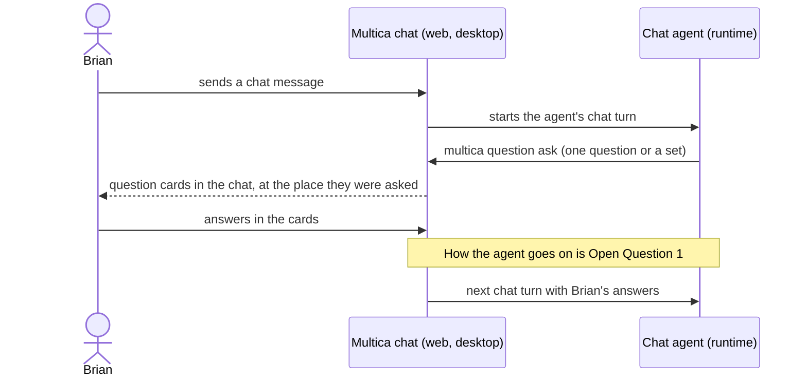

## At a glance

| Kind | Name | Change | Path |
|---|---|---|---|
| Spec | chat-questions | new | `specs/openspec/changes/questions-in-chat/specs/chat-questions/spec.md` |
| Spec | agent-question-tooling | changed | `specs/openspec/changes/questions-in-chat/specs/agent-question-tooling/spec.md` |

## Why

An agent in a Multica chat cannot use `multica question`: a run without an issue has questions off (ADR-0005), and the chat brief leaves out the Questions section. So a chat agent asks Brian a/b/c as plain text, and Brian types the letter back, without the answer types, suggested answer, notes and ask back that questions on issues have.

Success signal: in a chat on web or desktop, the agent asks Brian a question set with `multica question ask`, Brian answers it in cards inside that chat, and the agent's next chat turn has his answers.

## What Changes

- An agent in a chat run can ask with `multica question ask`; its brief and `multica --help` show the Questions tool while questions are on for the run.
- A question asked in a chat links to that chat and to the run it was asked in.
- The chat shows each question and question set as the same cards as on issues, at the place it was asked, with the same answer controls.
- Brian's answers reach the agent in a later chat turn.

## Capabilities

### New Capabilities

- `chat-questions`: lets an agent in a chat ask the chat's member questions, and lets the member answer them in the chat.

### Modified Capabilities

- `agent-question-tooling`: the brief, `multica --help` and `multica question ask` also serve chat runs, not only issue runs.

## Impact

- Server: task claim (`server/internal/handler/daemon.go`), `QuestionService.Ask` (`server/internal/service/question.go`), question links (`server/internal/question/links.go`, `server/internal/service/question_links.go`), question lists (`server/internal/service/question_list.go`).
- Daemon: chat brief (`server/internal/daemon/execenv/runtime_config_sections.go`), per-turn prompt (`server/internal/daemon/prompt.go`).
- Web and desktop: chat message list (`packages/views/chat/components/chat-message-list.tsx`), question cards (`packages/views/questions/`).

## Constraints

- Questions stay their own aggregate with typed answers and links (ADR-0002); a chat question uses the same tables, answer types and cards.
- Whether a run may ask is decided once, at claim (ADR-0005).
- An agent is told only that the tool exists, never when or why to ask (FR-22 of "PRD: Questions in Multica").
- Only agents ask and only members answer (`questions` spec).

## Non-goals

- The mobile app: questions are on web and desktop only ("PRD: Questions in Multica" 6.2).
- Chats connected from Slack, Feishu/Lark or WeCom: the request is about the Multica chat UI, and Brian's workspace has no connected channel chat.
- Members asking questions in a chat.
- Guidance to agents on when to ask or when to end a turn.

## Open Questions

Asked of Brian on WORK-447 as the question set "Agent questions in a chat":

1. When does the agent go on after Brian answered every question of an ask in a chat: at once by itself, on Wake, or with his next chat message?
2. Does a chat question also show on the Questions page, in the sidebar count and in the inbox?
3. Can an agent in a chat ask only the chat's member, or any member or squad?
4. What decides whether an agent may ask in a chat: the workspace default, always on, or a switch per chat?
5. What happens to open questions when Brian types a normal chat message instead of answering?

## Sources

- [PRD: Questions in Multica](anytype://object?objectId=bafyreiaviofipcl3ymgld2skld4ij6hlarsm2ra55ygufsepgk5laxjf34)
- WORK-447 "Allow Multica chat to use questions in chat", with Brian's screenshot of a chat agent asking a/b/c as text
- `adr/0002-questions-are-their-own-aggregate.md`, `adr/0003-only-wake-turns-answers-into-a-run.md`, `adr/0004-question-sets-group-questions-open-is-per-question.md`, `adr/0005-whether-a-run-may-ask-is-decided-at-claim.md`, `adr/0006-questions-are-listed-per-viewer-through-one-row-list.md`
