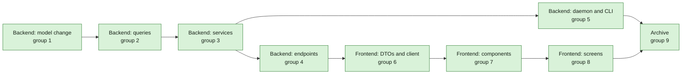

## At a glance

| Team | Groups | Lead | Builder |
|---|---|---|---|
| Backend | 1 model change, 2 queries, 3 services, 4 endpoints, 5 daemon and CLI | Joeri | `madspec-model-builder`, `madspec-service-builder`, `madspec-api-builder`, `madspec-command-builder` |
| Frontend | 6 DTOs and client, 7 components, 8 screens | Thomas | `madspec-dto-builder`, `madspec-component-builder`, `madspec-view-builder` |
| Verification | 9 archive | Sarkout | `as-verifier` |

The branch is stacked on `ask-back-wakes-the-asker` (pull request 34); the Wake checkbox, ask-back wake and decline paths it names exist there.

## 1. Backend and agent tooling: model change

- [x] 1.1 `server/migrations/711_questions_in_chat.up.sql`, `.down.sql` -- up: replace the CHECK constraints of `question_link.link_type` (add `chat`), `question.status` (add `cancelled`) and `question_event.kind` (add `cancelled`), starting from the lists in `710_question_link_types.up.sql` and `575_question_ask.up.sql`; down: set cancelled questions to `withdrawn`, delete `cancelled` events and `chat` links, restore the 710 constraints -- design.md Migration Plan.
- [x] 1.2 `server/internal/question/links.go` -- add `LinkTypeChat = "chat"` to the constants and the registry `ValidLinkType` reads -- Decision 1.
- [x] 1.3 `server/internal/question/policy.go` -- document `cancelled` beside `closed` and `withdrawn` (`:15`) as an explicit end status that `DeriveStatus` never returns; `IsOpen` (`:36`) already treats it as ended -- Decision 5.

## 2. Backend and agent tooling: queries

- [x] 2.1 `server/pkg/db/queries/question.sql` -- `CountUnseenQuestionAnswers` and `ListUnseenQuestionAnswers`: replace `issue_id = @issue_id` in the retry chain and the cutoff with `(sqlc.narg('issue_id')::uuid IS NOT NULL AND t.issue_id = sqlc.narg('issue_id')) OR (sqlc.narg('chat_session_id')::uuid IS NOT NULL AND t.chat_session_id = sqlc.narg('chat_session_id'))`, and add `cancelled` to the status filter -- Decision 4, ADR-0018.
- [x] 2.2 `server/pkg/db/queries/question.sql` -- rename `ListUnseenQuestionAskBacks` to `ListUnseenQuestionEvents`: `e.kind IN ('ask_back', 'cancelled')`, return `e.kind`, same scope parameters and status filter as 2.1 -- Decision 4.
- [x] 2.3 `server/pkg/db/queries/question.sql` -- `ListChatQuestionIDs` (questions with a `chat` link to the session, asked by the agent) and `HasActiveChatTaskForAgent` (a queued, dispatched or running task of the agent in the session); the overdue sweep (`:171-185`) takes questions whose position-0 link is `issue` or `chat` and returns the chat id beside the issue id -- Decisions 3, 4 and 6.
- [x] 2.4 `server/pkg/db/queries/question.sql` -- `ListQuestionsLinkedTo(workspace_id, link_type, link_id)` generalising the issue list query `ListForIssue` reads; `ListChatTaskIDs(workspace_id, chat_session_id)` for the run links of 3.4 -- Decisions 7 and 8.
- [x] 2.5 `server/pkg/db/queries/question_list.sql` -- project the position-0 `chat` link's `chat_session.creator_id` as `link_member_id`, never the chat's title -- Decision 6.
- [x] 2.6 `server/pkg/db/generated/` -- run `make sqlc` and commit the output -- generated code stays in step with the queries.

## 3. Backend and agent tooling: services

- [x] 3.1 `server/internal/service/question_links.go` -- `resolveLinks`: a `chat` link must be a chat session of the workspace; a `task` link accepts a task with an issue or a chat session; `Via` and the link DTO give a chat link `{type: "chat", id, member_id}` from the session's creator; add `OpenChat(links)` beside `OpenIssue` -- Decisions 1 and 6.
- [x] 3.2 `server/internal/service/question.go` `Ask` -- refuse with 422 "questions are asked during an issue run or a chat turn" unless the task has an issue or a chat session; for a chat turn put the chat at position 0 when no `--on` is given, else right after the `--on` link, and append the run link as today -- Decision 1, `agent-question-tooling` and `questions` specs.
- [x] 3.3 `server/internal/service/question.go` -- `Cancel(ctx, workspaceID, questionID, actor, CancelQuestionInput{Note, Wake})` through `mutate` as a current answerer: `SetQuestionStatus` to `cancelled` from `open`, `partly_answered`; event `cancelled` with `{"note"}`; publish reason `cancelled`; then, when `Wake` is true, `Wake` the asker after commit and log a refused wake while keeping the cancel, as `Answer` does (`:644-650`) -- Decision 5, `question-answering` spec.
- [x] 3.4 `server/internal/service/question.go` `Wake`, `wakeTargets`, `WakeScope`, `countUnseenAnswers`, `hasUnseenAskBacks` -- a scope type `{IssueID | ChatSessionID}`; the asker of a question whose `asked_in_task_id` task has a chat session gets the chat scope; for a chat scope lock the session, refuse with `ErrDuplicatePendingTask` on `HasActiveChatTaskForAgent`, count unseen answers and events by chat, call `EnqueueChatTaskForQuestionWake`, write no issue activity; `QuestionWakeTargetDTO` gains `chat_session_id`; issue scopes stay as they are -- Decisions 2 to 4, ADR-0018.
- [x] 3.5 `server/internal/service/task.go` -- `EnqueueChatTaskForQuestionWake(ctx, tx, session, agentID, actorID, questionID, count)`: the `CreateChatTask` row of `SendDirectChatMessage` with `trigger_evidence_kind` `question_wake`, ref the question, initiator the actor, no `chat_message`, then `SetChatTaskInputOwnerSelf`; the caller broadcasts and notifies after commit -- Decision 3.
- [x] 3.6 `server/internal/service/question_cleanup.go` -- `DropLinksOfChat(ctx, qtx, workspaceID, sessionID)`: drop `chat` links to the session and `task` links to `ListChatTaskIDs`, then `WithdrawUnlinked`, returning the affected question ids -- Decision 8.
- [x] 3.7 `server/internal/service/question_list.go` -- a row whose position-0 link is a chat no longer errors: `open_issue` stays null and the row link carries `member_id` -- Decision 6.
- [x] 3.8 `server/internal/service/question.go` `ListForIssue` -- generalise to `ListForLink(workspaceID, linkType, linkID)` over `ListQuestionsLinkedTo`, and move the issue caller to it -- Decision 7.
- [x] 3.9 `server/internal/service/question.go` `publish`, `server/pkg/protocol/events.go` -- `QuestionEventPayload` gains `chat_session_id` from the question's `chat` link -- Decision 7.
- [x] 3.10 `server/cmd/server/notification_listeners.go` -- question inbox items (asked, reassigned, overdue) of a question without an issue keep `issue_id` null and put `chat_session_id` and its `member_id` in details -- Decision 6.
- [x] 3.11 `server/internal/service/question_test.go` -- DB-backed: a chat turn's ask links chat then run, and `--on WORK-412` links the issue first; an ask from a quick-create task is refused; Brian cancels with a note, the question is `cancelled`, Anouk's earlier answer stays and nobody can answer, edit, close or withdraw it; a non-answerer's cancel is 403; cancel with `wake` enqueues one chat turn with no user message and without `wake` none; a second wake while that turn is queued returns `ErrDuplicatePendingTask`; unseen counts by chat ignore runs of the agent on issues and count a cancel; deleting a chat withdraws a question linked only to it and its run and keeps one also linked to WORK-412 -- the business rules of the `chat-questions`, `question-answering` and `agent-wake` specs.

## 4. Backend and agent tooling: endpoints

- [x] 4.1 `server/internal/handler/question.go`, `server/cmd/server/router.go` -- `CancelQuestion`: `POST /api/questions/{id}/cancel` with `{note?: string, wake?: bool}` in the human member group beside answer and ask-back, returning the question -- Decision 5.
- [x] 4.2 `server/internal/handler/chat.go`, `server/cmd/server/router.go` -- `ListChatQuestions`: `GET /api/chat/sessions/{sessionId}/questions` behind `gatePublicChatSessionForUser`, through `ListForLink(chat)` -- Decision 7.
- [x] 4.3 `server/internal/handler/chat.go` `DeleteChatSession` -- call `DropLinksOfChat` inside the delete transaction before the session row goes, and publish the affected questions after commit -- Decision 8.
- [x] 4.4 `server/internal/handler/daemon.go` claim (`:2644-2655`) -- a chat task without channel context resolves `questions_enabled` from the workspace settings with `ResolveAgentQuestions(nil, settings)`; every other task without an issue stays off -- ADR-0017.
- [x] 4.5 `server/internal/handler/daemon.go` `loadClaimQuestionAnswers` -- a chat task always hydrates the unseen answers and events of `ListChatQuestionIDs` with the chat scope, excluding its retry chain; an issue task keeps hydrating only on `question_wake`; a chat `question_wake` claim with no input messages is accepted as the intro chat is -- Decisions 3 and 4.
- [x] 4.6 `server/internal/handler/question_test.go`, `chat_test.go`, `daemon_question_wake_test.go` -- cancel returns 200 for an answerer and 403 for another member; the chat questions list is 403 for a member who is not the chat's creator; a chat claim has `questions_enabled` true with the default On and false with it Off or for a channel chat; a woken chat turn's claim carries the two answers and the cancel with its note, and a chat-message turn's claim carries an unseen answer -- the endpoint contracts of 4.1 to 4.5.

## 5. Backend and agent tooling: daemon and CLI

- [x] 5.1 `server/internal/daemon/execenv/runtime_config_sections.go` -- write the Questions section for a chat turn whose claim has `QuestionsEnabled`, still never for quick-create; its link line names the chat in a chat turn and the issue in an issue run -- Decision 9, ADR-0017.
- [x] 5.2 `server/internal/daemon/prompt.go` `buildQuestionAnswersBlock` -- render a `cancelled` event as "Cancelled by {member}: {note}" under its question, ordered with the answers and ask backs -- Decision 5.
- [ ] 5.3 `server/cmd/multica/cmd_question.go` `answers` -- print a cancelled question's status and the cancel line with who, the note and when -- `question-answering` spec "Pieter reads the cancel".
- [ ] 5.4 `server/internal/daemon/execenv/runtime_config_sections_test.go`, `server/internal/daemon/prompt_test.go` -- a chat turn with questions on has the Questions section and one with questions off has none; the `[ANSWERS]` block shows two answers and "Cancelled by Brian: already decided in the PRD" -- the brief and prompt rules of 5.1 and 5.2.

## 6. Frontend: DTOs and client

- [ ] 6.1 `packages/core/types/question.ts`, `packages/core/types/events.ts` -- `QuestionStatus` adds `cancelled`; event kinds and the update reason add `cancelled`; `QuestionLink` adds `{type: "chat", id, member_id}`; `QuestionWakeTarget` adds `chat_session_id`; the question event payload adds `chat_session_id` -- Decisions 5 to 7.
- [ ] 6.2 `packages/core/api/schemas.ts` -- the question, row and event schemas accept `cancelled` and the chat link, with the existing `.catch` fallbacks -- the server contracts of groups 3 and 4.
- [ ] 6.3 `packages/core/api/client.ts` -- `cancelQuestion(id, {note, wake})` and `listChatQuestions(sessionId)` -- 4.1 and 4.2.
- [ ] 6.4 `packages/core/questions/queries.ts`, `mutations.ts`, `ws-updaters.ts` -- `chatQuestionsOptions(wsId, sessionId)` under `questionKeys`; `useCancelQuestion`; mutations and `useWakeQuestionAgent` take a scope `{issueId} | {chatSessionId}` for invalidation; `handleQuestionEvent` invalidates the chat's questions on `chat_session_id` when no `issue_id` is set -- Decision 7.
- [ ] 6.5 `packages/core/paths/paths.ts` -- `chatSession(sessionId, {questionId})` adds `&question=` -- Decision 6.
- [ ] 6.6 `packages/core/api/schemas.test.ts`, `packages/core/questions/ws-updaters.test.ts` (new) -- a `cancelled` question and a chat link parse; an unknown link type falls back; a `question:updated` with only `chat_session_id` invalidates that chat's questions -- the parsing and invalidation rules.

## 7. Frontend: components

- [ ] 7.1 `packages/views/questions/question-card.tsx` -- **Cancel question** beside **Decline to answer** for a current answerer, with the same optional note; the **Wake {agent}** checkbox applies to Cancel as to Send on the last question still open for him; a cancelled card folds to "Cancelled by {member}" with the note, keeps every sent answer, and offers no answer controls and no **Edit answer**; the scope prop replaces the bare `issueId` for cache scope -- `question-answering` and `agent-wake` specs.
- [ ] 7.2 `packages/views/questions/question-set-card.tsx`, `wake-button.tsx` -- a cancelled question counts as ended for the last-open rule and shows its cancelled row; Wake uses the scope -- `agent-wake` spec.
- [ ] 7.3 `packages/views/questions/question-card.test.tsx` -- Cancel with a note sends `{note, wake: true}` on the last open question and `{note}` without wake on the first of three in a set; unchecking Wake sends no `wake`; a cancelled card shows "Cancelled by Brian", the note and Anouk's answer, and no answer controls -- the card's behaviour.

## 8. Frontend: screens

- [ ] 8.1 `packages/views/chat/components/chat-message-list.tsx` -- load `chatQuestionsOptions` for the session, group with `groupQuestionCards`, and render each group after the `AssistantMessage` whose `task_id` is its `asked_in_task_id`, or after the live turn while it streams, with the "Question for you" overline when the chat's member is an answerer -- Decision 7, `chat-questions` "Question cards in the chat".
- [ ] 8.2 `packages/views/chat/chat-page.tsx` -- read `?question=`, scroll the message list to the message holding that card and highlight the card -- Decision 6.
- [ ] 8.3 `packages/views/questions/questions-page.tsx`, `question-row.tsx` -- a chat row opens `paths.chatSession(id, {questionId})` when the link's `member_id` is the viewer, else Answer all at that question; rows group under "Chat with {member}" -- Decision 6.
- [ ] 8.4 `packages/views/questions/answer-all/answer-all-page.tsx` -- entries without an issue load through `questionDetailOptions` -- Decision 6.
- [ ] 8.5 `packages/views/inbox/components/inbox-question-pane.tsx` -- for a chat question the open button opens the chat at the card for the chat's member and Answer all for every other member -- Decision 6.
- [ ] 8.6 `packages/views/locales/{en,fr,ja,ko,zh-Hans}/questions.json` -- Cancel question, Cancelled by {name}, Chat with {name}, the cancel note placeholder -- one copy per language.
- [ ] 8.7 `packages/views/chat/components/chat-message-list.test.tsx`, `packages/views/questions/questions-page.test.tsx` (new), `packages/views/inbox/components/inbox-question-pane.test.tsx` -- a set of three shows after Pieter's message with the overline; Anouk's answer shows folded with no controls for Brian; Brian's chat row opens his chat with `question=`, Anouk's opens Answer all; the inbox pane opens the chat for Brian -- the screens' behaviour.

## 9. Archive

- [ ] 9.1 `specs/openspec/changes/questions-in-chat/` -- run `openspec validate questions-in-chat --type change --strict`, sync the specs and archive the change -- own work has no acceptance test.

## Implementation Notes

- 5.1: `buildMetaSkillContentSlim` now calls `writeQuestionsSection` for every chat turn as well as for non-quick-create runs with an issue; the section still writes only while the claim's `QuestionsEnabled` is true, so channel chat turns (off at claim) and quick-create get none. Surprise: `QuestionsSection` has no link line, and the in-force `agent-question-tooling` requirement "The brief tells only that the tool exists", which this change does not modify, fixes the section word for word (the workspace Questions settings show the same constant). Joeri agreed: a chat turn gets the identical section and no link line is added, so the section names neither the chat nor the issue. The section matrix comment and the `TaskContextForEnv.QuestionsEnabled` comment now cite ADR-0017.
- 5.2: `prompt.go` `buildQuestionAnswersBlock` collects answers, ask backs and the claim's `Cancels` as items and writes them in one stable chronological order (answer `updated_at`, event `created_at`, parsed as RFC 3339; an unparsable time sorts first and keeps its place), so a cancel sits among the answers and ask backs of the same wake. A cancel line names its question like the others: `- {id}  "{prompt}" · Cancelled by {member}: {note} · {when}`, without `: {note}` when the note is empty; notes and texts fold onto one line, and the `asked by … via …` suffix applies to all three kinds. A claim with only cancels still writes the block. The header's count is the claim's `AnswerCount`, which group 4 already counts with cancels. Existing answer and ask-back lines are unchanged byte for byte; only their relative order can change when an ask back predates an answer.

- 4.1: `handler/question.go` adds the thin current-member cancellation endpoint using `CancelQuestionInput` and the existing UUID, actor and question-error boundaries; `cmd/server/router.go` mounts it inside `RequireHumanActor` beside Answer. It returns the hydrated question with 200. The shared member-only refusal text includes cancellation. No checks run; endpoint regression coverage belongs to 4.6 and verification to the main agent.
- 4.2: `handler/chat.go` lists hydrated questions through `ListForLink(chat)` only after the existing public-session ownership/private-agent gate, and `cmd/server/router.go` exposes the session questions GET. Joeri resolved the 4.6 planning slip: another member receives the existing gate's 403, not 404; no masking or shared-gate change. Updated 4.6 accordingly. No checks run.
- 4.3: `handler/chat.go` drops the session's chat and run question links inside its existing locked deletion transaction before deleting the session; cleanup failure rolls the transaction back. After commit it publishes all affected question aggregates through `PublishLinkChanges`, alongside the existing cancelled-task and deleted-chat events. No checks run.
- 4.4: `handler/daemon.go` resolves an in-app chat turn's permission from its agent workspace settings before selecting skill variants; `ChannelContextRevision` identifies channel-context turns, which stay off. The resolver's typed absent issue setting is `pgtype.Bool{}` (the task's `nil` shorthand). Issue overrides and other non-issue tasks retain their behavior. No checks run.
- 4.5: `handler/daemon.go` hydrates every chat claim through the shared typed chat scope (`WakeScope` selects `ListChatQuestionIDs`), including ordinary message turns; issue claims remain question-wake-only. Both unseen queries exclude the claiming task and its retry chain, and message-free question wakes pass the input guard without manufacturing a user message. Joeri approved the supporting `protocol/question.go` contract: separate optional `Cancels []QuestionCancelData` carries question/asker identity, Via, prompt, note, actor and creation time; installed daemons ignore it instead of misrendering cancellation as an empty ask back. `AnswerCount` counts answers plus cancellations, matching Wake. Group 5 renders `Cancels` chronologically with answers and ask backs. No checks run.
- 4.6: `handler/question_test.go` covers member-only cancellation, non-answerer/agent refusal, bad IDs, the returned ended aggregate, note/actor event persistence and no unchecked enqueue; it also provides the shared chat-turn fixture. `handler/chat_test.go` covers the creator's hydrated list, another member's 403 and deletion's withdrawal versus surviving issue link. `handler/daemon_question_wake_test.go` covers workspace absent/On/Off and channel-off claim values including persistence, a message-free wake carrying two answers plus the cancel and note across three retry attempts despite an unrelated issue run, and ordinary message hydration that leaves other questions open and consumes the delivered answer once started. Tests were authored but not executed; the main agent owns verification.

- 3.1: `service/question_links.go` validates chat links and chat-turn run links against their workspace. `service/question.go` hydrates only the chat creator's `member_id`, caching repeat chat lookups within an aggregate batch; `OpenChat` returns that private-safe chat identity in the shared link metadata DTO. Chat links have no parent reach, so they do not manufacture a Via on issue or work pages. No checks run; the main agent owns verification.
- 3.2: `service/question.go` accepts a started, questions-enabled chat turn, inserts its chat first by default or immediately after the supplied first link, and retains link deduplication and the run link. Quick-create still refuses before any question write; off and not-started error copy now refers to the run rather than claiming every run is on an issue. No checks run.
- 3.3: `service/question.go` adds the current-answerer cancellation action using the existing locked mutation and after-commit publish path. It transitions only live statuses, records the optional note, preserves all answers, and attempts Wake only after cancellation commits; refused wakes are logged without discarding the cancellation. Wake's cancelled-event delivery is task 3.4. No checks run.
- 3.4: Joeri resolved the reported scope blocker: Decision 2 and cancellation Wake require `queries/question_reach.sql` to include cancelled questions and LEFT JOIN the optional asking issue, retaining its workspace gate when present. Updated the query and regenerated successfully with `make sqlc`. `service/question_audience.go` and `service/question.go` now use a single issue-or-chat scope for wake IDs, active-task guards, unseen answer/cancel counts and events; only the chat is used for a chat question's asker, even with an issue first. Chat wakes lock the session, reject active turns, and write no issue activity. The existing issue claim caller in `handler/daemon.go` adopts the typed scope; full chat hydration remains group 4. No tests run.
- 3.5: `service/task.go` creates a chat question-wake turn with the actor's direct-human attribution and question evidence, current agent/runtime checks under the agent claim lock, the normal runtime MCP overlay and self-owned input batch, without a chat message. Publication and runtime notification remain in `QuestionService.Wake` after commit. No checks run.
- 3.6: `service/question_cleanup.go` removes chat and chat-run links in the caller's transaction, then deduplicates affected question IDs and applies the existing unlinked-withdrawal rule once. Surviving links keep questions live; terminal statuses remain unchanged. No checks run.
- 3.7: `service/question_list.go` preserves the SQL-projected chat row, adds its creator's `member_id` and leaves `open_issue`/Via null instead of demanding an issue-bearing reach. It never projects chat titles or messages, including when secondary links reach an issue. No checks run.
- 3.8: `service/question.go` exposes `ListForLink` over the generic query, reusing workspace-local link validation and preserving not-found behavior for an inaccessible object. Migrated the issue endpoint in `handler/question.go` and its three existing service-test callers, removing `ListForIssue` rather than retaining an alias. No checks run.
- 3.9: `protocol/events.go` adds the chat scope and cancelled update reason. `service/question.go` includes the chat link on created and updated events, including Wake's minimal aggregate publication. The overdue publisher in `scheduler/jobs_question_overdue.go` also forwards the chat scope already returned by group 2's query, so chat overdue notifications reach 3.10 rather than being dropped. No checks run.
- 3.10: `cmd/server/notification_listeners.go` loads an issue only when present; otherwise it validates the chat's workspace, stores `chat_session_id` and creator `member_id` in details, and uses the question prompt rather than leaking the chat title. `notifyDirect` uses its existing optional-UUID helper for nullable issue IDs, keeping every issue notification unchanged. Asked, reassigned and overdue share this path. No checks run.
- 3.11: `service/question_test.go` adds DB-backed service regressions for chat-first and explicit issue links, private rows, foreign chat/run rejection, quick-create refusal, cancellation on issues and chats (including non-answerer refusal, notes, preserved earlier answers and terminal-action refusal), checked/unchecked and refused cancellation Wake, one attributed message-free chat turn and duplicate guards, chat cutoff isolation and cancellation counts, issue-assignee reach of a cancelled chat question, cancelled issue wake scope, and chat-deletion withdrawal versus a surviving issue link. `cmd/server/notification_listeners_test.go` extends the existing question-recipient matrix to chat asked/reassigned/overdue inbox items with null issue and private-safe chat details. Tests were written but not run; main-agent verification should run the affected service, server-command and scheduler tests plus formatting/type/build checks on the combined backend.

- 1.1: migration 711 follows 710's shape: `SET LOCAL lock_timeout = '2s'`, each CHECK dropped and added back `NOT VALID`, then validated. No index, so no `concurrentIndexCleanups` entry. The down restores 710's link type and event kind CHECKs and 575's status CHECK (710 never touched `question.status`). No other branch holds a 711 migration as of 2026-10-15. Checked on Crabbox against a temporary PostgreSQL 17: `go run ./cmd/migrate up` applies 711; the new CHECKs take a `chat` link, a `cancelled` question and a `cancelled` event and still refuse unknown values; running the down turns the question `withdrawn`, keeps its run link, deletes the `chat` link and `cancelled` event and leaves validated CHECKs that refuse `chat` and `cancelled`; the up then applies again.
- 1.2: the registry pairs each link type with its CLI prefix, so the chat entry takes the prefix `chat`: `ParseLinkRef("chat:<ref>")` now reads a chat link and the CLI's prefix list in its errors names `chat:`. New `links_test.go` covers `ValidLinkType` and `ParseLinkRef` with the chat type. Risks for later groups: until 3.1 adds a `chat` case to `resolveLinks` (`server/internal/service/question_links.go`), a `chat` link given in a request passes `ValidLinkType` and is stored without a workspace check; `resolveQuestionLink` in `server/cmd/multica/cmd_question.go` has no `chat` case, so `--on chat:<id>` or `--link chat:<id>` fails with "unknown question link type", and no task in groups 2 to 5 adds one, which matches the specs since the asking run puts its chat in itself. Checked on Crabbox: `gofmt`, `go vet` of `internal/question`, `internal/service` and `cmd/multica`, and `go test ./internal/question/` pass.
- 1.3: comments only in `policy.go`: `DeriveStatus` names closed, withdrawn and cancelled as terminal decisions it never returns, and `IsOpen` says every end status, cancelled included, is not open; statuses stay string literals as before. `policy_test.go` adds `cancelled` to the `IsOpen` and `IsOpenFor` table. Surprise for group 3: `AddLinks` in `server/internal/service/question_link_actions.go:32` refuses links to closed or withdrawn questions only, so a cancelled question still takes links; no task names it. Checked with the 1.2 run on Crabbox.
- 2.1: `server/pkg/db/queries/question.sql` gives answer counts and lists the same nullable issue/chat scope in both the retry ancestor chain and latest-started-run cutoff, and keeps answers readable after cancellation. Neither scope set matches no tasks; callers select one scope. Generation is task 2.6. Checks deferred to the main agent; no tests run in this task.
- 2.2: `server/pkg/db/queries/question.sql` uses one unseen event query for ask backs and cancels, returning `kind` with actor, details and time and sharing 2.1's scope and retry exclusion. The generated symbol and its callers move together in 2.6. Language-server reference lookup is unavailable for this checkout, so caller discovery used literal search. No tests run.
- 2.3: `server/pkg/db/queries/question.sql` adds workspace-scoped chat question IDs (including cancelled questions) and an active-turn check through both agent and chat workspace ownership. Overdue rows use only the position-0 issue/chat link and return nullable UUIDs for each scope, preventing duplicate notices from secondary issue links. Integration risk: the scheduler must publish the returned chat scope when the service/event work lands. Existing `question_reach.sql` issue wake IDs still filter out cancelled questions; group 3 must include them for issue cancellation wakes. No tests run.
- 2.4: `server/pkg/db/queries/question.sql` replaces the issue-only list with `ListQuestionsLinkedTo`, preserving issue cards reached through live comments and runs only when the requested type is `issue`; other types use their direct typed link. `ListChatTaskIDs` checks both agent and session workspace ownership for deletion cleanup and orders IDs deterministically. The service's issue caller is migrated mechanically with generation in 2.6; `ListForLink` remains task 3.8. No tests run.
- 2.5: all four row-list queries in `server/pkg/db/queries/question_list.sql` project nullable `link_member_id` from a workspace-scoped left join of the position-0 chat link to its session. No chat title or messages enter the projection. Counts, filtering and pagination retain their existing rules. No tests run.
- 2.6: `make sqlc` completed successfully using the repository's sqlc v1.31.1 target. Generated `question.sql.go` and `question_list.sql.go` expose nullable `pgtype.UUID` scope/member fields and event `Kind`. Existing callers in `service/question.go`, `service/question_audience.go`, `handler/daemon.go` and `service/question_test.go` use the renamed APIs without compatibility shims; issue behavior is retained pending groups 3 and 4. Added `service/question_queries_test.go` covering chat-vs-issue cutoff isolation, cancellation answers/events, a retry-of-retry chain, chat card links, position-0 overdue deduplication, private owner projection, cleanup task IDs, workspace isolation and active task states. The existing partly-answered query test omitted mandatory `QuestionIds`; supplied its question ID while migrating it. Tests, formatting, vet and builds were not run (main-agent verification). Group 4 must consume event `Kind`: its current claim mapping still treats every returned event as an ask back until that task lands.

## Plan Change Log

- 2026-10-15: technical design written from the proposal, the spec deltas and Brian's answers to "Agent questions in a chat" and "Cancelling questions" on WORK-447; ADR-0017 and ADR-0018 supersede ADR-0005 and ADR-0003.
