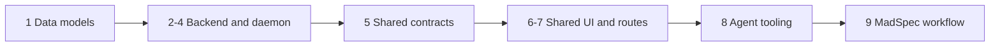

## At a glance

Standalone own-work change. Team leads, pull-request ownership and contracts are in [design.md](design.md#teams-and-pull-request-boundaries). Each team's groups form one stacked pull request; groups within that pull request are builder-sized slices. All checkboxes below are implementation work, not completed planning work.

| Kind | Name | Change | Path |
|---|---|---|---|
| Data | Owner, comment, task and wakeup subjects | changed | `server/migrations/`, `server/pkg/db/queries/`, `server/pkg/db/generated/` |
| Backend | Release APIs and coordination | new | `server/internal/handler/release_owner.go`, `server/internal/handler/release_detail.go`, `server/internal/handler/release_comment.go`, `server/internal/handler/release_wakeup.go`, `server/internal/service/release_coordination.go` |
| Runtime | Shared dispatch, claim/start and daemon execution | changed | `server/internal/service/task.go`, `server/internal/service/issue_wakeup.go`, `server/internal/handler/daemon.go`, `server/internal/daemon/`, `server/pkg/protocol/` |
| Core | API, schemas, queries and navigation | changed | `packages/core/api/`, `packages/core/releases/`, `packages/core/types/`, `packages/core/paths/paths.ts`, `packages/core/realtime/use-realtime-sync.ts` |
| UI | Release detail and discussion | new | `packages/views/releases/components/release-detail-route.tsx`, `packages/views/releases/components/release-detail.tsx`, `packages/views/releases/components/release-owner-picker.tsx`, `packages/views/releases/components/release-comments.tsx` |
| UI | Release entry points and translations | changed | `packages/views/releases/components/`, `packages/views/worklanes/components/worklane-activity.tsx`, `packages/views/locales/` |
| Route | Web release detail | new | `apps/web/app/[workspaceSlug]/(dashboard)/releases/[id]/page.tsx` |
| Route | Desktop workspace tab | changed | `apps/desktop/src/renderer/src/routes.tsx` |
| Tools | CLI and builtin platform skill | changed | `server/cmd/multica/`, `server/internal/service/builtin_skills/multica-platform/`, `server/internal/daemon/execenv/runtime_config_sections.go` |
| Docs | References and living architecture | changed | `CLI_AND_DAEMON.md`, `apps/docs/content/docs/cli.mdx`, `apps/docs/content/docs/cli.zh.mdx`, `specs/docs/system-design.md` |
| Workflow | Release-owned agent instructions | changed | `madspec:skills/madspec-releases/SKILL.md`, `madspec:skills/madspec-multica/SKILL.md` |

## 1. Data models: native release subjects

Team: data-models / Pieter. Allocate migration numbers after the maximum present at build time; each listed index gets its own single-statement concurrent up/down migration. No foreign keys, cascades or edits to accepted migrations.

- [ ] 1.1 `server/migrations/` -- add release.owner_type/owner_id with nullable-pair checks and native release_id to agent_task_queue, comment and issue_wakeup; make the latter two issue_id columns nullable with exclusive-subject checks, preserve existing non-release task variants, and allow release_coordination system rules -- one real release must be a valid subject without manufacturing an issue; prove existing rows remain valid and an invalid/mixed subject is refused with DB fixtures.
- [ ] 1.2 `server/migrations/` -- add concurrent release-comment chronological, release-wakeup lookup, unique release-system-rule and unique pending-release-task indexes, including waiting_local_directory in the pending task predicate -- concurrent comments and dispatch must retain one not-started run; prove conflicting pending inserts cannot both win while a running run allows a queued follow-up.
- [ ] 1.3 `server/cmd/migrate/main.go` -- register every concurrent index in concurrentIndexCleanups using the existing recovery convention -- interrupted creation must not leave an unusable index that blocks install.
- [ ] 1.4 `server/pkg/db/queries/release.sql` -- add owner writes, batch owner projection support, release owner-history reads and ordered release issue projection with parent, lane and GitHub/VCS PR data; reuse workspace/repository fences and line responses -- page and claim must consume one order without changing placement.
- [ ] 1.5 `server/pkg/db/queries/comment.sql` -- add release-scoped create/list/thread/ancestor/comment-by-id projections using both workspace and release predicates at every level; retain issue-specific reads and stable chronological limits -- replies cannot escape the release or disappear when their root lies outside the newest window.
- [ ] 1.6 `server/pkg/db/queries/wakeup.sql` and `server/pkg/db/queries/system_wakeup.sql` -- add release-scoped rule CRUD, dynamic-target queries, receipts/join/evidence operations, capacity accounting and delete cleanup in the existing tables -- release waits share dispatch and expiry rather than a second scheduler.
- [ ] 1.7 `server/pkg/db/queries/agent.sql` -- add release enqueue, pending evidence/comment merge with complete attribution replacement, exact delivery receipts, unstarted-task cancellation and subject-aware claim/start queries -- queued evidence is preserved and a delayed old-owner start cannot win.
- [ ] 1.8 `server/migrations/` -- extend the affected thread-root, wakeup subject/capacity and source-capture functions in new migrations; capture member release comments and every owned-release issue terminal transition transactionally using existing receipts, with custom status categories and id/revision event keys; preserve issue capture paths -- rollback, bulk status writes and automatic PR completion must not lose or duplicate coordination facts.
- [ ] 1.9 `server/pkg/db/queries/attachment.sql` and `server/pkg/db/queries/workspace_delete.sql` -- extend release-comment attachment authorization/cleanup and release-dependent teardown without adding another attachment store -- remove and workspace delete leave no orphan discussions, waits, receipts or tasks.
- [ ] 1.10 `server/pkg/db/generated/` -- regenerate through make sqlc after the SQL contract lands, retaining all nullable subject fields and scoped query results -- consuming services compile against the actual persistent contract, not hand-edited generated code.

## 2. Backend APIs: ownership and discussion

Team: backend / Joeri. Depends on group 1. Reuse existing author, membership, assignee and thread rules; release routes remain outside the client account allowlist.

- [ ] 2.1 `server/internal/handler/release_owner.go` -- implement the shared repository-locked owner write and PUT handler, presence-aware omitted/null/set pair parsing, agent/squad-only assignment validation with exact issue refusal messages, shipped refusal, unchanged-pair no-op and owner activity snapshots -- Plan/Edit/page/CLI must have the same effect without stale title/version writes.
- [ ] 2.2 `server/internal/handler/release.go` -- add batch-resolved owner type/id/name/avatar response fields and call the shared owner helper from Plan/Edit, preserving omitted fields for older clients; save owner and trigger receipt atomically before post-commit events -- no-runtime owners must save without a run, and unowned releases must keep their existing behavior.
- [ ] 2.3 `server/internal/handler/release_detail.go` -- implement detail, ordered issues and owner-activity reads using the same projection the claim consumes; include terminal lane-less issues and both PR providers -- the release page and coordinator must see the same current scope.
- [ ] 2.4 `server/internal/handler/release_comment.go` -- implement bounded comment/thread reads and member/agent writes with same-subject parent validation, source-task attribution and attachment association; capture only member comments/replies for coordination -- owner reports must not recursively wake the owner.
- [ ] 2.5 `server/internal/handler/comment.go` and `server/internal/handler/file.go` -- make shared comment DTO conversion, author-only edit/delete, attachment access and any issue post-processing explicitly branch on issue versus release; retain issue-specific trigger/mention behavior -- a nullable issue_id must not become an unguarded generic comment route or an issue lookup with an empty id.
- [ ] 2.6 `server/internal/handler/release_wakeup.go` -- implement create/list/delete for the current owner or authorized member, reusing rule authorization and schedule DTOs; permit only same-workspace other_issue predicates and at/every/cron with existing expiry/timeout/instruction options -- release waits target the current owner, not a caller-supplied agent.
- [ ] 2.7 `server/cmd/server/router.go` -- mount the detail/owner/issues/comments/activity/wakeup routes under existing workspace auth and task actor middleware, using UUID parsing and workspace-scoped release loading -- wrong-workspace ids and client credentials must remain denied.
- [ ] 2.8 `server/pkg/protocol/events.go` and `server/internal/handler/release_comment.go` -- publish release-comment invalidation only after commit and reuse release_line:updated for owner metadata/activity -- connected clients refresh without pretending a release is an issue.
- [ ] 2.9 `server/internal/handler/release_owner_test.go`, `server/internal/handler/release_comment_test.go` and `server/internal/handler/release_detail_test.go` -- add DB-backed consumer behavior cases for omitted/null/set, shipped/private/archived/member refusals, one repository-wide activity row, cross-workspace/subject parent and attachment denial, chronological complete threads and canonical issue order -- catch permission, scope and lost-reply regressions at the API boundary, not by source-text assertions.

## 3. Backend services: coordination and cleanup

Team: backend / Joeri. Depends on group 2; same backend pull request.

- [ ] 3.1 `server/internal/service/release_coordination.go` -- resolve current release owner or squad leader, ensure the native system rule, perform normal readiness/access checks, dispatch/merge durable source facts and keep existing source attribution; retain no-owner/no-runtime no-run behavior -- ownership is optional and only its current target coordinates.
- [ ] 3.2 `server/internal/service/issue_trigger.go` and `server/internal/handler/issue.go` -- extract only the shared assignee access/readiness logic needed by release dispatch while retaining all issue triage/backlog/stage semantics at their callers -- sharing validation must not impose a fake issue lifecycle on a release or change existing issue assignment.
- [ ] 3.3 `server/internal/service/issue_wakeup.go` and `server/internal/service/issue_wakeup_system.go` -- integrate release scope into existing processing, receipts, queued evidence merge, current-owner attribution and claim checks; preserve dispatched input immutability and retain late facts for a follow-up -- two member comments must coalesce without lost input or cross-user capability bleed.
- [ ] 3.4 `server/internal/service/issue_wakeup_condition.go` -- evaluate the approved release other_issue conditions through existing same-workspace loaders and scheduling machinery; use current status categories and distinguish all-successful from cancelled -- a cancelled issue must wake coordination without claiming successful completion or bypassing ship blockers.
- [ ] 3.5 `server/internal/service/task.go` -- add native release enqueue/finalize/start/requeue/terminal handling using repository-before-task lock order, existing owner-row fence and generation CAS; cancel every unstarted former-owner task and preserve running tasks -- owner replacement/removal, including A-to-B-to-A, cannot launch stale work.
- [ ] 3.6 `server/internal/handler/release_ship.go` and `server/internal/handler/release.go` -- clear release waits/receipts and cancel unstarted runs within ship/remove transactions; delete removed release discussions and attachments while preserving the running shipper's final report on a shipped release -- no later receipt or delayed claim may restart coordination.
- [ ] 3.7 `server/internal/handler/repository.go`, `server/internal/handler/project.go`, `server/internal/handler/agent.go` and `server/internal/handler/squad.go` -- apply release-dependent cleanup before repository/project deletion and clear owner references on owner deletion; preserve archived-owner readiness semantics and current squad-leader resolution -- soft references cannot enqueue against a deleted owner or release.
- [ ] 3.8 `server/internal/service/task.go` and `server/internal/handler/daemon.go` -- reconcile explicit source-task release reports and persist an actual nonempty final result once when no report exists, inside the winning terminal transition; retain reply context and surface real failures through existing failure handling -- completion replay must neither duplicate a report nor fabricate success, and a removed release must not be recreated.
- [ ] 3.9 `server/internal/service/release_coordination_test.go` -- add deterministic DB-backed cases for each terminal issue event, custom done/closed, last-successful versus cancelled, owner/squad readiness, current-owner timed/condition waits, queued merge and post-claim facts -- these are the canonical dispatch/condition behavior cases.
- [ ] 3.10 `server/internal/service/release_coordination_race_test.go` -- exercise owner change/start, squad leader replacement/claim, comment merge/claim, issue terminal capture/ship, remove/dispatch and teardown/enqueue races with controlled transaction barriers; also test source rollback and terminal callback replay -- prove lock order and delivery invariants rather than relying on timing sleeps.

## 4. Backend runtime: release claim and execution

Team: backend / Joeri. Depends on group 3; same backend pull request.

- [ ] 4.1 `server/internal/handler/daemon.go` and `server/internal/daemon/types.go` -- add explicit native release claim fields and hydrate release/repository/project, ordered issues, PRs, source actors, trigger reasons and delivered comment ids before quick-create branches; preserve task token and MCP authorization and questions-disabled claim state -- a release run must launch with real context, not an empty issue or fake quick-create request.
- [ ] 4.2 `server/pkg/protocol/messages.go`, `server/internal/daemon/daemon.go` and `server/internal/service/task.go` -- negotiate a release-coordination capability and filter/reject unsupported daemon claims in both batch and single-runtime paths; enforce current-owner/existence/shipped checks again in both legacy and generation-aware start handlers -- an installed older daemon must not launch a release as a quick-create task.
- [ ] 4.3 `server/internal/handler/squad_briefing.go` -- factor the shared roster/skills/instructions presentation and add release leader guidance without issue evaluation/status-completion rules -- only the current squad leader receives the coordination brief.
- [ ] 4.4 `server/internal/daemon/prompt.go` and `server/internal/daemon/execenv/runtime_config.go` -- add release input/prompt branches with fixed-scope/gate instructions, bounded source facts and exact comment receipts while preserving selected agent instructions and isolated task-directory behavior -- repository checkout remains on demand and no issue/worklane branch is borrowed.
- [ ] 4.5 `server/internal/daemon/execenv/runtime_config_kind.go` and `server/internal/daemon/execenv/runtime_config_sections.go` -- select release-specific workflow/result surface instead of issue status/parent workflow, referencing the release commands implemented in group 8; keep generated runtime markers and issue/chat/autopilot sections intact -- a release turn must post to its release, not mutate the feature issue's status.
- [ ] 4.6 `server/internal/handler/release_claim_test.go` and `server/internal/daemon/prompt_test.go` -- extend existing fake-runtime behavioral coverage for claimed release identity/order/reasons, squad leader only, stale/unsupported starts, and explicit-versus-terminal report deduplication; preserve issue/chat/autopilot cases -- inspect the consumed claim/prompt and stored report rather than pinning generated prose.
- [ ] 4.7 `specs/docs/system-design.md` -- update the server/daemon models, component relations and release input/report flow from the completed backend -- the living architecture must describe actual code while retaining untouched containers.

## 5. Shared packages: release data and navigation contracts

Team: shared-packages / Pieter. Depends on backend groups 2-4.

- [ ] 5.1 `packages/core/types/release.ts`, `packages/core/types/event.ts` and `packages/core/api/schemas.ts` -- define the nullable owner projection, release issue/comment/activity response contracts and comment event; parse every added UI response with parseWithFallback, defaulting unknown/missing/malformed owner data without discarding the release -- installed clients and newer servers must keep readable releases.
- [ ] 5.2 `packages/core/api/client.ts` -- add typed detail/owner/issues/comments/activity/wakeup calls with schema parsing and current workspace headers; leave issue response contracts intact -- release callers must not cast server JSON or call issue endpoints with release ids.
- [ ] 5.3 `packages/core/releases/queries.ts` and `packages/core/releases/mutations.ts` -- add workspace-scoped detail/issues/comments/activity keys, awaited owner writes that settle the whole line, and pending/retry comment mutations; preserve existing release refusal handling and owner omission in old edit callers -- saving one owner must not overwrite unrelated release fields or silently lose a failed message.
- [ ] 5.4 `packages/core/releases/overview.ts` and `packages/core/paths/paths.ts` -- expose releaseDetail(id) and reuse the existing first-holding-worklane-else-main target for the detail page; retain organisation/project ordering and counts -- navigation changes destination without introducing another overview or order rule.
- [ ] 5.5 `packages/core/realtime/use-realtime-sync.ts` and `packages/core/releases/index.ts` -- invalidate release detail/discussion/activity on the correct release events and issue projections on status/placement/PR changes, including previous release placement; export only the needed release APIs -- web and desktop must remain live without another server-data store.
- [ ] 5.6 `packages/core/releases/queries.test.ts`, `packages/core/releases/overview.test.ts` and `packages/core/api/schemas.test.ts` -- add malformed/missing-owner preservation, independent-workspace cache and first-holding-lane/fallback behavior cases using existing test conventions; remove any obsolete row-to-Timeline-only assertion rather than duplicating coverage -- test consumer-visible compatibility and selection boundaries, not forwarded request bytes.

## 6. Frontend: shared release page and owner controls

Team: frontend / Thomas. Depends on group 5. Read existing Button/Dialog contracts before changes. Use existing semantic tokens, AgentPicker/assignee permission patterns and comment presentation, with no store definitions in views.

- [ ] 6.1 `packages/views/releases/components/release-owner-picker.tsx` -- implement the one reusable agent/squad-only picker with No owner, assignability rules and ActorAvatar presentation -- Plan/Edit/detail must offer the same allowed owner set and preserve accessible names.
- [ ] 6.2 `packages/views/releases/components/release-dialog.tsx` -- wire Owner into Plan and Edit, default No owner/current owner respectively and send the presence-aware pair on save; preserve current version/bump preview and refusal UI -- adding an owner must not change line policy or old dialog behavior.
- [ ] 6.3 `packages/views/releases/components/release-detail.tsx` -- compose repository/version/title/state/date/description, inline unshipped owner control, canonical ordered issue rows with assignee/lane and issue links, required empty copy and Open on Timeline -- the complete release scope is readable without extra edit/move/ship/add-issue controls.
- [ ] 6.4 `packages/views/releases/components/release-comments.tsx` -- show bounded complete threads, markdown, author/time, owner activity in root chronological order and pending/retry comment/reply inputs using release queries/mutations; reuse display primitives without issue-specific API wiring -- member replies must appear under their root and preserve text on send failure.
- [ ] 6.5 `packages/views/releases/components/release-detail-route.tsx` and `packages/views/releases/index.ts` -- load release data under existing workspace/dashboard providers and render loading/not-found/error recovery through the shared page -- both app shells consume one business screen.
- [ ] 6.6 `packages/views/releases/components/release-row.tsx` and `packages/views/releases/components/release-column.tsx` -- show owner name/avatar and link row/version/title to releaseDetail while retaining independent row menus and organisation/project links -- the approved entry points now open the release page without click propagation regressions.
- [ ] 6.7 `packages/views/worklanes/components/worklane-activity.tsx`, `packages/views/locales/en/releases.json` and `packages/views/locales/zh-Hans/releases.json` -- add translated owner/page/discussion strings and exact set/change/remove activity templates, sharing their formatting with the release page -- one historical change must display the right actor, names and time on every eligible lane.
- [ ] 6.8 `packages/views/releases/components/release-detail.test.tsx` and `packages/views/releases/components/release-dialog.test.tsx` -- cover shipped read-only versus unshipped picker, agents/squads but no members, ordered issue links, thread replies/send failure recovery and row/Timeline/detail navigation through the shared navigation mock -- tests own UI behavior, not source text or mocked forwarding.

## 7. Frontend: web and desktop routes

Team: frontend / Thomas. Depends on group 6; same frontend pull request.

- [ ] 7.1 `apps/web/app/[workspaceSlug]/(dashboard)/releases/[id]/page.tsx` -- mount the shared release detail route under the existing dashboard layout -- a direct release URL must open in the right workspace and follow existing guards.
- [ ] 7.2 `apps/desktop/src/renderer/src/routes.tsx` -- add releases/:id as a workspace tab destination using the shared route and existing navigation adapter -- opening a release must preserve desktop workspace/tab routing rather than use an overlay or direct router import in views.
- [ ] 7.3 `specs/docs/system-design.md` -- update the web/desktop entry points, shared release screen and core API/query relations from the implemented feature -- retain the existing mobile boundary and unchanged overview architecture.

## 8. Agent tools: release CLI and runtime help

Team: agent-tools / Pieter. Depends on the preceding Multica contracts. Keep CLI command behavior in the existing command tree, with focused new files where the release subtrees need them.

- [ ] 8.1 `server/cmd/multica/cmd_release.go` -- add nullable owner fields to get/list and assignment via --to or --unassign using the existing agent/squad resolver; preserve ambiguity handling and errors, never resolve members -- agents and people must assign the same owner as the app without replaying a stale full edit.
- [ ] 8.2 `server/cmd/multica/cmd_release_comment.go` -- add release comment list/add with content-file/stdin conventions, parent replies, attachments and bounded roots/thread/since flags using existing comment CLI helpers -- a release run can inspect relevant history and post its real result through the supported surface.
- [ ] 8.3 `server/cmd/multica/cmd_issue_wakeup.go` and `server/cmd/multica/cmd_release_wakeup.go` -- share only existing schedule/condition argument parsing needed for release wakeup create/list/delete, preserving expiry/timeout/instruction flags and same-workspace issue resolution; keep issue-only commands and validation unchanged -- owner waits operate on the release with no proxy issue.
- [ ] 8.4 `server/internal/service/builtin_skills/multica-platform/SKILL.md`, `server/internal/service/builtin_skills/multica-platform/references/releases.md` and `server/internal/service/builtin_skills.go` -- route release ownership/coordination to one release reference covering bounded comments, dynamic-owner waits, fixed scope and explicit ship; include the reference in the existing builtin bundle and preserve question-free variants -- release guidance must be discoverable in the actual installed skill, not an unused local copy.
- [ ] 8.5 `server/internal/daemon/execenv/runtime_config_sections.go` and `server/cmd/multica/cmd_release_test.go` -- complete release command examples/result instructions against the actual CLI and add behavioral resolver ambiguity/wrong-kind/cross-workspace thread failure cases; exercise the command against the fake API/runtime rather than testing copied help prose -- the launched owner must have usable release commands and recovery messages.
- [ ] 8.6 `CLI_AND_DAEMON.md`, `apps/docs/content/docs/cli.mdx` and `apps/docs/content/docs/cli.zh.mdx` -- document owner fields, assignment, bounded release comments/replies and supported release wakeups with explicit shipment semantics -- command users in both supported documentation languages must see the same actual contract.

## 9. Product instructions: release-owned workflow

Team: product / Mitchel. Depends on group 8. `madspec:` paths refer to `~/Repos/Ventures/madspec`; change these in that repository's own task worktree and product-team pull request, not by writing outside the Multica issue worktree. Existing approved scope includes these two skills.

- [ ] 9.1 `madspec:skills/madspec-multica/SKILL.md` -- extend Releases with optional agent/squad ownership, native release reports and waits, and point to the existing release workflow for gates/publication; scope the issue-only Task handoff rule so it does not manufacture an issue for release coordination -- the planner and owner must agree on the real release as the coordination surface.
- [ ] 9.2 `madspec:skills/madspec-releases/SKILL.md` -- add the release-owned coordination entry branch: inspect the ordered fixed issues, start/wake their existing assignees according to the existing work flow, wait on unmet prerequisites and report/reply on the release; preserve scope/order/version/placement ahead of generic collect/add-issues/version selection and retain applicable Brian passes plus existing publication/ship commands -- the assigned owner must carry the whole approved workflow rather than merely wait for all issues to end.

## Implementation Notes

## Plan Change Log
