## At a glance

```mermaid
flowchart LR
  classDef new fill:#d9f2d9,stroke:#2e7d32,color:#172117
  classDef changed fill:#fff1cc,stroke:#b7791f,color:#172117
  Done[Issues done and merged]:::changed --> Main[On main]:::new
  Main --> Staging[Tested on staging, commit named]:::new
  Staging --> BetaConsent[Consent for beta]:::new
  BetaConsent --> BetaStart[Beta started by hand]:::new
  BetaStart --> ProdConsent[Consent for production]:::new
  Staging -. repository without beta .-> ProdConsent
  ProdConsent --> ProdStart[Production started by hand]:::new
  ProdStart --> Shipped[Shipped, live on production]:::changed
```

Each arrow is a gate Multica checks. Nothing moves a release along by itself: a merge, a passed test or an earlier phase never stands in for a consent.

| Kind | Name | Change | Path |
|---|---|---|---|
| Release rule | Phase order, records and refusals | new | `server/internal/releaseline/` |
| Endpoint | Release ship and the phase records | changed | `server/internal/handler/release_ship.go` |
| Data | Phase, staging test, consent and start records of a release | new | `server/migrations/` |
| Data | Beta environment of a repository | new | `server/migrations/` |
| CLI | `multica release` phase commands and `release ship` | changed | `server/cmd/multica/cmd_release.go` |
| Screen | Release page phases | changed | `packages/views/releases/components/release-detail.tsx` |
| Screen | Plan and Edit release text on what happens next | changed | `packages/views/releases/components/release-dialog.tsx`, `packages/views/locales/` |
| Screen | Release menu on a release on main | changed | `packages/views/releases/components/release-menu.tsx` |
| Screen | Beta environment in Edit repository | changed | `packages/views/` |
| Agent instructions | Built-in releases reference | changed | `server/internal/service/builtin_skills/multica-platform/references/releases.md` |
| Agent instructions | Runtime release brief | changed | `server/internal/daemon/execenv/runtime_config_sections.go` |
| Agent instructions | Release procedure of the agents | changed | `appboypov/work`: `skills/das-releases/SKILL.md`, `skills/das-releases/references/plx-commands.md`, `skills/our-git-conventions/SKILL.md`, `skills/our-workcycle-conventions/SKILL.md`, `skills/our-workphase-conventions/SKILL.md`, `skills/das-planning/SKILL.md`; `appboypov/madspec`: `skills/madspec/help/next-steps.md` |

## Why

A release in Multica has one step today: `release ship` marks it shipped once its issues are done and merged. Nothing separates the merge into `main` from a beta or production deployment, and the Plan release dialog even promises that Multica publishes the GitHub release, which for MultiChannable starts a production deployment. MultiChannable's beta shares the production database and its beta workflow runs migrations on it, so an unplanned beta deployment changes production data. Brian set on 20 October 2026 that every project releases in three phases, with a staging test first and every deployment started by hand only after explicit consent of the client or user. All other work in the workspace is paused until this change is merged and built.

Success signal: for MultiChannable 0.22.3, Multica shows the release on `main`, refuses to start beta until a staging test of the candidate commit and the client's consent for beta are recorded, and refuses production until beta started and a separate consent for production is recorded.

## What Changes

- A release goes through three phases in order: on `main`, then beta when its repository has a beta environment, then production. Getting on `main` starts no deployment.
- A release on `main` is tested on staging before any deployment. The staging test names the tested commit.
- Beta and production each need their own recorded consent of the client or user, for the staging-tested commit, and their own start by hand. A merge, a passed test, a staging test or an earlier phase never records a consent.
- A repository says whether it has a beta environment. Without one, only the beta phase is left out.
- Each phase follows the line: a release reaches a phase only once every release before it on the line reached it.
- A release on `main` keeps its version and its place on the line.
- `release ship` marks a release shipped only after its production start; its issue and pull request checks move to getting on `main`.
- The release page shows per phase what is reached and what is still needed, the needed consents included.
- Plan release and Edit release say what happens next, without the promise that Multica tags, writes the note and publishes the GitHub release. **BREAKING** for the dialog text only.
- The built-in releases reference and the runtime release brief state these rules. The release procedure of the agents in `appboypov/work` and `appboypov/madspec` states them too; that part lands through `madspec-update` in those repositories.

## Capabilities

### New Capabilities

- `release-phases`: lets Brian and his agents take a release from `main` through an optional beta to production, each deployment started by hand after a staging test and its own consent.
- `release-instructions`: lets every agent that works on a release read the phase rules in the instructions Multica gives it.

### Modified Capabilities

- `release-page`: the page shows each phase, what it reached and what it still needs.
- `plan-release`: the dialog says what happens after the merge without promising a publication.
- `release-coordination`: the platform and coordination runs never record a phase, a staging test, a consent or a start by themselves.
- `edit-release`: a release on `main` no longer offers Move earlier, Move later and Remove release, and keeps its version.

## Impact

The release rule in `server/internal/releaseline`, the ship handler and new phase handlers, a migration for the phase records and the repository's beta environment, the `multica release` commands, the release page, the release and repository dialogs, the release menu, the built-in releases reference, the runtime release brief, and their unit tests. Outside the fork: the release skills named in At a glance.

## Constraints

- No deployment starts automatically: not on a merge, a tag, a passed test, a staging test, a coordination run or an earlier phase.
- Every consent is for one phase and one commit; another commit needs a new staging test and new consent.
- Beta is never treated as an isolated test environment: its consent covers its effects on shared production resources.
- Existing gates of clients and Brian stay as they are; this change adds gates and removes none.
- AGENTS.md rules hold: no foreign keys, concurrent indexes in their own migration, zod schemas with `parseWithFallback` at the API boundary.

## Non-goals

- No staging environment set-up or staging deployment by Multica.
- No rollback of a deployment.
- No change to the Timeline and Releases labels "Next release" and "Planned".
- No approval of the MultiChannable 0.22.3 beta or of any other client deployment.

## Decisions

- The beta environment is a setting of the repository, not of the project: a release belongs to one repository, and the repository is what gets deployed.
- Getting on `main` is recorded explicitly, after the merge or right away when every issue is already on `main`: Multica does not see release branches, and the issue and pull request checks of `release ship` are also the checks of this record.
- A production deployment keeps two records: its start by hand, the gate before the deployment runs, and `release ship` once it is live, so the shipped date stays the date production went live.
- A release on `main` keeps its version and place, because its version is already in the release files on `main`.
- A staging test is recorded only for a release on `main`, so the tested commit is the code that beta and production get.

## Open Questions

Asked of Brian on WORK-2006; the spec deltas leave these out until he answers:

- Who may record a consent: only Brian on the release page, or also an agent with a link to the client's written agreement.
- Who may start a beta or production deployment once its consent is recorded: an agent by hand, or only Brian.
- Whether Multica only checks and records a start, with the repository's own workflow deploying, or also runs the deployment from a deploy command per repository.
- Who may record a staging test: the agent or person who ran it, or only Brian.

## Sources

- WORK-2006 with its handoff and context exports.
- Brian's comment `01a159d0-d73f-742e-a6ad-b78e01930059` on WORK-2002, 20 October 2026.
- WORK-2002: MultiChannable's beta shares the production database, its `v*-beta` tag workflow runs migrations, and a published GitHub Release deploys production.
- `server/internal/handler/release_ship.go`, `server/internal/releaseline/line.go`, `server/pkg/db/queries/release.sql`, `packages/views/locales/en/releases.json`.
- `server/internal/service/builtin_skills/multica-platform/references/releases.md`, `server/internal/daemon/execenv/runtime_config_sections.go`.
- `~/.agents/skills/das-releases/SKILL.md` "Release" steps 8 to 12.
