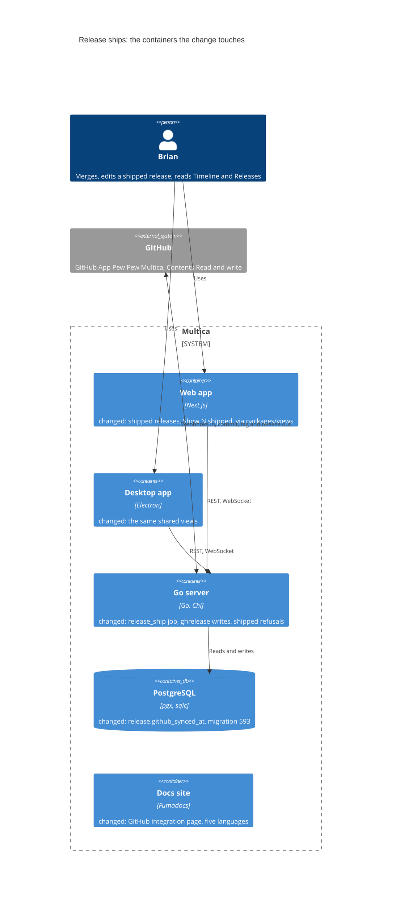
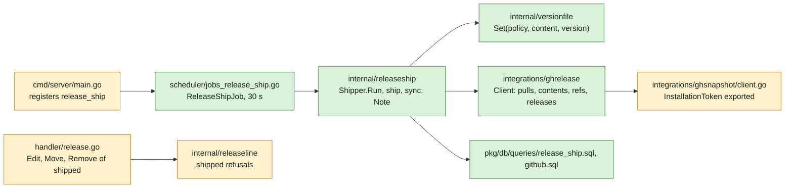
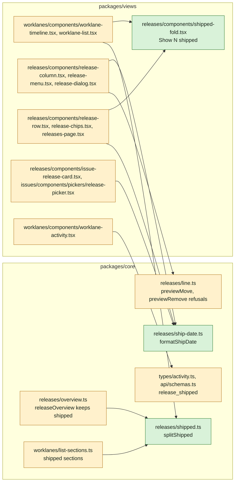
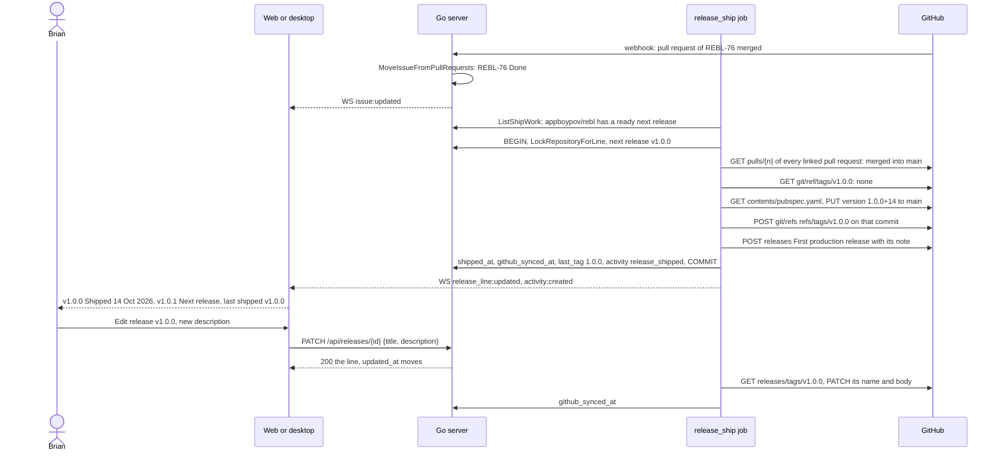

## At a glance

The delta of this change on the living system design, `specs/docs/system-design.md`, on top of UJ-7 `worklanes-and-releases-pages` (DAS-461). GitHub turns from read only into a system Multica writes to, through the GitHub App. The change adds one column, one migration, one scheduled job and three server packages. The daemon, the CLI and the mobile app do not change.

Go server component map, delta:

Web and desktop component map, delta. Every file is shared in `packages/`, so both apps get it without a route change:

Models, delta. `release` gains one column. Nothing else in the schema changes:

```mermaid
classDiagram
  class release {
    +uuid id
    +uuid workspace_id
    +uuid repository_id
    +int position
    +text version
    +text bump
    +text title
    +text description
    +timestamptz shipped_at
    +timestamptz github_synced_at
    +timestamptz updated_at
  }
  class repository {
    +uuid id
    +text full_name
    +text default_branch
    +text version_policy
    +text last_tag
  }
  class github_installation {
    +uuid workspace_id
    +bigint installation_id
    +text account_login
  }
  class activity_log {
    +uuid repository_id
    +uuid worklane_id
    +text actor_type
    +text action
    +jsonb details
  }
  repository "1" --> "*" release : repository_id
  repository "1" --> "*" activity_log : repository_id, release_shipped
  github_installation ..> repository : account_login is the owner of full_name
```

`release.github_synced_at` is new: the time the GitHub release last got the release's title and note. `shipped_at`, set at the ship, is the ship date everywhere. `repository.last_tag` is set to the shipped version. The activity entry is a repository-wide row (`worklane_id` NULL), so every worklane shows it (ADR-0008, ADR-0011).

Journey sequence and data flow:

| Kind | Name | Change | Path |
|---|---|---|---|
| Migration | `release.github_synced_at` | new | `server/migrations/593_release_github_sync.up.sql`, `.down.sql` |
| Queries | `ListShipWork`, `GetNextRelease`, `ListReleaseIssues`, `ListReleasePullRequests`, `MarkReleaseShipped`, `MarkReleaseSynced`, `ListShippedReleasesToSync` | new | `server/pkg/db/queries/release_ship.sql` |
| Queries | `GetGitHubInstallationByAccountLogin` | new | `server/pkg/db/queries/github.sql` |
| Generated | sqlc output | changed | `server/pkg/db/generated/` |
| Package | Version file writer | new | `server/internal/versionfile/` |
| Integration | GitHub writes through the App | new | `server/internal/integrations/ghrelease/` |
| Integration | `InstallationToken` and `APIBase()` exported, `GITHUB_API_URL` | changed | `server/internal/integrations/ghsnapshot/client.go`, `.env.example` |
| Service | Shipping and GitHub release sync | new | `server/internal/releaseship/` |
| Job | `release_ship` | new | `server/internal/scheduler/jobs_release_ship.go`, `server/cmd/server/main.go` |
| Package | Shipped refusals on the line | changed | `server/internal/releaseline/`, `testdata/cases.json` |
| Endpoint | Edit, move and remove of a shipped release | changed | `server/internal/handler/release.go` |
| Types | Activity action `release_shipped` | changed | `packages/core/types/activity.ts`, `packages/core/api/schemas.ts` |
| Helpers | `splitShipped`, `formatShipDate`, shipped refusals, overview and list sections | new, changed | `packages/core/releases/`, `packages/core/worklanes/list-sections.ts` |
| Component | "Show {N} shipped" | new | `packages/views/releases/components/shipped-fold.tsx` |
| Component | Shipped column, menu, dialog, row, chips, card, picker | changed | `packages/views/releases/components/`, `packages/views/issues/components/pickers/release-picker.tsx` |
| Section | Timeline, List, activity entry | changed | `packages/views/worklanes/components/` |
| Page | Releases with shipped releases | changed | `packages/views/releases/components/releases-page.tsx` |
| Copy | Five languages | changed | `packages/views/locales/{en,zh-Hans,ko,ja,fr}/` |
| Docs | Contents Read and write, release shipping | changed | `apps/docs/content/docs/github-integration.mdx` and its four translations |
| ADR | ADR-0017: A release ships from a server job that redoes only what GitHub lacks | new | `adr/0017-a-release-ships-from-a-server-job-that-redoes-only-what-github-lacks.md` |
| ADR | ADR-0018: Multica writes to GitHub through the installation of the repository's owner | new | `adr/0018-multica-writes-to-github-through-the-installation-of-the-repositorys-owner.md` |

## Context

Journey UJ-8 of [PRD: Multica: steer projects, repositories, worklanes and releases](anytype://object?objectId=bafyreiew63xw2dncss52jdx4qk4o6aktkklhqroclvs3cvjxcyztx7h5um), F8 with FR-65 to FR-68, FR-37, FR-41 and FR-81. It is the last journey. It builds on every earlier change, each on its own branch:

- UJ-7 `worklanes-and-releases-pages` (DAS-461): `releaseOverview` in `packages/core/releases/overview.ts`, built in the client from the workspace's lists in Projects' order (ADR-0016), `release-row.tsx`, `GET /api/release-progress` `releases` with totals over every issue of a release, `worklane-tree-row.tsx` and `work-tree.tsx`.
- UJ-6 `worklane-board-and-list` (DAS-459): `issue.done_at` and `trg_issue_done_at` (ADR-0015), the release chip `issue-release-chip.tsx` with a shipped colour from `lineStates`, `issue-peek-summary.tsx`, `listSections` and `worklane-list.tsx`.
- UJ-5 `issues-from-templates` (DAS-456): `issue.release_id` placed through `PUT /api/issues/{id}/placement` under the repository's lock (ADR-0013), which already refuses a shipped release with 409 `release_shipped` and already lets an issue leave one (FR-41), `release-picker.tsx`, `issue-release-card.tsx`, and "+ Add issue to release" only on unshipped columns.
- UJ-4 `release-line-of-a-repository` (DAS-455): the `release` table with `shipped_at`, always NULL until now, `repository.last_tag`, `LockRepositoryForLine`, the pure `server/internal/releaseline` with its shared `testdata/cases.json` and its TypeScript port `packages/core/releases/line.ts`, `release-column.tsx`, `release-menu.tsx`, `release-dialog.tsx`, `release-chips.tsx`, the header "last shipped v{version}" or "nothing shipped yet" in `worklane-page.tsx`, and repository-wide release activity (ADR-0010, ADR-0011).
- UJ-3 `worklanes-of-a-repository` (DAS-452): worklane activity in `activity_log` (ADR-0008) and `worklane-activity.tsx`.
- UJ-2 `repositories-of-a-project` (DAS-451): `repository.full_name`, `default_branch` and `version_policy` (`pubspec.yaml`, `Cargo.toml`, `pyproject.toml`, `package.json`, `tags`, `none`), with the tag pattern `v{version}`.

**Current code.** The GitHub App only reads. `ghsnapshot.Client` signs the App JWT and caches installation tokens (`installationToken`, unexported). `handler/github.go` mints a fresh token per request to list repositories. `github_installation` maps a workspace to an installation, with `account_login`. `github_pull_request` holds `repo_owner`, `repo_name`, `number`, `state` and `merged_at`, but no base branch. `issue_pull_request` links them to issues. `MoveIssueFromPullRequests` in `pr_auto_complete.go` moves an issue once all its linked pull requests merge. Issue statuses resolve to lifecycle categories in `server/internal/issuestatus`: "Done" is every status in the category `done`, the built-in `done` and custom ones. The scheduler in `server/internal/scheduler` runs leased jobs on a 30 second tick (`IssueWakeupJob` is the model). The App "Pew Pew Multica" has Contents Read-only today.

**Design and prototype.** Screen 3's rail (approved 12 October 2026) shows the last shipped release, then the next and the planned ones. Screens 3b, 4d and 8 to 8c show the shipped states. The pass in screens 8 to 8c and in `ReleaseDialog`'s note in the prototype's `creation.tsx` is superseded: a release ships without a pass. The prototype has no "Show {N} shipped" fold, and dates a shipped release from its issues' done days (`shipDate`). Here the ship date is the release's `shipped_at`, the moment it shipped.

**Journey steps.** The investigation finds nothing to build for three steps, and no `Keep:` Request names them. Each gets its `Skip:` Request once the journey exists in the brain:
- `Skip: J1` Project structure: no new container, app or workspace package. The new Go packages sit in `server/internal/`, and the new files in `packages/core/releases/` and `packages/views/releases/` from UJ-4.
- `Skip: J4` Design system: no new token. Shipped uses the library's `Release/Shipped` chip and its colours from UJ-4.
- `Skip: J10` Agent tooling for UI: shipping and editing releases from the CLI are non-goals, and `multica issue update --release none` already takes an issue out of a shipped release.

The steps with work are J2, J3, J5, J6, J7, J8, J9 and J11.

**What must not change.** A planned release's rules, versions and renumbering. Placement rules and refusals. Pull request linking and the merge rule of `pr_auto_complete.go`. The snapshot refresh. The worklane header's text, which UJ-4 already words "last shipped v{version}".

**Living system design.** `specs/docs/system-design.md` matches `main` at `df732b035`. It changes when this change's code merges, as with UJ-1 to UJ-7: GitHub becomes written to, the job and packages join the Go server map, and `release` gains its column.

## Goals / Non-Goals

**Goals:**

- A repository's next release ships by itself once it holds an issue, all its issues are Done and all their linked pull requests are merged into the default branch, as the `release-shipping` spec delta says: version commit, tag, GitHub release, ship date, Next release moving on, activity entry.
- The last shipped release with its ship date on the Timeline, List, worklane rows, New issue, chips and the issue page, older ones behind "Show {N} shipped", as `shipped-release-display` says.
- A shipped release's title and description editable and reaching GitHub, its version, place and intake fixed, as `shipped-release-edits` says.
- Releases with the last shipped release first and the older ones folded, counts over every release, as `releases-page-shipped` says.

**Non-Goals:**

- A pass, a "Ship now" button, shipping a release other than the next one, or shipping from the CLI.
- A changelog file, store builds and build numbers: Codemagic does those.
- A failure state for shipping in the UI. The release stays Next release until the job succeeds.
- A base branch column on pull requests.
- Squads, dark mode and the mobile app.

**Always:**

- No foreign keys or cascades.
- UI JSON through zod with `parseWithFallback`, with malformed-response tests.
- Shared logic in `packages/core` and `packages/views`, for web and desktop alike.
- Every GitHub step checks GitHub first and is skipped when GitHub has it.

**Never:**

- Ship outside the `release_ship` job.
- Change a shipped release's version, tag or place.
- Write to GitHub with anything but the App's installation token of the repository's owner.
- Hold a decision about Done in the client.

## Decisions

### 1. One job ships, under the repository's lock (ADR-0017)

`ReleaseShipJob(shipper)` in `server/internal/scheduler/jobs_release_ship.go`, modelled on `IssueWakeupJob`: name `release_ship`, cadence 30 s, `CatchUpLatestOnly`, `RunTimeout` 5 min, `StaleTimeout` 6 min, `MaxAttempts` 1, global scope. `main.go` registers it beside the other jobs with a `releaseship.Shipper` built from the pool, the queries, the `ghrelease.Client` and the event bus. The handler calls `releaseship.Shipper.Run(ctx)`.

`Run` reads `ListShipWork`: one row per repository that has either

- a ship candidate: the first release by `position` with `shipped_at IS NULL` holds at least one issue (`issue.release_id`), every such issue's status is in the category `done` of its workspace (the built-in `done` and every `issue_status` row with that category), every GitHub pull request linked to them (`issue_pull_request` to `github_pull_request`) has `state = 'merged'`, no VCS pull request is linked to them, and `repository.version_policy <> 'none'`, or
- a shipped release with `github_synced_at IS NULL OR github_synced_at < updated_at`.

For each repository, in `full_name` order, `Run` calls `ship(repositoryID)` until it ships nothing, then `sync(repositoryID)`. A failure is logged as `release ship failed` with the workspace, repository, version, step and error, and `Run` goes on with the next repository. `Run` returns nil, so the scheduler keeps its cadence.

`ship(repositoryID)`, in one transaction:

1. `LockRepositoryForLine`, then `GetNextRelease`: the first unshipped release by position with its issue count. No release, no issue or `version_policy = 'none'`: return.
2. `ListReleaseIssues`: every issue with the release, with its status, type, identifier and title. One not in a Done status: return.
3. `ListReleasePullRequests`: every pull request linked to those issues. A VCS one, or a GitHub one not `merged`: return. For each GitHub one, `ghrelease.PullRequest`: it must be merged, its base repository must be `repository.full_name` (case-insensitive) and its base branch `repository.default_branch`. One that is not: return.
4. Steps on GitHub, each only when GitHub lacks it (decision 3).
5. `MarkReleaseShipped`: `shipped_at = now()`, `github_synced_at = now()`, `updated_at = now()`. `SetRepositoryLastTag` to the version. `CreateRepositoryActivity` with the action `release_shipped` (decision 5).
6. `COMMIT`, then publish `release_line:updated` `{repository_id}` and `activity:created` to the workspace, as release writes do.

Holding the lock across the GitHub calls is the point: the release's version, title and place cannot change between deciding and shipping. Each call has the client's 20 s timeout.

"The next release is the first unshipped one" is UJ-4's rule. Planning, moving or removing releases, placing issues and changing statuses need no hook. The next run sees the new state.

### 2. The merge into the default branch is confirmed on GitHub

`github_pull_request` has no base branch, and pull requests merged before this change will never send another webhook to fill one. So the database narrows the candidates with `state = 'merged'`, and `ship` asks GitHub for each linked pull request: `GET /repos/{owner}/{name}/pulls/{number}`, read `merged`, `base.ref` and `base.repo.full_name`. The calls happen only for a release whose issues are all Done and whose pull requests are all merged, so a run makes them rarely. A pull request of another repository, or one merged into another branch, keeps the release waiting, as the spec's words "merged into the repository's default branch" say.

### 3. Version commit, tag and GitHub release (ADR-0017, ADR-0018)

`server/internal/integrations/ghrelease.Client` is the only writer. It is built from `ghsnapshot.Client`, whose `installationToken` becomes the exported `InstallationToken(ctx, installationID)`, so both share one token cache, and whose `APIBase()` gives the base URL. `ghsnapshot.NewClientFromEnv` reads that base from `GITHUB_API_URL`, default `https://api.github.com`, so the token mint and every write go to the same GitHub, and the acceptance test can point both at a fake one. Requests carry `setGitHubAPIHeaders`' headers. Methods, each taking the installation id, owner and name:

| Method | GitHub call |
|---|---|
| `PullRequest(n)` | `GET /repos/{o}/{r}/pulls/{n}` |
| `TagRef(tag)` | `GET /repos/{o}/{r}/git/ref/tags/{tag}`, 404 is "none" |
| `BranchHead(branch)` | `GET /repos/{o}/{r}/git/ref/heads/{branch}` |
| `File(path, branch)` | `GET /repos/{o}/{r}/contents/{path}?ref={branch}`, decoded, with its blob sha |
| `PutFile(path, branch, content, sha, message)` | `PUT /repos/{o}/{r}/contents/{path}`, answers the commit sha |
| `CreateTag(tag, sha)` | `POST /repos/{o}/{r}/git/refs` `{ref: refs/tags/{tag}, sha}` |
| `ReleaseByTag(tag)` | `GET /repos/{o}/{r}/releases/tags/{tag}`, 404 is "none" |
| `CreateRelease(tag, name, body)` | `POST /repos/{o}/{r}/releases` `{tag_name, name, body}` |
| `UpdateRelease(id, name, body)` | `PATCH /repos/{o}/{r}/releases/{id}` `{name, body}` |

The installation is `GetGitHubInstallationByAccountLogin(workspace_id, owner)`, case-insensitive on `account_login`. None is a failed step "no installation for {owner}".

The steps, for tag `v{version}`:

1. `TagRef`. The tag exists: go to 4.
2. "Tags only" (`tags`): `BranchHead(default_branch)` gives the sha. Go to 3.
   A version file policy: `File(policy file, default_branch)`, then `versionfile.Set(policy, content, version)`. When the content already holds the version, the sha is `BranchHead(default_branch)`. Otherwise `PutFile` with the message `chore(release): v{version}` gives the sha.
3. `CreateTag(v{version}, sha)`.
4. `ReleaseByTag`. None: `CreateRelease(v{version}, title, Note(release))`, and keep its id for the log.

The file per policy: `pubspec.yaml`, `Cargo.toml`, `pyproject.toml` and `package.json` at the repository root, as UJ-2's checkout check reads them.

`server/internal/versionfile.Set(policy, content, version) (string, error)` is pure. It changes the version only and keeps everything else byte for byte, also a build part after `+`:

| Policy | The version it changes |
|---|---|
| `pubspec.yaml` | the top-level `version:` line, `1.0.0+14` keeps `+14` |
| `package.json` | the first top-level `"version": "..."` |
| `Cargo.toml` | `version = "..."` in `[package]` |
| `pyproject.toml` | `version = "..."` in `[project]`, else in `[tool.poetry]` |

No version line is an error naming the file. `Has(policy, content, version)` answers whether the content already holds the version, ignoring the build part.

`releaseship.Note(description, issues)`: the trimmed description when it is not empty. Otherwise one line per issue, ordered by issue number: `{Type} {identifier} {title}`, where Type is the template's English name from `server/internal/issuetemplate` (Story, Chore and so on), left out for an issue without a type. GitHub release notes stay English, as template headings do (ADR-0012).

### 4. A shipped release's edits reach GitHub, its line stays

`server/internal/releaseline` gains shipped refusals, in both Go and `packages/core/releases/line.ts`, with new cases in `testdata/cases.json`:

| Operation | Refusal | Message in the UI |
|---|---|---|
| `Edit` of a shipped release with a bump or version | `release_shipped` | "Shipped: its tag is fixed." |
| `Move` of a shipped release | `release_shipped` | "Shipped: its tag is fixed" |
| `Move` earlier of the first unshipped release, after a shipped one | `previous_shipped` | "The release before it has shipped" |
| `Remove` of a shipped release | `release_shipped` | not offered |

`handler/release.go` answers them as 409 with `{version, title}`, in UJ-4's refusal order after `first_release` and `last_release`. `PATCH /api/releases/{id}` of a shipped release takes `{title, description}` and needs neither bump nor version. A bump or version answers 409 `release_shipped`. A changed title or description moves `updated_at`, so the next run of the job syncs it.

`sync(repositoryID)`: for each row of `ListShippedReleasesToSync` (shipped, `github_synced_at` NULL or before `updated_at`), `ReleaseByTag(v{version})`. Found: `UpdateRelease(id, title, Note(release))`. None: `CreateRelease`. Then `MarkReleaseSynced(id, updated_at)` sets `github_synced_at` to the `updated_at` it read, so an edit during the call syncs again. The tag is never touched. The note from issues uses the issues the release holds now.

Add issue to a shipped release is already refused (UJ-5 `release_shipped`). An issue leaving a shipped release is already allowed (UJ-5, FR-41) and changes no shipped field.

### 5. The activity entry

`CreateRepositoryActivity` with `repository_id`, `worklane_id` NULL, `issue_id` NULL, `actor_type` `system`, no actor id, action `release_shipped`, details `{release_id, version, title}` (ADR-0008, ADR-0011). `ListActivitiesForWorklane` already returns repository-wide rows from the worklane's creation on, so every worklane shows it. `worklane-activity.tsx` renders it as "Multica shipped {version} {title}", with Multica's mark as the avatar and the time. The zod action enum gains `release_shipped`. An unknown action still falls back to `unknown` and is not rendered.

### 6. The shipped release in the client

- `packages/core/releases/shipped.ts`: `splitShipped(line)` gives `{older, last, unshipped}`: the shipped releases before the last one in line order, the last shipped one or null, and the rest. Timeline, List, Releases and the worklane rows all use it.
- `packages/core/releases/ship-date.ts`: `formatShipDate(shippedAt, locale)` with day, short month and year, so English reads "14 Oct 2026". English formats as `en-GB`, the other languages with their own locale.
- `worklane-timeline.tsx`: before the next release, the last shipped column with `Release/Shipped`, "Shipped", the ship date, title, description and its issues of this worklane, and no "+ Add issue to release". `shipped-fold.tsx` stands before it as "Show {N} shipped" when `older` is not empty. Clicking it shows the older columns in line order. `?release={id}` of an older one opens with them shown and that column scrolled into view.
- `listSections` gains the shipped sections with the ship date. `worklane-list.tsx` puts "Show {N} shipped" before the last shipped section, the same way.
- `releaseOverview` keeps, per repository, the older shipped rows as `older`, then the last shipped row, then the unshipped rows. A row has `state` `shipped`, `next` or `planned` and `shippedAt`. Its counts count every release on the line, shipped ones included. `releases-page.tsx` renders "Show {N} shipped" in the repository's group before the last shipped row. `release-row.tsx`'s shipped state shows the `Release/Shipped` chip, the title, the ship date, the progress and the worklanes. Its target is ADR-0016's: the first worklane with issues in the release, else `main`.
- `release-chips.tsx` on worklane rows: the last shipped chip with "Shipped" and the ship date in place of "nothing shipped", then the next release.
- `issue-release-chip.tsx` keeps UJ-6's shipped look on Board cards, List rows and the preview. `issue-release-card.tsx` shows "Shipped" and the ship date for a shipped release.
- `release-picker.tsx` in New issue lists the last shipped release of the picked worklane's repository first, disabled with "Shipped", then the unshipped ones.
- `release-menu.tsx`: for a shipped release, Add issue to release disabled with "Shipped: add it to a later release", Edit release, Move earlier and Move later disabled with "Shipped: its tag is fixed", and no Remove release. For the next release after a shipped one, Move earlier is disabled with "The release before it has shipped". The reasons come from `previewMove`.
- `release-dialog.tsx` in Edit for a shipped release: Version as a read-only value with "Shipped: its tag is fixed.", Title, Description, and the note "Shipped as {version}. A new title or description changes the release here and on GitHub; the tag stays." in place of the Ships line. `useEditRelease` sends `{title, description}`.
- The header keeps UJ-4's "last shipped v{version}" from `lineStates`.
- `release_line:updated` already invalidates `releaseKeys.list(wsId)` and the worklanes' activity, so a ship shows without a new event or query.

### 7. The GitHub App permission

The App "Pew Pew Multica" moves its repository permission Contents from Read-only to Read and write. Brian changes it in the App's settings and approves it on the installations appboypov and deappspecialist (ADR-0018). `github-integration.mdx` and its four translations list Contents as Read and write, "required to ship releases: the version commit, the tag and the GitHub release", and gain a section "Releases ship by themselves" that names when a release ships, what it writes and that Multica never ships a repository that does not release.

## Risks / Trade-offs

- [A ship holds the repository's lock during GitHub calls] -> Plan, edit, move and remove on that repository wait a few seconds while it ships. The alternative, a "shipping" state between decide and commit, needs a new release state and UI. One user and a 20 s timeout per call make waiting the boring choice.
- [Shipping can fail with no sign in the UI] -> The release stays Next release and the server logs `release ship failed` with the step. The spec has no failure state, and adding one would change frozen specs. A later change can add it through `madspec-revise-plan`.
- [Branch protection on the default branch can refuse the App's commit] -> `PutFile` fails, and the log names it. The App must be allowed to push to the default branch of a repository with a version file. "Tags only" repositories need no push.
- [A tag made outside Multica with the next version] -> Step 1 finds the tag, skips the commit and tags nothing, and the release ships on that tag. Tags never move.
- [A cancelled issue in a release] -> Cancelled is not Done, so the release waits until the issue leaves it. That is the spec's "every issue in it is Done".
- [A linked VCS pull request or one of another repository] -> The release waits, as "merged into the repository's default branch" says. Brian unlinks or moves the issue.
- [Up to 30 s between the last merge and the ship] -> The scheduler's tick. Shipping on every event would need a hook in each of Done's paths.
- [Migration numbers] -> 593 can be taken on `main` before J2. The builder then takes the next free number.

## Migration Plan

1. Release UJ-7.
2. Brian moves Contents to Read and write on the App and approves it on appboypov and deappspecialist.
3. Apply migration 593: `ALTER TABLE release ADD COLUMN github_synced_at timestamptz`. Existing releases are all unshipped, so nothing is backfilled.
4. Release this change with `make local-release`. The job's first run ships every next release that is already done and merged.
5. Rollback is the previous release and the down migration, which drops the column. Tags, commits and GitHub releases already made stay on GitHub, and their releases stay shipped in Multica.
