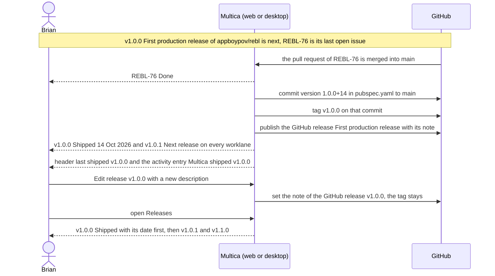

## At a glance

| Kind | Name | Change | Path |
|---|---|---|---|
| Integration | Shipping the next release once its issues are done and merged: the version commit, the tag and the GitHub release with its note | new | `server/internal/handler/github.go`, `server/internal/handler/pr_auto_complete.go` |
| Integration | GitHub App permission Contents: Read and write | changed | `apps/docs/content/docs/github-integration.mdx` and its translations |
| Concept | Release: Shipped with its ship date | changed | `packages/core/types/` |
| Section | Worklane Timeline and List: the last shipped release with "Shipped" and its date, older ones behind "Show N shipped" | changed | `packages/views/projects/`, `designs/screens/steer-all-work.pen` (screen 3) |
| Section | Worklane header: "last shipped {version}" | changed | `packages/views/projects/` |
| Menu | Release actions of a shipped release: Add issue to release, Move earlier and Move later disabled with their reasons, no Remove release | changed | `designs/screens/steer-all-work.pen` (screen 3b) |
| Dialog | Edit release of a shipped release: read-only version, title and description that reach GitHub | changed | `designs/screens/steer-all-work.pen` (screens 8b, 8c) |
| Row | Worklane row: the last shipped release with its ship date | changed | `packages/views/projects/` |
| Page | Releases: the last shipped release first, older ones behind "Show N shipped" | changed | `designs/screens/steer-all-work.pen` (screen 4d) |
| Dialog | New issue: the last shipped release disabled as "Shipped" | changed | `packages/views/modals/create-issue-dialog.tsx` |
| Section | Issue page release card, Board card, List row and preview: the shipped release | changed | `packages/views/issues/components/` |
| Section | Worklane activity: "Multica shipped {version} {title}" | changed | `packages/views/projects/` |

## Why

Brian wants a release to ship as soon as its work is merged, without cutting it by hand (brief). UJ-4 to UJ-7 plan releases, fill them with issues and show their progress, but nothing ships: no release gets a tag, a GitHub release or a date, and the release line never moves on. Today MadSpec cuts releases by hand after the merge, and Multica has no releases.

Success signal: when the pull request of REBL-76, the last open issue of v1.0.0 First production release, merges into `main` of appboypov/rebl, `main` gets a commit setting `pubspec.yaml` to `version: 1.0.0+14`, tagged v1.0.0, GitHub has the release "First production release" with its note, and in Multica v1.0.0 shows Shipped with "14 Oct 2026" on the Timeline, List and Releases, the headers say "last shipped v1.0.0", and v1.0.1 Membership hardening is Next release.

## What Changes

- A repository's next release ships as soon as it holds at least one issue, every issue in it is Done and every pull request linked to them is merged into the default branch; an issue without a linked pull request counts once it is Done. Only the next release ships, so a release after an empty next release waits, and a done release after the one that just shipped ships right after it.
- Shipping writes the version into the version file of the repository's policy, keeping a build number after `+`, commits it to the default branch through the GitHub App and tags that commit `v{version}`; "Tags only" gets the tag alone on the default branch's latest commit.
- Shipping publishes the GitHub release, named with the release's title, with its description as the note, or one line per issue with its type, ID and title when it has none.
- A shipped release gets its ship date, and the first unshipped release after it becomes Next release. Every worklane of the repository gets the activity entry "Multica shipped {version} {title}".
- The Timeline, List and Releases show the last shipped release with "Shipped" and its ship date before the next release, and fold older shipped releases behind "Show N shipped". The worklane header says "last shipped {version}"; worklane rows show the last shipped release with its ship date; Board cards, List rows, the preview and the issue page's release card show it shipped.
- A shipped release's version is read only with "Shipped: its tag is fixed."; its title and description stay editable and reach its GitHub release. Its menu has Add issue to release disabled with "Shipped: add it to a later release", Move earlier and Move later disabled with "Shipped: its tag is fixed", and no Remove release; it has no "+ Add issue to release". Move earlier on the next release is disabled with "The release before it has shipped". New issue shows the last shipped release disabled as "Shipped".
- An issue can still leave a shipped release, as from any release; the release stays shipped with its tag.

## Capabilities

### New Capabilities

- `release-shipping`: lets a repository's next release ship by itself once its work is done and merged, with its version commit, tag, GitHub release, ship date and activity entry.
- `shipped-release-display`: lets Brian see on the Timeline, List, worklane header, worklane rows, New issue and an issue's release which release shipped and when.
- `shipped-release-edits`: lets Brian change a shipped release's title and description on GitHub too, while its version, place and issue intake stay fixed.
- `releases-page-shipped`: lets Brian see on Releases each repository's last shipped release with its date and unfold the older ones.

### Modified Capabilities

None in `specs/openspec/specs/`. This change builds on the unarchived changes `repositories-of-a-project` (UJ-2: the version policy, its version file and tag pattern `v{version}`, the GitHub App), `worklanes-of-a-repository` (UJ-3: the worklane's activity; its non-goals hand the shipping entries here), `release-line-of-a-repository` (UJ-4: the release line, Next release and Planned, "nothing shipped yet", "nothing shipped" on worklane rows, the release menu, Edit release and the Ships line; its non-goals hand the shipped release and its refusals here), `issues-from-templates` (UJ-5: a release's issues, New issue's Release, the issue page's release card and pickers, Remove from release and `multica issue update`; its non-goals hand the shipped release in New issue and Add issue to release here, and its "Remove from release" on unshipped releases only is superseded by Brian's answer below), `worklane-board-and-list` (UJ-6: the header, Board, List, the preview and an issue's done date; its non-goals hand "last shipped" and the shipped release here) and `worklanes-and-releases-pages` (UJ-7: Releases and Worklanes; its non-goals hand the shipped releases on Releases here).

## Impact

- Server: deciding when the next release ships, on a status change, a pull request merge and a change to a release's issues; the version commit, the tag and the GitHub release through the GitHub App; updating the GitHub release when a shipped release's title or description changes; the ship date; the activity entry.
- GitHub App "Pew Pew Multica": it has Contents Read-only today (`gh api /apps/pew-pew-multica`); writing the commit, the tag and the release needs Contents: Read and write, approved on its installations appboypov and deappspecialist. Brian owns the App and is the only member and admin of deappspecialist, so no outsider acts and there is no Event. The GitHub integration docs list the permission in every language.
- Web and desktop: the worklane's Timeline, List, Board and header, the release menu, Edit release, New issue, the issue page and preview, worklane rows on a repository card, Projects, an organisation's page and Worklanes, and Releases.
- Shared packages: the release's shipped state and ship date in the types, zod schemas, queries and malformed-response tests.
- Copy in every supported language.

## Constraints

- A release ships without a pass; the pass in design screens 8 to 8c and in the prototype's `creation.tsx` line 711 is superseded (PRD non-goals).
- Only the next release ships, and only once it holds an issue (PRD FR-65).
- Shipping changes only the version in the version file; the build number after `+` is Codemagic's (Brian, 13 October 2026).
- A shipped release's version and tag never change (PRD FR-37).
- No restriction beyond the PRD's: an issue can leave a shipped release (Brian, 13 October 2026).
- Light mode only.
- AGENTS.md: responses pass zod schemas with `parseWithFallback` and malformed-response tests, no foreign keys or cascades, no compatibility shims, every check local, no build from upstream installed.

## Non-goals

- Passing a release in Multica.
- A changelog file, store builds and build numbers: Codemagic does those.
- Shipping a release by hand, or a release other than the next one.
- Release notes written by a fixed writer: any member or agent writes the description (PRD FR-67).
- Shipping or editing releases from the CLI.
- Squads, dark mode and the mobile app.

## Sources

- Intent: [Steer projects, repositories, worklanes and releases in Multica](anytype://object?objectId=bafyreib727ukptyvcfbkud627gjb3cu2lmwsh3u4cjbu4kisjofa25km3u) and its Requests.
- PRD: [Multica: steer projects, repositories, worklanes and releases](anytype://object?objectId=bafyreiew63xw2dncss52jdx4qk4o6aktkklhqroclvs3cvjxcyztx7h5um): UJ-8, F8 with FR-65 to FR-68, FR-37 and FR-81, FR-41, the glossary (Release) and the non-goals.
- Brief: [Multica: steer projects, repositories, worklanes and releases](anytype://object?objectId=bafyreicccdj6bucv5d65bxvkz4gy7jf7etplsswmwfggupqbakc6rudpmi).
- Earlier changes: `specs/openspec/changes/repositories-of-a-project/`, `worklanes-of-a-repository/`, `release-line-of-a-repository/`, `issues-from-templates/`, `worklane-board-and-list/`, `worklanes-and-releases-pages/`.
- Design: [Steer all work screens](anytype://object?objectId=bafyreiauxfhf7w74hwn5je7ljakzxfgo2qv4noid2oshvtqjwkos2v5oiq), screens 3 Worklane timeline (its rail: the last shipped release, the next and the planned ones, approved by Brian on 12 October 2026), 3b Release actions, 4d Releases and 8 to 8c Plan and Edit release in `designs/screens/steer-all-work.pen`, exports in `designs/exports/`; [component library](anytype://object?objectId=bafyreiamoqycfo735krrpmzn3ujhdardv6uixsrdzkadzlodwpr7aenwee); `designs/creation-flows.md` "Plan release" step 5, "Edit and move a release" 2 and 4, "Decisions" 2.
- Prototype: [Steer all work prototype](anytype://object?objectId=bafyreieck7zsmzslnfe5asszexojznfbnsnwcg62eqbesqqeigkkzgoclm), revision 460535099583266816: `shipDate`, the `LanePage` header, `ReleaseActions`, `ReleaseColumn`, `ReleaseRow`, `ReleaseChain` and the New issue release menu in `prototypes/web/src/components/generated/MulticaSteerAllWorkPrototype.tsx`; `ReleaseDialog` in `creation.tsx`; `shippedCount`, `releaseStates`, `renumber` and `moveRelease` in `model.ts`.
- Current code: the GitHub App's webhooks and pull request links in `server/internal/handler/github.go`, the merge rule (an issue moves on once every linked pull request is merged) in `server/internal/handler/pr_auto_complete.go`.
- Brian's answers in the P4 session of 13 October 2026, on the [UJ-8 Task](anytype://object?objectId=bafyreib2s4tynxqhg7y254hpmmd4denper3kz4soh5bprsczz27zv2vlhu): Codemagic sets the build number, and no restriction keeps an issue in a shipped release.
- Brian's design session of 12 October 2026 (`/tmp/brian-design-session-inputs.txt`).
