## At a glance

```mermaid
flowchart LR
  classDef work fill:#d9f2d9,stroke:#2e7d32,color:#172117
  classDef skip fill:#eeeeee,stroke:#9e9e9e,color:#424242
  P5[P5 Technical design] --> J1[J1 Project structure<br/>Skip: J1]:::skip --> J2[J2 Data models<br/>groups 1-2]:::work --> J3[J3 Data-flow prototype<br/>group 3]:::work --> J4[J4 Design system<br/>Skip: J4]:::skip --> J5[J5 Components<br/>group 4]:::work --> J6[J6 Screens<br/>group 5]:::work --> J7[J7 Live prototype<br/>group 6]:::work --> J8[J8 Backend and agent tooling<br/>groups 7-10]:::work --> J9[J9 Frontend<br/>groups 11-13]:::work --> J10[J10 Agent tooling for UI<br/>Skip: J10]:::skip --> J11[J11 Acceptance test and archive<br/>group 14]:::work
```

| Step | Groups | Builder |
|---|---|---|
| J1 Project structure | none: `Skip: J1` | - |
| J2 Data models | 1 model change, 2 DTO | `madspec-model-builder`, `madspec-dto-builder` |
| J3 Data-flow prototype | 3 | `madspec-prototype-builder` |
| J4 Design system | none: `Skip: J4` | - |
| J5 Components | 4 | `madspec-design-system-designer` |
| J6 Screens | 5 | `madspec-screen-designer` |
| J7 Live prototype | 6 | `madspec-prototype-builder` |
| J8 Backend and agent tooling | 7 integration, 8 service, 9 job, 10 endpoint | `madspec-api-builder`, `madspec-service-builder`, `madspec-function-builder`, `madspec-api-builder` |
| J9 Frontend | 11 flow, 12 component, 13 screen | `madspec-api-builder`, `madspec-component-builder`, `madspec-view-builder` |
| J10 Agent tooling for UI | none: `Skip: J10` | - |
| J11 Acceptance test and archive | 14 | Sarkout |

This change builds on UJ-7 (`worklanes-and-releases-pages`, DAS-461), which builds on UJ-6 (`worklane-board-and-list`, DAS-459), UJ-5 (`issues-from-templates`, DAS-456), UJ-4 (`release-line-of-a-repository`, DAS-455), UJ-3 (`worklanes-of-a-repository`, DAS-452), UJ-2 (`repositories-of-a-project`, DAS-451) and UJ-1 (`projects-by-organisation`, DAS-450). It uses:
- from UJ-7: `releaseOverview` in `packages/core/releases/overview.ts`, `release-row.tsx`, `releases-page.tsx`, `worklane-tree-row.tsx`;
- from UJ-6: `issue-release-chip.tsx` with its shipped look, `listSections` in `packages/core/worklanes/list-sections.ts`, `worklane-list.tsx`;
- from UJ-5: `issue.release_id`, the placement refusal `release_shipped` and the leave from a shipped release, `release-picker.tsx`, `issue-release-card.tsx`, `release-issue-row.tsx`;
- from UJ-4: the `release` table with `shipped_at`, `repository.last_tag`, `LockRepositoryForLine`, `CreateRepositoryActivity`, `server/internal/releaseline` with `testdata/cases.json`, `packages/core/releases/line.ts` with `lineStates`, `previewMove` and `previewRemove`, `release-column.tsx`, `release-menu.tsx`, `release-dialog.tsx`, `release-chips.tsx`, `worklane-timeline.tsx`, `worklane-page.tsx`, `release_line:updated`;
- from UJ-3: `ListActivitiesForWorklane` and `worklane-activity.tsx`;
- from UJ-2: `repository.full_name`, `default_branch` and `version_policy`.

## 1. J2 Data models: model change

- [ ] 1.1 `server/migrations/593_release_github_sync.up.sql`, `.down.sql` -- `ALTER TABLE release ADD COLUMN github_synced_at timestamptz`, and the down drops it -- design.md "Models".
- [ ] 1.2 `server/pkg/db/queries/release_ship.sql` -- the shipping queries -- design.md decisions 1 and 4:
  - `ListShipWork`: repositories, with their workspace, that have a ship candidate (the first unshipped release by `position` holds an issue, every issue with it is in a status of the category `done` of its workspace, every linked `github_pull_request` is `merged`, no `issue_vcs_pull_request` is linked, `version_policy <> 'none'`) or a shipped release with `github_synced_at` NULL or before `updated_at`, ordered by `full_name`.
  - `GetNextRelease(workspace_id, repository_id)`: the first release with `shipped_at IS NULL` by position, with its issue count.
  - `ListReleaseIssues(release_id)`: `id`, `number`, the identifier parts, `type`, `title`, `status`.
  - `ListReleasePullRequests(release_id)`: every pull request linked to its issues, GitHub with `repo_owner`, `repo_name`, `number`, `state`, and VCS with its provider.
  - `MarkReleaseShipped(id)`: `shipped_at`, `github_synced_at` and `updated_at` to `now()`.
  - `ListShippedReleasesToSync(repository_id)` and `MarkReleaseSynced(id, synced_at)`.
- [ ] 1.3 `server/pkg/db/queries/github.sql` -- `GetGitHubInstallationByAccountLogin(workspace_id, account_login)`, case-insensitive -- design.md decision 3, ADR-0018.
- [ ] 1.4 `server/pkg/db/generated/` -- run `make sqlc` and commit the output.

## 2. J2 Data models: DTO

- [ ] 2.1 `packages/core/types/activity.ts` -- the action `release_shipped` with details `{release_id, version, title}` -- design.md decision 5.
- [ ] 2.2 `packages/core/api/schemas.ts` -- the activity action enum gains `release_shipped`, its details default `version` and `title` to `""`, and an unknown action still falls back to `unknown` -- AGENTS.md "API Compatibility".
- [ ] 2.3 `packages/core/api/schemas.test.ts` -- malformed-response cases: `release_shipped` without details, with a numeric `version`, and a release with a malformed `shipped_at` falling back to `null`.

## 3. J3 Data-flow prototype: data-flow prototype

- [ ] 3.1 `prototypes/web/release-ships/data-flow/` -- an interactive prototype without UI that runs design.md "Journey sequence and data flow" against an in-memory GitHub. It covers:
  - The ready rule: no issue, an issue not Done, a cancelled issue, an open pull request, a pull request merged into another branch, a VCS link, a repository that does not release, and a release after an empty next release: none ships. All Done and merged, and Done without a pull request: it ships, and a done release after it ships in the same run.
  - The steps: `pubspec.yaml` `0.9.0+14` to `1.0.0+14`, `package.json` `0.4.2` to `0.4.3`, "Tags only" on the branch head, a run that failed after the tag finishing without a second commit or tag, a file that already holds the version, and the note from the description or from the issues.
  - After the ship: `shipped_at`, Next release moving on, `last_tag`, the activity entry, and a title edit syncing once.
  - `splitShipped` with no, one and three shipped releases, and "Show {N} shipped".
- [ ] 3.2 `prototypes/web/release-ships/data-flow/README.md`, PNG exports -- how to run it, and one PNG per step -- J3's contract.

## 4. J5 Components: component design

- [ ] 4.1 `designs/systems/multica.lib.pen` -- built from the library's existing tokens and the `Release/Shipped` chip -- J5's contract:
  - `Release row` shipped state: chip, title, ship date, progress and worklane chips.
  - `Timeline column` shipped state: chip, "Shipped", ship date, title, description, issues, no "+ Add issue to release".
  - `Shipped fold`: "Show {N} shipped" for the Timeline, the List and Releases.
  - `Release chips` with the last shipped chip and its date before the next release.
  - `Activity entry` with Multica as the actor.
- [ ] 4.2 `designs/exports/library-components.png` -- the refreshed components export.

## 5. J6 Screens: screen design

- [ ] 5.1 `designs/screens/steer-all-work.pen` -- the journey's states, built from the library's components -- J6's contract:
  - Screen 3 Timeline of Fan accounts and push with v1.0.0 First production release Shipped "14 Oct 2026", "Show 2 shipped" before it, then v1.0.1 Membership hardening as Next release and v1.1.0 Account and profile.
  - Screen 3b the release menu of shipped v1.0.0 with its disabled reasons and no Remove release, and the menu of v1.0.1 with Move earlier disabled "The release before it has shipped".
  - Screen 4d Releases with appboypov/rebl's "Show 1 shipped", v1.0.0 Shipped with its date, then v1.0.1 and v1.1.0, and the header counting 3 releases.
  - Screens 8 to 8c without the pass. 8b and 8c Edit release of shipped v1.0.0 with the read-only version "Shipped: its tag is fixed." and "Shipped as v1.0.0. A new title or description changes the release here and on GitHub; the tag stays."
  - A List of Fan accounts and push with the shipped section, a worklane row on Projects with "v1.0.0 Shipped 14 Oct 2026" then v1.0.1, and the worklane activity with "Multica shipped v1.0.0 First production release".
- [ ] 5.2 `designs/exports/` -- one PNG per new or changed screen -- J6's contract.

## 6. J7 Live prototype: live prototype

- [ ] 6.1 `prototypes/web/src/components/generated/creation.tsx` -- `ReleaseDialog`'s note for an unshipped release without the pass, and for a shipped one "Shipped as {version}. A new title or description changes the release here and on GitHub; the tag stays." -- the proposal's Constraints.
- [ ] 6.2 `prototypes/web/src/components/generated/MulticaSteerAllWorkPrototype.tsx`, `model.ts` -- "Show {N} shipped" on the Timeline, the List and Releases, the ship date from the moment the release shipped instead of `shipDate`, the shipped menu reasons, and New issue's last shipped release disabled -- the `shipped-release-display`, `shipped-release-edits` and `releases-page-shipped` spec deltas.

## 7. J8 Backend and agent tooling: integration

- [ ] 7.1 `server/internal/versionfile/versionfile.go`, `versionfile_test.go` -- `Set(policy, content, version)` and `Has(policy, content, version)` for `pubspec.yaml`, `package.json`, `Cargo.toml` and `pyproject.toml`, keeping everything but the version byte for byte -- design.md decision 3. Table tests: a build part kept, CRLF line ends kept, a nested `"version"` in `package.json` untouched, `[project]` before `[tool.poetry]`, no version line as an error.
- [ ] 7.2 `server/internal/integrations/ghsnapshot/client.go`, `.env.example` -- `installationToken` becomes `InstallationToken`, with its callers, `APIBase()` is added, and `NewClientFromEnv` reads the base from `GITHUB_API_URL`, default `https://api.github.com` -- design.md decision 3, ADR-0018.
- [ ] 7.3 `server/internal/integrations/ghrelease/client.go`, `client_test.go` -- `Client` with `PullRequest`, `TagRef`, `BranchHead`, `File`, `PutFile`, `CreateTag`, `ReleaseByTag`, `CreateRelease` and `UpdateRelease` on `APIBase()`, tokens from `InstallationToken`, 20 s timeout -- design.md decision 3. Tests against an `httptest` GitHub: each call's method, path and body, 404 as "none" for `TagRef` and `ReleaseByTag`, and an error naming the call for any other failure.
- [ ] 7.4 The GitHub App "Pew Pew Multica" (Brian) -- Contents to Read and write in the App's settings, approved on the installations appboypov and deappspecialist, checked with `gh api /apps/pew-pew-multica` -- design.md decision 7. The builder asks Brian through his inbox and does not wait for it to build.

## 8. J8 Backend and agent tooling: service

- [ ] 8.1 `server/internal/releaseship/note.go`, `note_test.go` -- `Note(description, issues)`: the trimmed description, else one line `{Type} {identifier} {title}` per issue by number, with the template's English name and no type for an issue without one -- design.md decision 3, the spec scenario "Without a description".
- [ ] 8.2 `server/internal/releaseship/shipper.go` -- `Shipper` with `Run`, `ship` and `sync`, built from the pool, queries, `ghrelease.Client` and the event bus -- design.md decisions 1 to 4:
  - `ship` in one transaction under `LockRepositoryForLine`: the next release, its issues all Done, its pull requests confirmed on GitHub, the steps each only when GitHub lacks them, `MarkReleaseShipped`, `last_tag`, the `release_shipped` activity with actor `system`, commit, then `release_line:updated` and `activity:created`.
  - `Run` ships a repository until nothing ships, then syncs it, logs a failure as `release ship failed` with workspace, repository, version, step and error, and goes on with the next repository.
  - `sync` updates or creates the GitHub release by tag and sets `github_synced_at` to the `updated_at` it read.
- [ ] 8.3 `server/internal/releaseship/shipper_test.go` -- DB tests with `testutil` fixtures and an `httptest` GitHub:
  - The `release-shipping` scenarios: the last pull request merging, Done without a pull request, an open pull request, a release without issues, the release after it already done, a repository that does not release.
  - The steps: `pubspec.yaml` with a build number, `package.json`, "Tags only", a run failing at the tag then finishing with one commit and one tag, a pull request merged into another branch waiting, no installation for the owner failing.
  - The ship date, `last_tag`, Next release moving on, one repository-wide activity row, and another workspace's repositories untouched.
  - A title or description edit syncing the GitHub release once, the tag untouched, and an edit during the sync syncing again.

## 9. J8 Backend and agent tooling: job

- [ ] 9.1 `server/internal/scheduler/jobs_release_ship.go` -- `ReleaseShipJob(shipper)`: `release_ship`, 30 s, `CatchUpLatestOnly`, `RunTimeout` 5 min, `StaleTimeout` 6 min, `MaxAttempts` 1, global scope, calling `Run` -- design.md decision 1, ADR-0017.
- [ ] 9.2 `server/cmd/server/main.go` -- build the `ghrelease.Client` and the `Shipper`, and register the job beside `IssueWakeupJob`.

## 10. J8 Backend and agent tooling: endpoint

- [ ] 10.1 `server/internal/releaseline/line.go`, `testdata/cases.json`, `line_test.go` -- `Edit` with a bump or version of a shipped release, `Move` of a shipped release, and `Remove` of a shipped release refuse `release_shipped`. `Move` earlier of the first unshipped release after a shipped one refuses `previous_shipped`. A title and description edit of a shipped release passes -- design.md decision 4.
- [ ] 10.2 `server/internal/handler/release.go` -- `PATCH /api/releases/{id}` of a shipped release takes `{title, description}` without bump or version, and the refusals answer 409 with `{version, title}` in UJ-4's order -- design.md decision 4.
- [ ] 10.3 `server/internal/handler/release_test.go`, `issue_placement_test.go` -- DB tests: the `shipped-release-edits` scenarios on the server (a new title, a new description, a version on a shipped release refused, move and remove refused, moving the next release earlier refused), and REBL-22 leaving shipped v1.0.0 with `shipped_at` and version unchanged.

## 11. J9 Frontend: flow

- [ ] 11.1 `packages/core/releases/line.ts`, `line.test.ts` -- `previewEdit`, `previewMove` and `previewRemove` give the shipped refusals from the shared `cases.json`, with the messages "Shipped: its tag is fixed" and "The release before it has shipped" -- design.md decision 4.
- [ ] 11.2 `packages/core/releases/shipped.ts`, `ship-date.ts`, `index.ts` -- `splitShipped(line)` and `formatShipDate(shippedAt, locale)` -- design.md decision 6.
- [ ] 11.3 `packages/core/releases/overview.ts` -- `releaseOverview` keeps `older`, the last shipped row and the unshipped rows per repository, with `state` and `shippedAt`, and counts every release on the line -- design.md decision 6, ADR-0016.
- [ ] 11.4 `packages/core/worklanes/list-sections.ts` -- the shipped sections with the ship date, and the older ones marked for the fold -- design.md decision 6.
- [ ] 11.5 `packages/core/releases/mutations.ts` -- `useEditRelease` sends `{title, description}` for a shipped release.
- [ ] 11.6 `packages/core/releases/shipped.test.ts`, `ship-date.test.ts`, `overview.test.ts`, `packages/core/worklanes/list-sections.test.ts` (`// @vitest-environment node`) -- no, one and three shipped releases, the counts with shipped ones, "14 Oct 2026" in English, and a release after an empty next release staying planned.

## 12. J9 Frontend: component

- [ ] 12.1 `packages/views/releases/components/shipped-fold.tsx` -- "Show {N} shipped", a button that shows the older shipped releases -- design.md decision 6.
- [ ] 12.2 `packages/views/releases/components/release-column.tsx` -- the shipped state: chip, "Shipped", ship date, title, description, issues of this worklane, no "+ Add issue to release".
- [ ] 12.3 `packages/views/releases/components/release-menu.tsx` -- the shipped menu with its disabled reasons and no Remove release, and Move earlier of the next release disabled with "The release before it has shipped".
- [ ] 12.4 `packages/views/releases/components/release-dialog.tsx` -- Edit of a shipped release with the read-only version, "Shipped: its tag is fixed.", and "Shipped as {version}. A new title or description changes the release here and on GitHub; the tag stays."
- [ ] 12.5 `packages/views/releases/components/release-row.tsx`, `release-chips.tsx`, `issue-release-card.tsx` -- the shipped row with its date, the last shipped chip with its date before the next release on worklane rows, and "Shipped" with the date on the issue page's card.
- [ ] 12.6 `packages/views/issues/components/pickers/release-picker.tsx` -- the last shipped release first, disabled with "Shipped".
- [ ] 12.7 `packages/views/worklanes/components/worklane-activity.tsx` -- "Multica shipped {version} {title}" with Multica's mark -- design.md decision 5.
- [ ] 12.8 `packages/views/releases/components/*.test.tsx`, `packages/views/issues/components/pickers/release-picker.test.tsx`, `packages/views/worklanes/components/worklane-activity.test.tsx` -- the shipped states, the menu's reasons, the dialog's read-only version, the picker's disabled shipped release and the activity sentence.

## 13. J9 Frontend: screen

- [ ] 13.1 `packages/views/worklanes/components/worklane-timeline.tsx` -- the last shipped column before the next release, "Show {N} shipped" before it, and `?release={id}` of an older shipped release opening with them shown and that column in view -- the `shipped-release-display` spec delta.
- [ ] 13.2 `packages/views/worklanes/components/worklane-list.tsx` -- the shipped sections with "Show {N} shipped" before the last one.
- [ ] 13.3 `packages/views/releases/components/releases-page.tsx` -- "Show {N} shipped" in each repository's group and the counts over every release -- the `releases-page-shipped` spec delta.
- [ ] 13.4 `packages/views/locales/{en,zh-Hans,ko,ja,fr}/releases.json`, `worklanes.json` -- "Shipped", "Show {N} shipped", the menu reasons, the dialog's lines and the activity sentence in all five languages.
- [ ] 13.5 `packages/views/worklanes/components/worklane-timeline.test.tsx`, `worklane-list.test.tsx`, `packages/views/releases/components/releases-page.test.tsx` -- the folds, the order and the counts of the `shipped-release-display` and `releases-page-shipped` scenarios.
- [ ] 13.6 `apps/docs/content/docs/github-integration.mdx`, `.zh.mdx`, `.ko.mdx`, `.ja.mdx`, `.fr.mdx` -- Contents as Read and write and the section "Releases ship by themselves" -- design.md decision 7.

## 14. J11 Acceptance test and archive: acceptance test

- [ ] 14.1 `e2e/release-ships.spec.ts` -- the journey's acceptance test through `TestApiClient`, with the server's `GITHUB_API_URL` on a fake GitHub that mints installation tokens and answers pull requests, contents, refs and releases, on appboypov/rebl (`pubspec.yaml` at `version: 0.9.0+14`) with worklanes `main` and Fan accounts and push, and the releases v1.0.0 First production release (REBL-22 Done, REBL-76 In Review with a linked open pull request), v1.0.1 Membership hardening (REBL-24 Todo) and v1.1.0 Account and profile (no issues):
  - A signed `pull_request` webhook merging REBL-76's pull request into `main` makes REBL-76 Done, and the fake GitHub then holds one commit with `version: 1.0.0+14`, the tag v1.0.0 on it and the release "First production release".
  - The Timeline of Fan accounts and push shows v1.0.0 Shipped with its date, then v1.0.1 as Next release, the header says "last shipped v1.0.0", and the activity says "Multica shipped v1.0.0 First production release".
  - Projects shows v1.0.0 Shipped with its date then v1.0.1 on Fan accounts and push, and Releases shows v1.0.0 first with "3" releases in the header.
  - The menu of v1.0.0 shows its disabled reasons and no Remove release. Edit release shows the read-only version, and a new description reaches the fake GitHub's release while the tag stays.
  - New issue from Fan accounts and push shows v1.0.0 disabled as "Shipped". REBL-22 leaves v1.0.0, and v1.0.0 stays shipped.
  - After a second shipped release, "Show 1 shipped" shows v1.0.0 on the Timeline and Releases.
- [ ] 14.2 The first real ship on Brian's Mac -- on the local release, ship the next release of appboypov/rebl as the PRD's success signal says, and record the commit, the tag, the GitHub release and the Timeline in the J11 pull request.
- [ ] 14.3 `specs/openspec/changes/release-ships/` -- run `openspec validate release-ships --type change --strict`, sync the specs and archive the change -- the journey closes on its J11 pull request.

## Implementation Notes

## Plan Change Log
