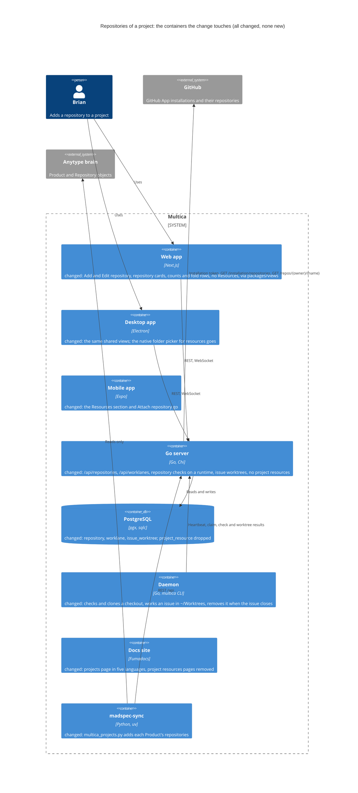
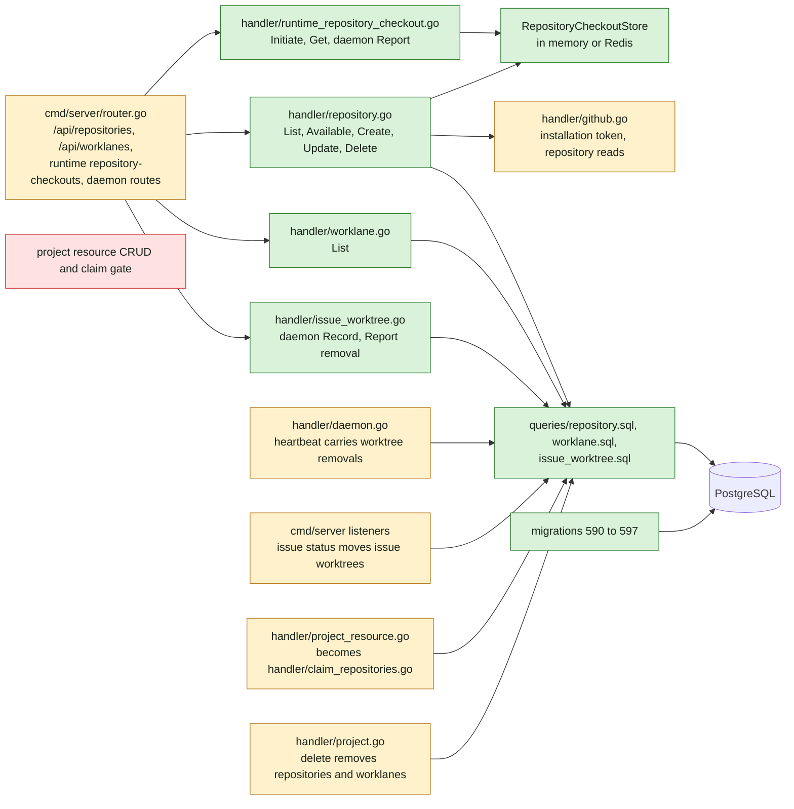
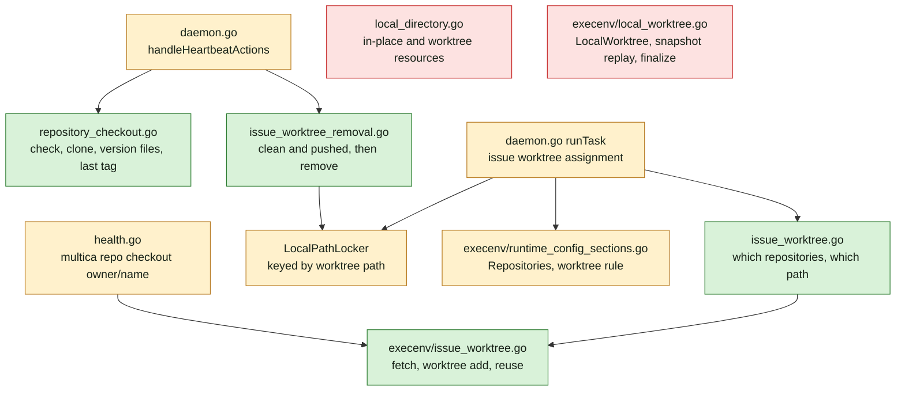
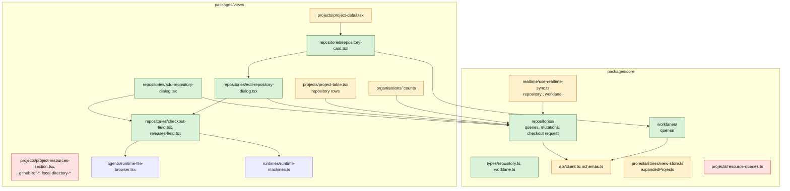
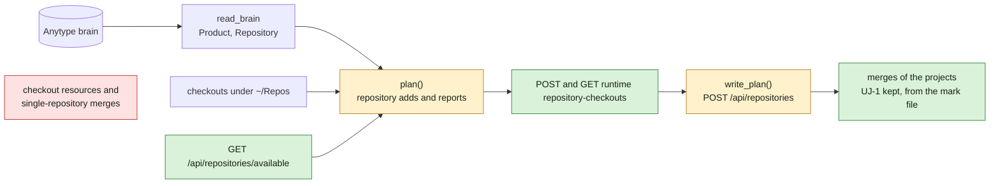
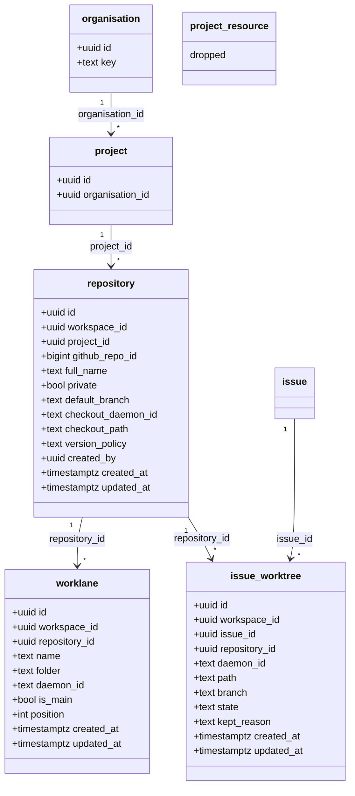
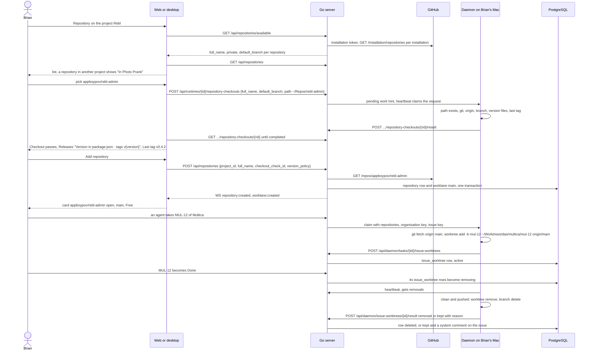

## At a glance

The delta of this change on the living system design, `specs/docs/system-design.md`. Every container it touches already exists; the change adds no container. The mobile app changes only by losing its Resources section, because the endpoints behind it go.

Go server component map, delta:

Daemon component map, delta:

Web and desktop component map, delta:

Brain sync, delta:

Models:

Journey sequence and data flow:

| Kind | Name | Change | Path |
|---|---|---|---|
| Migration | `repository`, `worklane`, `issue_worktree` tables | new | `server/migrations/590_repository.up.sql`, `.down.sql` |
| Migration | Unique repository per workspace, ignoring case | new | `server/migrations/591_repository_full_name_index.up.sql`, `.down.sql` |
| Migration | Repositories by project | new | `server/migrations/592_repository_project_index.up.sql`, `.down.sql` |
| Migration | Unique worklane name per repository | new | `server/migrations/593_worklane_name_index.up.sql`, `.down.sql` |
| Migration | One `main` per repository | new | `server/migrations/594_worklane_main_index.up.sql`, `.down.sql` |
| Migration | One issue worktree per issue and repository | new | `server/migrations/595_issue_worktree_issue_index.up.sql`, `.down.sql` |
| Migration | Removals per daemon | new | `server/migrations/596_issue_worktree_removing_index.up.sql`, `.down.sql` |
| Migration | `project_resource` dropped | new | `server/migrations/597_drop_project_resource.up.sql`, `.down.sql` |
| Migrator | Cleanups for the six concurrent indexes | changed | `server/cmd/migrate/main.go` |
| Queries | Repository, worklane and issue worktree queries | new | `server/pkg/db/queries/repository.sql`, `worklane.sql`, `issue_worktree.sql` |
| Queries | Project resource queries | removed | `server/pkg/db/queries/project_resource.sql` |
| Queries | Workspace delete sweeps the three tables, not resources | changed | `server/pkg/db/queries/workspace_delete.sql` |
| Queries | Waiting comment no longer names resources | changed | `server/pkg/db/queries/agent.sql` |
| Generated | sqlc output | changed | `server/pkg/db/generated/` |
| Handler | Repository endpoints | new | `server/internal/handler/repository.go` |
| Handler | Worklane list | new | `server/internal/handler/worklane.go` |
| Handler | Checkout check and clone on a runtime | new | `server/internal/handler/runtime_repository_checkout.go` |
| Handler | Issue worktree record and removal result | new | `server/internal/handler/issue_worktree.go` |
| Handler | Project resource CRUD, claim gate and claim mapping | removed | `server/internal/handler/project_resource.go` |
| Handler | Claim context with repositories | new | `server/internal/handler/claim_repositories.go` |
| Handler | Installation token and repository reads | changed | `server/internal/handler/github.go` |
| Handler | Heartbeat carries removals, claim carries repositories | changed | `server/internal/handler/daemon.go`, `agent.go` |
| Handler | Project delete removes repositories and worklanes, no `resource_count` | changed | `server/internal/handler/project.go` |
| Handler | Workspace delete manifest | changed | `server/internal/handler/workspace.go`, `workspace_delete_manifest_test.go` |
| Service | Waiting status comment | changed | `server/internal/service/task.go` |
| Routes | Repository, worklane, check and daemon routes | changed | `server/cmd/server/router.go` |
| Events | `repository:*`, `worklane:created`, `worklane:deleted`; `project_resource:*` removed | changed | `server/pkg/protocol/events.go`, `server/cmd/server/listeners.go` |
| Listener | Issue status moves its issue worktrees | new | `server/cmd/server/issue_worktree_listeners.go` |
| Protocol | Pending work kind, heartbeat removals, claim repositories | changed | `server/pkg/protocol/messages.go` |
| Daemon | Checkout check and clone | new | `server/internal/daemon/repository_checkout.go` |
| Daemon | Issue worktree assignment | new | `server/internal/daemon/issue_worktree.go` |
| Daemon | Issue worktree removal | new | `server/internal/daemon/issue_worktree_removal.go` |
| Daemon | Local directory resources | removed | `server/internal/daemon/local_directory.go` |
| Daemon | Task run, heartbeat actions, claim types | changed | `server/internal/daemon/daemon.go`, `types.go`, `client.go` |
| Daemon | `multica repo checkout owner/name` | changed | `server/internal/daemon/health.go` |
| Runtime | Issue worktree in git | new | `server/internal/daemon/execenv/issue_worktree.go` |
| Runtime | Local worktree mode | removed | `server/internal/daemon/execenv/local_worktree.go` |
| Runtime | Repositories in the brief, worktree rule | changed | `server/internal/daemon/execenv/runtime_config_sections.go`, `runtime_config.go`, `context.go`, `execenv.go` |
| CLI | `multica project resource` | removed | `server/cmd/multica/cmd_project.go`, `cmd_id_resolver.go` |
| Skill | Platform skill's projects and runtimes references | changed | `server/internal/service/builtin_skills/multica-platform/references/projects.md`, `runtimes.md` |
| Type | Repository, worklane, check request | new | `packages/core/types/repository.ts`, `worklane.ts` |
| Type | Project resource types, `resource_count` | removed | `packages/core/types/project.ts` |
| Schema and client | Repository, worklane and check schemas and calls | changed | `packages/core/api/schemas.ts`, `client.ts` |
| Feature | Repository queries, mutations, check request | new | `packages/core/repositories/` |
| Feature | Worklane queries | new | `packages/core/worklanes/` |
| Feature | Resource queries | removed | `packages/core/projects/resource-queries.ts` |
| Feature | Realtime, modals, projects view store | changed | `packages/core/realtime/use-realtime-sync.ts`, `packages/core/modals/store.ts`, `packages/core/projects/stores/view-store.ts` |
| Dialog | Add repository | new | `packages/views/repositories/components/add-repository-dialog.tsx` |
| Dialog | Edit repository | new | `packages/views/repositories/components/edit-repository-dialog.tsx` |
| Component | Checkout and Releases fields | new | `packages/views/repositories/components/checkout-field.tsx`, `releases-field.tsx` |
| Section | Repository card with its menu | new | `packages/views/repositories/components/repository-card.tsx` |
| Section | Project page: cards and count in place of Resources | changed | `packages/views/projects/components/project-detail.tsx` |
| Component | Resources section, GitHub ref and local directory parts | removed | `packages/views/projects/components/project-resources-section.tsx`, `github-ref-dialog.tsx`, `github-ref-field.tsx`, `local-directory-*`, `packages/views/platform/local-directory.ts` |
| Page | Projects and an organisation's page: repository rows | changed | `packages/views/projects/components/project-table.tsx` (made in UJ-1) |
| Page | Organisations and an organisation's page: repository counts | changed | `packages/views/organisations/components/` |
| Dialog | New project: no resources | changed | `packages/views/modals/create-project.tsx` |
| Desktop | Native folder picker for resources | removed | `apps/desktop/src/main/local-directory.ts` |
| Mobile | Resources section and Attach repository | removed | `apps/mobile/components/project/project-resources-section.tsx`, `apps/mobile/app/(app)/[workspace]/project/[id]/add-resource.tsx`, `apps/mobile/data/` |
| Copy | `repositories` namespace, projects copy | new, changed | `packages/views/locales/`, `apps/mobile/` locales |
| Docs | Projects page; project resources pages removed | changed, removed | `apps/docs/content/docs/projects*.mdx`, `project-resources*.mdx`, `meta.json` |
| Tool | Brain sync adds repositories and merges the repository projects UJ-1 kept | changed | `madspec-sync/multica_projects.py`, `madspec-sync/tests/test_multica_projects.py` |
| Tool spec | The sync's rules | changed | `madspec-sync/specs/multica-projects.md`, `madspec-sync/README.md` |
| Design | Screens of this journey | changed | `designs/screens/steer-all-work.pen`, `designs/exports/`, `designs/creation-flows.md` |
| Prototype | Data-flow prototype | new | `prototypes/web/repositories-of-a-project/data-flow/` |
| Prototype | Live prototype | changed | `prototypes/web/src/components/generated/` |
| E2E | Journey acceptance test | new | `e2e/repositories.spec.ts` |
| ADR | A repository belongs to a project and holds its worklanes (supersedes ADR-0004) | new | `adr/0006-repositories-hold-worklanes.md` |
| ADR | Worktrees are made by the daemon and recorded by the server | new | `adr/0007-worktrees-are-made-by-the-daemon-and-recorded-by-the-server.md` |

## Context

Journey UJ-2 of [PRD: Multica: steer projects, repositories, worklanes and releases](anytype://object?objectId=bafyreiew63xw2dncss52jdx4qk4o6aktkklhqroclvs3cvjxcyztx7h5um). It builds on UJ-1, `projects-by-organisation` (DAS-450), whose design is committed on branch `das-450-uj-1-brian-sees-his-projects-by-organisation`: its `organisation` table and key, its migrations 572 to 574, its brain-sync mark file and ADR-0004 and ADR-0005. This change's migrations start at 590. The later changes build on its model: `worklanes-of-a-repository` (UJ-3) adds worklanes, their worktrees and the install command; `release-line-of-a-repository` (UJ-4) adds releases on a repository's line; `issues-from-templates` (UJ-5) places issues in a worklane and a release; `worklane-board-and-list` (UJ-6) works a worklane's issue in its worktree and makes it Busy; `worklanes-and-releases-pages` (UJ-7) and `release-ships` (UJ-8) read the repository's default branch and version policy.

**Journey steps.** The investigation finds nothing for four steps, and no `Keep:` Request names them. Each gets its `Skip:` Request once the journey exists in the brain:

- `Skip: J1` Project structure: no new container, app or package. Every new module sits in an existing Go package or workspace package (`packages/core/repositories/`, `packages/core/worklanes/`, `packages/views/repositories/`).
- `Skip: J4` Design system: `designs/systems/multica.lib.pen` has no token gap for this journey. Its foundations cover every state the screens need.
- `Skip: J5` Components: the library already holds what the dialogs and cards need: `Repo option/Default`, `/Selected` and `/Taken`, `Check/Done`, `/Running`, `/Pending` and `/Failed`, `Repository section`, `Worklane row`, `Tree row/Repository`, `Menu`, `Menu item/Default` and `/Disabled`, `Form field`, `Readonly value`, `Select`, `Input/Error`, `Dialog` and `Note`.
- `Skip: J10` Agent tooling for UI: no agent adds, edits or removes a repository. The brain sync is a tool, built in J8; the agent's side of this journey, its issue worktree and brief, is J8 too.

J2, J3, J6, J7, J8, J9 and J11 have work. Screen 6, "Add repository", and screen 2, "Project", exist; J6 adds the states and dialogs they lack.

**Code map.**

- Server, project resources today:
  - `server/migrations/065_project_resources.up.sql` creates `project_resource (id, project_id, workspace_id, resource_type, resource_ref jsonb, label, position, created_at, created_by)`, unique on `(project_id, resource_type, resource_ref)`. Production holds 32 rows, every one a `local_directory` in `worktree` mode that the brain sync made (label `madspec:<owner/name>`), and no `github_repo` row.
  - `server/internal/handler/project_resource.go`: CRUD (L547 to L905), the worktree claim gate `requireWorktreeCapableDaemon` (L166), and the claim mapping `resolveClaimProjectContext` (L974) with `projectResourcesForClaim` (L1029), where project `github_repo` resources replace the workspace's repos.
  - `server/pkg/protocol/events.go` L102 to L104: `project_resource:*`. `workspace_delete.sql` L426 deletes resources.
  - `server/cmd/multica/cmd_project.go`: `multica project resource list|add|update|remove`, and `cmd_id_resolver.go` L381.
- Server, patterns to copy:
  - A runtime round trip that the UI polls: `handler/runtime_directory_listing.go` (`DirectoryListingStore`, in memory or Redis), `InitiateDirectoryListing` (L190) with `requestDaemonPendingWork` (`runtime_models.go` L446), `protocol.PendingWorkKindDirectoryListing` (`messages.go` L170), and the daemon's `handleDirectoryListing` in `directory_listing.go`. The UI side is `packages/core/runtimes/directory-listing.ts`.
  - GitHub App calls: `signGitHubAppJWT` (`github.go` L679) and the installation token in `fetchGitHubInstallationRepositories` (L818), which asks for `metadata: read`. Installations are listed with `ListGitHubInstallationsByWorkspace`.
  - System comments: `author_type = 'system'` with the zero author id, as in `service/task.go` L6456.
  - Issue status listeners: `cmd/server/activity_listeners.go` L55 reads `status_changed` on `issue:updated`.
- Daemon today:
  - `daemon/local_directory.go`: `findLocalDirectoryAssignment` picks the `local_directory` resource of this daemon. `LocalPathLocker` (L480) serialises tasks on one real path and marks a waiting task `waiting_local_directory` (`agent.sql` L1002).
  - `daemon/execenv/local_worktree.go`: per-task worktrees under the task's env root on branch `agent/{agent}/{issue key}`, with a snapshot of Brian's uncommitted state replayed into it, and a finalize that commits and removes it. Only `local_directory` resources in `worktree` mode use it.
  - `daemon/health.go` L427: `multica repo checkout <url>` makes a worktree from the bare repo cache for workspace repos.
  - `daemon/execenv/runtime_config_sections.go`: `worktreeRule` (L290) sends the agent to `madspec-git`'s folder; `writeRepositories` (L422) and `writeProjectContext` (L486) list repos and resources.
- Core and views today:
  - `types/project.ts`: `ProjectResource*`, `GithubRepoResourceRef`, `LocalDirectoryResourceRef`, `resource_count`.
  - `projects/resource-queries.ts`, and in views `project-resources-section.tsx` (L111) with `github-ref-*`, `local-directory-*` and `platform/local-directory.ts`, which drives the desktop's native picker in `apps/desktop/src/main/local-directory.ts`.
  - `runtimes/components/runtime-machines.ts` `buildRuntimeMachines` groups runtimes into machines. `agents/components/runtime-file-browser.tsx` browses a runtime's folders on web and desktop.
- Mobile today: `apps/mobile/components/project/project-resources-section.tsx`, `app/(app)/[workspace]/project/[id]/add-resource.tsx`, and the resource calls in `data/api.ts`, `schemas.ts`, `mutations/projects.ts`, `queries/projects.ts` and `realtime/project-ws-updaters.ts`.
- Brain sync: `madspec-sync/multica_projects.py` finds checkouts under `~/Repos` by `origin` and writes one `local_directory` resource per checkout. In UJ-1 it merges the repository project of each Product with one repository, found by that resource's label, and keeps the repository projects of a Product with several, because a project holds one `local_directory` per daemon. It records each kept project in its mark file under `repository_projects`, keyed by the Repository's brain id.
- Checkouts on this Mac use `git@github.com:owner/name.git` as `origin`.

**What must not change.** Settings > Repositories, the workspace's repository list, and the `multica repo checkout <url>` path from the bare cache for those repositories (proposal Non-goals). The Issues pages. Brian's normal checkouts: no task writes in them.

## Goals / Non-Goals

**Goals:**

- A repository table keyed by project, with the GitHub repository resolved by the server, a checkout checked on a runtime, and a version policy.
- Worklane `main` made with each repository, as a row UJ-3 adds lanes next to.
- Add repository, Edit repository and Remove repository on web and desktop; repository cards on the project page; repository rows and counts on Projects, Organisations and an organisation's page.
- Project resources gone from the database, the API, the CLI, web, desktop, mobile and the docs.
- An agent on an issue without a worklane works in `~/Worktrees/{organisation key}/{repo}/{issue key}` on the issue's branch, and the worktree goes when the issue is Done or Cancelled and nothing would be lost.
- The brain sync adds each Product's repositories and merges the repository projects UJ-1 kept into their Product's project.

**Non-Goals:**

- Worklanes other than `main`, the install command, releases, issues in worklanes, and Busy (UJ-3 to UJ-6). In UJ-2 no issue can be in a worklane, so every worklane is Free.
- Settings > Repositories and the workspace repos of a claim without project repositories.
- A `multica repository` CLI. An agent never adds a repository.
- Changing which GitHub repository a repository is.

**Always:**

- No foreign keys or cascades. Each concurrent index is in its own migration file.
- The server is the authority: it resolves the GitHub repository itself and accepts a checkout only with a passed check it holds.
- UI-consumed JSON goes through zod with `parseWithFallback`.
- Shared logic lives in `packages/core` and shared screens in `packages/views`, wired into web and desktop.
- Create, edit and remove await the server.

**Never:**

- A task writes in a repository's normal checkout.
- Removing a repository touches its checkout folder.
- The daemon removes a worktree that holds an uncommitted change or a commit missing from its remote.
- The brain sync changes a repository that exists in Multica.

## Decisions

### 1. The model

The model is ADR-0006, which supersedes ADR-0004: it keeps the organisation and adds the repository and worklane levels, and gives a project without an organisation worktrees at `~/Worktrees/{repo}/{folder}`, as Brian answered at P4.

`repository`:

- `id`, `workspace_id`, `project_id`, `created_by` (nullable), `created_at`, `updated_at`.
- `github_repo_id bigint`, `full_name text` (`owner/name` as GitHub returns it), `private bool`, `default_branch text`. The server reads them from GitHub on create and on every edit.
- `checkout_daemon_id text` and `checkout_path text`: the machine and the absolute path of the normal checkout. The daemon id is the machine, as the `local_directory` resources had it, so a machine's runtimes for different agent providers share it.
- `version_policy text NOT NULL CHECK (version_policy IN ('pubspec.yaml', 'Cargo.toml', 'pyproject.toml', 'package.json', 'tags', 'none'))`. The tag pattern is always `v{version}`, so it has no column. `none` is "This repository does not release".
- A repository is in at most one project of the workspace: `UNIQUE (workspace_id, LOWER(full_name))` (591). `project_id` is indexed (592), because the project page and project delete read by it.

`worklane`:

- `id`, `workspace_id`, `repository_id`, `name`, `folder` (nullable), `daemon_id` (nullable), `is_main bool`, `position int`, `created_at`, `updated_at`.
- `main` is `is_main = true`, named `main`, with `folder` and `daemon_id` NULL: its worktree is the repository's checkout, read through the repository, so an edited checkout moves `main` with it. UJ-3's lanes fill `folder` and `daemon_id`.
- `UNIQUE (repository_id, LOWER(name))` (593) and `UNIQUE (repository_id) WHERE is_main` (594).
- State is not stored. UJ-6 makes a worklane Busy from its active issue.

`issue_worktree`:

- `id`, `workspace_id`, `issue_id`, `repository_id`, `daemon_id`, `path`, `branch`, `state text CHECK (state IN ('active', 'removing', 'kept'))`, `kept_reason` (nullable), `created_at`, `updated_at`.
- `UNIQUE (issue_id, repository_id)` (595), and `(daemon_id) WHERE state = 'removing'` (596) for the heartbeat's read.
- The row is the authority for where an issue's worktree is. A later key change does not move it: the next task on the issue reads the stored path (spec "A changed organisation key").

Deletes, in application code inside one transaction:

- Removing a repository deletes it and its worklanes. Its issue worktrees stay recorded, so they are still removed when their issue closes.
- Deleting a project deletes its repositories and their worklanes.
- Deleting an issue deletes its issue worktree rows; the folders stay on disk, as a removed repository's checkout does.
- Workspace delete deletes the three tables in the step that deletes projects.

`597_drop_project_resource` drops `project_resource`. Its down migration recreates the empty table with the two indexes of 065 in plain `CREATE INDEX`, since a rollback rebuilds them on an empty table.

### 2. Repository endpoints

| Method and path | Body | Answer |
|---|---|---|
| `GET /api/repositories` | none | `{repositories, total}` of the workspace, by `full_name` |
| `GET /api/repositories/available` | none | `{repositories: [{github_repo_id, full_name, private, default_branch}], install_url}` |
| `POST /api/repositories` | `{project_id, full_name, checkout_check_id, version_policy}` | 201 and the repository |
| `PUT /api/repositories/{id}` | `{checkout_check_id?, version_policy?}` | the repository |
| `DELETE /api/repositories/{id}` | none | 204 |
| `GET /api/worklanes` | none | `{worklanes, total}` of the workspace |

- `available` mints one installation token per installation of the workspace (`ListGitHubInstallationsByWorkspace`), reads `GET /installation/repositories` in pages of 100, and merges them by `full_name`. `install_url` is the App's installation page, the same one `GitHubConnect` builds. A failed GitHub read returns 502 "GitHub could not be read". Membership gates it, like projects, because adding a repository is project work.
- `POST` and `PUT` read the repository again with `GET /repos/{owner}/{name}` through an installation that sees it. None sees it: 400 "the GitHub App cannot see this repository".
- `checkout_check_id` names a completed check in the `RepositoryCheckoutStore` (decision 3) that passed, for the same `full_name` and the current `default_branch`. Otherwise 400 "the checkout has not passed its check". The server takes `checkout_daemon_id` and `checkout_path` from the check, never from the body.
- `version_policy` is required on `POST` and one of the six values, else 400.
- A taken repository returns 409 "repository is in project {title}", from the unique index.
- `POST` creates the repository and its `main` worklane in one transaction and publishes `repository:created` and `worklane:created`. `PUT` publishes `repository:updated`, `DELETE` publishes `repository:deleted` and `worklane:deleted`. Payloads carry `{repository_id, project_id}` and `{worklane_id, repository_id}`.
- `PUT` without `checkout_check_id` keeps the checkout. No field changes `full_name` (spec "The repository is fixed").
- `ProjectResponse` loses `resource_count`. The client counts repositories from `GET /api/repositories`, as UJ-1 counts projects (ADR-0006).

### 3. The checkout check and clone run on the runtime

Every touch of a runtime's disk in this change follows ADR-0001 and ADR-0007: the daemon does it on the server's request, the server stores only the absolute paths the daemon resolved, and only the runtime's owner may ask.

The check is a runtime round trip, like the directory listing:

- `POST /api/runtimes/{runtimeId}/repository-checkouts` with `{full_name, default_branch, path, clone}` enqueues a request in `RepositoryCheckoutStore` (in memory or Redis, as `DirectoryListingStore`) and calls `requestDaemonPendingWork` with the new `PendingWorkKindRepositoryCheckout`. It uses the directory listing's access check, `requireRuntimeLocalSkillAccess`, so only the runtime's owner can check or clone on it. An offline runtime returns 503; the dialog shows offline machines and does not let them be picked.
- The daemon claims it on its heartbeat and answers `POST /api/daemon/runtimes/{runtimeId}/repository-checkouts/{requestId}/result`.
- The UI polls `GET /api/runtimes/{runtimeId}/repository-checkouts/{requestId}` as `resolveRuntimeDirectoryListing` does. A check times out after 30 seconds, a clone after 10 minutes.
- The store keeps a finished request for 30 minutes, so `POST /api/repositories` can find it by id. The repository's `checkout_path` is the check's `resolved_path`, absolute.

The daemon's work, in `daemon/repository_checkout.go`:

1. `~` expands to the runtime user's home. The path is made absolute and cleaned.
2. With `clone`, when nothing is at the path: `git clone git@github.com:{full_name}.git {path}`. A failure answers `clone_failed` with git's last error line.
3. The check: the path exists (`not_found`), is a git work tree (`not_git`), `origin` names `full_name` in SSH or HTTPS form ignoring case and `.git` (`origin_mismatch` with the origin), and the current branch is `default_branch` (`wrong_branch` with the branch).
4. With a passed check: the version files that exist on `refs/heads/{default_branch}` (`git cat-file -e`), in the order `pubspec.yaml`, `Cargo.toml`, `pyproject.toml`, `package.json`, and the highest local tag matching `v{major}.{minor}.{patch}`.

The result is `{status, resolved_path, passed, failures: [{code, detail}], version_files, last_tag}`. The check reads only what is on the machine; it does not fetch. The dialog turns each code into its sentence and how to fix it.

### 4. Issue worktrees

The claim of an issue task carries `repositories`: for each repository of the issue's project, `{id, full_name, default_branch, checkout_daemon_id, checkout_path, worktree_path}`, where `worktree_path` is the recorded `issue_worktree.path` or empty. It also carries the organisation key (empty without an organisation) and the issue key. Project repositories replace the workspace repos in the claim, as project `github_repo` resources did.

The daemon, for the repositories whose `checkout_daemon_id` is its own:

- The path is the recorded one, else `~/Worktrees/{organisation key}/{repo}/{issue key}`, or `~/Worktrees/{repo}/{issue key}` without an organisation. `{repo}` is the name part of `full_name` and `{issue key}` the issue identifier in lowercase, e.g. `mul-12`.
- The branch is the issue key in lowercase, `mul-12`. GitHub's pull request auto-link already reads identifiers in branch names, so the issue's pull request links itself.
- `execenv/issue_worktree.go`: an existing worktree of that checkout at the path is reused. Otherwise, under the checkout's repo lock, `git fetch origin {default_branch}` in the checkout, then `git worktree add -b {branch} {path} origin/{default_branch}`, or `git worktree add {path} {branch}` when the branch exists. A path that exists but is not a worktree of that checkout fails the task with that reason.
- After creating it, the daemon records it: `POST /api/daemon/tasks/{taskId}/issue-worktrees` `{repository_id, path, branch}`, with `path` absolute, an upsert on `(issue_id, repository_id)` as `active`.
- `LocalPathLocker` keys on the worktree path, so a second task on the same issue waits as `waiting_local_directory`, as it waited on a local folder.
- With one repository on this daemon, the agent starts in its worktree. With more, it starts in its task folder, and the brief lists each repository with its worktree path; `multica repo checkout owner/name` makes or reuses that issue worktree and prints its path. A URL that is no project repository keeps today's bare-cache path.
- Repositories on another daemon are named in the brief as on another runtime, without a path.
- The task's sidecar files go in and come out as the local-directory flow does them today (the sidecar manifest in `execenv/execenv.go`). The worktree itself persists between tasks.
- Chat and other tasks without an issue get the repositories in the brief with their checkout paths and no worktree.
- The brief's `worktreeRule`, for an issue task with an issue worktree: work in that worktree on its branch, commit and push there, never in the normal checkout. Other tasks keep today's rule.

`execenv/local_worktree.go`, `daemon/local_directory.go` and the in-place mode go: their only callers were `local_directory` resources. The repo lock, `LocalPathLocker`, the git helpers and the sidecar manifest stay.

### 5. Removing an issue's worktrees

- A listener on `issue:updated` with `status_changed` sets the issue's rows to `removing` when the new status is Done or Cancelled, and to `active` when it leaves them. Moving to `removing` calls `requestDaemonPendingWork` with `PendingWorkKindIssueWorktrees` for each online runtime of each daemon involved.
- The heartbeat response carries `issue_worktree_removals: [{id, path, branch, issue_identifier}]` for the daemon's `removing` rows. An offline daemon gets them when it is back.
- The daemon, per row, while it can take the path's lock without waiting: a path that no longer exists is removed. Otherwise `git status --porcelain` empty and `git log {branch} --not --remotes` empty mean nothing would be lost: `git worktree remove`, then the local branch is deleted. Otherwise it is kept with the reason "holds uncommitted changes" or "holds N commits that are not pushed". A held lock skips the row until the next heartbeat.
- `POST /api/daemon/issue-worktrees/{id}/result` `{outcome: removed | kept, reason}`: `removed` deletes the row; `kept` sets `kept`, the reason, and adds one system comment on the issue: "`{path}` stayed because it {reason}."
- A kept worktree goes back to `active` when the issue is reopened and is tried again when it closes again.

### 6. Web and desktop

- `packages/core/repositories/`: `repositoryKeys.list(wsId)`, `repositoryKeys.available(wsId)`, `useCreateRepository`, `useUpdateRepository`, `useDeleteRepository`, which await the server and invalidate on settle, and `resolveRepositoryCheckout` polling the check. `packages/core/worklanes/`: `worklaneKeys.list(wsId)`. Realtime `repository:` and `worklane:` events invalidate them.
- Add repository (`add-repository` modal): the searchable list from `available`, each with `owner/name`, Private or Public and its default branch; one already in a project shows "In {project}" and is not pickable; no match says so; "Missing one? Give Multica access on GitHub" opens `install_url`, and the list reloads when the window regains focus. Checkout: a machine select from `buildRuntimeMachines` (offline machines shown and not pickable), the path filled with `~/Repos/{name}`, and Choose through `RuntimeFileBrowser`. Picking a repository or a path runs the check; `not_found` shows "Clone it there". Releases: one option per found version file in order, then "Tags only", then "This repository does not release", the first preselected, with the last tag or "No tags yet". Add repository is enabled with a picked repository and a passed check, then opens the project page with the new card open.
- Edit repository (`edit-repository` modal): the same Checkout and Releases fields, filled in, with the repository shown and not changeable. Save sends a new check id only when the checkout changed.
- The project page: the header counts repositories, "Repository" opens Add repository, and one `repository-card.tsx` per repository by `full_name` shows `owner/name`, its default branch and worklane `main`, Free. Its header folds it; the menu has Edit repository and Remove repository. Remove awaits the server.
- Projects and an organisation's page: a project row folds open to one row per repository with `owner/name` and default branch; `expandedProjects` joins the persisted projects view store. Organisations and an organisation's page count repositories next to projects.
- New project loses its resource fields. Every Resources section, dialog and helper goes.

### 7. The brain sync adds repositories

`multica_projects.py` keeps UJ-1's organisations and product projects, and its lock, mark file and read guards. Its checkout step and its single-repository merge step go: they used the `local_directory` resources and their labels, which this change drops. UJ-1's run merged the repository project of each Product with one repository, and recorded each repository project it kept for a Product with several under `repository_projects` in the mark file, before this change lands (Migration Plan). A product project's take-over no longer looks for a checkout mark, because no project carries one.

For each Repository object of each Product, by `github_key`:

1. Already a repository in Multica, in any project: nothing is written. In another project than the Product's, it prints "in {project}".
2. Not in `GET /api/repositories/available`: "the GitHub App cannot see it".
3. Checkouts under `~/Repos` whose `origin` is that repository (today's scan): none prints "has no checkout", more than one "has N checkouts".
4. A check through the API on the sync's runtime: a failure prints its code and detail.
5. Otherwise `POST /api/repositories` on the Product's project with the first found version file, else `tags`.

After each repository it adds, the sync writes the brain id of the Repository object and the Multica repository id into the mark file, atomically as UJ-1 does. A marked repository whose Repository object is gone from the brain prints "has no Repository in the brain" on every run. A repository Brian added by hand carries no mark and prints nothing. A mark whose repository Brian removed is replaced when step 5 adds it again. Nothing the sync writes changes a repository that exists, so a checkout or policy Brian set stays, and a second run without changes writes nothing. A failed read of the brain, GitHub or Multica writes nothing.

Then each project recorded under `repository_projects` merges, as UJ-1 merged a Product with one repository:

- Only once its Repository is a repository of the project of that Repository's Product. Its issues then move there with `POST /api/issues/batch-update` (`{issue_ids, updates: {project_id}}`), in pages of 100. It is deleted only after every move succeeded and a fresh `GET /api/projects/{id}` reads `issue_count` 0, and its entry then leaves the mark file.
- While its Repository is not added, it stays with its issues, and the run prints why the repository was not added. When Brian added that repository to another project, the recorded project included, it stays too, and step 1 prints where the repository is.
- A recorded project that no longer exists leaves the mark file.

## Risks / Trade-offs

- **Migration numbers.** The questions journeys keep 575 to 589 and the lanes journeys take 590 onward, so this change takes 590 to 597 and each later lanes change goes on from the highest lanes number. When `main` has taken any of them before J2, the builder takes the next free numbers and renames the cleanup entries with them.
- **Removals wait for their callers.** Each step's pull request merges into `main` and is released on its own, so J2 only adds tables, queries, types, schemas, events and modal names. The `project_resource` drop (597), its queries, `EventProjectResource*` and `DaemonCapabilityLocalWorktreeV1` go with J8, which removes the handlers and the daemon code that use them. `local_worktree_supported`, the resource types and schemas and `resource_count` go with J9, which removes the web, desktop and core code that reads them.
- **The kept projects need UJ-1's run.** The repository projects UJ-1 kept are found through its mark file, not through the checkout labels 597 drops. Without UJ-1's sync run before 597, they are not recorded and stay with their issues. The Migration Plan orders them.
- **The brain-project-sync spec still names the single-repository merge and the kept projects** after this change removes the checkout step. Their subject, a project carrying a checkout mark, no longer exists after 597, and this change's `brain-repository-sync` merges the projects UJ-1 kept. Both requirements need retiring at this change's J11 through `madspec-revise-plan` (Open Questions).
- **`madspec-git`'s Core Rule** still puts worktrees at `~/Worktrees/{team}/{lane folder}/{repo}`. Agents read both; the brief's issue rule names the path the daemon made, so the agent has one place to work. The skill's text is out of this repository.
- **A check is a snapshot.** Brian can switch the checkout's branch after adding it. The issue worktree is cut from `origin/{default_branch}` after a fetch, so the checkout's current branch does not matter to a task.
- **Mobile loses Resources.** The PRD keeps mobile out of scope, but the endpoints it calls go, so its section goes rather than failing.
- **The fetch at worktree creation needs GitHub.** A failed fetch fails the task with git's error; nothing else in the task depends on it.

## Migration Plan

1. Release UJ-1 and run its brain sync once. It merges the repository project of each Product with one repository and records each repository project it keeps for a Product with several (UJ-1 Migration Plan).
2. Apply the migrations. 590 to 596 arrive with J2 and add the empty tables. 597 arrives with J8: `project_resource` and its 32 rows go, and issues of the projects keep running with workspace repos until step 4.
3. Release with `make local-release`.
4. Run `uv run madspec-sync/multica_projects.py` once by hand. It adds each Product's repositories with worklane `main`, moves the issues of each project UJ-1 kept into its Product's project once its repository is added there, deletes the emptied projects, and prints every repository it cannot add.

Rollback is the down migrations. The repositories, worklanes and recorded worktrees go; the worktree folders stay on disk.

## Open Questions

- Retire the `brain-project-sync` requirements "The repository project of a Product with one repository merges into its project" and "The repository projects of a Product with several repositories stay" through `madspec-revise-plan` before this change's J11 syncs its specs. Recommended: retire both, since UJ-1's run did the single-repository merges and this change's `brain-repository-sync` merges the projects UJ-1 kept and decides where a repository stays.
