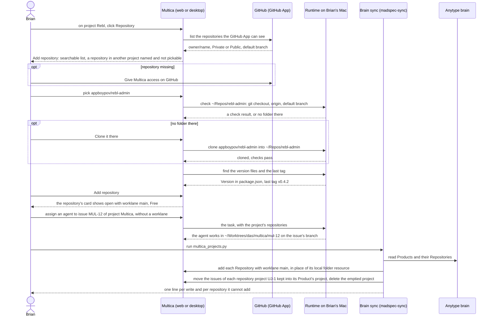

## At a glance

| Kind | Name | Change | Path |
|---|---|---|---|
| Concept | Repository of a project: a GitHub repository, its checkout on a runtime, its version policy | new (in place of the project's GitHub and local folder resources) | `packages/core/types/project.ts`, `server/migrations/065_project_resources.up.sql` |
| Concept | Worklane `main`: the repository's normal checkout, Free | new | `packages/core/types/` |
| Dialog | Add repository: repository, checkout, releases | new | `packages/views/projects/`, `designs/screens/steer-all-work.pen` (screen 6) |
| Section | Project page: one card per repository with its default branch and worklane `main`, in place of Resources | changed | `packages/views/projects/components/project-detail.tsx`, `packages/views/projects/components/project-resources-section.tsx` |
| Header | Project page: number of repositories | changed | `packages/views/projects/components/project-detail.tsx` |
| Dialog | Edit repository: checkout and releases | new | `packages/views/projects/` |
| Menu | Repository card: Edit repository, Remove repository | new | `packages/views/projects/` |
| Page | Projects and an organisation's page: a project folds open to its repositories | changed | `packages/views/projects/components/projects-page.tsx`, `packages/views/organisations/` |
| Page | Organisations and an organisation's page: number of repositories | changed | `packages/views/organisations/` |
| Runtime | An issue's task works in a worktree per repository at `~/Worktrees/{organisation key}/{repo}/{issue key}`, removed once the issue is done and nothing would be lost | changed | `server/internal/daemon/execenv/`, `server/internal/daemon/local_directory.go` |
| Tool | Brain sync: each Product's repositories as repositories with worklane `main`, in place of local folder resources, and the repository projects UJ-1 kept merged into their Product's project | changed | `madspec-sync/multica_projects.py`, `madspec-sync/specs/multica-projects.md` |

The `main` rows on Projects and an organisation's page, other worklanes and their counts come with UJ-3. What keeps a repository with other worklanes, releases or issues from removal comes with the journeys that bring them: UJ-3, UJ-4 and UJ-5.

## Why

A project in Multica shows no repository. Its code lives in resources: a GitHub link or a local folder typed in by hand, with no check that the folder is that repository's checkout, no default branch and no idea how the repository releases. A project holds one local folder per runtime, so after UJ-1 a Product with several repositories, such as MadSpec, still has one project per repository next to its Product's empty project, and an agent on a project's issues has one folder to work in at most. Brian cannot see or set what each project builds from, and the worklanes and releases of UJ-3 to UJ-8 need a repository with a checked checkout and a version policy to stand on.

Success signal: Brian adds appboypov/rebl-admin to the project Rebl by picking it from the GitHub App's list, cloning it to `~/Repos/rebl-admin` from the dialog, and sees its card open on Rebl's page with worklane `main` Free and "Version in package.json"; after one brain sync run every project shows its Product's repositories as cards, MadSpec and SuperMarty hold the issues of their repositories' former projects, and no project shows a resource.

## What Changes

- Add repository, from a project's page, lists the repositories the GitHub App can see, checks the checkout on a runtime, clones it when its folder does not exist, shows the version policy it found, and creates the repository with worklane `main`.
- A project's page shows one card per repository and its number of repositories; Projects and an organisation's page fold a project open to its repositories; Organisations and an organisation's page count repositories.
- A repository card's menu has Edit repository, for its checkout and releases, and Remove repository, which leaves the checkout folder on disk.
- **BREAKING** Project resources go: no page shows Resources, and no GitHub repository or local folder can be attached to a project.
- **BREAKING** An agent on an issue without a worklane gets the project's repositories and works in a worktree per repository at `~/Worktrees/{organisation key}/{repo}/{issue key}`, in place of a throwaway worktree of the project's local folder; the worktree stays for the issue's tasks and goes once the issue is Done or Cancelled and nothing in it would be lost.
- **BREAKING** The brain sync adds each Product's repositories to its project as repositories with worklane `main`, in place of the local folder resource it made per checkout. It moves the issues of each repository project UJ-1 kept for a Product with several repositories into the Product's project once the repository is added there, and deletes the emptied project.

## Capabilities

### New Capabilities

- `add-repository`: lets Brian add a GitHub repository to a project with a checked checkout and a version policy.
- `project-repositories`: lets Brian see a project's repositories on its page, on Projects and on the organisation pages, and edit or remove one.
- `issue-worktrees`: lets an agent work an issue without a worklane in a worktree per repository under `~/Worktrees`, leaving Brian's checkouts untouched.
- `brain-repository-sync`: lets Brian fill each project's repositories from the brain with one sync run.

### Modified Capabilities

None in `specs/openspec/specs/`. This change builds on the unarchived change `projects-by-organisation` (UJ-1): `brain-repository-sync` extends its `brain-project-sync`, and `issue-worktrees` uses the organisation key its `organisations` adds.

## Impact

- Web and desktop: the project page, Projects, Organisations, an organisation's page, and the new Add repository and Edit repository dialogs.
- Shared packages: project types and the repository and worklane types, the API client and its schemas, project queries, the GitHub repository query Add repository reads.
- Server: repositories and worklane `main` in the API and the database in place of project resources; the checks, clone and version policy run on the runtime; the task claim hands the project's repositories to the daemon.
- Daemon: an issue's worktree under `~/Worktrees` in place of the local folder and its execution modes; the worktree rule in the agent's brief (`server/internal/daemon/execenv/runtime_config_sections.go`) names the issue's worktree in place of the `madspec-git` folder.
- `madspec-sync/`: `multica_projects.py`, its spec `madspec-sync/specs/multica-projects.md`, its tests and the README.
- `madspec-git` "Core Rule" puts lane worktrees at `~/Worktrees/{team}/{lane folder}/{repo}`; Multica's worktrees no longer follow it.
- Copy in every supported language and the project docs in `apps/docs`.

## Constraints

- A GitHub repository is in at most one project of the workspace.
- A repository is added only from the GitHub App's list; there is no URL field.
- A repository is saved only with a checkout that is a git checkout of it, whose `origin` is that repository and which is on its default branch.
- Every repository has worklane `main` on its checkout from the moment it is added.
- Removing a repository never deletes its checkout folder.
- An agent's task never changes Brian's normal checkout; it works in the issue's worktree.
- An issue's worktree is removed only when the issue is Done or Cancelled and it holds nothing uncommitted or unpushed.
- The brain sync writes nothing to the brain and never changes a checkout or version policy set in Multica.
- The brain sync deletes only a repository project UJ-1 kept whose issues it moved into its Product's project.
- AGENTS.md: no foreign keys or cascades, `CREATE INDEX CONCURRENTLY` in its own migration, zod schemas with `parseWithFallback` and malformed-response tests for the new responses, no compatibility shims, every check local.

## Non-goals

- Worklanes other than `main`, their rows and counts: UJ-3.
- The rules that keep a repository with worklanes besides `main`, releases or issues from removal: UJ-3, UJ-4 and UJ-5.
- Planning and shipping releases: UJ-4 and UJ-8.
- An agent on a runtime without the repository's checkout: it keeps today's checkout in its own folder.
- Settings › Repositories, the workspace's repository list: unchanged.
- Changing which GitHub repository a repository is; Remove and Add do that.
- Squads, the mobile app and dark mode.

## Sources

- Intent: [Steer projects, repositories, worklanes and releases in Multica](anytype://object?objectId=bafyreib727ukptyvcfbkud627gjb3cu2lmwsh3u4cjbu4kisjofa25km3u) and its Requests.
- PRD: [Multica: steer projects, repositories, worklanes and releases](anytype://object?objectId=bafyreiew63xw2dncss52jdx4qk4o6aktkklhqroclvs3cvjxcyztx7h5um): UJ-2, F2 with FR-10 to FR-19, FR-2 to FR-4, the glossary, non-goals and the Addendum.
- Brief: [Multica: steer projects, repositories, worklanes and releases](anytype://object?objectId=bafyreicccdj6bucv5d65bxvkz4gy7jf7etplsswmwfggupqbakc6rudpmi).
- UJ-1 change: `specs/openspec/changes/projects-by-organisation/`.
- Brian's decision of 13 October 2026: UJ-1 merges only Products with one repository, and the repository projects of a Product with several stay until this change gives a project several repositories ([Decision](anytype://object?objectId=bafyreigpipb7flny46p4h3cxarg726x6vvij2yvgxcdq6zuiglqw3jgb2y)).
- Design: [Steer all work screens](anytype://object?objectId=bafyreiauxfhf7w74hwn5je7ljakzxfgo2qv4noid2oshvtqjwkos2v5oiq), screens 2 Project and 6 Add repository in `designs/screens/steer-all-work.pen`, exports `designs/exports/2-project.png` and `designs/exports/6-add-repository.png`; [component library](anytype://object?objectId=bafyreiamoqycfo735krrpmzn3ujhdardv6uixsrdzkadzlodwpr7aenwee); `designs/creation-flows.md` "What exists today", "The model" and "Add repository".
- Prototype: [Steer all work prototype](anytype://object?objectId=bafyreieck7zsmzslnfe5asszexojznfbnsnwcg62eqbesqqeigkkzgoclm), revision `460535099583266816`, `AddRepositoryDialog` in `prototypes/web/src/components/generated/creation.tsx`.
- Brian's answers in the P4 session of 13 October 2026, on the [UJ-2 Task](anytype://object?objectId=bafyreidtcw5ftbcaufzpiwkq3gdajdd2rug5a72eoy2j7mnhz6edkjpdwi): worktrees live at `~/Worktrees/{organisation key}/{repo}/{issue key in lowercase}`, or `~/Worktrees/{repo}/{issue key}` without an organisation; an issue's worktree goes once the issue is Done or Cancelled and nothing would be lost; Multica looks for pubspec.yaml, Cargo.toml, pyproject.toml and package.json and offers each it finds. His answers that a worklane's worktree is `~/Worktrees/{organisation key}/{repo}/{worklane folder}` and that organisations get a key supersede PRD UJ-3 step 2, FR-21 and FR-23 (`~/Worktrees/{project key}/{folder}/{repo}`) and change the UJ-1 change.
- Today's code: `packages/views/projects/components/project-resources-section.tsx`, `packages/views/settings/components/repositories-section.tsx`, `packages/core/github/`, `server/internal/handler/project_resource.go` and `github.go`, `server/internal/daemon/local_directory.go`, `server/internal/daemon/execenv/runtime_config_sections.go`.
- The brain sync's passed spec `madspec-sync/specs/multica-projects.md`, whose rules this change keeps where it does not replace them: a repository it cannot place is reported and left alone, a repository with two checkouts is reported, a value Brian set in Multica stays, a failed read writes nothing.
