## At a glance

```mermaid
flowchart LR
  classDef work fill:#d9f2d9,stroke:#2e7d32,color:#172117
  classDef skip fill:#eeeeee,stroke:#9e9e9e,color:#424242
  P5[P5 Technical design] --> J1
  J1[J1 Project structure<br/>Skip: J1]:::skip --> J2
  J2[J2 Data models<br/>groups 1-3]:::work --> J3
  J3[J3 Data-flow prototype<br/>group 4]:::work --> J4
  J4[J4 Design system<br/>Skip: J4]:::skip --> J5
  J5[J5 Components<br/>Skip: J5]:::skip --> J6
  J6[J6 Screens<br/>group 5]:::work --> J7
  J7[J7 Live prototype<br/>group 6]:::work --> J8
  J8[J8 Backend and agent tooling<br/>groups 7-9]:::work --> J9
  J9[J9 Frontend<br/>groups 10-12]:::work --> J10
  J10[J10 Agent tooling for UI<br/>Skip: J10]:::skip --> J11
  J11[J11 Acceptance test and archive<br/>group 13]:::work
```

| Step | Groups | Builder |
|---|---|---|
| J1 Project structure | none: `Skip: J1` | - |
| J2 Data models | 1 new model, 2 model change, 3 action names | `madspec-model-builder`, `madspec-dto-builder` |
| J3 Data-flow prototype | 4 | `madspec-prototype-builder` |
| J4 Design system | none: `Skip: J4` | - |
| J5 Components | none: `Skip: J5` | - |
| J6 Screens | 5 | `madspec-screen-designer` |
| J7 Live prototype | 6 | `madspec-prototype-builder` |
| J8 Backend and agent tooling | 7 endpoint, 8 integration, 9 integration | `madspec-api-builder` |
| J9 Frontend | 10 flow, 11 component change, 12 screen | `madspec-api-builder`, `madspec-component-builder`, `madspec-view-builder` |
| J10 Agent tooling for UI | none: `Skip: J10` | - |
| J11 Acceptance test and archive | 13 | Sarkout |

This change builds on UJ-1 (`projects-by-organisation`, DAS-450): its `organisation` table, migrations 572 to 574, `project-table.tsx`, the Organisations pages and the brain sync's mark file. Its J2 starts once UJ-1's J2 is merged.

## 1. J2 Data models: new model

- [ ] 1.1 `server/migrations/590_repository.up.sql`, `.down.sql` -- create `repository`, `worklane` and `issue_worktree` with the columns and `CHECK`s of design.md decision 1, without foreign keys. The down migration drops the three tables.
- [ ] 1.2 `server/migrations/591_repository_full_name_index.up.sql`, `.down.sql` -- `CREATE UNIQUE INDEX CONCURRENTLY repository_workspace_full_name_unique ON repository (workspace_id, LOWER(full_name))` -- a repository is in at most one project.
- [ ] 1.3 `server/migrations/592_repository_project_index.up.sql`, `.down.sql` -- `CREATE INDEX CONCURRENTLY repository_project_idx ON repository (project_id)`.
- [ ] 1.4 `server/migrations/593_worklane_name_index.up.sql`, `.down.sql` -- `CREATE UNIQUE INDEX CONCURRENTLY worklane_repository_name_unique ON worklane (repository_id, LOWER(name))`.
- [ ] 1.5 `server/migrations/594_worklane_main_index.up.sql`, `.down.sql` -- `CREATE UNIQUE INDEX CONCURRENTLY worklane_repository_main_unique ON worklane (repository_id) WHERE is_main`.
- [ ] 1.6 `server/migrations/595_issue_worktree_issue_index.up.sql`, `.down.sql` -- `CREATE UNIQUE INDEX CONCURRENTLY issue_worktree_issue_repository_unique ON issue_worktree (issue_id, repository_id)`.
- [ ] 1.7 `server/migrations/596_issue_worktree_removing_index.up.sql`, `.down.sql` -- `CREATE INDEX CONCURRENTLY issue_worktree_removing_idx ON issue_worktree (daemon_id) WHERE state = 'removing'`.
- [ ] 1.8 `server/cmd/migrate/main.go` -- add 591 to 596 to the concurrent index cleanups -- `TestEveryConcurrentUpBuildHasCleanup` requires it. When `main` has taken any of 590 to 597, take the next free numbers and rename every reference.
- [ ] 1.9 `server/pkg/db/queries/repository.sql` -- `ListRepositories` (by `LOWER(full_name)`), `ListRepositoriesByProject`, `GetRepositoryInWorkspace`, `CreateRepository`, `UpdateRepositoryCheckout`, `UpdateRepositoryGithub`, `UpdateRepositoryVersionPolicy`, `DeleteRepository`, `DeleteRepositoriesByProject`, each filtered by `workspace_id`.
- [ ] 1.10 `server/pkg/db/queries/worklane.sql` -- `ListWorklanes`, `CreateWorklane`, `DeleteWorklanesByRepository`, `DeleteWorklanesByProject` (through `repository`), each filtered by `workspace_id`.
- [ ] 1.11 `server/pkg/db/queries/issue_worktree.sql` -- `UpsertIssueWorktree` on `(issue_id, repository_id)`, `ListIssueWorktreesForIssue`, `SetIssueWorktreesStateForIssue`, `ListRemovingIssueWorktreesForDaemon`, `DeleteIssueWorktree`, `KeepIssueWorktree` (state and reason), `DeleteIssueWorktreesByIssue`.
- [ ] 1.12 `server/pkg/db/queries/workspace_delete.sql` -- add deletes of `issue_worktree`, `worklane` and `repository` in the step that deletes projects. `server/internal/handler/workspace_delete_manifest_test.go` -- classify `repository`, `worklane` and `issue_worktree` as deleted with the workspace.
- [ ] 1.13 `server/pkg/db/generated/` -- run `make sqlc` and commit the output.

## 2. J2 Data models: model change

- [ ] 2.1 `packages/core/types/repository.ts`, `worklane.ts`, `index.ts` -- `Repository`, `VersionPolicy` (the six values), `AvailableRepository`, `ListRepositoriesResponse`, `ListAvailableRepositoriesResponse {repositories, install_url}`, `CreateRepositoryRequest`, `UpdateRepositoryRequest`, `RepositoryCheckoutRequest` and its result with `failures: {code, detail}[]`, `version_files`, `last_tag`; `Worklane` and `ListWorklanesResponse`.
- [ ] 2.2 `packages/core/api/schemas.ts` -- `RepositorySchema`, `AvailableRepositoriesResponseSchema`, `WorklaneSchema`, `RepositoryCheckoutRequestSchema` with defaults and an unknown `version_policy` falling back to `none`, an unknown failure `code` kept as `unknown` -- AGENTS.md "API Compatibility".
- [ ] 2.3 `packages/core/api/schemas.test.ts` -- malformed-response cases: missing `repositories`, a repository without `default_branch`, an unknown `version_policy`, a check result without `failures`.

## 3. J2 Data models: action names

- [ ] 3.1 `server/pkg/protocol/events.go` -- `EventRepositoryCreated`, `EventRepositoryUpdated`, `EventRepositoryDeleted`, `EventWorklaneCreated`, `EventWorklaneDeleted` with the payloads of design.md decision 2.
- [ ] 3.2 `server/pkg/protocol/messages.go` -- `PendingWorkKindRepositoryCheckout`, `PendingWorkKindIssueWorktrees` and the heartbeat response's `issue_worktree_removals`.
- [ ] 3.3 `packages/core/modals/store.ts` -- `"add-repository"` and `"edit-repository"` in `ModalType`.

## 4. J3 Data-flow prototype: data-flow prototype

- [ ] 4.1 `prototypes/web/repositories-of-a-project/data-flow/` -- an interactive prototype without UI that runs design.md "Journey sequence and data flow": the available list, a taken repository, the check with each failure code, clone, the found version policy, create with worklane `main`, an issue task's claim and worktree path with and without an organisation, the removal and the kept worktree with its comment, and the brain sync's adds and reports. Each step shows its input, output and store -- J3's contract.
- [ ] 4.2 `prototypes/web/repositories-of-a-project/data-flow/README.md`, PNG exports -- how to run it, and one PNG per step -- J3's contract.

## 5. J6 Screens: screen design

- [ ] 5.1 `designs/screens/steer-all-work.pen` -- screen 6 Add repository in the states of the `add-repository` spec: the list, searching, no match, a taken repository, giving access; Checkout passed, another folder, origin mismatch, wrong branch, not a git checkout, offline runtime, no folder with Clone it there, cloning, clone failed; Releases with one file, two files, none, no tags, does not release; Add repository disabled. Edit repository with its fixed repository and its Checkout and Releases fields. Screen 2 Project with repository cards, folded and open, the card menu and no Resources; Projects and an organisation's page with a project folded open to its repositories; Organisations with repository counts. Built from the library's existing components and tokens -- J6's contract.
- [ ] 5.2 `designs/creation-flows.md` -- the UX notes of these screens, with an At a glance flowchart where each arrow names its action -- J6's contract.
- [ ] 5.3 `designs/exports/` -- one PNG per new or changed screen -- J6's contract.

## 6. J7 Live prototype: prototype change

- [ ] 6.1 `prototypes/web/src/components/generated/` -- bring `AddRepositoryDialog`, the project page's repository cards and the fold rows in line with group 5's screens, and add Edit repository and Remove repository -- the live prototype of the journey.
- [ ] 6.2 `prototypes/web/` -- one PNG per changed prototype screen, beside the existing exports -- J7's contract.

## 7. J8 Backend and agent tooling: endpoint

- [ ] 7.1 `server/internal/handler/github.go` -- extract the installation token mint from `fetchGitHubInstallationRepositories` into one helper; add `listInstallationRepositories` (pages of 100) and `getInstallationRepository` (`GET /repos/{owner}/{name}`), returning `github_repo_id`, `full_name`, `private`, `default_branch`.
- [ ] 7.2 `server/internal/handler/repository.go` -- `ListRepositories`, `ListAvailableRepositories`, `CreateRepository`, `UpdateRepository`, `DeleteRepository` as design.md decision 2 sets out:
  - `available` merges every installation's repositories by `full_name` and returns `install_url`; a failed GitHub read is 502.
  - Create and update read the repository from GitHub; none sees it: 400.
  - `checkout_check_id` must name a passed, completed check for the same `full_name` and current default branch, else 400. `checkout_daemon_id` and `checkout_path` come from the check.
  - Create writes the repository and worklane `main` in one transaction; a taken repository is 409 naming its project.
  - Delete removes the repository and its worklanes in one transaction and leaves its issue worktree rows.
  - `parseUUIDOrBadRequest` for path and body ids; publish the events of 3.1.
- [ ] 7.3 `server/internal/handler/worklane.go` -- `ListWorklanes`.
- [ ] 7.4 `server/internal/handler/runtime_repository_checkout.go` -- `RepositoryCheckoutStore` (in memory and Redis, as `DirectoryListingStore`), `InitiateRepositoryCheckout`, `GetRepositoryCheckout`, the daemon's `ReportRepositoryCheckoutResult`, guarded by `requireRuntimeLocalSkillAccess`; 503 for an offline runtime; timeouts of 30 seconds for a check and 10 minutes for a clone; finished requests kept 30 minutes -- design.md decision 3, ADR-0001.
- [ ] 7.5 `server/internal/handler/issue_worktree.go` -- the daemon's `RecordIssueWorktree` (upsert, `active`, absolute path) and `ReportIssueWorktreeRemoval` (`removed` deletes the row; `kept` sets state and reason and adds one system comment "`{path}` stayed because it {reason}.") -- design.md decision 5.
- [ ] 7.6 `server/internal/handler/project_resource.go` -- delete the file and `project_resource_test.go`, `worktree_claim_gate_test.go`. `server/pkg/db/queries/project_resource.sql` -- delete the file. `server/pkg/protocol/events.go` -- remove `EventProjectResource*`. `server/internal/handler/claim_repositories.go` -- the claim context of design.md decision 4: for an issue task, the project's repositories with the recorded worktree path, the organisation key and the issue key; project repositories replace the workspace repos; chat tasks get the repositories with their checkout paths. Move `claim_project_context_test.go` to the new shape.
- [ ] 7.7 `server/internal/handler/daemon.go` -- the claim response carries `repositories`, `organisation_key` and `issue_key`; the heartbeat response carries `issue_worktree_removals` for the daemon's `removing` rows. `server/internal/handler/config.go` -- remove `local_worktree_supported`. `server/pkg/agent/version.go` -- remove `MinLocalWorktreeCLIVersion` and `worktree_capability_contract_test.go`. `server/pkg/protocol/messages.go`, `server/internal/daemon/client.go`, `client_test.go`, `server/internal/handler/daemon_test.go` -- remove `DaemonCapabilityLocalWorktreeV1`.
- [ ] 7.8 `server/internal/handler/project.go` -- `ProjectResponse` drops `resource_count`; create drops `resources`; project delete deletes the project's repositories and worklanes in its transaction. `server/internal/handler/issue.go` -- issue delete deletes its issue worktree rows. `server/pkg/db/queries/workspace_delete.sql` -- remove `deleted_project_resources`. `server/internal/handler/workspace_delete_manifest_test.go` -- drop `project_resource`.
- [ ] 7.9 `server/cmd/server/issue_worktree_listeners.go` -- on `issue:updated` with `status_changed`: Done or Cancelled sets the issue's rows `removing` and calls `requestDaemonPendingWork` with `PendingWorkKindIssueWorktrees` for the online runtimes of each daemon involved; leaving them sets the rows `active`.
- [ ] 7.10 `server/cmd/server/router.go`, `server/cmd/server/listeners.go` -- register `/api/repositories`, `/api/repositories/available`, `/api/worklanes` in the workspace-member group, the runtime and daemon routes of 7.4 and 7.5, and broadcast `repository:*` and `worklane:*` to the workspace. Remove the project resource routes.
- [ ] 7.11 `server/internal/service/task.go` -- the waiting status comment names the worktree, not a local folder resource. `server/pkg/db/queries/agent.sql` -- the `MarkAgentTaskWaitingLocalDirectory` comment names the worktree lock, not a resource.
- [ ] 7.12 `server/internal/handler/repository_test.go`, `runtime_repository_checkout_test.go`, `issue_worktree_test.go`, `server/cmd/server/issue_worktree_listeners_test.go` -- DB tests with `testutil` fixtures and a fake GitHub server:
  - Available merges two installations; a repository in a project is listed; a failed read is 502.
  - Create with a passed check makes worklane `main`; without a check, with a failed check, with another repository's check, and with a check for an old default branch: 400.
  - A taken repository: 409 naming its project. Another workspace's repository is invisible.
  - Update with a new check moves the checkout; update without one keeps it; `full_name` cannot change.
  - Delete leaves issue worktree rows; project delete removes repositories and worklanes.
  - A check on another member's runtime is refused; an offline runtime is 503.
  - Done sets `removing`, reopening sets `active`; a `kept` result adds one system comment.
  - The spec scenarios at their canonical layer.
- [ ] 7.13 `server/migrations/597_drop_project_resource.up.sql`, `.down.sql` -- `DROP TABLE project_resource`. The down migration recreates the empty table and the two indexes of `065_project_resources.up.sql` with plain `CREATE INDEX`. Run `make sqlc` and commit the output: `project_resource.sql.go` and the `ProjectResource` model go.

## 8. J8 Backend and agent tooling: integration

- [ ] 8.1 `server/internal/daemon/repository_checkout.go`, `daemon.go` `handleHeartbeatActions` -- claim `PendingWorkKindRepositoryCheckout`, expand `~`, clone with `git clone git@github.com:{full_name}.git` when asked and nothing is at the path, check exists, git work tree, `origin` (SSH or HTTPS, case and `.git` ignored) and current branch, then the version files on `refs/heads/{default_branch}` and the highest `v{major}.{minor}.{patch}` tag -- design.md decision 3. Report through `client.go`.
- [ ] 8.2 `server/internal/daemon/execenv/issue_worktree.go` -- reuse an existing worktree of the checkout at the path; else under the checkout's repo lock fetch `origin {default_branch}` and `git worktree add -b {issue key} {path} origin/{default_branch}`, or add the existing branch; a path that is not a worktree of the checkout fails the task with that reason.
- [ ] 8.3 `server/internal/daemon/issue_worktree.go`, `daemon.go` `runTask`, `types.go` -- for repositories on this daemon: the recorded path, else `~/Worktrees/{organisation key}/{repo}/{issue key}` or `~/Worktrees/{repo}/{issue key}`; lock the path with `LocalPathLocker`; with one repository the agent starts in its worktree, with more in its task folder; record each new worktree with `POST /api/daemon/tasks/{taskId}/issue-worktrees` -- design.md decision 4.
- [ ] 8.4 `server/internal/daemon/health.go` -- `multica repo checkout owner/name` for a project repository makes or reuses the issue worktree on this daemon and prints its path, recording it as 8.3 does. Other URLs keep the bare-cache path.
- [ ] 8.5 `server/internal/daemon/issue_worktree_removal.go` -- per heartbeat removal, with a lock taken without waiting: a missing path is removed; empty `git status --porcelain` and empty `git log {branch} --not --remotes` remove the worktree and delete its branch; otherwise keep with "holds uncommitted changes" or "holds N commits that are not pushed"; report each.
- [ ] 8.6 `server/internal/daemon/local_directory.go`, `execenv/local_worktree.go`, their tests and the in-place mode in `execenv/execenv.go` and `daemon.go` -- delete. Keep `LocalPathLocker` (moved into `issue_worktree.go`), the repo lock, the git helpers and the sidecar manifest; move their tests with them.
- [ ] 8.7 `server/internal/daemon/execenv/runtime_config_sections.go`, `runtime_config.go`, `context.go` -- `writeRepositories` lists each project repository with its worktree path on this daemon, its checkout path for chat, or "on another runtime"; `writeProjectContext` drops resources; `worktreeRule` for an issue task with an issue worktree says to work, commit and push in that worktree on its branch, never in the normal checkout.
- [ ] 8.8 `server/cmd/multica/cmd_project.go`, `cmd_id_resolver.go`, `cmd_project_test.go` -- remove `multica project resource`.
- [ ] 8.9 `server/internal/service/builtin_skills/multica-platform/references/projects.md`, `runtimes.md` -- replace project resources with repositories and issue worktrees.
- [ ] 8.10 Daemon tests beside the code -- a fake git repository: the check's five outcomes, clone into a missing folder, version files on the default branch and the last tag; a new worktree, a reused worktree with an earlier commit, a recorded path after a key change; removal of a clean pushed worktree, kept with an uncommitted change and with an unpushed commit; a held lock skips the removal. The `issue-worktrees` spec scenarios.

## 9. J8 Backend and agent tooling: integration

- [ ] 9.1 `madspec-sync/multica_projects.py` -- design.md decision 7:
  - Remove the checkout step, UJ-1's single-repository merge step and the checkout mark from take-over.
  - Read `GET /api/repositories` and `/api/repositories/available`.
  - For each Repository of each Product: skip one already in Multica (print "in {project}" when in another project), report one the App cannot see, with no checkout or with several, run a check on the sync's runtime and report a failure, else `POST /api/repositories` with the first found version file or `tags`.
  - Write each added repository into the mark file; print "has no Repository in the brain" for a marked repository whose object is gone.
  - Merge each project recorded under `repository_projects` in the mark file once its Repository is a repository of its Product's project: issues through `POST /api/issues/batch-update` in pages of 100, delete it only after a fresh read shows `issue_count` 0, then drop its entry. One whose repository is not added there stays. One that no longer exists leaves the mark file.
  - A failed read writes nothing.
- [ ] 9.2 `madspec-sync/tests/test_multica_projects.py` -- `plan()` cases per scenario of the `brain-repository-sync` spec delta: MadSpec's three repositories, the version policy, a second run writing nothing, not on the default branch then added after the switch, the App cannot see it, in another project Brian chose, an edited checkout and policy kept, removed in Multica and added again, deleted from the brain, MadSpec takes in its kept projects' 13 issues, and a repository the sync cannot add keeps its project. Drop UJ-1's checkout and single-repository merge cases.
- [ ] 9.3 `madspec-sync/specs/multica-projects.md`, `madspec-sync/README.md` -- rewrite the spec to the new rules (repositories in place of checkout resources, the merge of the projects UJ-1 kept, the repository marks) and update the README -- `madspec-sync/README.md` says the spec is the sync's contract.

## 10. J9 Frontend: flow

- [ ] 10.1 `packages/core/api/client.ts` -- `listRepositories`, `listAvailableRepositories`, `createRepository`, `updateRepository`, `deleteRepository`, `listWorklanes`, `initiateRepositoryCheckout`, `getRepositoryCheckout`, each through `parseWithFallback`. Remove the resource calls.
- [ ] 10.2 `packages/core/repositories/` (`queries.ts`, `mutations.ts`, `checkout.ts`, `index.ts`), `packages/core/package.json` -- `repositoryKeys.list(wsId)`, `repositoryKeys.available(wsId)`, the three mutations awaiting the server and invalidating on settle, and `resolveRepositoryCheckout` polling as `resolveRuntimeDirectoryListing` does. Export `./repositories`.
- [ ] 10.3 `packages/core/worklanes/` (`queries.ts`, `index.ts`), `packages/core/package.json` -- `worklaneKeys.list(wsId)`. Export `./worklanes`.
- [ ] 10.4 `packages/core/realtime/use-realtime-sync.ts` -- `repository:` and `worklane:` events invalidate their keys; drop `project_resource:`.
- [ ] 10.5 `packages/core/projects/resource-queries.ts`, `packages/core/projects/index.ts`, `packages/core/runtimes/` -- remove the resource queries and `runtimeAdvertisesLocalWorktree`. `packages/core/api/schemas.ts`, `schemas.test.ts`, `packages/core/platform/auth-initializer.tsx` -- remove `local_worktree_supported` from the config schema, its drift test and its reader.
- [ ] 10.6 `packages/core/projects/stores/view-store.ts`, `view-store.test.ts` -- add persisted `expandedProjects` for the repository rows; a payload without it loads.
- [ ] 10.7 `packages/core/repositories/*.test.ts` -- the check polling: completed, failed, timed out; an unknown failure code.

## 11. J9 Frontend: component change

- [ ] 11.1 `packages/views/repositories/components/checkout-field.tsx` -- the machine select from `buildRuntimeMachines` with offline machines shown and not pickable, the path filled with `~/Repos/{name}`, Choose through `RuntimeFileBrowser`, the check run on pick and on path change, each failure's sentence and fix, "No folder at {path}" with Clone it there and Cloning -- the `add-repository` spec's Checkout rules.
- [ ] 11.2 `packages/views/repositories/components/releases-field.tsx` -- one option per found version file in order, Tags only, This repository does not release, the first preselected, `tags v{version}`, the last tag or "No tags yet", and the no-releases note.
- [ ] 11.3 `packages/views/repositories/components/add-repository-dialog.tsx` -- the searchable list with Private or Public and default branch, "In {project}" not pickable, no match, "Missing one? Give Multica access on GitHub" opening `install_url` and reloading on focus; Add repository enabled with a picked repository and a passed check; on success the project page with the new card open.
- [ ] 11.4 `packages/views/repositories/components/edit-repository-dialog.tsx` -- the fixed repository and the two fields filled in; Save sends a check id only when the checkout changed.
- [ ] 11.5 `packages/views/repositories/components/repository-card.tsx` -- `owner/name`, default branch, worklane `main` Free; header folds; menu with Edit repository and Remove repository; Remove awaits the server.
- [ ] 11.6 `packages/views/modals/registry.tsx` -- register both dialogs.
- [ ] 11.7 Component tests beside them -- the list's taken and missing states, each Checkout failure, clone, the Releases options for one, two and no files, Add disabled until a passed check, Edit keeping the repository fixed, the card fold and menu.

## 12. J9 Frontend: screen

- [ ] 12.1 `packages/views/projects/components/project-detail.tsx` -- the header's repository count and Repository button, one repository card per repository by `full_name`, no Resources.
- [ ] 12.2 `packages/views/projects/components/project-resources-section.tsx`, `github-ref-dialog.tsx`, `github-ref-field.tsx`, `local-directory-*`, `project-resources-*.test.tsx`, `packages/views/platform/local-directory.ts`, `apps/desktop/src/main/local-directory.ts` and its preload wiring, `packages/views/modals/create-project.tsx`, `create-project-local-mode.test.tsx` -- remove the Resources section, its parts and New project's resource fields. `packages/core/types/project.ts`, `index.ts`, `packages/core/api/schemas.ts` -- remove `ProjectResource*`, `GithubRepoResourceRef`, `LocalDirectoryResourceRef`, `LocalDirectoryExecutionMode`, `ProjectResourceType`, `resources` on create and `resource_count` from the type, `ProjectSchema`, `EMPTY_PROJECT` and the test fixtures.
- [ ] 12.3 `packages/views/projects/components/project-table.tsx` -- a project row folds open through `expandedProjects` to one row per repository with `owner/name` and default branch, on Projects and an organisation's page.
- [ ] 12.4 `packages/views/organisations/components/` -- repository counts next to project counts on Organisations and an organisation's page.
- [ ] 12.5 `packages/views/locales/{en,zh-Hans,ko,ja,fr}/` -- a `repositories` namespace for the dialogs, fields and card, and the projects copy; remove the resource keys in all five languages -- `locales/parity.test.ts` stays green.
- [ ] 12.6 `apps/mobile/components/project/project-resources-section.tsx`, `apps/mobile/app/(app)/[workspace]/project/[id]/add-resource.tsx`, `apps/mobile/app/(app)/[workspace]/project/[id].tsx`, `apps/mobile/data/` (api, schemas, mutations, queries, realtime), the mobile locales -- remove Resources, because its endpoints go. Verify with the commands in `apps/mobile/AGENTS.md`.
- [ ] 12.7 `packages/views/projects/components/project-detail.test.tsx`, `projects-page.test.tsx`, `packages/views/organisations/components/*.test.tsx` -- the `project-repositories` spec scenarios that belong to pages: Rebl with one repository, a project without repositories, the fold, no Resources, the fold rows, the counts, a repository added.
- [ ] 12.8 `apps/docs/content/docs/projects.mdx`, `projects.zh.mdx`, `projects.ko.mdx`, `projects.ja.mdx`, `projects.fr.mdx` -- repositories in place of resources; delete `project-resources*.mdx` and their `meta.json` entries.

## 13. J11 Acceptance test and archive: acceptance test and archive

- [ ] 13.1 `e2e/repositories.spec.ts` -- the journey's acceptance test through `TestApiClient`, with a fake GitHub App list and a runtime that answers checks:
  - Add repository on Rebl lists the App's repositories, shows a taken one "In Photo Prank", picks appboypov/rebl-admin, passes the check, shows "Version in package.json" and Last tag, adds it, and Rebl's page shows its card open with `main` Free.
  - A failed check keeps Add repository disabled.
  - Edit repository moves the checkout and stops releasing; Remove repository removes the card.
  - Projects folds Rebl open to its repositories; Organisations counts them.
- [ ] 13.2 The brain sync run -- run `uv run madspec-sync/multica_projects.py` once against the local release and record its printed lines in the J11 pull request -- the PRD's success signal: every project shows its Product's repositories as cards, MadSpec and SuperMarty hold the issues of their repositories' former projects, and no project shows a resource.
- [ ] 13.3 An issue worktree on Brian's Mac -- assign an agent to a Multica issue without a worklane, see it work in `~/Worktrees/das/multica/{issue key}`, close the issue and see the worktree go; record both in the J11 pull request.
- [ ] 13.4 `specs/openspec/changes/repositories-of-a-project/` -- retire the `brain-project-sync` requirements "The repository project of a Product with one repository merges into its project" and "The repository projects of a Product with several repositories stay" through `madspec-revise-plan` (design.md Open Questions), run `openspec validate repositories-of-a-project --type change --strict`, sync the specs and archive the change -- the journey closes on its J11 pull request.

## Implementation Notes

## Plan Change Log

- 2026-10-13, before J2: UJ-1 (`projects-by-organisation`) now merges only Products with one repository, because a project holds one `local_directory` per daemon, and records the repository projects it keeps for a Product with several under `repository_projects` in its mark file (Brian's decision). This change's sync merges those kept projects into their Product's project once their repository is added there. 9.1 to 9.3, 13.2 and 13.4, the `brain-repository-sync` spec delta, proposal.md, design.md decision 7, its Risks, Migration Plan and Open Questions are revised through `madspec-revise-plan`.
- 2026-10-14, before J2: J2 only adds. Each removal moves to the step that removes its callers, so `main` builds and runs after each merged step: the drop of `project_resource` (old 1.8, now 7.13), `project_resource.sql` and `EventProjectResource*` (7.6), `DaemonCapabilityLocalWorktreeV1` (7.7) and the `agent.sql` comment (7.11) go with J8, `local_worktree_supported` (10.5) and the resource types, schemas and `resource_count` (old 2.2, now 12.2) with J9. The workspace delete manifest entries of the three new tables move from 7.8 to 1.12, since the manifest test fails once 590 adds them. Groups 1 and 2 are renumbered. design.md Risks and Migration Plan are revised through `madspec-revise-plan` (Brian approved).
