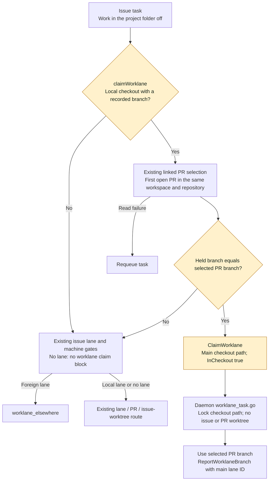

## At a glance

| Kind | Name | Change | Path |
|---|---|---|---|
| Claim | Held PR checkout selection | changed | `server/internal/handler/worklane_branch.go` |
| Tests | Held PR checkout regression | changed | `server/internal/handler/worklane_branch_test.go` |
| System design | Claim and daemon routing | changed | `specs/docs/system-design.md` |
| Metadata | Change build state | new | `specs/openspec/changes/retain-held-pull-request-checkout/.openspec.yaml` |
| Proposal | Checkout retention scope | new | `specs/openspec/changes/retain-held-pull-request-checkout/proposal.md` |
| Design | Claim flow and file inventory | new | `specs/openspec/changes/retain-held-pull-request-checkout/design.md` |
| ADR review | Existing checkout contract | new | `specs/openspec/changes/retain-held-pull-request-checkout/adr.md` |
| Tasks | Implementation and verification | new | `specs/openspec/changes/retain-held-pull-request-checkout/tasks.md` |
| Acceptance | Held checkout PR branch | new | `specs/openspec/changes/retain-held-pull-request-checkout/specs/repository-work-in-checkout/spec.md` |

## Decision

`claimWorklane` retains a main-worklane candidate with a nonempty recorded branch only on the checkout's machine. The existing pull request selection determines whether that candidate belongs to the issue. A matching branch receives `InCheckout` and the main worklane's checkout path. A nonmatching branch uses the issue's worklane with its existing location checks. An issue without a worklane gets no block for a nonmatching branch.

Reuse the existing linked-pull-request query and its workspace/repository filters. Load failure requeues the task. Machine gates remain before pull request reads for candidates without an eligible local checkout. The selected worklane is checked before its claim block is emitted.

## Verification

`TestClaimTask_CheckoutHoldingThePullRequestBranch` failed before the fix for both an issue without a worklane and an issue in another worklane. Both pass after the fix. Different branches and closed or unrelated pull requests keep their existing routes.

The focused worklane claim tests and daemon checkout execution tests pass. A disposable HTTP claim program with PostgreSQL and a real git repository retains the checkout on `review/actual-head` with the setting off. Handler vet and the server build pass in the isolated local ARM64 container.
