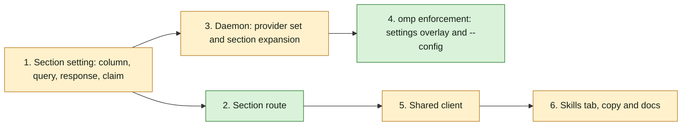

## At a glance

Joeri's Backend builders make groups 1-4 in one pull request; Thomas's Frontend builders make groups 5-6 in a second pull request stacked on it.

| Group | Team, builder | Proves it |
|---|---|---|
| 1. Section setting: column, query, response, claim | Backend, `madspec-api-builder` | `make sqlc && cd server && go build ./... && go test ./internal/handler -run 'TestAgentInheritRuntimeSkills' -count=1` |
| 2. Section route | Backend, `madspec-api-builder` | `cd server && go test ./internal/handler -run 'TestSetAgentRuntimeSkill' -count=1` |
| 3. Daemon: provider set and section expansion | Backend, `madspec-service-builder` | `cd server && go test ./internal/daemon -run 'TestConvertDisabledRuntimeSkills\|TestListRuntimeLocalSkills' -count=1` |
| 4. omp enforcement: settings overlay and `--config` | Backend, `madspec-function-builder` | `cd server && go test ./internal/daemon/execenv ./pkg/agent -run 'TestPrepareOmpSkillSettings\|TestEscapeOmpSkillGlob\|TestBuildPiArgs\|TestPrepare\|TestReuse' -count=1` |
| 5. Shared client | Frontend, `madspec-api-builder` | `pnpm typecheck` |
| 6. Skills tab, copy and docs | Frontend, `madspec-view-builder` | `pnpm --filter @multica/views exec vitest run agents/components/tabs/skills-tab.test.tsx` |

## 1. Section setting: column, query, response, claim

- [x] 1.1 `server/migrations/711_agent_inherit_runtime_skills.up.sql`, `.down.sql` -- up: `ALTER TABLE agent ADD COLUMN inherit_runtime_skills BOOLEAN NOT NULL DEFAULT true;`; down: `ALTER TABLE agent DROP COLUMN inherit_runtime_skills;`. -- every existing and new agent inherits until switched off (design Migration Plan). Verify: `make migrate-up` in the worktree environment, then `psql` shows the column `true` on existing rows.
- [x] 1.2 `server/pkg/db/queries/agent.sql` -- add `UpdateAgentInheritRuntimeSkills :one` after `UpdateAgentDisabledRuntimeSkills` (line 195): `UPDATE agent SET inherit_runtime_skills = $2, updated_at = now() WHERE id = $1 RETURNING *;`. Run `make sqlc`; commit `server/pkg/db/generated/*`. -- the single-column write of design Decision 2. Verify: `make sqlc` leaves `db.Agent.InheritRuntimeSkills bool` and the new method; `cd server && go build ./...`.
- [x] 1.3 `server/internal/handler/agent.go` -- add `InheritRuntimeSkills bool \`json:"inherit_runtime_skills"\`` to `AgentResponse` next to `DisabledRuntimeSkills` (line 127) and map it in `agentToResponse` (line 229); add `InheritRuntimeSkills *bool \`json:"inherit_runtime_skills,omitempty"\`` to `TaskAgentData` (line 773). `server/internal/handler/daemon.go` -- set it from `agent.InheritRuntimeSkills` in the claim's `TaskAgentData` (line 2630). -- the tab and the daemon read the setting. Verify: a new `TestAgentInheritRuntimeSkillsInResponseAndClaim` in `server/internal/handler/agent_runtime_skills_broadcast_test.go` asserts `GET /api/agents/{id}` returns `inherit_runtime_skills: true` for a fresh agent and the claim's agent data carries `true`, then `false` after the column is set off.
- [x] 1.4 `specs/docs/system-design.md` -- add `+jsonb disabled_runtime_skills` and `+bool inherit_runtime_skills` to the `agent` class. -- the living view matches the model (design inventory). Verify: the Mermaid block renders.

## 2. Section route

- [x] 2.1 `server/internal/handler/agent_runtime_skills_broadcast_test.go`, `server/internal/handler/skill_list_test.go` -- add tests, failing before 2.2-2.4: `PUT /api/agents/{id}/runtime-skills/inherit` with `{"enabled": false}` stores `false`, keeps `disabled_runtime_skills` unchanged, publishes `agent:status` with the new value and returns 204; `{"enabled": true}` restores `true`; a missing `enabled` is 400; an agent without a runtime is 400; a non-local runtime and a provider outside claude, codex and omp are 400; a member who cannot manage the agent is 403; the per-skill route now accepts an omp runtime and still rejects a plugin root for omp. -- the spec's section and per-skill scenarios on the API. Verify: `cd server && go test ./internal/handler -run 'TestSetAgentRuntimeSkill' -count=1` fails on the new cases only.
- [x] 2.2 `server/internal/handler/agent_runtime_skills.go` -- add `runtimeSkillControlsSupported(provider string) bool` (`claude`, `codex`, `omp`) and use it at line 119 with the message `runtime skill controls are only supported for claude, codex and omp`; plugin roots stay `claude` only (design Decision 3). -- one provider set in the handler package. Verify: 2.1's per-skill omp cases pass.
- [x] 2.3 `server/internal/handler/agent_runtime_skills.go` -- move the response building and publish of lines 193-208 into `broadcastAgentRuntimeSkills(w, r, agent db.Agent)` and call it from `SetAgentRuntimeSkillEnabled`; add `SetAgentRuntimeSkillsInherited` as design Decision 2 says: `loadAgentForUser` -> `canManageAgent` -> decode `{enabled *bool}` (400 when nil) -> runtime set (400 `agent has no runtime`) -> `getAgentRuntime` (404) -> local and `runtimeSkillControlsSupported` (400) -> `UpdateAgentInheritRuntimeSkills` -> `broadcastAgentRuntimeSkills` -> 204. Log with `slog` and the request attrs as the per-skill route does. -- the section switch's write. Verify: 2.1 passes.
- [x] 2.4 `server/cmd/server/router.go` -- add `r.Put("/runtime-skills/inherit", h.SetAgentRuntimeSkillsInherited)` after line 2337. -- the route exists. Verify: 2.1 passes; `TestSetAgentRuntimeSkillEnabledBroadcastsAgentStatus` and `TestSetAgentRuntimeSkillEnabledPersistsScopedOverride` still pass.

## 3. Daemon: provider set and section expansion

- [x] 3.1 `server/internal/daemon/daemon_test.go`, `server/internal/daemon/local_skills_test.go` -- add tests next to `TestConvertDisabledRuntimeSkillsForEnvScopesToClaimedRuntime` (line 6330), failing before 3.2-3.4: with a temp `HOME` holding two skills under `~/.omp/agent/skills` and one under `~/.agents/skills`, section off for `omp` returns all three as `{Root, Key, Name, Plugin}`; section off for `claude` returns its listed skills; section on, and section nil, return the scoped stored list; section off for a provider outside the set returns the stored list; a listing error returns an error. In `local_skills_test.go`, `CanDisable` is true for omp skills, as for Claude and Codex. -- the spec's run scenarios at the daemon. Verify: `cd server && go test ./internal/daemon -run 'TestConvertDisabledRuntimeSkills\|TestListRuntimeLocalSkills' -count=1` fails on the new cases only.
- [x] 3.2 `server/internal/daemon/types.go` -- add `InheritRuntimeSkills *bool \`json:"inherit_runtime_skills,omitempty"\`` to `AgentData` (line 205). -- a missing setting counts as on. Verify: `go build ./...`.
- [x] 3.3 `server/internal/daemon/local_skills.go` -- add `runtimeSkillsCanDisable(provider string) bool` (`claude`, `codex`, `omp`) and use it for `CanDisable` at line 619. -- omp rows get switches; one provider set in the daemon package. Verify: 3.1's `CanDisable` case passes.
- [x] 3.4 `server/internal/daemon/daemon.go` -- change `convertDisabledRuntimeSkillsForEnv` (line 9853) to `([]execenv.RuntimeSkillRefForEnv, error)` per design Decision 1; in `runTask`, call it before `execenv.TaskContextForEnv` (line 7583), return its error as `runTask` does for `expandInstructionSelection` (line 7576), and pass the list at line 7600. Log the expansion with `taskLog.Info` (provider, count). -- a section-off run starts without any listed runtime skill, and a later-installed skill follows the switch. Verify: 3.1 passes.

## 4. omp enforcement: settings overlay and `--config`

- [x] 4.1 `server/internal/daemon/execenv/runtime_skill_policy_test.go`, `server/internal/daemon/execenv/execenv_test.go`, `server/pkg/agent/pi_test.go` -- add tests, failing before 4.2-4.4: `prepareOmpSkillSettings` writes `omp-runtime-skill-settings.yml` with `{"skills":{"ignoredSkills":[...]}}`, using `Name` else the cleaned key's basename, escaping `\ * ? [ ] { } !`, skipping invalid keys and names an assigned skill claims, deduplicating, mode `0o600`; it removes the file and returns `""` when nothing is left. `Prepare` and `Reuse` for provider `omp` set `Environment.OmpSettingsPath`; other providers leave it empty. `buildPiArgs` with `OmpSettingsPath` set ends with `--config <path>` after the custom args, and without it has no `--config`. -- the spec's omp scenarios in the task environment. Verify: `cd server && go test ./internal/daemon/execenv ./pkg/agent -run 'TestPrepareOmpSkillSettings\|TestEscapeOmpSkillGlob\|TestBuildPiArgs\|TestPrepare' -count=1` fails on the new cases only.
- [x] 4.2 `server/internal/daemon/execenv/runtime_skill_policy.go` -- add `ompRuntimeSkillSettingsFile`, `escapeOmpSkillGlob` and `prepareOmpSkillSettings(envRoot, disabled, workspaceSkills) (string, error)` beside `prepareClaudeSkillSettings`, as design Decision 4 says. -- the overlay omp reads. Verify: 4.1's policy cases pass.
- [x] 4.3 `server/internal/daemon/execenv/execenv.go` -- add `OmpSettingsPath string` to `Environment` next to `ClaudeSettingsPath` (line 273); in `Prepare`, for provider `omp`, call `prepareOmpSkillSettings` after `prepareOmpMcpConfig` (line 543) and return its error; in `Reuse`, call it after line 842 and return `nil` on failure with a `logger.Warn`, as the omp MCP refresh does. -- every omp task, fresh or reused, carries its own overlay. Verify: 4.1's `Prepare`/`Reuse` cases pass.
- [x] 4.4 `server/pkg/agent/agent.go` -- add `OmpSettingsPath string` to `ExecOptions` next to `ClaudeSettingsPath` (line 135). `server/pkg/agent/pi.go` -- in `buildPiArgs` (line 995), append `--config`, `opts.OmpSettingsPath` after `filterPiCustomArgs` when set. `server/internal/daemon/daemon.go` -- set `OmpSettingsPath: env.OmpSettingsPath` next to `ClaudeSettingsPath` (line 8340). -- the omp run loads the overlay last. Verify: 4.1 passes; `cd server && go test ./internal/daemon/... ./pkg/agent/... -count=1` passes.

## 5. Shared client

- [ ] 5.1 `packages/core/types/agent.ts` -- add `inherit_runtime_skills?: boolean;` to `Agent` after `disabled_runtime_skills` (line 620), with the comment that older servers omit it and absent counts as on; change the `can_disable` comment (line 1292) to name Claude, Codex and omp. `packages/core/api/client.ts` -- add `setAgentRuntimeSkillsInherited(agentId: string, enabled: boolean): Promise<void>` after `setAgentRuntimeSkillEnabled` (line 3778), `PUT /api/agents/{id}/runtime-skills/inherit` with `{ enabled }`. -- the tab can read and write the section. Verify: `pnpm typecheck`.

## 6. Skills tab, copy and docs

- [ ] 6.1 `packages/views/agents/components/tabs/skills-tab.test.tsx` -- add tests, failing before 6.2-6.3, with a `mockSetAgentRuntimeSkillsInherited` beside `mockSetAgentRuntimeSkillEnabled` (line 17): the header switch shows on and calls `setAgentRuntimeSkillsInherited(agent.id, false)`; an agent without `inherit_runtime_skills` shows it on; while off, every row switch shows off and is disabled, and a stored per-skill off comes back when the section is on again; omp rows with `can_disable` show switches; no header switch without `canEdit`, when the listing fails, or when no listed skill can be disabled; a failed write shows `runtime_inherit_failed_toast`. -- the spec's tab scenarios. Verify: the vitest command of the group fails on the new cases only.
- [ ] 6.2 `packages/views/agents/components/tabs/skills-tab.tsx` -- add the header switch and the row states of design Decision 5: section on = `agent.inherit_runtime_skills !== false`; switch in the inherited section's `action` slot, in a `flex items-center gap-2` group before Refresh; busy key `runtime:inherit`; `refreshAgent()` after success; toast on failure, as `handleRuntimeToggle` (lines 117-143) does. -- Brian turns the section off and on. Verify: 6.1 passes.
- [ ] 6.3 `packages/views/locales/{en,fr,ja,ko,zh-Hans}/agents.json` -- add `runtime_inherit_aria` ("Inherit skills from {{runtime}}" in English) and `runtime_inherit_failed_toast` ("Could not change skill inheritance" in English) next to `runtime_toggle_aria`, translated per `apps/docs/content/docs/developers/conventions.mdx`. -- every supported language names the switch. Verify: 6.1 passes; the views locale parity test passes.
- [ ] 6.4 `apps/docs/content/docs/skills.mdx`, `skills.fr.mdx`, `skills.ja.mdx`, `skills.ko.mdx`, `skills.zh.mdx` -- line 96: runtime-local skills of Claude Code, Codex and Oh-My-Pi can be turned off per skill, or all at once with the section switch, by anyone who may modify the agent. -- the docs match the tab. Verify: `git diff --check`; each page renders in `pnpm --filter @multica/docs dev`.

## Implementation Notes

- Backend groups 1-4 are implemented and verified. Frontend groups 5-6 remain for Thomas in the stacked pull request.
- Migration 711 and sqlc generation succeeded. The migration smoke confirmed defaults for both existing and new rows and exercised the down migration inside a rolled-back temporary-table transaction.
- Database-backed inheritance response, claim, section toggle, broadcast, permission and provider tests pass. Fixture corrections use supported permission modes and do not fabricate a runtime missing behind the existing foreign key.
- The complete daemon and agent package suites pass with run-owned Multica environment variables cleared and the agent CLI guard enabled. The initial inherited environment caused unrelated Reasonix and Dsh path tests to fail; the isolated rerun passed.
- Go build and scoped go vet pass. A throwaway Prepare/Reuse executable and Bun.Glob smoke proved assigned-skill retention, exact literal-name exclusions, private overlay permissions and stale-overlay removal. No real agent CLI or production release ran.
- The model diagram rendered with both runtime-skill fields in Mermaid. Screenshot capture was unavailable for the non-visible browser tab.
- Discovery retains the approved existing listing semantics: errors returned by listRuntimeLocalSkills stop a section-off task; errors suppressed within its best-effort traversal remain outside that returned-error contract.
- omp reuse without a task-owned root declines preparation at the overlay boundary, avoiding relative settings writes or removal.
