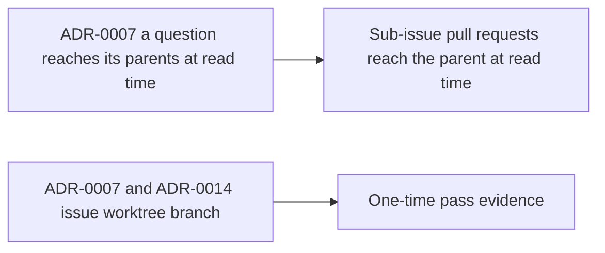

# ADR Review Manifest

- Status: completed
- Review date: 2026-10-17

## At a glance

| Kind | Name | Change | Path |
|---|---|---|---|
| Review | Pull request link constraints | new | `specs/openspec/changes/see-an-issues-pull-requests/adr.md` |

## Review Summary

ADR review completed for this change. All 26 files in `adr/` were read. The highest sequence is 0021. ADR-0006 (repositories) supersedes ADR-0004 (organisations), and ADR-0020 supersedes ADR-0003; ADR-0011 amends the read of ADR-0008. Reused numbers are told apart by file name.

No accepted ADR decides how pull requests link to issues. The design follows two in-force decisions: a parent shows its sub-issues' pull requests as a read-time projection, as `adr/0007-a-question-reaches-its-parents-at-read-time.md` does for questions, so no link row is written on the parent; and the one-time pass reads an issue's branch from `issue_worktree`, the record `adr/0007-worktrees-are-made-by-the-daemon-and-recorded-by-the-server.md` and `adr/0014-a-worklanes-issues-work-in-its-worktree-on-their-own-branch.md` make authoritative.

Fetching an unmirrored pull request through the existing GitHub App client, the link subcommand and the brief section are tactical and bind no later change. No major durable architectural decision is introduced, and no new repository-level ADR file is created.

## In-Force ADRs Reviewed

- `adr/0001-runtime-machine-files-are-read-by-the-daemon.md`
- `adr/0002-questions-are-their-own-aggregate.md`
- `adr/0004-question-sets-group-questions-open-is-per-question.md`
- `adr/0005-project-status-and-dates-stay-stored-but-unseen.md`
- `adr/0005-whether-a-run-may-ask-is-decided-at-claim.md`
- `adr/0006-questions-are-listed-per-viewer-through-one-row-list.md`
- `adr/0006-repositories-hold-worklanes.md`
- `adr/0007-a-question-reaches-its-parents-at-read-time.md`
- `adr/0007-worktrees-are-made-by-the-daemon-and-recorded-by-the-server.md`
- `adr/0008-worklane-activity-is-kept-in-the-activity-log.md`, read as amended by ADR-0011
- `adr/0009-the-server-keeps-worklane-and-issue-worktree-folders-apart.md`
- `adr/0010-the-server-keeps-each-repositorys-release-line.md`
- `adr/0011-a-worklane-shows-repository-activity-from-its-creation-on.md`
- `adr/0012-the-server-holds-the-issue-templates-and-a-type-is-set-once.md`
- `adr/0013-an-issue-is-placed-in-a-worklane-and-a-release-under-the-repositorys-lock.md`
- `adr/0014-a-worklanes-issues-work-in-its-worktree-on-their-own-branch.md`
- `adr/0015-the-database-keeps-an-issues-done-date.md`
- `adr/0016-the-worklanes-and-releases-pages-are-built-from-the-workspaces-lists.md`
- `adr/0017-a-client-account-is-refused-outside-the-session-list.md`
- `adr/0017-runtime-skill-switches-exist-only-where-the-run-enforces-them.md`
- `adr/0019-input-reaches-a-running-run-as-a-receipt.md`
- `adr/0020-only-wake-turns-answers-into-a-run-and-a-checked-answer-is-seen.md`
- `adr/0021-a-member-asks-on-an-issue-and-wakes-no-agent.md`
- `adr/0021-client-memberships-hold-organisation-sets.md`

Superseded, historical only: `adr/0003-only-wake-turns-answers-into-a-run.md`, `adr/0004-organisations-hold-projects.md`.

## New Durable ADRs Created

- None - no major durable architectural decisions were introduced.
