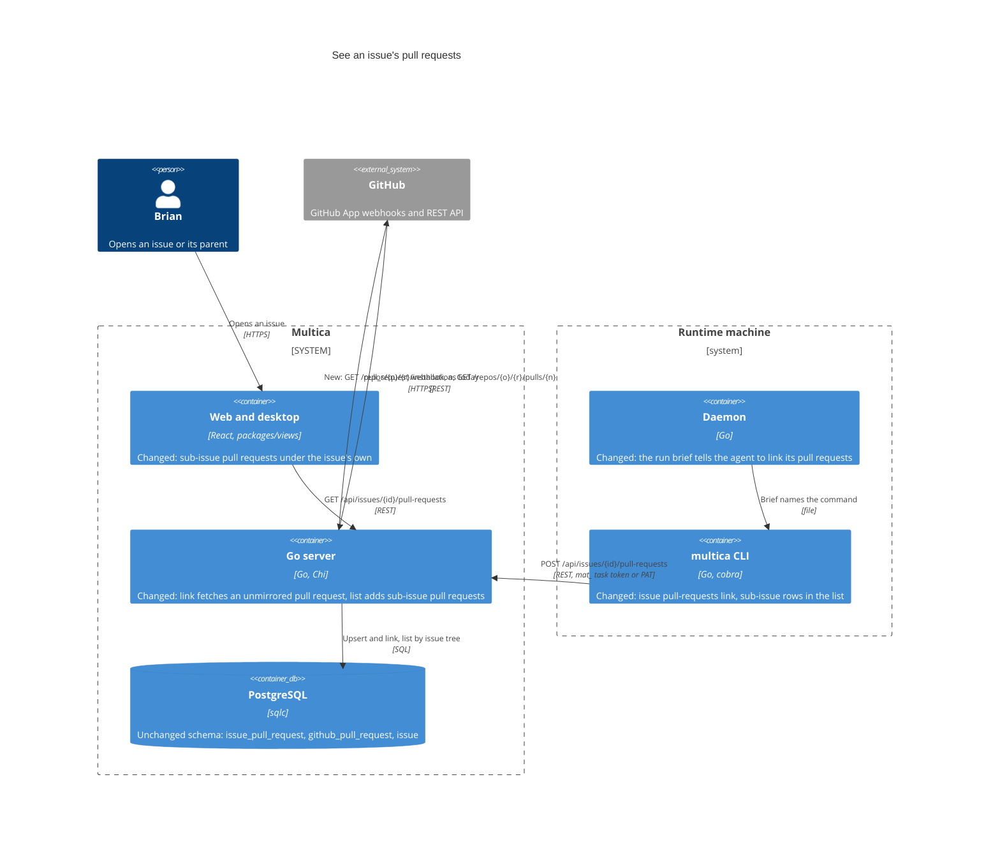
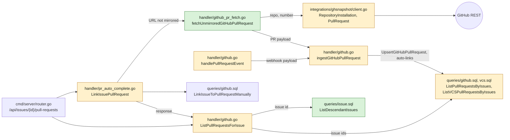
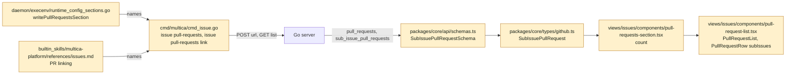
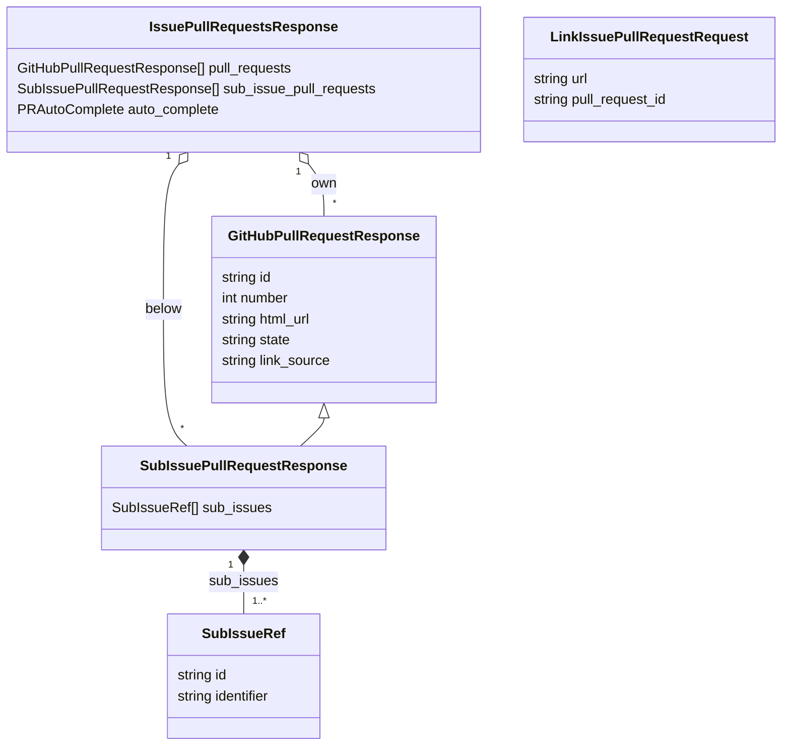
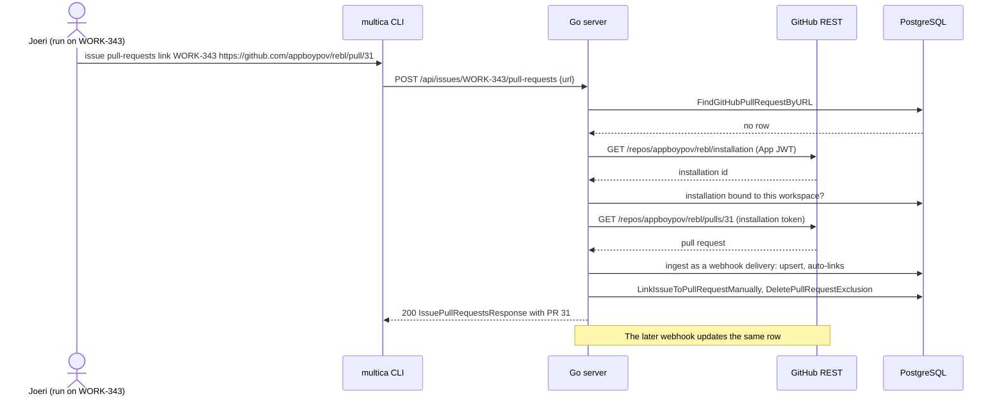
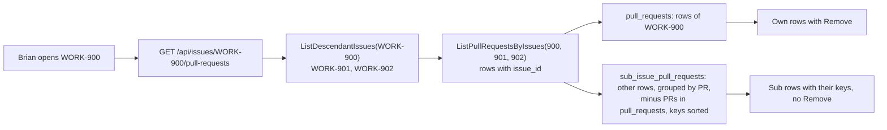

## At a glance

Delta against the living system design: `prototypes/system/system.json`, whose baseline this change adds from the code at `7fc83d223`, and `specs/docs/system-design.md`. No new container, table or migration. The Go server reads one pull request from GitHub's REST API when an agent links one Multica has not mirrored yet. The CLI gains a link command, the run brief tells agents to use it, and the issue page lists the pull requests of sub-issues.

### Containers

### Go server

### Daemon, CLI and web

### Models

`sub_issue_pull_requests` and `SubIssuePullRequestResponse` are new; every other field exists today. `issue_pull_request`, `github_pull_request` and `issue` keep their columns.

### Link before the webhook

### Parent list data flow

| Kind | Name | Change | Path |
|---|---|---|---|
| Queries | Issue descendants | new | `server/pkg/db/queries/issue.sql`, `server/pkg/db/generated/issue.sql.go` |
| Queries | Pull requests of several issues, GitHub and VCS | changed | `server/pkg/db/queries/github.sql`, `server/pkg/db/queries/vcs.sql`, `server/pkg/db/generated/github.sql.go`, `server/pkg/db/generated/vcs.sql.go` |
| Integration | Repository installation and pull request reads | changed | `server/internal/integrations/ghsnapshot/client.go`, `server/internal/integrations/ghsnapshot/client_test.go` |
| API | Fetch of an unmirrored pull request | new | `server/internal/handler/github_pr_fetch.go` |
| API | Shared pull request ingest, sub-issue list | changed | `server/internal/handler/github.go`, `server/internal/handler/handler.go` |
| API | Link falls back to GitHub | changed | `server/internal/handler/pr_auto_complete.go` |
| Behaviour coverage | Link, refusal, several issues, sub-issue list | changed | `server/internal/handler/github_test.go` |
| CLI | `issue pull-requests link`, ISSUE column | changed | `server/cmd/multica/cmd_issue.go`, `server/cmd/multica/cmd_issue_test.go` |
| Run brief | Pull Requests section | changed | `server/internal/daemon/execenv/runtime_config_sections.go`, `server/internal/daemon/execenv/runtime_config_sections_test.go` |
| Platform skill | PR linking | changed | `server/internal/service/builtin_skills/multica-platform/references/issues.md` |
| Client schema | Sub-issue pull requests | changed | `packages/core/api/schemas.ts`, `packages/core/types/github.ts`, `packages/core/api/client.test.ts` |
| Issue page | Sub-issue rows and count | changed | `packages/views/issues/components/pull-request-list.tsx`, `packages/views/issues/components/pull-requests-section.tsx`, `packages/views/issues/components/pull-request-list.test.tsx` |
| Docs | CLI and GitHub integration pages | changed | `apps/docs/content/docs/cli*.mdx`, `apps/docs/content/docs/github-integration*.mdx` |
| System view | Baseline zoom map | new | `prototypes/system/` |
| System view | Link, fetch and sub-issue list parts | changed | `prototypes/system/system.json`, `specs/docs/system-design.md` |
| Data | One-time links of open unlinked pull requests | new | `specs/openspec/changes/see-an-issues-pull-requests/tasks.md` (Implementation Notes) |

## Context

The proposal and the two spec deltas are the behaviour contract. Brian's four answers of 17 Oct 2026 settle what an issue shows. This design settles the four open points of the task: how a link holds before the webhook, how the link command fits the list command, how a run authenticates, and how the one-time pass finds each issue.

Code as it stands at `7fc83d223`:

- `LinkIssuePullRequest` (`server/internal/handler/pr_auto_complete.go:459`) links only a pull request the workspace already mirrors, found by normalised URL (`FindGitHubPullRequestByURL`, then `FindVCSPullRequestByURL`). Otherwise it answers 404. It writes `linked_by_type = 'member'`, the marker for a link no webhook may remove, and deletes the issue's exclusion of that pull request, so a link after a Remove holds.
- `issue_pull_request` has primary key `(issue_id, pull_request_id)`. One pull request already links to many issues; linking to one leaves the others.
- Only `handlePullRequestEvent` (`server/internal/handler/github.go:1405`) writes `github_pull_request`: it fans one delivery out over every workspace bound to the installation, settles `prLinkPolicy`, runs `mirrorPullRequestForWorkspace` per workspace and enqueues the API snapshot.
- `ghsnapshot.Client` already signs the App JWT, mints and caches installation tokens with the App's own permissions, maps rate limits and has a test seam (`apiBase`). The handler's `mintGitHubInstallationToken` asks only `metadata: read`.
- The `mat_` task token of a run passes `requireUserID`: the Auth middleware sets `X-User-ID`, `X-Agent-ID` and `X-Actor-Source: task_token` from the token row (`server/internal/middleware/auth.go:125-138`). The pull request routes sit outside `RequireHumanActor` (`server/cmd/server/router.go:2085-2088`). `resolveActor` returns the agent.
- `ListPullRequestsForIssue` lists one issue's GitHub and VCS links and computes `auto_complete`. Link, unlink and auto-complete toggles answer with it. `decidePRAutoComplete` reads its own queries.
- `multica issue pull-requests <id>` (`server/cmd/multica/cmd_issue.go:250`) prints the response as JSON or a NUMBER, STATE, TITLE, URL table.
- The web and desktop client parses the response with `IssuePullRequestsResponseSchema`. `pull_request:updated` invalidates every `["github", "pull-requests"]` query, so a parent's list refetches when a sub-issue's link changes.
- Production data, read-only: 564 mirrored pull requests, 33 open ones without a link. Issue trees are at most 3 levels deep over 932 issues.

ADRs in force that bear on this change: none decides pull request links. ADR-0007 and ADR-0014 make `issue_worktree.branch` the record of an issue's branch, which the one-time pass uses as evidence.

## Goals / Non-Goals

**Goals:** an agent or member links a GitHub pull request to an issue by URL from the CLI, also before the webhook; a run's brief tells the agent to link its pull requests; an issue lists its own pull requests, then those of every issue below it with their keys; the 33 open unlinked pull requests get linked once where an issue holds their work.

**Non-Goals:** the mobile app; unlinking from the CLI; changing which title, branch and body keys link by themselves; MadSpec instructions outside a Multica run; fetching pull requests of Forgejo, Gitea or GitLab connections; linking merged or closed pull requests in the pass.

**Always:** a link by URL is a manual link (`linked_by_type = 'member'`) and lifts the issue's exclusion; a pull request shown through a sub-issue stays out of the parent's auto-complete and offers no Remove there; the response keeps every existing field.

**Never:** a schema migration; a second GitHub token cache; a pending-link table; a parent link row for a sub-issue's pull request.

## Decisions

### 1. A link before the webhook fetches the pull request from GitHub

When the URL is a `github.com` pull request that the workspace does not mirror and the GitHub App is configured, `LinkIssuePullRequest` calls `fetchUnmirroredGitHubPullRequest` in the new `server/internal/handler/github_pr_fetch.go`:

1. Parse owner, repository and number from the normalised URL.
2. `GitHubApp.RepositoryInstallation(owner, repo)`: `GET /repos/{owner}/{repo}/installation` with the App JWT. A 404 means no installation covers the repository.
3. The installation id must be one of the workspace's `ListGitHubInstallationsByWorkspace` rows.
4. `GitHubApp.PullRequest(installationID, owner, repo, number)`: `GET /repos/{owner}/{repo}/pulls/{number}` with the installation token. The REST object has the fields of the webhook's `pull_request` object, so it unmarshals into `ghPullRequestPayload.PullRequest`; `base.repo.owner.login` and `base.repo.name` fill `Repository` in GitHub's own casing, and `Installation.ID` is the id from step 2. `Action` stays empty, so a stored mergeable state is kept.
5. `ingestGitHubPullRequest(ctx, &payload)`, the body of `handlePullRequestEvent` after unmarshalling, now shared by both: installations bound to the id, `resolvePRLinkPolicy`, `mirrorPullRequestForWorkspace` per workspace, snapshot enqueue. The pull request lands exactly as its webhook would land it, auto-links included.
6. Look the URL up again and link it as today.

`Handler.GitHubApp` holds the `*ghsnapshot.Client` that `NewHandler` already builds for `PRRefresh`. The two reads go on that client, so there is one token cache and one rate-limit mapping.

Answers: refused repository 422 `no GitHub installation of this workspace covers acme/widget`; unknown number 404 `GitHub has no pull request acme/widget#4`; `RateLimitError` 503; other GitHub failures 502; a non-GitHub host or a deployment without App credentials keeps today's 404. Nothing is written before the checks pass.

Alternative: a pending-link row keyed by URL that the webhook resolves. It shows nothing until GitHub delivers, needs a table, its index migration and cleanup of links that never resolve, and it cannot refuse a repository no installation covers. Rejected.

Alternative: mint a token with the handler's `mintGitHubInstallationToken`. It asks only `metadata: read` and has no cache. Rejected.

### 2. The CLI link command is a subcommand of the list command

`multica issue pull-requests link <issue> <pr-url>` posts `{"url": ...}` to the existing endpoint and prints the issue's list as the list command does, in table or JSON. `multica issue pull-requests <issue>` keeps listing, and its `prs` alias stays. Cobra dispatches `link` as a subcommand and any other first argument to the list. This keeps one noun for the issue's pull requests, as `issue comment add` and `issue wakeup create` do, and leaves room for no second list command.

The table gets an ISSUE column: empty for the issue's own pull requests, the sub-issue keys joined by `, ` for the others, own rows first. JSON prints the response as it is, `sub_issue_pull_requests` included.

Alternative: a flat `multica issue link-pr`. It splits one subject over two command names. Rejected.

### 3. A run authenticates with its task token as it is

No auth change. The run's `mat_` token reaches `LinkIssuePullRequest` with the task's user in `X-User-ID`, so `requireUserID` and `loadIssueForUser` pass as for every other issue write a run makes, and `resolveActor` records the agent's id in `linked_by_id`. A member's PAT or login works the same way. A handler test proves the link with task-token headers.

The link keeps `linked_by_type = 'member'`, which today means "a link no webhook removes". Agents need exactly that guarantee. The column then holds `member` beside an agent id, as manual links made from a run already do.

### 4. An issue's list adds the pull requests of its descendants

- `ListDescendantIssues(issue_id, workspace_id)` in `issue.sql`: a recursive CTE over `parent_issue_id`, filtered by workspace, with `UNION` so a parent cycle ends. It returns `id` and `number`, served by `idx_issue_parent`.
- `ListPullRequestsByIssue` becomes `ListPullRequestsByIssues(issue_ids uuid[])` and returns `ipr.issue_id` with each row. Its `issue_prs` CTE selects `DISTINCT` pull requests, so a pull request linked to two issues counts its checks once. `ListVCSPullRequestsByIssue` becomes `ListVCSPullRequestsByIssues` the same way. The primary key on `issue_pull_request` serves `issue_id = ANY(...)`.
- `ListPullRequestsForIssue` calls them once with the issue and its descendants. Rows of the issue itself build `pull_requests` exactly as today. The other rows group by pull request id into `sub_issue_pull_requests`, each a `GitHubPullRequestResponse` with `sub_issues: [{id, identifier}]` ordered by number, minus every pull request already in `pull_requests`, newest first. `link_source` is left empty on sub rows: it explains a link of this issue. Each sub row also triggers `MaybeEnqueueOnView`.
- `auto_complete` keeps coming from `decidePRAutoComplete`, which reads only the issue's own links. Unlink takes only the issue's own link. So a sub-issue pull request never completes the parent and cannot be removed from it.

Alternative: duplicate the list query with a descendant join. It copies the check aggregation. Rejected.

### 5. The client renders sub rows without actions

`SubIssuePullRequestSchema` extends `GitHubPullRequestSchema` with `sub_issues: z.array({id, identifier}).default([])`. `IssuePullRequestsResponseSchema` gains `sub_issue_pull_requests` with default `[]`, and `EMPTY_ISSUE_PULL_REQUESTS_RESPONSE` holds an empty array. An older server parses to an empty list.

`PullRequestList` renders own rows with today's actions, then sub rows through `PullRequestRow` with a new `subIssues` prop and no `actions`. Each key is an `AppLink` to its issue in the row's meta line, and the title strips the first sub-issue key. One list, so the existing collapse after four rows covers both. The empty state shows only when both lists are empty. `PullRequestsSection` counts both. `AutoCompleteLine` keeps reading own pull requests. Keys are identifiers, so no copy and no translation is added.

### 6. The run brief has a Pull Requests section

`writePullRequestsSection` writes it for runs on an issue, gated like the Questions section (`ctx.IssueID != ""`, not chat, not quick-create):

> `## Pull Requests` - Link each pull request you open for this issue, and each open pull request you push this issue's work to, right after you open it or push to it: `multica issue pull-requests link <issue-id> <pr-url>`. A key in the title or branch is not enough when the pull request holds the work of several issues; link it to each of them.

The multica-platform skill's "PR linking" section names the same command for agents outside a run.

### 7. The one-time pass is a recorded run of the new command

The pass runs once, with the link command built from this change, against the production server: the 33 pull requests are already mirrored, so the existing endpoint links them. It covers each pull request that is open and has no link at that time, starting from the list of 33 below. Merged and closed ones are skipped.

For each pull request the builder looks for the issue whose work it holds, in this order, and links when one issue clearly holds it:

1. A key of an existing issue in its title, branch or body (brainspace 6 names `WORK-173`).
2. An `issue_worktree` row whose branch is the pull request's branch (multica 82 is on WORK-1218's branch). Several rows mean reading those issues to pick the ones whose work it holds; each of them gets the link.
3. `multica issue search` on its old key (such as `REBL-136`) and on its subject, and reading the candidates.
4. None found: it stays unlinked.

The outcome per pull request, linked issue keys or "no issue" with the evidence, goes into this change's `tasks.md` Implementation Notes.

The 33 at planning time: brainspace 6, 12; das-duckmd-brain 17; das-overview 8; hvo 42; madspec 61, 112, 204, 209; multica 1, 82, 84, 85, 86, 87, 88; multichannable 339, 340; omp-messenger 19, 20; photoprank 209, 210; rebl 27; sm-cli 1; sparkaart 34, 35; work 3, 8, 11; wwfo-dashboard 4, 37, 40. The source query is `github_pull_request` in state `open` or `draft` without a row in `issue_pull_request`.

Alternative: a migration or server job. It cannot judge which issue holds the work of a pull request named after an old key. Rejected.

## Risks / Trade-offs

- [GitHub refuses a read for one installation] -> the fetch answers 502 with GitHub's status in the log; a pull request the webhook mirrored still links. Checked on 17 Oct 2026: all four installations grant `pull_requests: read`, `GET /repos/appboypov/rebl/installation` returns installation 167374870, and `acme/widget` returns 404.
- [An agent links a merged pull request that was never mirrored] -> the ingest treats it as a first merge and runs merge handling for its auto-linked issues, as its webhook would have. Agents link pull requests they open or push to, which are open.
- [A large tree] -> one recursive query and one list query per page view; trees are at most 3 levels today.
- [A reparented sub-issue] -> the old parent's list refreshes on its next fetch, since reparenting sends no pull request event.
- [`linked_by_type = 'member'` beside an agent id] -> unchanged meaning, a manual link; nothing reads `linked_by_id`.
- [A pull request in a repository bound to two workspaces] -> the fetch ingests it for every bound workspace, as a webhook does, and links it only in the caller's.

## Migration Plan

No schema migration and no configuration. The server, CLI and brief changes ship in one release with `make local-release`; the response only adds a field, so an installed desktop app keeps working. The pass runs once after the Agent Tools group's command exists, against production, and is undone per link with Remove on the issue page. Rollback is reverting the change; links made stay as manual links.
