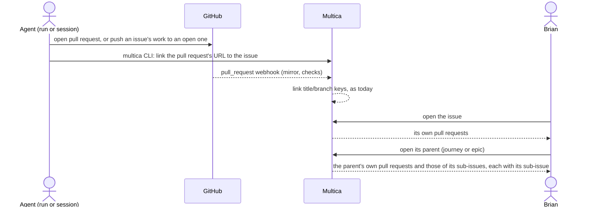

## At a glance

| Kind | Name | Change | Path |
|---|---|---|---|
| Spec delta | issue-pull-request-links | new | `specs/openspec/changes/see-an-issues-pull-requests/specs/issue-pull-request-links/spec.md` |
| Spec delta | sub-issue-pull-requests | new | `specs/openspec/changes/see-an-issues-pull-requests/specs/sub-issue-pull-requests/spec.md` |

## Why

Brian follows all work from its Multica issue. The pull request is where that work lands. Today a pull request shows on an issue only when its title or branch holds the issue's key, or when a member links it by hand. Agents cannot link one: the CLI only lists an issue's pull requests. So Rebl PR 26 names only `REBL-10` and shows on none of the fix tasks `WORK-339` to `WORK-343` built on it. 417 of the 564 pull requests Multica mirrors show on no issue, and 33 of them are still open. Brian's own projects now move into Multica too, so every issue has to show its work.

Success signal: an agent opens a pull request for `WORK-343` whose title and branch name no key, and links it. Brian sees it on `WORK-343` and on the parent's page with `WORK-343` beside it. The open pull requests that showed on no issue show on their issues.

## What Changes

- An agent links a pull request to an issue from the CLI by its URL. This also works before Multica has received the pull request from GitHub.
- A run's instructions tell its agent to link every pull request it opens for its issue. They also tell it to link every open pull request it pushes its issue's work to, so one pull request shows on each issue it does work for.
- Under its own pull requests, an issue shows the pull requests of every issue below it. Each shows the sub-issue it belongs to, and `multica issue pull-requests` lists them the same way.
- The open pull requests that show on no issue today are linked once to the issue whose work they hold. Merged and closed ones stay as they are.

## Capabilities

### New Capabilities

- `issue-pull-request-links`: agents link a pull request from the CLI to each issue it does work for. A run's instructions tell them to, and the open unlinked pull requests are linked once.
- `sub-issue-pull-requests`: an issue lists the pull requests of its sub-issues in the app and the CLI, each with its sub-issue.

### Modified Capabilities

None.

## Impact

- Go server: `server/internal/handler/pr_auto_complete.go` (`LinkIssuePullRequest`, `ListPullRequestsForIssue`), `server/internal/handler/github.go` (receiving a pull request not yet mirrored), `server/pkg/db/queries/` pull request queries for an issue's descendants.
- Run instructions: `server/internal/daemon/execenv/runtime_config_sections.go`.
- CLI: `server/cmd/multica/cmd_issue.go` (`issue pull-requests` and its link command).
- Web and desktop: `packages/core/api` schema and client, `packages/core/github`, `packages/views/issues/components/pull-requests-section.tsx` and `pull-request-list.tsx`, with their translations.
- Data: one pass over the open pull requests that show on no issue, linking each through the same link.
- Docs: `apps/docs` GitHub integration page, `specs/docs/system-design.md`.

## Constraints

- A pull request shown on a parent through a sub-issue is not linked to the parent. It does not count toward the parent's auto-complete, and the parent offers no Remove for it.
- A pull request a member removed from an issue stays removed until someone links it again. A key in its title or branch does not bring it back, as today.
- Merged and closed pull requests that show on no issue today stay unlinked.
- AGENTS.md: no foreign keys, `CREATE INDEX CONCURRENTLY` in its own migration, zod schemas with `parseWithFallback` for the changed response.

## Non-goals

- The mobile app, which shows no pull requests today.
- Unlinking from the CLI.
- Changing which title, branch and body keys link a pull request by themselves.
- MadSpec's own instructions for agents outside a Multica run, such as `madspec-git` "Before the pull request": a MadSpec change of its own.

## Sources

- Issue WORK-1243 "See an issue's pull requests in Multica" and its comment thread.
- [Request 44 of persona-agents-in-multica](anytype://object?objectId=bafyreidorvkpsdyqtjfqf42qn7dzklfy2md4vyi2h7apmiwhrmg7y64ski), 4 Oct 2026.
- Brian's answers, 17 Oct 2026: [An agent links its pull request to its issue when it opens it](anytype://object?objectId=bafyreichktawu5h45ceo43fdedcobuez3de3x7ehxrzjnuwzmvvqq2tgli), [One pull request shows on every issue it does work for](anytype://object?objectId=bafyreicrozi5eyfoiwqnry4upxddz5o3y65zlmbbiggai4mlxo6o3iaqei), [A parent issue lists its sub-issues' pull requests](anytype://object?objectId=bafyreihzobs2d2bygjunvrcz2bnclsmewdhvcsyolax5rdayq3ry5k3o5e), [Only open unlinked pull requests are linked once](anytype://object?objectId=bafyreie5ompeutnkxhvufzvly3u4k5falktrx77snhn7sdkweprkrlqmqy).
