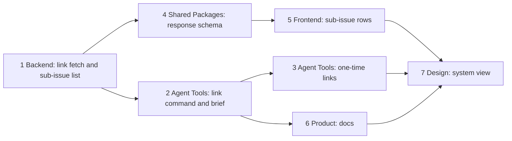

## At a glance

| Group | Team / builder | Depends on | Outcome |
|---|---|---|---|
| 1 | Backend, Joeri / `madspec-api-builder` | - | Link fetches an unmirrored GitHub pull request, refuses an uncovered repository, list adds `sub_issue_pull_requests` |
| 2 | Agent Tools, Paul / `madspec-command-builder`, `madspec-skill-builder` | 1 | `multica issue pull-requests link`, ISSUE column, Pull Requests brief section, platform skill |
| 3 | Agent Tools, Paul (lead) | 2 | The open unlinked pull requests linked once, outcome recorded |
| 4 | Shared Packages, Pieter / `madspec-util-builder` | 1 | Client parses sub-issue pull requests |
| 5 | Frontend, Thomas / `madspec-component-builder` | 4 | Issue page shows sub-issue rows with keys, no Remove |
| 6 | Product, Mitchel / `madspec-polisher` | 2 | CLI and GitHub integration docs in five languages |
| 7 | Design and Prototypes, Guus / `madspec-prototype-builder` | 3, 5, 6 | System view shows the shipped parts |

Own work on "The line": one change, six stacked pull requests in group order, one per team: Backend; Agent Tools with groups 2 and 3; Shared Packages; Frontend; Product; Design. The last pull request archives the change. No journey passes, no migration, no mobile work.

| Kind | Name | Change | Path |
|---|---|---|---|
| Queries | Issue descendants, pull requests of several issues | new, changed | `server/pkg/db/queries/issue.sql`, `server/pkg/db/queries/github.sql`, `server/pkg/db/queries/vcs.sql`, `server/pkg/db/generated/` |
| Integration | Repository installation and pull request reads | changed | `server/internal/integrations/ghsnapshot/client.go` |
| API | Fetch, shared ingest, link, list | new, changed | `server/internal/handler/github_pr_fetch.go`, `server/internal/handler/github.go`, `server/internal/handler/pr_auto_complete.go`, `server/internal/handler/handler.go` |
| CLI and brief | Link command, Pull Requests section, platform skill | changed | `server/cmd/multica/cmd_issue.go`, `server/internal/daemon/execenv/runtime_config_sections.go`, `server/internal/service/builtin_skills/multica-platform/references/issues.md` |
| Client | Schema, types, rows, count | changed | `packages/core/api/schemas.ts`, `packages/core/types/github.ts`, `packages/views/issues/components/pull-request-list.tsx`, `packages/views/issues/components/pull-requests-section.tsx` |
| Docs | CLI and GitHub integration pages | changed | `apps/docs/content/docs/cli*.mdx`, `apps/docs/content/docs/github-integration*.mdx` |
| System view | Shipped parts | changed | `prototypes/system/system.json`, `prototypes/system/exports/`, `specs/docs/system-design.md` |

## 1. Backend: link fetch and sub-issue list

- [ ] 1.1 `server/pkg/db/queries/issue.sql` -- add `ListDescendantIssues(issue_id, workspace_id)`: recursive CTE over `parent_issue_id` filtered by `workspace_id`, joined with `UNION`, returning `id` and `number` -- the list needs every issue below the opened one at any depth, and `UNION` ends a parent cycle.
- [ ] 1.2 `server/pkg/db/queries/github.sql`, `server/pkg/db/queries/vcs.sql` -- turn `ListPullRequestsByIssue` into `ListPullRequestsByIssues(issue_ids uuid[])` and `ListVCSPullRequestsByIssue` into `ListVCSPullRequestsByIssues(issue_ids uuid[])` with `ipr.issue_id = ANY(...)`, return `ipr.issue_id` per row, and select `DISTINCT` pull requests in the `issue_prs`/`checks` CTEs -- one query serves the issue and its descendants, and a pull request on two issues counts its checks once.
- [ ] 1.3 `server/pkg/db/generated/` -- run `make sqlc` and move the callers in `server/internal/handler/github_test.go` and `server/internal/handler/vcs_webhook_test.go` to the new methods with a one-element id list -- generated code is the only database entry point.
- [ ] 1.4 `server/internal/integrations/ghsnapshot/client.go` -- add `RepositoryInstallation(ctx, owner, repo) (int64, error)` (`GET /repos/{o}/{r}/installation` with the App JWT, 404 as `ErrNotInstalled`) and `PullRequest(ctx, installationID, owner, repo, number) (json.RawMessage, error)` (`GET /repos/{o}/{r}/pulls/{n}` with the cached installation token, 404 as `ErrNotFound`, 403/429 rate limits as `RateLimitError`) -- the link reuses the App client's JWT, token cache and rate-limit mapping, as design.md Decision 1 says.
- [ ] 1.5 `server/internal/integrations/ghsnapshot/client_test.go` -- cover both reads against an `httptest` server: success, 404 to the sentinel errors, rate limit to `RateLimitError`, and the installation token reused -- the link's error answers depend on these mappings.
- [ ] 1.6 `server/internal/handler/handler.go` -- keep the `*ghsnapshot.Client` built in `NewHandler` on a new `GitHubApp` field beside `PRRefresh` -- one client instance for the pipeline and the link.
- [ ] 1.7 `server/internal/handler/github.go` -- move the body of `handlePullRequestEvent` after unmarshalling into `ingestGitHubPullRequest(ctx, *ghPullRequestPayload)` and call it from the webhook -- a fetched pull request lands exactly as its webhook would, auto-links and snapshot included.
- [ ] 1.8 `server/internal/handler/github_pr_fetch.go` -- add `fetchUnmirroredGitHubPullRequest(ctx, workspaceID, normalizedURL)`: parse a `github.com` pull request URL, resolve the installation, require it among `ListGitHubInstallationsByWorkspace`, fetch the pull request, fill `ghPullRequestPayload` from the REST object (`Repository` from `base.repo`, `Installation.ID`, empty `Action`) and call `ingestGitHubPullRequest`; return typed errors for uncovered repository, unknown number, rate limit and other GitHub failures -- design.md Decision 1, nothing written before the checks pass.
- [ ] 1.9 `server/internal/handler/pr_auto_complete.go` -- in `LinkIssuePullRequest`, when the URL is not mirrored and `GitHubApp.Enabled()`, call the fetch, look the URL up again and link as today; answer 422 `no GitHub installation of this workspace covers <owner>/<repo>`, 404 `GitHub has no pull request <owner>/<repo>#<n>`, 503 on rate limit, 502 on other GitHub failures, with `slog` warnings carrying repo and number; keep today's 404 for other hosts and without App credentials -- the spec's link before the webhook and refusal naming the repository.
- [ ] 1.10 `server/internal/handler/github.go` -- in `ListPullRequestsForIssue`, read `ListDescendantIssues`, call the two list queries once with the issue and its descendants, build `pull_requests` from the issue's own rows as today, and build `sub_issue_pull_requests` from the other rows: one `SubIssuePullRequestResponse` (embedded `GitHubPullRequestResponse` plus `sub_issues []SubIssueRef{ID, Identifier}` sorted by number) per pull request not in `pull_requests`, newest first, `link_source` empty, `MaybeEnqueueOnView` per GitHub row -- design.md Decision 4; `auto_complete` stays from `decidePRAutoComplete`.
- [ ] 1.11 `server/internal/handler/github_test.go` -- add DB-backed cases with `testutil` fixtures: link by URL with task-token headers (`X-Agent-ID`, `X-Actor-Source: task_token`) shows the pull request; link of an unmirrored URL against a fake GitHub (`ghsnapshot` client on an `httptest` server) mirrors and links it; uncovered repository answers 422 naming it and writes no row; link after Remove shows it again; linking PR 26 to four more issues keeps the first link; a two-level tree lists a grandchild's pull request with its key; a pull request on the parent and a child appears only in `pull_requests`; one pull request on two children appears once with both keys; a merged child pull request leaves the parent's `auto_complete` and status as they are -- the scenarios of both spec deltas at the API.

## 2. Agent Tools: link command and brief

- [ ] 2.1 `server/cmd/multica/cmd_issue.go` -- add `link <issue> <pr-url>` under `issuePullRequestsCmd` (exact 2 args): resolve the issue, `PostJSON` `{"url": ...}` to `/api/issues/{id}/pull-requests`, print the response as JSON or the list table, and surface the server's error message; extend `runIssuePullRequests`'s table with an ISSUE column (empty for own rows, sub-issue keys joined by `, ` for `sub_issue_pull_requests`, own rows first) -- design.md Decision 2.
- [ ] 2.2 `server/cmd/multica/cmd_issue_test.go` -- cover the link request path and body against an `httptest` server, the error message on 422, and the table rows for own and sub-issue pull requests -- the CLI half of the link and list scenarios.
- [ ] 2.3 `server/internal/daemon/execenv/runtime_config_sections.go` -- add `writePullRequestsSection` with the text of design.md Decision 6 and call it in `buildMetaSkillContentSlim` under the same condition as `writeQuestionsSection` -- every run on an issue is told to link its pull requests with the named command.
- [ ] 2.4 `server/internal/daemon/execenv/runtime_config_sections_test.go` -- add a table test like `TestQuestionsSectionForIssueRuns`: present once for assignment, comment and autopilot-on-issue runs, absent for chat, quick-create and runs without an issue -- the brief's gating is the requirement.
- [ ] 2.5 `server/internal/service/builtin_skills/multica-platform/references/issues.md` -- in "PR linking" and "Default for code-changing issue work", say that an agent links each pull request it opens for an issue and each open one it pushes the issue's work to with `multica issue pull-requests link <issue-id> <pr-url>`, and that the list includes sub-issue pull requests in `sub_issue_pull_requests` with their `sub_issues` -- agents read this reference for PR contracts.

## 3. Agent Tools: one-time links

- [ ] 3.1 `specs/openspec/changes/see-an-issues-pull-requests/tasks.md` -- with the CLI built from this branch and a member login on the production server, take every pull request of design.md Decision 7's list that is still `open` or `draft` and has no link, find its issue in the evidence order of Decision 7, link it with `multica issue pull-requests link` to each issue that holds its work, and record one line per pull request (repository and number, linked keys or "no issue", the evidence) in Implementation Notes -- the spec's one-time pass; merged and closed ones stay as they are.

## 4. Shared Packages: response schema

- [ ] 4.1 `packages/core/api/schemas.ts` -- add `SubIssuePullRequestSchema` (`GitHubPullRequestSchema` extended with `sub_issues: z.array(z.object({ id: z.string(), identifier: z.string() })).default([])`), add `sub_issue_pull_requests: z.array(SubIssuePullRequestSchema).default([])` to `IssuePullRequestsResponseSchema` and an empty array to `EMPTY_ISSUE_PULL_REQUESTS_RESPONSE` -- an older server parses to an empty list.
- [ ] 4.2 `packages/core/types/github.ts` -- add `SubIssueRef`, `SubIssuePullRequest` and `sub_issue_pull_requests` on `IssuePullRequestsResponse` -- the views type their rows from core.
- [ ] 4.3 `packages/core/api/client.test.ts` -- add cases: a response with sub-issue pull requests parses with their keys; a response without the field parses to `[]`; a malformed `sub_issues` entry falls back without dropping `pull_requests` -- AGENTS.md asks malformed-response tests for a changed response.

## 5. Frontend: sub-issue rows

- [ ] 5.1 `packages/views/issues/components/pull-request-list.tsx` -- render own rows as today, then `sub_issue_pull_requests` through `PullRequestRow` with a new `subIssues` prop and no `actions`; show each key as an `AppLink` to its issue in the row's meta line, strip the first key from the title, keep the collapse after four rows over the combined list, and show the empty state only when both lists are empty -- design.md Decision 5.
- [ ] 5.2 `packages/views/issues/components/pull-requests-section.tsx` -- count own and sub-issue pull requests in the header -- the count matches the rows shown.
- [ ] 5.3 `packages/views/issues/components/pull-request-list.test.tsx`, `packages/views/issues/components/pull-requests-section.test.tsx` -- cover: own row first, sub rows with their keys linking to the sub-issues, one row with two keys, no Remove in a sub row's menu, empty state only with both lists empty, count of both -- the issue-page scenarios of `sub-issue-pull-requests`.

## 6. Product: docs

- [ ] 6.1 `apps/docs/content/docs/cli.mdx`, `cli.fr.mdx`, `cli.ja.mdx`, `cli.ko.mdx`, `cli.zh.mdx` -- add the `pull-requests link <id> <url>` row beside `pull-requests <id>` and say the list includes sub-issue pull requests -- the CLI reference names every command.
- [ ] 6.2 `apps/docs/content/docs/github-integration.mdx`, `.fr`, `.ja`, `.ko`, `.zh` -- in "Link a PR to an issue" add linking from the CLI, also before GitHub delivers the pull request and the refusal for an uncovered repository; in "View PRs on an issue" add the sub-issue pull requests under the issue's own, without Remove and outside auto-complete -- users read the integration page for linking rules.

## 7. Design: system view

- [ ] 7.1 `prototypes/system/system.json` -- update the zooms the change touches from the merged code: the GitHub REST edges for installation and pull request reads, `github_pr_fetch.go`, the shared ingest, the descendant query, the link command and the Pull Requests brief section, the sub-issue list in the issue page -- the living system design shows shipped code.
- [ ] 7.2 `prototypes/system/exports/` -- run `bun run --cwd prototypes/system export` and commit the PNG of each changed zoom -- a pull request that changes the system design carries its exports.
- [ ] 7.3 `specs/docs/system-design.md` -- update the Go server component map and the `issue_pull_request` relations to the shipped parts -- the Markdown view stays in step with the zoom map.
- [ ] 7.4 `specs/openspec/changes/see-an-issues-pull-requests/` -- sync the spec deltas and archive the change on this branch with `openspec archive see-an-issues-pull-requests` after `openspec validate see-an-issues-pull-requests --type change --strict` -- the last pull request of the stack archives the change.

## Implementation Notes

## Plan Change Log
