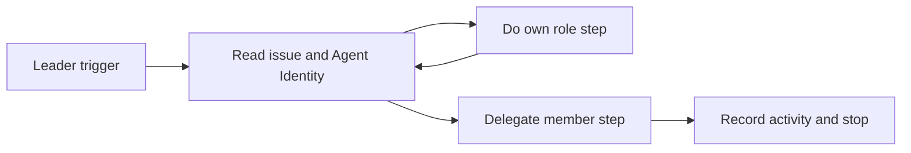

## At a glance

| Part | Scope |
|---|---|
| Leader briefing | Choose each step by Agent Identity and roster |
| Runtime workflow | Allow own delivery without waiting for a member |
| Docs and tests | Match the same leader contract |

## Why

Squad leads have persona duties as well as routing duties. A blanket ban on doing the work blocks their own decisions and outputs. A lead must be able to do its role step, then pass the next step to a suitable member.

## What changes

- The leader reads the issue and its Agent Identity, including its persona skill, on every trigger.
- It does its own steps in the current turn and delegates member steps by the existing mention path.
- The stop rule applies after delegation, not before own work.
- Own work without delegation uses normal result delivery and status rules.

The full behavior is in the [spec delta](specs/squad-leader-steps/spec.md). The [design](design.md) names the affected prompt surfaces and boundaries.

## Capabilities

### Added capabilities

- `squad-leader-steps`: choose own work or delegation on each leader trigger.

### Modified capabilities

None.

## Impact

The server's squad briefing, the daemon's leader status guidance, prompt contract tests, builtin squad reference, and squad guides in all five languages. No API, database, trigger, squad member behavior, or live data changes.
