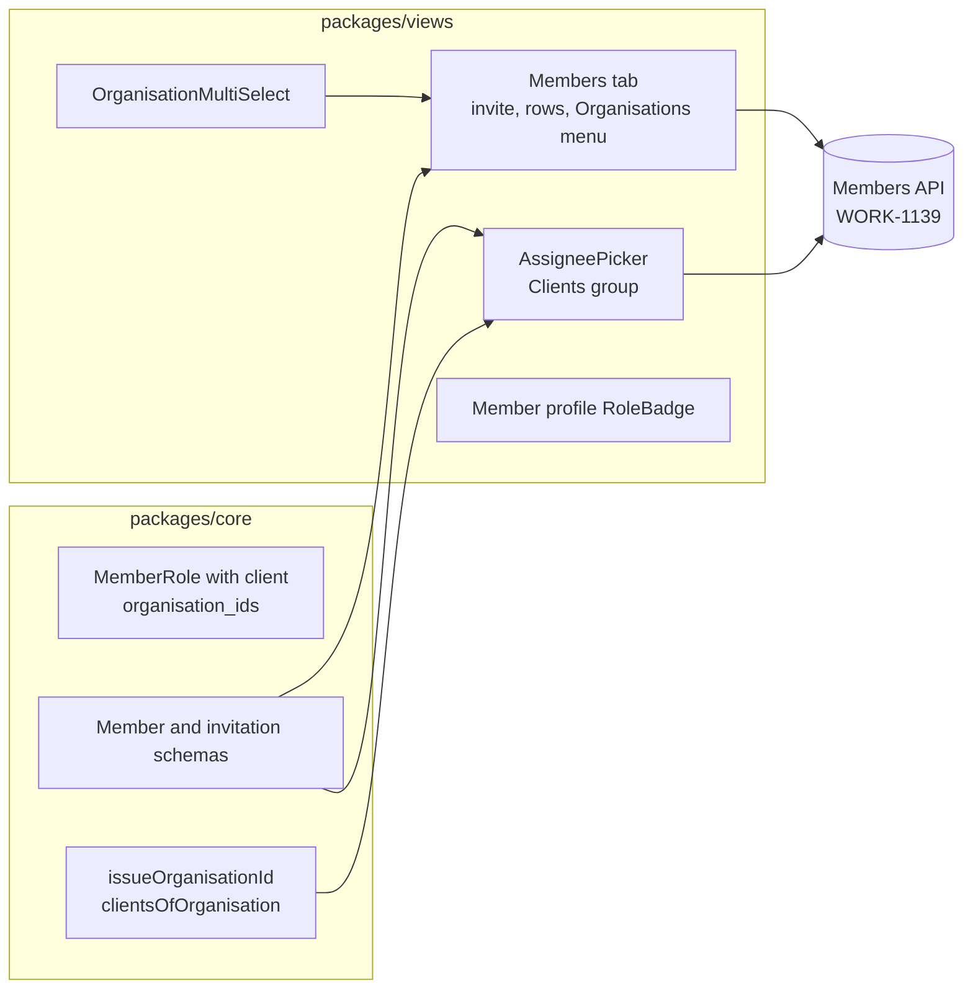

## At a glance

| Kind | Name | Change | Path |
|---|---|---|---|
| Type | `MemberRole`, `StaffRole`, `organisation_ids` | changed | `packages/core/types/workspace.ts` |
| Schema | Member and invitation schemas | changed | `packages/core/api/schemas.ts` |
| Helper | Client helpers | new | `packages/core/organisations/clients.ts` |
| Component | Organisation multi select | new | `packages/views/projects/components/organisation-multi-select.tsx` |
| Component | Members tab | changed | `packages/views/settings/components/members-tab.tsx` |
| Component | Assignee picker | changed | `packages/views/issues/components/pickers/assignee-picker.tsx` |
| Component | Role badge | changed | `packages/views/members/` |
| Query | Client waits | changed | `server/pkg/db/queries/client_read.sql` |
| Script | Team state client waits | changed | `server/internal/service/builtin_skills/multica-platform/scripts/team_state.py` |
| Reference | MadSpec planning | changed | `server/internal/service/builtin_skills/multica-platform/references/madspec-planning.md` |

## Context

WORK-1139 made the server hold a client membership with a set of organisations and published `organisation_ids` on members and invitations. The web and desktop app still parse the role `client` as `member` and drop `organisation_ids`, so staff can't see, invite or assign a client. A client's waits today are only chores with the `Client wait` label, while Brian's rule is that everything a client has to do is an ordinary issue on the client's own member.

## Goals / Non-Goals

**Goals:** staff invite a client for organisations, see and change those organisations, and assign any issue in an organisation's project to a client of that organisation.

**Non-Goals:** client screens, the staff overview of waits, mobile, share links for clients.

## Decisions

- **Role type.** `MemberRole` becomes `StaffRole | "client"` with `StaffRole = "owner" | "admin" | "member"`. Share link roles stay staff. Code that branches on roles keeps reading staff roles as before.
- **Boundary parsing.** The member and invitation schemas accept `client` and fall back to `member` for unknown roles. `organisation_ids` defaults to an empty list when the field is missing or malformed, so an older server shows no badges.
- **Writes.** A client invite sends `{email, role: "client", organisation_ids}`. Organisations sends `{role: "client", organisation_ids}` with the whole new set, as the server replaces the set. Staff writes send no `organisation_ids`. The server refuses an empty set, so the menu blocks unticking the last organisation instead of sending a request that fails.
- **Issue organisation.** An issue's organisation is its project's `organisation_id`. The picker takes `projectIds` from its caller, and `issueOrganisationId` returns an organisation only when every id maps to one project with the same organisation. A batch of mixed organisations shows no clients, as assigning one client there would put an issue outside that client's organisations.
- **Picker groups.** Members filters out clients. Clients reuses the member item, filter and sort and sits between Members and Agents, as the mock shows. The project list comes from the cached `projectListOptions(wsId)` query.
- **Multi select.** `OrganisationMultiSelect` builds on `PropertyPicker` and `PickerItem`, as `SubscriberMultiSelect` does, so search, keyboard and checks match the other pickers. Chips with a remove button sit in the field and the trigger opens the list.
- **Client waits.** A client's waits are the open issues assigned to them in a project of their organisations, of any type and with any labels. The queries keep the organisation scope, so an issue assigned to a client outside their organisations stays hidden. Routes, response fields and ordering stay as they are.
- **Team state.** `team_state.py` reads the client members once with `workspace member list` and treats an issue assigned to one of them as a client wait, the way it reads the verifier once.
- **Reference.** The `Client waits` section of the MadSpec planning reference says the wait goes on the client's own member with `multica issue assign <issue> --to <client>`, found as the member with role client in the issue's organisation.

## Risks / Trade-offs

- A picker on a page without the project list loads it once; it is cached per workspace and small.
- A client with access to an organisation's issues only reads them; assigning does not grant writes, as the server keeps a client session read-only.

## Migration Plan

No schema migration. The change ships with the next `make local-release`; rollback is the previous build.

The open issues that carry the `Client wait` label get their client's member as assignee once that member exists. Then the label is deleted from the workspace. On 18 October 2026 no client member exists yet, so this data step waits on the client invitations.

## Open Questions

None.
