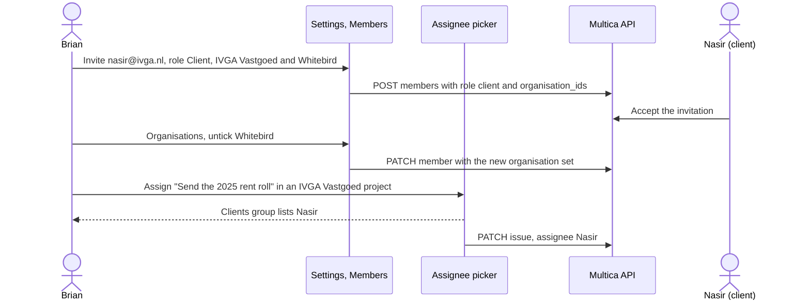

## At a glance

| Kind | Name | Change | Path |
|---|---|---|---|
| Capability | Staff client controls | new | `specs/openspec/specs/staff-client-controls/spec.md` |

## Why

Brian can only make a client contact through the CLI, and the staff screens read every client as a plain member. So nothing a client has to do can sit on that client's name from the app. Everything a client has to do, such as reviewing a prototype or delivering a DNS record or a login, is an issue assigned to that client's own member. Success is a client invited for A and B from Members, one organisation removed again, and a wait in A's project assigned to that client from the ordinary assignee picker.

## What Changes

- Invite member gets the role Client, with an Organisations field that takes one or more organisations of the workspace.
- Members and Pending invitations show the role Client and a badge per organisation of a client.
- A client's row menu gets Organisations, which adds or removes one organisation at once and never removes the last one.
- Change role keeps the staff roles; a client can be changed to a staff role.
- The assignee picker lists clients in their own Clients group, and only the clients of the issue's organisation: the organisation of the issue's project. Any issue there can go on a client's name, not only a `Client wait`.
- The member profile shows the role Client.
- The Multica reference for MadSpec planning says how a client wait goes on the client's member.

## Capabilities

### New Capabilities

- `staff-client-controls`: staff invite and manage client contacts and assign issues to them in the existing member and assignee controls.

## Impact

Shared web/desktop code only: member and invitation types and zod schemas in `packages/core`, the members tab, the assignee picker and its call sites, the member profile in `packages/views`, their translations, and the built-in `multica-platform` reference. The server API from WORK-1139 is used as published; no server, migration, mobile or client-screen change.

## Constraints

- The server stays the only authority: it refuses an empty organisation set, foreign organisations and every write from a client session.
- Staff roles, share links and assignment to staff, agents and squads behave as before.
- No client-contact directory and no client role on share links.

## Non-goals

Client screens (WORK-1073), the staff overview of waits (WORK-1074), a server rule on the `Client wait` label, mobile.

## Sources

- WORK-1072 description and Brian's comment of 18 October 2026.
- WORK-1059 "Plan", R1 and R5.
- Approved mock: `designs/screens/client-access.md`, screens 1, 2, 2b, 2c and 3.
- Membership API: `specs/openspec/changes/archive/2026-10-16-client-organisation-sets/design.md` "Published API contract".
