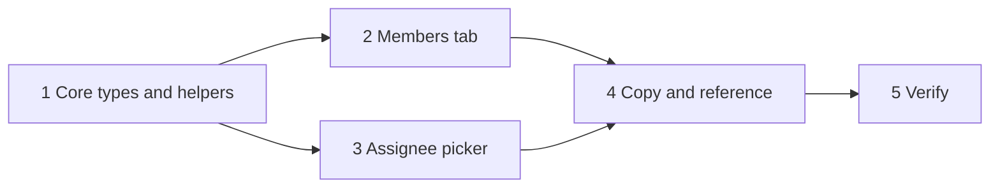

## At a glance

| Kind | Name | Change | Path |
|---|---|---|---|
| Plan | Staff client controls tasks | new | `specs/openspec/changes/staff-client-controls/tasks.md` |

## 1. Core types and helpers

- [ ] 1.1 Add `StaffRole`, the `client` role and `organisation_ids` to member, invitation and member request types. Verify: `pnpm typecheck`.
- [ ] 1.2 Parse `client` and `organisation_ids` in the member and invitation schemas with fallbacks. Verify: `members-invitations.test.ts`.
- [ ] 1.3 Add `issueOrganisationId` and `clientsOfOrganisation`. Verify: `clients.test.ts`.

## 2. Members tab

- [ ] 2.1 Add `OrganisationMultiSelect`. Verify: its component test.
- [ ] 2.2 Invite member offers Client with Organisations and sends `organisation_ids` only for a client; share links stay staff. Verify: members tab test.
- [ ] 2.3 Member and invitation rows show role Client and organisation badges. Verify: members tab test.
- [ ] 2.4 A client's row menu holds Organisations and keeps the last organisation. Verify: members tab test.
- [ ] 2.5 The member profile badge reads Client. Verify: smoke.

## 3. Assignee picker

- [ ] 3.1 The picker takes `projectIds`, keeps clients out of Members and lists the issue organisation's clients under Clients. Verify: assignee picker test.
- [ ] 3.2 Every caller passes its issues' project ids. Verify: `pnpm typecheck`.

## 4. Copy and reference

- [ ] 4.1 Add the new strings in en, fr, ja, ko and zh-Hans. Verify: `parity.test.ts`.
- [ ] 4.2 The MadSpec planning reference says how a client wait goes on the client's member. Verify: `multica issue assign --help` matches.

## 5. Verify

- [ ] 5.1 `pnpm typecheck`, `pnpm lint` and `pnpm test` pass.
- [ ] 5.2 Smoke on web and desktop against the dev stack: invite a test client for A and B, accept, remove B, assign an A issue to the client and check B, C and no-project issues show no such client.
- [ ] 5.3 Update `specs/docs/system-design.md` for the staff controls.
