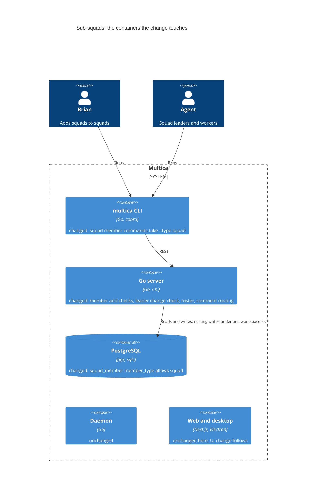
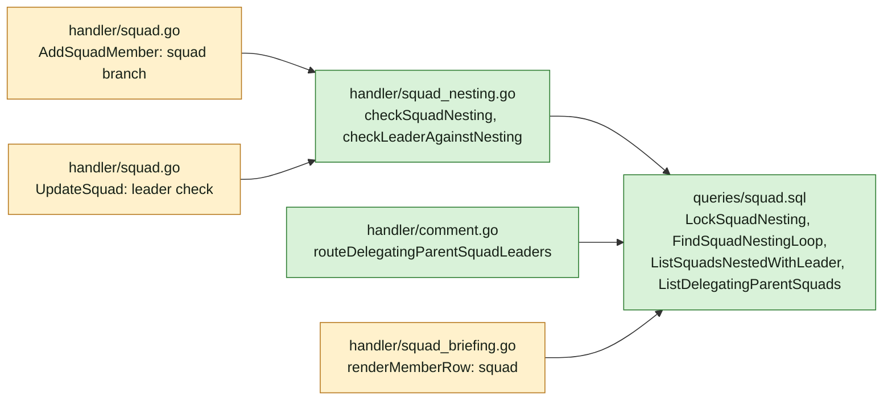
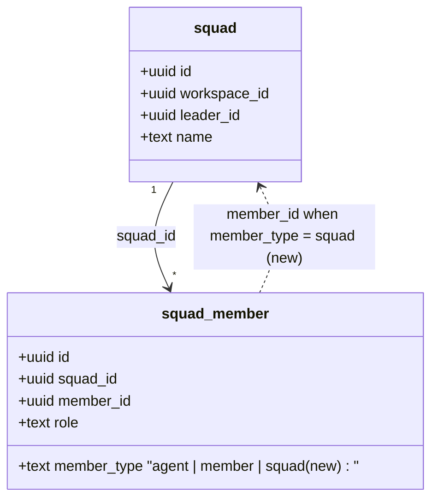
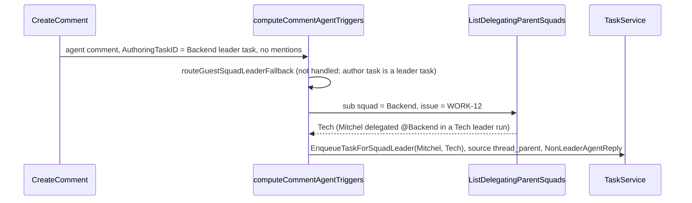

## At a glance

The delta of this change on the living system design, `specs/docs/system-design.md`. It adds no container. The Go server, its database and the CLI change; the daemon, web, desktop and mobile do not. The UI follows as its own change.

Go server component map, delta:

Models, delta:

Report-back data flow on a guest issue:

| Kind | Name | Change | Path |
|---|---|---|---|
| Migration | `732_squad_member_squad` | new | `server/migrations/732_squad_member_squad.up.sql`, `.down.sql` |
| Query | `LockSquadNesting`, `FindSquadNestingLoop`, `ListSquadsNestedWithLeader`, `ListDelegatingParentSquads` | new | `server/pkg/db/queries/squad.sql` |
| Service | nesting checks | new | `server/internal/handler/squad_nesting.go` |
| Endpoint | `POST /api/squads/{id}/members` | changed | `server/internal/handler/squad.go` |
| Endpoint | `PUT /api/squads/{id}` | changed | `server/internal/handler/squad.go` |
| Briefing | Squad Roster | changed | `server/internal/handler/squad_briefing.go` |
| Routing | comment triggers | changed | `server/internal/handler/comment.go` |
| CLI | `multica squad member add/remove/set-role` | changed | `server/cmd/multica/cmd_squad.go` |
| Docs | squads page, five languages; multica-platform squads reference | changed | `apps/docs/content/docs/squads*.mdx`, `server/internal/service/builtin_skills/multica-platform/references/squads.md` |
| ADR | ADR-0017 | new | `adr/0017-a-squad-holds-squads-and-nesting-is-checked-when-written.md` |

## Context

Team: Backend (`as-backend-lead`, Joeri). The UI is the Frontend team's own change after this one: `SquadMemberType` gains `"squad"` in `packages/core/types/squad.ts`, a zod schema with fallback for squad member list, preview and status responses in `packages/core/api/schema.ts`, the add-member picker lists squads, and member rows render a squad. This change keeps out of those files.

Code map:

- `server/migrations/084_squad.up.sql`: `squad_member.member_type` has the inline CHECK `squad_member_member_type_check` on `('agent', 'member')`; `UNIQUE(squad_id, member_type, member_id)`; `idx_squad_member_entity(member_type, member_id)` serves parent lookups.
- `server/internal/handler/squad.go` `AddSquadMember`: validates `member_type`, loads the agent or member in the workspace, `memberCanWireAgent` for agents, inserts without a transaction. `UpdateSquad`: transaction, `LockSquadForUpdate`, then the new leader through `LockAgentForAutopilotAssignment`. `RemoveSquadMember` and `UpdateSquadMemberRole` take any `member_type` and need no change.
- `server/internal/handler/squad_briefing.go` `renderMemberRow`: `agent` and `member` cases, `default` returns "" (a `squad` row is dropped today). `formatRosterRow` and `formatMention` give the row format.
- `server/internal/handler/comment.go` `computeCommentAgentTriggers`: an agent comment without mentions tries `routeGuestSquadLeaderFallback`, which refuses an authoring task that is a leader task, then `routeAssignedSquadLeaderFallback` when the issue is assigned to a squad. A sub-squad leader's report replies under its own trigger comment, which is its worker's result, so no comment of the main leader is its parent after the first hop: a parent-comment rule cannot find the main leader.
- `enqueueSingleCommentTrigger`: a `thread_parent` trigger with `Squad` set enqueues `EnqueueTaskForSquadLeader`; `keepReplayableAgentTriggers` replays `thread_parent` only with `NonLeaderAgentReply` and a planned input.
- `shouldSuppressSquadLeaderSelfTrigger`: an agent's own @squad mention of a squad it leads is suppressed, which is why a same-leader sub-squad would stall.
- Direct-member readers that stay as they are: `notification_listeners.go` (@squad inbox), `service/question.go` (squad audience), the "involves me" filters in `queries/issue.sql` and `queries/agent.sql`, `ListSquadMemberStatusRows` (a `squad` row returns with no status, as a `member` row does).
- `server/cmd/multica/cmd_squad.go`: `add`, `remove` and `set-role` refuse every type but `agent` and `member` before the request.
- Advisory lock pattern: `queries/issue_status.sql` `pg_advisory_xact_lock(hashtextextended(workspace_id || ':issue_status', 0))`.

ADRs in force: none governs squads. ADR-0017 records this change's lasting decision.

## Goals / Non-Goals

Always:

- A sub-squad's leader takes its work exactly as from an @squad mention today.
- No loop and no same-leader pair can exist in stored data.
- Every reader outside the roster and the report-back route reads direct members only.

Never:

- Walk sub-squads for notices, questions, "involves me" or status.
- Add a depth cap or runtime loop guard.
- Touch web, desktop or mobile files.

## Decisions

1. **One workspace advisory lock for nesting writes.** `LockSquadForUpdate` on one squad cannot stop a loop closed by two adds on disjoint squads (spec "Two adds at the same time"). Adding a `squad` member and changing a leader take `pg_advisory_xact_lock(hashtextextended(workspace_id || ':squad_nesting', 0))` in their transaction before they check. Adding an `agent` or `member` does not take it.
2. **Loop check as one recursive query.** `FindSquadNestingLoop(child, parent)` walks `squad_member` rows of type `squad` down from the added squad, carrying the path, and returns the path to the main squad when it is reached; the handler resolves names and answers 400 `adding <child> would create a loop: <parent> → <child> → … → <parent>`. A self-add returns the path at once. Archived squads stay in the walk: their rows still exist.
3. **Same leader is checked on both writes.** Adding refuses a child whose `leader_id` equals the parent's. Changing a leader runs `ListSquadsNestedWithLeader(squad, new_leader)` over direct, non-archived parents and children of the squad. Only direct pairs stall a hand-off, so deeper levels may share a leader.
4. **Report-back is found from the delegation, not the reply parent.** `routeDelegatingParentSquadLeaders` runs for an agent comment without mentions whose authoring task is a leader task of squad S on this issue, by the same agent. `ListDelegatingParentSquads(S, issue)` returns each non-archived squad P with S as a member, where a comment on the issue, not deleted, written by a leader task of P whose agent is P's current leader, contains `mention://squad/<S>`. Each P that is not the issue's assigned squad becomes a `thread_parent` trigger for P's leader with `Squad = P` and `NonLeaderAgentReply`, checked with `canInvokeAgent`, runtime and archive as `routeReplyToParentAuthor` checks. When P is the assigned squad, the route leaves it to `routeAssignedSquadLeaderFallback`, so that case runs as today. With no P left, routing continues as today.
5. **Adding a squad uses the agent access rule on its leader.** A regular member may add a squad only when `memberCanWireAgent` allows its leader, as for adding that agent.
6. **Roster row.** `renderMemberRow` gains `case "squad"`: `GetSquad`, skip when archived, `formatRosterRow(name, "squad", role, "", formatMention(name, "squad", id))`.

## Risks / Trade-offs

- A sub-squad report wakes every main squad that delegated to it on the issue, once each; two main squads sharing a sub-squad on one issue both wake. Each leader evaluates and records `no_action` when nothing is needed.
- Older desktop clients get `member_type: "squad"` rows before the UI change ships; the UI change adds the fallback.

## Migration Plan

`732_squad_member_squad.up.sql` drops `squad_member_member_type_check` and adds it back `NOT VALID` with `('agent', 'member', 'squad')`, then validates, under `SET LOCAL lock_timeout = '2s'`, as `710_question_link_types` does. Down deletes `squad` rows, then restores the two-type CHECK and validates it.
