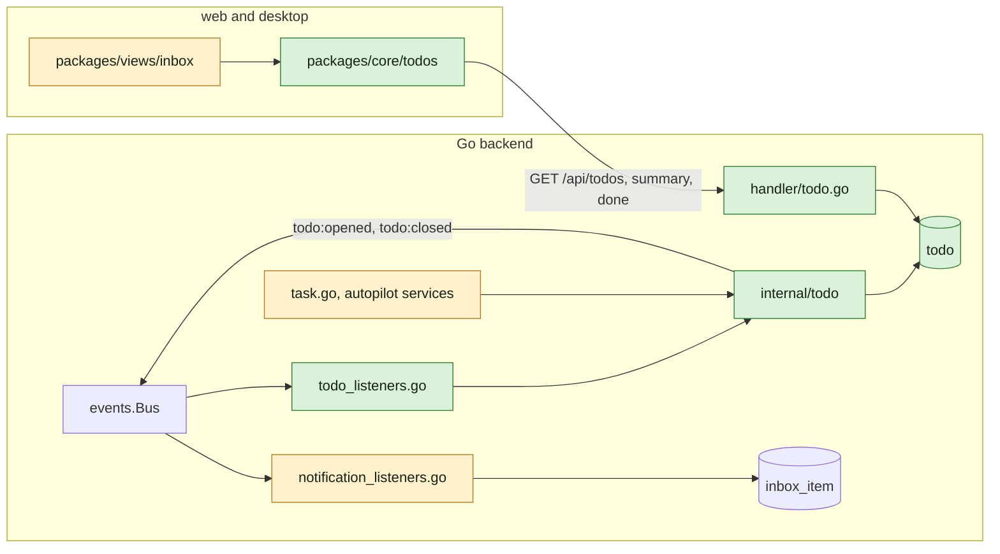
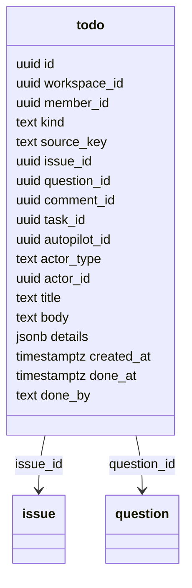
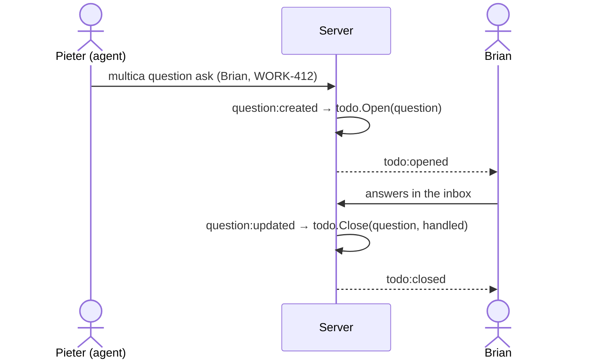

## At a glance







| Kind | Name | Change | Path |
|---|---|---|---|
| Migration | `todo` table | new | `server/migrations/740_todo.up.sql` |
| Migration | open-row unique index, `CONCURRENTLY` | new | `server/migrations/741_todo_open_index.up.sql` |
| Migration | open list index, `CONCURRENTLY` | new | `server/migrations/742_todo_list_index.up.sql` |
| Migration | creator of agent-made issues | new | `server/migrations/743_issue_creator_backfill.up.sql` |
| Migration | open to-dos from today's data, archive moved notices | new | `server/migrations/744_todo_backfill.up.sql` |
| Queries | open, close, list, summary, mark done | new | `server/pkg/db/queries/todo.sql` |
| Package | `Open`, `Close`, kinds, events | new | `server/internal/todo/` |
| Listeners | question, comment, issue, task, autopilot events | new | `server/cmd/server/todo_listeners.go` |
| Handler | list, summary, done | new | `server/internal/handler/todo.go` |
| Events | `todo:opened`, `todo:closed` | new | `server/pkg/protocol/events.go` |
| Notices | moved types no longer made | changed | `notification_listeners.go`, `service/task.go`, `autopilot_failure_monitor.go`, `service/autopilot_quota_notifications.go` |
| Creator | originator member of the run | changed | `server/internal/handler/issue.go` `CreateIssue` |

## Context

Today's inbox writes one `inbox_item` per notice, kept until archived (`server/cmd/server/notification_listeners.go`). Brian's scope (WORK-449) splits it: to-dos that leave once handled, and Updates for the rest. The design is in `designs/screens/todo-inbox.md`.

## Decisions

### A to-do is a row the server opens and closes from events

`todo` holds one row per to-do. `internal/todo` opens a row when the event that makes it happens and closes it when the event that handles it happens; `done_at` set means closed. Lists and counts read open rows only. See `adr/0017-a-to-do-is-a-row-the-server-opens-and-closes.md`.

- Open is `INSERT … ON CONFLICT DO NOTHING` on the open-row key `(workspace_id, member_id, kind, source_key) WHERE done_at IS NULL`, so a repeated event opens nothing new.
- Close is an `UPDATE … WHERE done_at IS NULL`, so a repeated event closes nothing more. Every closed row publishes `todo:closed`.
- Overdue, the issue's title and status, and the question's type are read at list time from `issue` and `question`, so they never go stale.
- No foreign keys (AGENTS.md). A row whose issue is gone is not listed.

### Kinds

| Kind | `source_key` | Opens | Closes | Member | Due date |
|---|---|---|---|---|---|
| `question` | question id | `question:created`; `question:updated` reason `reassigned` | `question:updated` when the member answered or the question is not open; reassigned away | each current answerer | `question.due_date` |
| `mention` | comment id | `comment:created`, and issue description mentions on create or edit | `comment:created` by the member on the issue | each mentioned member, not the author | none |
| `assigned` | issue id | `issue:created` / `issue:updated` when a member assignee and the status is `todo`, `back_from_qa`, `blocked` or `in_review` | `issue:updated` status or assignee change | the member assignee | `issue.due_date` |
| `agent_blocked` | issue id | `issue:updated` to `blocked` by an agent in a run, assignee agent or squad | `issue:updated` away from `blocked`; `task:dispatched` on the issue | the run's `originator_user_id` | none |
| `run_failed` | task id | `task:failed` on an issue, not a quick create | same as `agent_blocked` | the task's `originator_user_id` | none |
| `autopilot_paused` | autopilot id | the failure monitor pauses it | the autopilot leaves `paused` | today's notice recipients | none |
| `quota_reached` | the period's start and end, UTC RFC 3339, joined by `/` | the first quota rejection of a period | an autopilot run is admitted in the workspace, which closes every open `quota_reached` row of the workspace | today's notice recipients | none |
| `quick_create_failed` | task id | quick create failed or unconfirmed | its retry creates the issue | the requester | none |
| `review` | issue id | `issue:created` / `issue:updated` into `in_review` | `issue:updated` out of `in_review` | the member creator, unless assignee | `issue.due_date` |

A status move between two `assigned` statuses closes the row and opens a new one, so the row shows the new status and time.

### The review row hides behind a question

The list and the count leave out a `review` row while the same member has an open `question` row on the same issue. Both rows stay in the table, so the review row shows again once the question is answered and the issue is still In Review.

### Notices that became to-dos

These `inbox_item` types are no longer made: `question_asked`, `question_reassigned`, `question_overdue`, `mentioned`, `task_failed`, `autopilot_paused`, `autopilot_quota_exceeded`, `quick_create_failed`, `quick_create_unconfirmed`. The question overdue sweep still stamps `overdue_notified_at` for agents that read it, and makes no notice. `GET /api/inbox` and its endpoints are the Updates list, unchanged.

### Creator of agent-made issues

`CreateIssue` already resolves the run behind an agent's create: `X-Task-ID` for `agent_create`, `origin_id` for `quick_create`. When that run has an `originator_user_id`, the issue's creator is that member; `ActorID` and the origin stay the agent and its run. Production has 91 such issues, all with an originator who is a workspace member. Migration 743 sets the same for them, before migration 744 opens the review to-dos of their creators.

`attribution.DelegatedSubscriber` acts only on agent creators, so the member now follows these issues through the ordinary creator subscription.

## API contract

All routes are workspace-scoped like `/api/inbox`, except the summary, which is account-level like `/api/inbox/unread-summary`.

### `GET /api/todos`

The member's open to-dos in the workspace, overdue first, then newest first. Returns an array of `Todo`:

```json
{
  "id": "uuid",
  "workspace_id": "uuid",
  "kind": "question | mention | assigned | agent_blocked | run_failed | autopilot_paused | quota_reached | quick_create_failed | review",
  "issue_id": "uuid | null",
  "issue_identifier": "WORK-412 | null",
  "issue_title": "string | null",
  "issue_status": "in_review | null",
  "question_id": "uuid | null",
  "question_answer_type": "approval | null",
  "comment_id": "uuid | null",
  "task_id": "uuid | null",
  "autopilot_id": "uuid | null",
  "actor_type": "member | agent | null",
  "actor_id": "uuid | null",
  "title": "string",
  "body": "string | null",
  "details": {},
  "due_date": "2026-10-14 | null",
  "overdue": true,
  "created_at": "RFC 3339",
  "done_at": "RFC 3339 | null",
  "done_by": "handled | member | null"
}
```

- `actor_*` is who the to-do waits on: the asker, the mentioning author, the agent. Null for system problems.
- `title` is the issue title for issue kinds, the autopilot's name, or the quick create's prompt.
- `body` is what went wrong, for system problems.
- `details` carries what a system problem's action needs, the same keys today's notice carries, such as `prompt`, `agent_id`, `reason`, `reset_at`.

### `GET /api/todos/summary`

Open to-do counts per workspace the member belongs to, for the Inbox number, the workspace switcher dot and the desktop badge. Workspaces without open to-dos are left out.

```json
[{ "workspace_id": "uuid", "count": 3 }]
```

### `POST /api/todos/{id}/done`

Marks the member's open to-do done (`done_by = member`) and returns the `Todo`. 404 for another member's to-do; 200 with the row as it is when it is already closed.

### Realtime

Sent only to the member, like `inbox:new`.

| Event | Payload |
|---|---|
| `todo:opened` | `{ "member_id": "uuid", "todo": Todo }` |
| `todo:closed` | `{ "member_id": "uuid", "todo_id": "uuid", "kind": "…", "done_by": "handled | member" }` |

`todo:opened` carries the row as `GET /api/todos` returns it, so a client can notify the member without a fetch.

## Risks

- A missed close leaves a stale row. Mark done is the member's way out, and each close has a test.
- Mentions in old comments get no to-do: the backfill only opens mention to-dos for unarchived `mentioned` notices with no later comment by the member.
- Brian's notification settings for issues he created now apply to agent-made issues.
