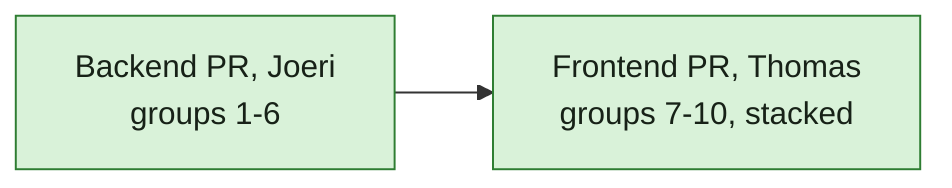

## At a glance

| Part | Groups | Owner |
|---|---|---|
| Backend: data, logic, API, creator fix | 1-6 | Joeri |
| Frontend: web and desktop | 7-10 | Thomas |

Server checks: `cd server && go test ./...` with the test database, as AGENTS.md "Development and Verification" says. Frontend checks: `pnpm typecheck`, `pnpm test`.

## 1. Data

- [x] 1.1 `server/migrations/740_todo.up.sql` / `.down.sql`: the `todo` table as `design.md` "classDiagram" holds it, with CHECKs on `kind`, `actor_type` and `done_by`. Verify: `make migrate-up` and `make migrate-down` on the worktree database.
- [x] 1.2 `server/migrations/741_todo_open_index.up.sql` / `.down.sql`: unique `CONCURRENTLY` index on `(workspace_id, member_id, kind, source_key) WHERE done_at IS NULL`; `server/migrations/742_todo_list_index.up.sql` / `.down.sql`: `CONCURRENTLY` index on `(workspace_id, member_id, created_at DESC) WHERE done_at IS NULL`; both registered as AGENTS.md "Database" says. Verify: migrate up.
- [x] 1.3 `server/pkg/db/queries/todo.sql`: `OpenTodo`, `CloseTodos` (by member, kind and source key, or by kind and source key for all members), `CloseTodosOnIssue`, `ListOpenTodos`, `CountOpenTodosByWorkspace`, `GetTodoForMember`, `MarkTodoDone`; `make sqlc`. Verify: `go build ./...`.

## 2. Logic

- [x] 2.1 `server/internal/todo/`: kind constants, `Open` and `Close` that publish `todo:opened` / `todo:closed`; `server/pkg/protocol/events.go` gets both events; `server/cmd/server/listeners.go` sends them to `member_id`. Verify: a test that opening twice keeps one row and publishes once.
- [x] 2.2 `server/cmd/server/todo_listeners.go`: question open and close. Verify: tests for asked, answered (`any_one` and `each`), reassigned, withdrawn.
- [x] 2.3 Mention open and close, from comments and issue descriptions. Verify: tests for mentioned, own mention, member replies, mentioned again after Mark done.
- [x] 2.4 Assigned open and close. Verify: tests for assigned in Todo, in Backlog, status move inside and outside the set, reassigned.
- [x] 2.5 Agent blocked and run failed open and close. Verify: tests for blocked in a run, blocked by a member, failed run, run starts again, issue leaves Blocked.
- [x] 2.6 Review open and close, and its hiding behind an open question in list and count. Verify: tests for In Review, Waiting For QA, creator is assignee, approval question on the issue.
- [x] 2.7 System problems: autopilot paused, quota reached, quick create failed open where today's notice is made, and close on resume, admitted run, successful retry. Verify: tests for each open and close.
- [x] 2.8 Stop the moved notice types in `notification_listeners.go`, `service/task.go`, `autopilot_failure_monitor.go` and `service/autopilot_quota_notifications.go`; update the tests that expected them. Verify: `go test ./cmd/server/... ./internal/service/...`.

## 3. API

- [x] 3.1 `server/internal/handler/todo.go` and routes in `server/cmd/server/router.go`: `GET /api/todos`, `GET /api/todos/summary`, `POST /api/todos/{id}/done` as `design.md` "API contract" says. Verify: handler tests for order, overdue, review hidden, summary per workspace, done by another member is 404.

## 4. Backfill

- [x] 4.1 `server/migrations/744_todo_backfill.up.sql`: open to-dos from open questions, assigned issues, created issues In Review, and the unarchived notices of the moved types that are still open; then archive those notices. It runs after 743, so review rows use the corrected creators. Verify: a migration test on seeded rows.

## 5. Creator

- [x] 5.1 `CreateIssue` sets the run's `originator_user_id` as creator for `agent_create` and `quick_create`. Verify: tests for quick create, agent in a run, agent run without originator; the subscriber test that the member follows as creator.
- [x] 5.2 `server/migrations/743_issue_creator_backfill.up.sql`. Verify: migration test; on production data 91 issues change.

## 6. Docs

- [x] 6.1 `specs/docs/system-design.md`: the `todo` table and its flow. Verify: read-through.

## 7. Client data (Thomas)

- [ ] 7.1 `packages/core/types/todo.ts`, zod schemas with `parseWithFallback` in `packages/core/api/schemas.ts`, API client methods, `packages/core/todos/` queries (`todoKeys`), Mark done mutation with optimistic removal, `todo:*` handlers in `use-realtime-sync.ts`, desktop notification on `todo:opened`. Verify: unit tests.

## 8. Inbox (Thomas)

- [ ] 8.1 `packages/views/inbox/`: to-do rows, detail pane per kind, Mark done selecting the next row, empty state, as `designs/screens/todo-inbox.md` says. Verify: component tests.

## 9. Updates (Thomas)

- [ ] 9.1 Today's inbox list on its own Updates route: `paths.ts`, web route, desktop `routes.tsx`, tab presentation, sidebar item with a bell icon and no number. Verify: component tests and the page in the browser.

## 10. Badges (Thomas)

- [ ] 10.1 The sidebar Inbox number, the workspace switcher dot and the desktop dock badge read `GET /api/todos/summary`. Verify: `badge-convergence.test.tsx`, `app-sidebar.test.tsx`.

## Implementation Notes

- 1.1: Added `server/migrations/740_todo.up.sql` and `.down.sql` with the designed fields, bounded kind/actor/completion vocabularies, nullable system actor, and no foreign keys. `details` defaults to an empty object.
- 1.1 verification: `make migrate-up ENV_FILE=.env.worktree` passed against isolated database `multica_todo_inbox_660`. `make migrate-down` successfully reversed 740, then stopped at the historical forward-only migration 494. With Joeri's approval, restored the database with migrate-up and independently ran 740's down and up files through `psql -v ON_ERROR_STOP=1`; both passed. Historical migrations are unchanged.
- 1.2: Added the standalone concurrent index migrations 741 and 742, their concurrent drop rollbacks, and both invalid-index cleanup registrations in `server/cmd/migrate/main.go`. Migrate-up passed on the isolated worktree database; standalone down/down/up/up through psql also passed.
- 1.3: Added `server/pkg/db/queries/todo.sql`, generated `server/pkg/db/generated/todo.sql.go` and the `Todo` model in `generated/models.go`, plus `server/pkg/db/todo_test.go`. Reads project live issue/question fields, hide missing issues and reviews shadowed by a question, sort overdue then newest, and count only workspaces with current membership.
- 1.3 decisions: `member_id` uses the recipient's user ID, matching existing inbox recipients and `member.user_id`. A null member on close means all recipients; issue closes accept a set of kinds. Duplicate opens and repeated Mark done return `pgx.ErrNoRows`; callers can distinguish real transitions for event publication and retrieve an already-completed row with `GetTodoForMember`.
- 1.3 surprise: sqlc inferred a concatenated issue identifier (even a CASE returning NULL) as a nonnullable string. The issue-projection CTE and left join preserve its nullable `pgtype.Text` type, including system to-dos without issues. Fixed this and an incomplete question test fixture before the final passing run.
- 1.3 verification: `make sqlc`, `go -C server build ./...`, and `TEST_DATABASE_URL`-configured `go -C server test ./pkg/db -count=1 -v` passed (four tests). Tests cover vocabulary constraints, duplicate opens, completion/reopening and ownership, member/all-member/issue close scopes, workspace isolation, overdue/newest order, live source fields, nullable system fields, review suppression/reappearance, and account-level membership filtering.
- 2.1: Added `server/internal/todo/todo.go` and its transition test, protocol constants, member-private routing in `listeners.go`, and its audience test in `todo_listeners_test.go`. `todo.Service` publishes only real inserts/closures and shares live-source response projection with the future API. The DB-backed duplicate-open/close test passed against the isolated worktree database (`go -C server test ./internal/todo -count=1 -v`). No design deviation; the audience test runs with the listener group below.
- 2.2: Added question transitions in `todo_listeners.go`, registration in `main.go`, and asked/any-one/each/reassigned/withdrawn tests in `todo_listeners_test.go`. Reassignment opens only the event's new recipient, not other answerers who may have marked done. Targeted listener tests passed, including private realtime delivery. Fixture errors (answerers have no `id`; events require explicit IDs) were corrected. Server integration tests read `DATABASE_URL`, not `TEST_DATABASE_URL`; an initial run used the default database and failed because it had no todo table. Subsequent listener runs explicitly selected the isolated worktree database.
- 2.3: Updated `todo_listeners.go` and its tests for comment and newly added description mentions, self-mention exclusion, member replies closing every mention on the issue, and later mentions after Mark done. Description mentions use the issue ID as source key and no comment ID, since no comment exists; comments use their comment ID. Existing member/all/squad mention expansion is preserved; agents and platform comments do not create member to-dos. `TestTodoMentionLifecycle` passed on the isolated database.
- 2.4: Updated `todo_listeners.go` and its tests for member assignment in the exact Todo/Back From QA/Blocked/In Review set. Relevant status or assignee transitions retire the old row before opening its replacement; unrelated edits do not revive Mark done. `TestTodoAssignedLifecycle` passed, covering Backlog exclusion, Todo, a move inside/outside the set, and reassignment. No design deviation.
- 2.5: Updated `todo_listeners.go`, its tests, `handler/issue.go` and `listeners.go`. Single and batch issue updates carry the trusted run's `source_task_id` internally (stripped before realtime fanout), so blocked to-dos use the run's originator rather than an agent owner or guess. Failed issue runs open separately; quick-create jobs do not. Dispatch and leaving Blocked close both failure kinds. `TestTodoAgentFailures` passed; task fixtures were corrected to supply the existing accountable-human and runtime invariants.
- 2.6: Updated `todo_listeners.go` and its tests for creator review rows, excluding self-assignment and every status other than In Review. Reused the data group's list/count suppression, preserving the review row behind an open question so it returns afterward. `TestTodoReviewLifecycle` passed for review, approval question precedence in both list and count, question closure, Waiting For QA, and creator-as-assignee.
- 2.7: Converted paused-autopilot, quota rejection, and failed/unconfirmed quick-create writes to to-dos in `autopilot_failure_monitor.go`, `service/autopilot_quota_notifications.go`, and `service/task.go`. Added resume closure to `todo_listeners.go`, workspace quota closure to `service/autopilot_quota.go`, a generated `CloseTodosInWorkspace` query, and post-commit opened publication in `internal/todo`. Quick-create success closes its own row plus retry/rerun ancestors; unconfirmed results retain their neutral wording and explicit reason in details. Tests added in `service/todo_test.go` and `todo_listeners_test.go` passed for all three open/close paths.
- 2.7 decision: With Joeri's approval, corrected `design.md`: quota periods have no surrogate ID, so the source key is start/end UTC RFC 3339 joined by `/`. An admitted run closes all open quota rows across the workspace, including older periods. Quota recipient writes and the first-rejection marker remain transactional; opened events publish only after commit. `make sqlc` passed. Corrected the quick-create fixture to satisfy the existing runtime constraint before its passing run.
- 2.8: Removed question/mention/blocked/failed-run notice listeners and stale failure-notice archival from `notification_listeners.go`. The system-problem producers were cut over in 2.7. Also removed the secondary `task_failed` notice produced by delegated-recovery exhaustion in `service/task.go`; its system explanation remains, while failed-run to-dos belong to the task lifecycle listener. Informational issue, comment, assignment and successful quick-create notices are unchanged.
- 2.8 tests: Updated `notification_listeners_test.go`, `notification_mentions_test.go`, `autopilot_failure_monitor_test.go`, `quick_create_subscriber_test.go`, `service/autopilot_quota_test.go`, and `service/delegated_failure_recovery_test.go`. Tests now assert to-do recipients, no obsolete notices, unmuted actionable mentions, explicit quick-create failure/unconfirmed reasons, and transactional quota rollback/retry; fixture cleanup removes to-dos. The focused `TestTodo|TestNotification|TestAutopilotFailureMonitor|TestAutopilotQuota|TestQuickCreate|TestDelegatedFailureRecoveryStopsAfterBoundedUndeliveredAttempts` run passed in both server packages against the isolated worktree DB.
- 2.8 verification limitation: The full requested `go -C server test ./cmd/server/... ./internal/service/...` was exercised. Corrected my autopilot event assertions to read `member_id` from the event envelope, then the focused rerun passed. The full service run also failed in unchanged question tests: `TestQuestionPartlyAnsweredRemainsUnseenAndOverdue` (line 125), `TestQuestionUnseenTracksClaimsAndAnswerEdits` (388), `TestQuestionWakeRefusesEveryActiveTask/awaiting_local_directory` (417), `TestQuestionWakeRefusesUnavailableAgent/archived` (448), and `TestQuestionSetWakeFromAnyStatusKeepsStatusAndGetsAllUnseenAnswers` (1087/1100). Reported these out-of-scope unseen-answer/wake failures to Joeri; did not change question behavior or narrow its tests.
- 3.1: Added `server/internal/handler/todo.go`, `todo_test.go`, and routes in `server/cmd/server/router.go`. List and done require workspace membership; the summary route sits outside that gate and counts only current workspace memberships, independent of the selected workspace. Responses reuse `internal/todo.Response`, keeping API rows and opened events identical.
- 3.1 decisions: Mark done first loads the member/workspace-scoped live projection, returns 404 for inaccessible or missing rows, and publishes `todo:closed` only for a real completion. Already closed rows preserve their original completion time and reason; a concurrent completion is reloaded rather than overwritten. No query or service changes were needed.
- 3.1 verification: The database-backed `go -C server test ./internal/handler -run '^TestTodo' -count=1 -v` exercised five tests. Four passed immediately: overdue/newest ordering and live/null source fields, review suppression/reappearance in list and summary, account-level summary membership isolation, and Mark done ownership/idempotence/realtime/system-action payloads. The access test initially expected 403 for workspace nonmembership; existing middleware intentionally returns 404. Corrected that assertion, then `-run '^TestTodoEndpointsRequireMember$'` passed. All five new tests passed across those runs on `.env.worktree`'s isolated database. Broader server verification remains with the build lead; the known unrelated question failures were not rerun.
- 4.1: Added `server/migrations/744_todo_backfill.up.sql`, its non-destructive `.down.sql`, and `server/pkg/db/todo_backfill_test.go`. The migration seeds unanswered current question answerers, member assignments in the four specified statuses, creator reviews, current agent failures, and still-actionable unarchived mention/system notices, then archives all nine moved notice types in the same transaction. Repeated application preserves existing open rows and their IDs.
- 4.1 decisions: With Joeri, reordered the creator backfill to 743 and the to-do backfill to 744 in `design.md` and this task list, so reviews use corrected member creators. Failed runs come from an issue's latest task and its originator, never the old failure notice's subscriber audience. Blocked rows require the latest status activity to come from the latest dispatched run's agent; a member-blocked issue or a later dispatched run is excluded, while merely queued work does not close the obligation. Quick-create success follows retry/rerun ancestry; quota notices remain open only without a later admission reservation. Only existing workspace members receive backfilled rows.
- 4.1 verification: Four seeded PostgreSQL migration tests passed against `.env.worktree`'s isolated database, each applying the real SQL twice inside a rollback-only transaction. Covered open/partly answered/answered/withdrawn/closed questions; all assignment statuses; self-review and Waiting For QA exclusions; review rows retained behind questions; existing-row preservation; latest failed run and originator; agent/squad/member-blocked and queued/dispatched cases; comment/description/self/replied/archived/missing mentions; paused/resumed autopilots; quota admission; failed/unconfirmed/retried quick creates and preserved action details; all moved notices archived, informational updates retained, and rollback leaving notices untouched. Initial fixture errors (comment workspace and autopilot creator column names) were corrected, then the two affected tests passed; the subsequently added queued-run regression also passed. Used focused `go -C server test ./pkg/db -run '^TestTodoBackfill...' -count=1 -v` runs, plus `gofmt` on the new test file. Broader verification remains with the build lead; no production data was accessed.
- 5.1: Updated `server/internal/handler/issue.go` to take the creator from the resolved run's `originator_user_id` for ordinary agent creates and explicit quick creates, retaining the agent when no originator exists. Actor and origin remain the filing agent and task. Added `issue_creator_test.go`; updated `cmd/server/subscriber_listeners_test.go` and the explanatory comment in `quick_create_subscriber_test.go`.
- 5.1 decision: With Joeri's approval, added `ActorType` alongside `ActorID` in `service.IssueCreateOpts`. The service uses that identity for quick-create ownership checks, placement activities, events, analytics and assignment triggers, independently of the persisted member creator. A handler-only edit would reject quick creates and falsely label agent events as member events. Existing callers without an actor override retain creator-based attribution.
- 5.1 verification: Ran gofmt on the five changed Go files and focused database-backed tests in `internal/handler`, `cmd/server` and `internal/service` against `.env.worktree`'s isolated database. Origin stamping, forged-agent refusal, creator subscription, creation activity attribution and selected quick-create/source-context tests passed. The new four-case handler test initially violated the fixture's accountable/originator equality constraint; corrected the fixture, then all four cases passed, including a requester distinct from the authenticated daemon owner. Known unrelated question tests were not run.
- 5.2: Added `server/migrations/743_issue_creator_backfill.up.sql`, its non-destructive `.down.sql`, and `server/pkg/db/issue_creator_backfill_test.go`. Only agent creators on `agent_create` or `quick_create` issues with a resolved non-null run originator change to member creators; origin, timestamps and other issue fields are untouched. The down migration deliberately preserves corrected creators, since provenance cannot safely distinguish them from member-created issues.
- 5.2 verification: `gofmt` and `TEST_DATABASE_URL`-configured `go -C server test ./pkg/db -run '^TestIssueCreatorBackfill$' -count=1 -v` passed. The seeded migration test corrects 91 issues, leaves existing member creators and missing/unattributed/unrelated origins unchanged, confirms a repeat changes zero rows, exercises the down file alone, and applies 744 afterward to prove all 91 reviews belong to the corrected member creator. Both table-wide backfills run inside a rollback-only test transaction.
- 5.2 production observation: A read-only candidate count in the running production Postgres (`default_transaction_read_only=on`) found 95 eligible issues, all with originators still in their workspace, rather than the planning snapshot's 91. Joeri confirmed this is live-data drift as agents keep creating issues; the general creator rule remains unchanged. No production migration or write was run.
- 6.1: Completed the existing edit of `specs/docs/system-design.md`: server component relationships, the full `todo` model and logical source/actor references, question-to-do integration, and the storage/API/realtime/Updates flow. Kept the document present-state only and retained the durable ADR-0017 link rather than linking to the archivable change design. This task and its notes are the only other changes, in `tasks.md`.
- 6.1 verification: Read through the system design against every apply context file and all three build-context files, including ADR-0017. Confirmed recipient identity, open-row indexes, completion events, list/count projection, API scopes and migration ordering match the change. No code tests or diagram rendering checks ran for this documentation-only task. The apply command reports `missingPrerequisites: ["adr"]` even though the accepted ADR-0017 exists and is explicitly included in build context; no missing design decision was encountered.
