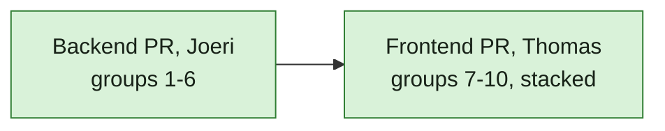

## At a glance

| Part | Groups | Owner |
|---|---|---|
| Backend: data, logic, API, creator fix | 1-6 | Joeri |
| Frontend: web and desktop | 7-10 | Thomas |

Server checks: `cd server && go test ./...` with the test database, as AGENTS.md "Development and Verification" says. Frontend checks: `pnpm typecheck`, `pnpm test`.

## 1. Data

- [x] 1.1 `server/migrations/740_todo.up.sql` / `.down.sql`: the `todo` table as `design.md` "classDiagram" holds it, with CHECKs on `kind`, `actor_type` and `done_by`. Verify: `make migrate-up` and `make migrate-down` on the worktree database.
- [ ] 1.2 `server/migrations/741_todo_open_index.up.sql` / `.down.sql`: unique `CONCURRENTLY` index on `(workspace_id, member_id, kind, source_key) WHERE done_at IS NULL`; `server/migrations/742_todo_list_index.up.sql` / `.down.sql`: `CONCURRENTLY` index on `(workspace_id, member_id, created_at DESC) WHERE done_at IS NULL`; both registered as AGENTS.md "Database" says. Verify: migrate up.
- [ ] 1.3 `server/pkg/db/queries/todo.sql`: `OpenTodo`, `CloseTodos` (by member, kind and source key, or by kind and source key for all members), `CloseTodosOnIssue`, `ListOpenTodos`, `CountOpenTodosByWorkspace`, `GetTodoForMember`, `MarkTodoDone`; `make sqlc`. Verify: `go build ./...`.

## 2. Logic

- [ ] 2.1 `server/internal/todo/`: kind constants, `Open` and `Close` that publish `todo:opened` / `todo:closed`; `server/pkg/protocol/events.go` gets both events; `server/cmd/server/listeners.go` sends them to `member_id`. Verify: a test that opening twice keeps one row and publishes once.
- [ ] 2.2 `server/cmd/server/todo_listeners.go`: question open and close. Verify: tests for asked, answered (`any_one` and `each`), reassigned, withdrawn.
- [ ] 2.3 Mention open and close, from comments and issue descriptions. Verify: tests for mentioned, own mention, member replies, mentioned again after Mark done.
- [ ] 2.4 Assigned open and close. Verify: tests for assigned in Todo, in Backlog, status move inside and outside the set, reassigned.
- [ ] 2.5 Agent blocked and run failed open and close. Verify: tests for blocked in a run, blocked by a member, failed run, run starts again, issue leaves Blocked.
- [ ] 2.6 Review open and close, and its hiding behind an open question in list and count. Verify: tests for In Review, Waiting For QA, creator is assignee, approval question on the issue.
- [ ] 2.7 System problems: autopilot paused, quota reached, quick create failed open where today's notice is made, and close on resume, admitted run, successful retry. Verify: tests for each open and close.
- [ ] 2.8 Stop the moved notice types in `notification_listeners.go`, `service/task.go`, `autopilot_failure_monitor.go` and `service/autopilot_quota_notifications.go`; update the tests that expected them. Verify: `go test ./cmd/server/... ./internal/service/...`.

## 3. API

- [ ] 3.1 `server/internal/handler/todo.go` and routes in `server/cmd/server/router.go`: `GET /api/todos`, `GET /api/todos/summary`, `POST /api/todos/{id}/done` as `design.md` "API contract" says. Verify: handler tests for order, overdue, review hidden, summary per workspace, done by another member is 404.

## 4. Backfill

- [ ] 4.1 `server/migrations/743_todo_backfill.up.sql`: open to-dos from open questions, assigned issues, created issues In Review, and the unarchived notices of the moved types that are still open; then archive those notices. Verify: a migration test on seeded rows.

## 5. Creator

- [ ] 5.1 `CreateIssue` sets the run's `originator_user_id` as creator for `agent_create` and `quick_create`. Verify: tests for quick create, agent in a run, agent run without originator; the subscriber test that the member follows as creator.
- [ ] 5.2 `server/migrations/744_issue_creator_backfill.up.sql`. Verify: migration test; on production data 91 issues change.

## 6. Docs

- [ ] 6.1 `specs/docs/system-design.md`: the `todo` table and its flow. Verify: read-through.

## 7. Client data (Thomas)

- [ ] 7.1 `packages/core/types/todo.ts`, zod schemas with `parseWithFallback` in `packages/core/api/schemas.ts`, API client methods, `packages/core/todos/` queries (`todoKeys`), Mark done mutation with optimistic removal, `todo:*` handlers in `use-realtime-sync.ts`, desktop notification on `todo:opened`. Verify: unit tests.

## 8. Inbox (Thomas)

- [ ] 8.1 `packages/views/inbox/`: to-do rows, detail pane per kind, Mark done selecting the next row, empty state, as `designs/screens/todo-inbox.md` says. Verify: component tests.

## 9. Updates (Thomas)

- [ ] 9.1 Today's inbox list on its own Updates route: `paths.ts`, web route, desktop `routes.tsx`, tab presentation, sidebar item with a bell icon and no number. Verify: component tests and the page in the browser.

## 10. Badges (Thomas)

- [ ] 10.1 The sidebar Inbox number, the workspace switcher dot and the desktop dock badge read `GET /api/todos/summary`. Verify: `badge-convergence.test.tsx`, `app-sidebar.test.tsx`.

## Implementation Notes

- 1.1: Added `server/migrations/740_todo.up.sql` and `.down.sql` with the designed fields, bounded kind/actor/completion vocabularies, nullable system actor, and no foreign keys. `details` defaults to an empty object.
- 1.1 verification: `make migrate-up ENV_FILE=.env.worktree` passed against isolated database `multica_todo_inbox_660`. `make migrate-down` successfully reversed 740, then stopped at the historical forward-only migration 494. With Joeri's approval, restored the database with migrate-up and independently ran 740's down and up files through `psql -v ON_ERROR_STOP=1`; both passed. Historical migrations are unchanged.
