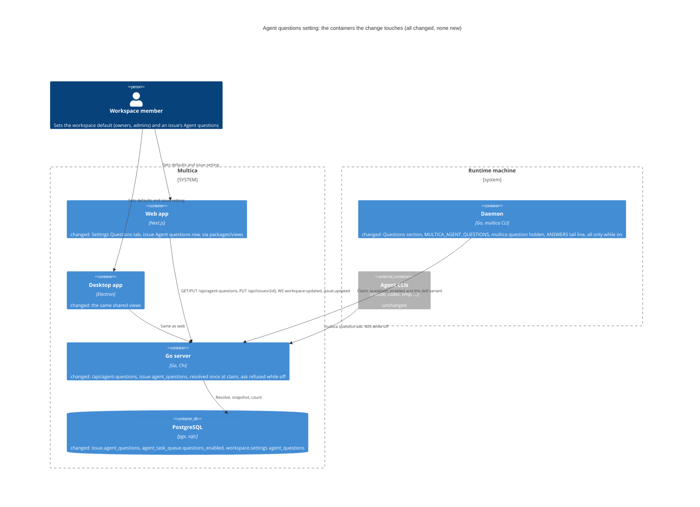
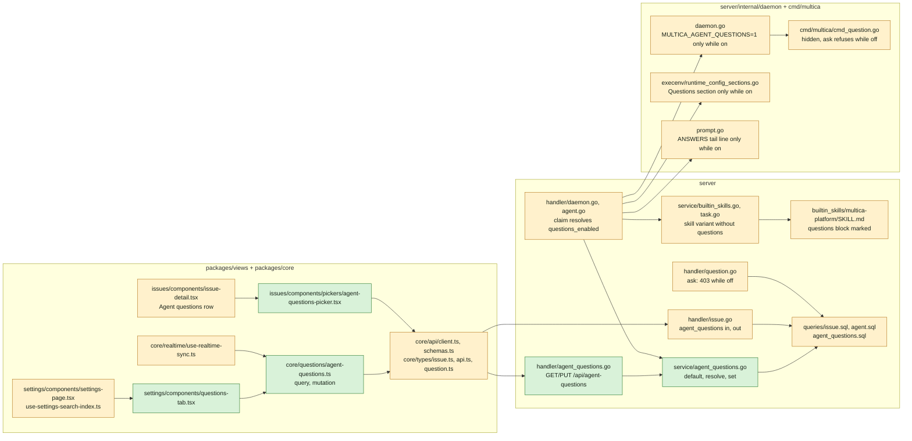
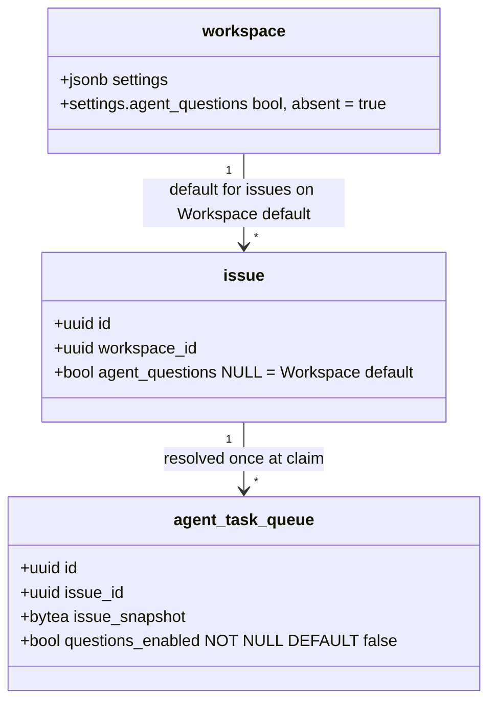
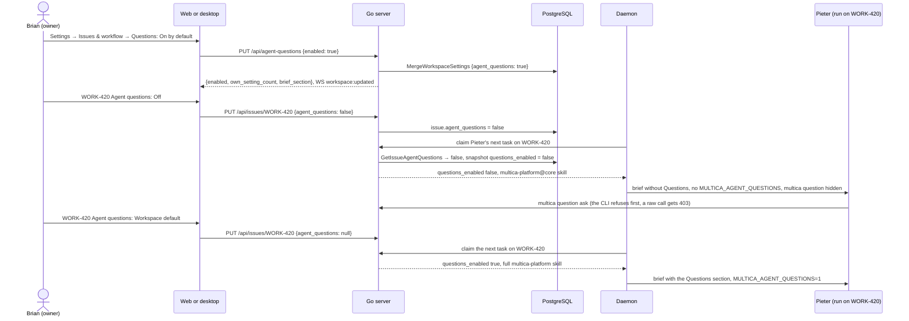

## At a glance

The delta of this change on the living system design, `specs/docs/system-design.md`, as change `answer-an-agents-question-and-wake-it` (UJ-1) leaves it. Every container it touches already exists; the change adds no container and no table.









| Kind | Name | Change | Path |
|---|---|---|---|
| Migration | `issue.agent_questions boolean` (NULL = Workspace default) | new | `server/migrations/572_issue_agent_questions.up.sql`, `.down.sql` |
| Migration | `CONCURRENTLY` partial index on `issue (workspace_id) WHERE agent_questions IS NOT NULL` | new | `server/migrations/573_issue_agent_questions_index.up.sql`, `.down.sql` |
| Migration | `agent_task_queue.questions_enabled boolean NOT NULL DEFAULT false` | new | `server/migrations/574_agent_task_questions_enabled.up.sql`, `.down.sql` |
| Queries | `agent_questions` in UpdateIssue and every named issue column list; `GetIssueAgentQuestions`, `CountOwnAgentQuestionIssues`; `SetTaskClaimSnapshot` replaces `SetTaskIssueSnapshot` | changed | `server/pkg/db/queries/issue.sql`, `server/pkg/db/queries/agent_questions.sql`, `server/pkg/db/queries/agent.sql` |
| Service | `AgentQuestionsDefault`, `ResolveAgentQuestions`, `SetAgentQuestionsDefault` | new | `server/internal/service/agent_questions.go` |
| Service | Built-in skill variant without the questions block; claim snapshot takes `questions_enabled` | changed | `server/internal/service/builtin_skills.go`, `server/internal/service/task.go` |
| Skill | `multica-platform` questions block between markers | changed | `server/internal/service/builtin_skills/multica-platform/SKILL.md` |
| Handler | `GET`, `PUT /api/agent-questions` | new | `server/internal/handler/agent_questions.go`, `server/cmd/server/router.go` |
| Handler | Issue `agent_questions` in and out; withheld from and refused to task tokens | changed | `server/internal/handler/issue.go` |
| Handler | Claim resolves `questions_enabled`, picks the skill variant, snapshots it | changed | `server/internal/handler/daemon.go`, `server/internal/handler/agent.go` |
| Handler | `POST /api/questions` refuses while the run's questions are off | changed | `server/internal/handler/question.go` |
| Daemon | `Task.QuestionsEnabled`; `MULTICA_AGENT_QUESTIONS=1` only while on | changed | `server/internal/daemon/types.go`, `server/internal/daemon/daemon.go`, `server/internal/daemon/execenv/execenv.go` |
| Agent brief | Questions section only while on; `QuestionsSection` exported | changed | `server/internal/daemon/execenv/runtime_config_sections.go` |
| Prompt | `[ANSWERS]` tail line only while on | changed | `server/internal/daemon/prompt.go` |
| CLI | `multica question` hidden and `ask` refused while off | changed | `server/cmd/multica/cmd_question.go` |
| Type and schema | `Issue.agent_questions`, `UpdateIssueRequest.agent_questions`, `AgentQuestionsSettings` | changed | `packages/core/types/issue.ts`, `packages/core/types/api.ts`, `packages/core/types/question.ts`, `packages/core/api/schemas.ts`, `packages/core/api/client.ts` |
| Feature | `agentQuestionsOptions`, `useUpdateAgentQuestionsDefault` | new | `packages/core/questions/agent-questions.ts` |
| Realtime | `workspace:updated` invalidates the agent questions query | changed | `packages/core/realtime/use-realtime-sync.ts` |
| Screen | Settings → Issues & workflow → Questions | new | `packages/views/settings/components/questions-tab.tsx`, `settings-page.tsx`, `use-settings-search-index.ts` |
| Component | Agent questions picker: Workspace default (On/Off), On, Off | new | `packages/views/issues/components/pickers/agent-questions-picker.tsx` |
| Screen | Issue detail: Agent questions row | changed | `packages/views/issues/components/issue-detail.tsx` |
| Copy | Settings and issue keys, five languages | changed | `packages/views/locales/{en,zh-Hans,ko,ja,fr}/settings.json`, `issues.json` |
| Design | Screen 7 and the Agent questions row on screen 1 | changed | `designs/screens/issue-questions.pen`, `designs/screens/issue-questions.md` |
| Prototype | Data-flow path and the settings and row screens of this journey | changed | `prototypes/web/issue-questions/` |
| E2E | Journey acceptance test | new | `e2e/agent-questions-setting.spec.ts` |
| ADR | ADR-0005: Whether a run may ask is decided once, at claim | new | `adr/0005-whether-a-run-may-ask-is-decided-at-claim.md` |

## Context

Journey UJ-5 of [PRD: Questions in Multica](anytype://object?objectId=bafyreiaviofipcl3ymgld2skld4ij6hlarsm2ra55ygufsepgk5laxjf34), journey issue [DAS-431](https://linear.app/skuddy/issue/DAS-431/uj-5-turn-agent-questions-off-for-one-issue). It builds on change `answer-an-agents-question-and-wake-it` (UJ-1, [DAS-432](https://linear.app/skuddy/issue/DAS-432/uj-1-answer-an-agents-question-and-wake-it)), whose Questions section, `multica question`, `[ANSWERS]` block, `multica-platform` line and `POST /api/questions` this change makes conditional. UJ-2's ask (several at once) uses the same endpoint and CLI command, so its asks are refused the same way.

**Journey steps.** No `Skip:` Request is linked to the journey. Steps with work: J2 Data models, J3 Data-flow prototype, J6 Screens, J7 Live prototype, J8 Backend and agent tooling, J9 Frontend, J11 Acceptance test and archive. The investigation found nothing to change for J1 Project structure (every new file sits in an existing Go package or workspace package), J4 Design system (no token or colour), J5 Components (screen 7 and the Agent questions row use only the switch, option and nav item that UJ-1's J5 brings from appboypov/multica#6, whose library exports list exactly those) and J10 Agent tooling for UI (only people set it; see decision 3); each waits under Open Questions.

**Design sources.** Screen 7 "Settings - Questions" of [appboypov/multica#6](https://github.com/appboypov/multica/pull/6) (`designs/screens/exports/7-settings-questions.png`): the tab under Issues & workflow after Wakeups, title "Questions", "The default for every issue. Each issue can change it in its properties.", card "Agents can ask questions" with the row **On by default** + switch + "3 open issues have their own setting and ignore this default.", then "What agents get while questions are on" with the brief section in a code block and "While questions are off, agents get none of this, and `multica question` is not in their CLI help." The UX spec's "Where questions live" 3: an **Agent questions** row below the Questions row, menu **Workspace default** / **On** / **Off**. Prototype [appboypov/multica#8](https://github.com/appboypov/multica/pull/8): `pages.tsx` (settings page, "On by default"), `issue.tsx` (the row, "workspace default" label and the three-item menu).

**Code map.** What the build reuses, beyond UJ-1's code map. Paths are under `server/` unless they start with `packages/` or `apps/`.

- Workspace defaults precedent: the Wakeups tab. `internal/handler/issue_system_wakeup.go` `ListWorkspaceSystemWakeups` / `UpdateWorkspaceSystemWakeup` (member read; PUT checks `systemWakeupHuman` then `roleAllowed(member.Role, "owner", "admin")`), `service.SystemWakeupDefault(ws.Settings)`, `pkg/db/queries/system_wakeup.sql` `MergeWorkspaceSettings` (server-side JSONB merge, no client full-object replace) and `CountCustomizedSystemWakeups` (the open-issue predicate with `terminal_status_keys`). `h.terminalIssueStatusKeys(ctx, wsID)` (`internal/handler/issue_status.go:48`) gives the keys. Routes: `cmd/server/router.go` beside `/api/system-wakeups`.
- Settings UI precedent: `packages/views/settings/components/wakeups-tab.tsx` (`SettingsTab`, `SettingsSection`, `SettingsCard`, `SettingsRow`, `Switch`, `canManage` from `memberListOptions` + `useAuthStore`, `admin_only` text), registered in `settings-page.tsx:215` with `entry(...)`, searchable through `use-settings-search-index.ts:144`. Mutation precedent: `useUpdateWorkspaceSystemWakeup` (`packages/core/issues/wakeups.ts:68`), awaited, not optimistic.
- Workspace realtime: `UpdateWorkspace` publishes `protocol.EventWorkspaceUpdated` with `workspaceToResponse(ws)` (`internal/handler/workspace.go:460`); `packages/core/realtime/use-realtime-sync.ts:491` patches the workspace list.
- Issue property precedent: `stage` — `UpdateIssueRequest` + `rawFields` key presence, explicit `null` clears (`internal/handler/issue.go:3930`); `UpdateIssue` in `pkg/db/queries/issue.sql` (the `changed` CTE with `next_stage`); named column lists at `issue.sql` lines 8-11 and 510-513 must stay in step with the table so they keep returning `db.Issue`. `IssueResponse` / `issueToResponse` (`issue.go:38`, `:478`, 21 callers). Frontend: `IssueSchema` (`packages/core/api/schemas.ts:1292`), `Issue` (`packages/core/types/issue.ts:170`), `UpdateIssueRequest` (`packages/core/types/api.ts:53`), `useUpdateIssue` (`packages/core/issues/mutations.ts:190`, optimistic through `applyIssueChange`), `PropRow` + `PriorityPicker` pattern (`packages/views/issues/components/pickers/priority-picker.tsx`, `property-picker.tsx`).
- Actor source: `middleware.Auth` stamps `X-Actor-Source: task_token` and `X-Task-ID` for `mat_` tokens; handlers read `r.Header.Get("X-Actor-Source") == "task_token"` (`internal/handler/handler.go:865`).
- Claim: `buildClaimedTaskResponse` (`internal/handler/daemon.go:2343`) loads skills at ~2553 (`LoadAgentSkillBundles`) or ~2565 (`BuiltinSkills`, legacy full payload) before it loads the issue at ~2607; `FinalizeTaskClaim` (`internal/service/task.go:3799`) writes `SetTaskIssueSnapshot` (`pkg/db/queries/agent.sql:837`) under the claim CAS. `AgentTaskResponse` (`internal/handler/agent.go:360`).
- Built-in skills: `internal/service/builtin_skills.go` (`loadBuiltinSkill` reads `SKILL.md` and every file of the skill directory), `BuiltinSkillID(name)` = `"builtin:" + name` (`task.go:6923`), assigned in `BuildAgentSkillBundles` when `ID` is empty (`task.go:7024`) and matched in `LoadRequestedAgentSkillBundles` against `AllBuiltinSkills()` (`task.go:6996`). The daemon names skill directories from `Name` (`execenv/context.go` `resolveSkillSlugs`) and caches bundles by hash, so two variants with one name and two ids land in the same directory with their own content.
- Daemon: `Task` (`internal/daemon/types.go:70`), `taskMulticaEnvironment` (`internal/daemon/daemon.go:178`), `TaskContextForEnv` (`execenv/execenv.go:130`), `buildMetaSkillContentSlim` (`execenv/runtime_config_sections.go:1051`) where UJ-1's `writeQuestionsSection` sits, `perTurnContextBlocks` (`prompt.go:63`) where UJ-1's `[ANSWERS]` block sits. The brief-cache test `TestBriefByteIdenticalAcrossRunsForEveryKind` (`execenv/runtime_config_test.go:2062`) holds for runs with the same setting.
- CLI: `cmd/multica/help.go` `commandsInGroup` filters with `IsAvailableCommand()`, so a `Hidden` command leaves `multica --help`; `inDaemonTaskIdentityContext()` (`cmd/multica/cmd_agent.go:391`) tells a task process from a person's terminal.
- Must not change: UJ-1's requirements and its Questions section text; the `UpdateIssue` COALESCE and `rawFields` contract; `expected_revision`; owner/admin-only `PATCH /api/workspaces/{id}`; the claim CAS; answering, Wake and the display of questions already asked (non-goal).

## Goals / Non-Goals

**Goals:**
- Owners and admins set the workspace Questions default; every member reads it and the count of open issues with their own setting.
- Every issue has Agent questions: Workspace default (showing its current value), On or Off; members change it at any time.
- Whether a run may ask is decided once, when its task is claimed, and stays fixed for that run.
- While a run's questions are off, its brief, environment, `multica --help`, skills and `[ANSWERS]` tail say nothing about questions, and its asks are refused by the CLI and by the server.

**Always:**
- One resolution, in Go: `service.ResolveAgentQuestions(issue.agent_questions, workspace.settings)`; issue value when set, else the workspace default, absent default = On.
- A task without an issue resolves to off (UJ-1 already refuses its asks with 422).
- The server refusal reads the task's snapshot, never the live issue, so a running run is unchanged by a change mid-run.
- Workspace default changes publish `workspace:updated`; issue changes ride the existing `issue:updated`.

**Never:**
- No per-run setting; no setting for answering, Wake or showing questions.
- No `agent_questions` in issue responses to task tokens and no change of it by task tokens (decision 3, until Open Question 5 is answered).
- No CLI flag for the setting; no new design token or colour; no mobile change; no foreign keys.

**Non-Goals:** a setting per agent run; turning off answering, Wake or the display of questions already asked; workspace skills written by people (their text is theirs; only product-owned text is withheld).

## Decisions

### 1. Where the setting lives

The workspace default is the key `agent_questions` (boolean) in `workspace.settings`, absent meaning On, as the GitHub and wakeup defaults live there. The issue value is a nullable column `issue.agent_questions boolean`: `NULL` is Workspace default, `true` On, `false` Off. A column, not `issue.properties`, because the claim and the count filter on it and because custom properties are member-defined. The count of open issues with their own setting uses a partial index on `issue (workspace_id) WHERE agent_questions IS NOT NULL`, in its own `CONCURRENTLY` migration.

### 2. Settings API

`GET /api/agent-questions` (any member) and `PUT /api/agent-questions` (body `{enabled: bool}`, `DisallowUnknownFields`; member actor via `systemWakeupHuman`; `owner` or `admin`, else 403) both return:

```json
{ "enabled": true, "own_setting_count": 3, "brief_section": "## Questions\n\n`multica question` asks …" }
```

`own_setting_count` is `CountOwnAgentQuestionIssues(workspace_id, terminal_status_keys)`. `brief_section` is `execenv.QuestionsSection`, the constant the brief writes, so screen 7 shows the text agents get and never drifts from it. PUT calls `service.SetAgentQuestionsDefault`, which writes through `MergeWorkspaceSettings`, then publishes `workspace:updated` with the workspace, as `UpdateWorkspace` does.

### 3. The issue's Agent questions

`UpdateIssueRequest.AgentQuestions *bool`; key presence in `rawFields` decides: absent keeps, `null` sets Workspace default, `true`/`false` set On/Off. `IssueResponse.AgentQuestions *bool` with `json:"agent_questions,omitempty"`, so Workspace default is absent on the wire and the client schema defaults it to `null`. `issue:updated` carries it to open clients; `useUpdateIssue` patches optimistically, as for priority (predictable, trivial rollback).

Brian's words decide what agents see of it: "agents must not get any info about the functionality when its disabled". The proposal's "anyone who can edit an issue" also covers agents, which can edit issues, so this part is planned as option A of Open Question 5 and waits for Brian's answer. `GetIssue` and `UpdateIssue` clear `AgentQuestions` in responses to `X-Actor-Source: task_token`, and `UpdateIssue` refuses a body with the key from a task token with 403 "only members can change this setting". So the setting is people's, an agent cannot turn its own questions on, and `multica issue get` shows nothing about it. No CLI flag sets it, since `multica issue update --help` would list it to agents.

### 4. Decided once, at claim (ADR-0005)

`buildClaimedTaskResponse`, before it loads skills, runs `GetIssueAgentQuestions(task.IssueID)` → `(issue.agent_questions, workspace.settings)` and computes `questionsEnabled := service.ResolveAgentQuestions(...)`; no issue → false; a load error rejects the claim through `rejectClaimSourceLoad`, as the issue load does. It sets `AgentTaskResponse.QuestionsEnabled` (`json:"questions_enabled"`), picks the skill variant (decision 5) and passes the value to `FinalizeTaskClaim`, whose `SetTaskClaimSnapshot` writes `issue_snapshot = COALESCE(sqlc.narg('issue_snapshot'), issue_snapshot)` and `questions_enabled` in one UPDATE under the existing CAS, for every claim. The column defaults to false, so a task claimed before this change cannot ask: fail closed. `POST /api/questions` (UJ-1's handler, after its 422 for a task without an issue) loads the task by `X-Task-ID` and returns 403 "questions are off for this issue" when `questions_enabled` is false, before it writes anything.

### 5. What a run gets while off

- **Brief.** `TaskContextForEnv.QuestionsEnabled`; `writeQuestionsSection` writes `execenv.QuestionsSection` only when true. The brief differs between runs only when the setting changed between them.
- **Environment.** `taskMulticaEnvironment` adds `MULTICA_AGENT_QUESTIONS=1` only when on; when off there is no variable at all, so the environment names nothing about questions.
- **CLI.** `cmd_question.go`: `questionsAvailable() = !inDaemonTaskIdentityContext() || os.Getenv("MULTICA_AGENT_QUESTIONS") == "1"`; `questionCmd.Hidden = !questionsAvailable()`, so `multica --help` drops it, and `ask` fails before any request with "questions are off for this issue". A person's own terminal always sees the command.
- **Skills.** UJ-1's `multica question` text in `multica-platform` sits between the lines `<!-- questions -->` and `<!-- /questions -->`, in any file of a built-in skill. `loadBuiltinSkill(fsys, root, name, questions)` drops the marker lines when on and the whole block when off. A skill whose files hold no block is one variant with id `builtin:<name>`; one with a block gets the off variant's id `builtin:<name>@core`. `BuiltinSkills(systemKey, legacyRedirects, questions)` returns the run's variants; `AllBuiltinSkills()` returns every variant, and the resolver matches `builtin.ID`. The name, and so the daemon's skill directory, stays `multica-platform`.

  ```go
  func questionsBlock(text string, on bool) (string, bool) // returns the text and whether it had a block
  ```

- **`[ANSWERS]`.** A Wake while off still delivers the answers (Wake and answering are not turned off), but the block's last line, "`multica question answers <question-id>` shows a question in full.", is written only when on.

`multica question answers`, `close` and `withdraw` are hidden with the command but not refused: only asking is turned off.

### 6. Web and desktop

`packages/core/questions/agent-questions.ts`: `agentQuestionsKeys.settings(wsId)`, `agentQuestionsOptions(wsId)` over `api.getAgentQuestions()` (parsed with `AgentQuestionsSettingsSchema`: `enabled` default true, `own_setting_count` default 0, `brief_section` default ""), and `useUpdateAgentQuestionsDefault(wsId)`, awaited, which sets the query data from the PUT response. `use-realtime-sync.ts` invalidates `agentQuestionsKeys.settings(wsId)` on `workspace:updated`.

`questions-tab.tsx` is screen 7 on the Wakeups tab's parts: the switch is disabled for members who are neither owner nor admin, with the `admin_only` line; the count line uses a plural key and hides at 0. It is registered after Wakeups under Issues & workflow, with a search entry.

`agent-questions-picker.tsx` is a `PropertyPicker` with three `PickerItem`s: "Workspace default (On)" or "(Off)" from `agentQuestionsOptions`, "On", "Off"; it sends `null`, `true` or `false` through `useUpdateIssue`. `issue-detail.tsx` shows the row on every issue, after Priority and UJ-1's Questions row, with the trigger reading the same text as the selected item.

## Risks / Trade-offs

- [A resumed agent session keeps what earlier runs saw] → a run that resumes a session started with questions on still has that brief in its history; its tool is hidden and its asks refused, so it cannot act on it.
- [`MULTICA_AGENT_QUESTIONS` is read by the CLI from the environment] → a person could set it inside a task process; the server snapshot still refuses the ask, so the variable only decides what help shows.
- [Two skill ids for one built-in skill] → only skills that hold a questions block get a second id; the test of decision 5 checks that every off variant is free of `multica question` and of the markers.
- [Migration and ADR numbers can collide with UJ-3 and UJ-4, designed at the same time] → each journey takes the next free numbers when it merges; nothing refers to them but this change's files.
- [The claim adds one read] → `GetIssueAgentQuestions` is a primary-key join; the claim already reads the issue and workspace later, and moving skill loading after them would reorder a long function for one boolean.

## Migration Plan

`572` adds `issue.agent_questions`, `573` the concurrent partial index, `574` `agent_task_queue.questions_enabled` with its default. No backfill: absent workspace key and `NULL` issue value mean On by default, as today's UJ-1 behaviour. Rollback runs the `.down.sql` files in reverse. `make local-release` deploys server, daemon and CLI together, so a daemon without `MULTICA_AGENT_QUESTIONS` never runs a CLI that hides the command.

## Open Questions

1. **J1 Project structure has nothing to build.** Every new file sits in an existing Go package or workspace package. Options: **Skip J1** (a `Skip: J1` Request on journey UJ-5; it goes from P5 to J2) or **Keep J1** (name the structure it should add; P5 then plans it).
2. **J4 Design system has nothing to build.** Screen 7 and the Agent questions row add no token or colour. Options: **Skip J4** or **Keep J4** (name the design-system change).
3. **J5 Components has nothing to build.** The switch, option and nav item these screens use come from appboypov/multica#6 with UJ-1's J5. Options: **Skip J5** or **Keep J5** (name the components it should add).
4. **J10 Agent tooling for UI has nothing to build.** Only people set Agent questions, and agents are told nothing about it (decision 3). Options: **Skip J10** or **Keep J10** (name the UI tooling agents should get).
5. **Agents and an issue's Agent questions.** The proposal lets "anyone who can edit an issue" set it, and agents can edit issues; Brian also said agents must get no information about questions while they are off. Options: **Members only** (decision 3 as written: task tokens neither see `agent_questions` in issue responses nor change it, so an agent cannot turn its own questions on) or **Agents too** (task tokens see the field in `multica issue get` and may change it through the API; still no CLI flag, so `multica issue update --help` stays silent; the task-token cases of tasks 8.2 and 8.6 drop).
