## At a glance

```mermaid
flowchart LR
  classDef work fill:#d9f2d9,stroke:#2e7d32,color:#172117
  classDef ask fill:#fff1cc,stroke:#b7791f,color:#172117
  classDef skip fill:#eeeeee,stroke:#9e9e9e,color:#424242
  P5[P5 Technical design] --> J1
  J1[J1 Project structure<br/>Skip: J1]:::skip --> J2
  J2[J2 Data models<br/>groups 1-2]:::work --> J3
  J3[J3 Data-flow prototype<br/>group 3]:::work --> J4
  J4[J4 Design system<br/>Skip: J4]:::skip --> J5
  J5[J5 Components<br/>nothing to build, Open Question 1]:::ask --> J6
  J6[J6 Screens<br/>group 4]:::work --> J7
  J7[J7 Live prototype<br/>group 5]:::work --> J8
  J8[J8 Backend and agent tooling<br/>groups 6-9]:::work --> J9
  J9[J9 Frontend<br/>groups 10-12]:::work --> J10
  J10[J10 Agent tooling for UI<br/>Skip: J10]:::skip --> J11
  J11[J11 Acceptance test and archive<br/>group 13]:::work
```

| Step | Groups | Builder |
|---|---|---|
| J1 Project structure | none: `Skip: J1` | — |
| J2 Data models | 1 model change, 2 DTOs | `madspec-model-builder`, `madspec-dto-builder` |
| J3 Data-flow prototype | 3 | `madspec-prototype-builder` |
| J4 Design system | none: `Skip: J4` | — |
| J5 Components | none until Brian answers Open Question 1 | — |
| J6 Screens | 4 | `madspec-screen-designer` |
| J7 Live prototype | 5 | `madspec-prototype-builder` |
| J8 Backend and agent tooling | 6 rules, 7 services, 8 endpoints, 9 daemon and CLI | `madspec-rules-builder`, `madspec-service-builder`, `madspec-api-builder`, `madspec-command-builder` |
| J9 Frontend | 10 flow, 11 new component, 12 screens | `madspec-api-builder`, `madspec-component-builder`, `madspec-view-builder` |
| J10 Agent tooling for UI | none: `Skip: J10` | — |
| J11 Acceptance test and archive | 13 | Sarkout |

Every group builds on UJ-1's code (change `answer-an-agents-question-and-wake-it`), merged first; the UJ-1 paths it names exist once UJ-1's J2 to J9 are built. The task-token cases of 8.2 and 8.6 follow Open Question 2's answer.

## 1. J2 Data models: model change

- [ ] 1.1 `server/migrations/572_issue_agent_questions.up.sql`, `.down.sql` -- `ALTER TABLE issue ADD COLUMN IF NOT EXISTS agent_questions boolean` with `SET LOCAL lock_timeout` as `536_issue_duplicate_of` does; down drops it -- NULL is Workspace default (design.md decision 1).
- [ ] 1.2 `server/migrations/573_issue_agent_questions_index.up.sql`, `.down.sql` -- `CREATE INDEX CONCURRENTLY IF NOT EXISTS idx_issue_agent_questions ON issue (workspace_id) WHERE agent_questions IS NOT NULL` -- counts the open issues with their own setting; one concurrent index per file (AGENTS.md).
- [ ] 1.3 `server/migrations/574_agent_task_questions_enabled.up.sql`, `.down.sql` -- `ALTER TABLE agent_task_queue ADD COLUMN IF NOT EXISTS questions_enabled boolean NOT NULL DEFAULT false` -- the run's decision, fail closed (design.md decision 4).
- [ ] 1.4 `server/pkg/db/queries/issue.sql` -- add `i.agent_questions` to every named issue column list so they keep returning `Issue`; `UpdateIssue` takes `sqlc.narg('agent_questions')::boolean AS next_agent_questions` in the `changed` CTE beside `next_stage` and writes it as-is, so a null param clears it -- the tri-state of decision 3.
- [ ] 1.5 `server/pkg/db/queries/agent_questions.sql` -- `GetIssueAgentQuestions :one` (`SELECT i.agent_questions, w.settings FROM issue i JOIN workspace w ON w.id = i.workspace_id WHERE i.id = $1`) and `CountOwnAgentQuestionIssues :one` (workspace-filtered, `agent_questions IS NOT NULL`, not in `terminal_status_keys`) -- the claim's read and the settings count.
- [ ] 1.6 `server/pkg/db/queries/agent.sql` -- replace `SetTaskIssueSnapshot` with `SetTaskClaimSnapshot`: `issue_snapshot = COALESCE(sqlc.narg('issue_snapshot'), issue_snapshot), questions_enabled = @questions_enabled` under the same CAS, comment updated -- one write per claim.
- [ ] 1.7 `server/pkg/db/generated/` -- run `make sqlc` and commit the output -- generated code stays in step with the queries.

## 2. J2 Data models: DTOs

- [ ] 2.1 `packages/core/types/issue.ts`, `packages/core/types/api.ts` -- `Issue.agent_questions: boolean | null` and `UpdateIssueRequest.agent_questions?: boolean | null` -- null is Workspace default.
- [ ] 2.2 `packages/core/types/question.ts` -- `AgentQuestionsSettings = { enabled: boolean; own_setting_count: number; brief_section: string }` -- the settings response of design.md decision 2.
- [ ] 2.3 `packages/core/api/schemas.ts` -- `IssueSchema` defaults an absent or malformed `agent_questions` to `null`; `AgentQuestionsSettingsSchema` defaults `enabled` to true, `own_setting_count` to 0 and `brief_section` to "" -- an older server or a task-token-shaped response still parses.
- [ ] 2.4 `packages/core/api/schemas.test.ts` -- malformed-response cases: an issue without `agent_questions` parses as null, a string value falls back to null; a settings response missing fields gets the defaults -- AGENTS.md requires it for a changed response.

## 3. J3 Data-flow prototype: data-flow prototype

- [ ] 3.1 `prototypes/web/issue-questions/data-flow/` -- add this journey's path to UJ-1's data-flow prototype: Brian sets the default On, WORK-420 to Off; Pieter's next claim has `questions_enabled` false, no Questions section, no `MULTICA_AGENT_QUESTIONS`, the `@core` skill, and `multica question ask` refused; WORK-420 back to Workspace default and the next claim has them all again; per step its input, output, store and agent action, as design.md's sequence draws.

## 4. J6 Screens: screen design

- [ ] 4.1 `designs/screens/issue-questions.pen` -- screen 7 "Settings - Questions" from appboypov/multica#6, and on screen 1 the Agent questions row after the Questions row with its menu open (Workspace default (On), On, Off), built from library components only -- the screens of this journey.
- [ ] 4.2 `designs/screens/issue-questions.md` -- screen 7 and the Agent questions row in the UX spec, its At a glance flowchart with an arrow per action (switch, choose Off, choose Workspace default) -- J6's contract.
- [ ] 4.3 `designs/screens/exports/` -- the PNGs of screen 7 and of screen 1 with the menu open -- J6's contract.

## 5. J7 Live prototype: prototype

- [ ] 5.1 `prototypes/web/issue-questions/` -- bring the settings page and the issue's Agent questions row and menu of appboypov/multica#8 (`pages.tsx`, `issue.tsx`), matching group 4's screens -- the live prototype of this journey.
- [ ] 5.2 `prototypes/web/issue-questions/exports/` -- one PNG per prototype screen of this journey -- J7's contract.

## 6. J8 Backend and agent tooling: rules

- [ ] 6.1 `server/internal/service/agent_questions.go` -- `AgentQuestionsSettingKey = "agent_questions"`; `AgentQuestionsDefault(settings []byte) bool` (absent, null, malformed JSON or a non-boolean value → true); `ResolveAgentQuestions(issue pgtype.Bool, settings []byte) bool` (issue value when valid, else the default) -- the one resolution (design.md Goals "Always").
- [ ] 6.2 `server/internal/service/agent_questions_test.go` -- table tests: empty settings → true; `{"agent_questions": false}` → false; a string value → true; issue true over default false; issue false over default true; issue NULL follows each default -- the precedence of the `agent-questions-setting` spec.

## 7. J8 Backend and agent tooling: services

- [ ] 7.1 `server/internal/service/agent_questions.go` -- `SetAgentQuestionsDefault(ctx, q, workspaceID, enabled)` through `MergeWorkspaceSettings` with `{"agent_questions": enabled}` -- a server-side merge, as the wakeup default does.
- [ ] 7.2 `server/internal/service/builtin_skills/multica-platform/SKILL.md` -- put UJ-1's `multica question` text between the lines `<!-- questions -->` and `<!-- /questions -->` -- the block an off run's skill leaves out.
- [ ] 7.3 `server/internal/service/builtin_skills.go` -- `questionsBlock(text, on)`; `loadBuiltinSkill` applies it to `SKILL.md` and every file and sets the off variant's `ID` to `BuiltinSkillID(name) + "@core"` when a block was removed; `BuiltinSkills(agentSystemKey, legacyRedirects, questions bool)`; `AllBuiltinSkills()` returns both variants of a skill with a block -- design.md decision 5 "Skills".
- [ ] 7.4 `server/internal/service/task.go` -- `LoadAgentSkillBundles` takes `questions bool` and passes it on; `LoadRequestedAgentSkillBundles` matches `wantBuiltin` on the bundle's `ID` (`BuiltinSkillID(name)` when empty); `FinalizeTaskClaim` takes `questionsEnabled bool` and writes `SetTaskClaimSnapshot` for every claim -- the claim snapshot of decision 4.
- [ ] 7.5 `server/internal/service/builtin_skills_test.go`, `task_test.go` -- every off variant holds no `multica question` and no marker, every on variant holds no marker and `multica-platform`'s holds UJ-1's line; the two variants of `multica-platform` have different ids and hashes and the same name; the resolver returns each by its id; a claim snapshot stores `questions_enabled` with and without an issue snapshot -- the `agent-question-tooling` "Nothing about questions while off" skills case.

## 8. J8 Backend and agent tooling: endpoints

- [ ] 8.1 `server/internal/handler/agent_questions.go`, `server/cmd/server/router.go` -- `GET /api/agent-questions` (workspace member) and `PUT /api/agent-questions` (`{enabled}`, `DisallowUnknownFields`, `systemWakeupHuman`, owner or admin else 403), both returning `{enabled, own_setting_count, brief_section: execenv.QuestionsSection}`; PUT publishes `protocol.EventWorkspaceUpdated` with `workspaceToResponse` -- design.md decision 2.
- [ ] 8.2 `server/internal/handler/issue.go` -- `IssueResponse.AgentQuestions *bool` (`omitempty`) filled by `issueToResponse`; `UpdateIssueRequest.AgentQuestions` with `rawFields` presence as `stage` has; for `X-Actor-Source: task_token`, `GetIssue` and `UpdateIssue` responses clear it and a body with the key is 403 "only members can change this setting" -- design.md decision 3.
- [ ] 8.3 `server/internal/handler/agent.go`, `server/internal/handler/daemon.go` -- `AgentTaskResponse.QuestionsEnabled` (`json:"questions_enabled"`); `buildClaimedTaskResponse` resolves it with `GetIssueAgentQuestions` before loading skills (no issue → false; a load error → `rejectClaimSourceLoad`), passes it to `LoadAgentSkillBundles` and `BuiltinSkills`, and returns it for `FinalizeTaskClaim` in both claim paths -- design.md decision 4.
- [ ] 8.4 `server/internal/handler/question.go` -- `POST /api/questions`, after UJ-1's 422 for a task without an issue, loads the task by `X-Task-ID` and returns 403 "questions are off for this issue" when `questions_enabled` is false, writing nothing -- the `agent-question-tooling` "Asking refuses while off" requirement.
- [ ] 8.5 `server/internal/handler/agent_questions_test.go` -- an owner turns the default off and GET reads false; a plain member's PUT is 403 and a task token's PUT is 403; two open issues Off, one open On and one done Off count 3; PUT publishes `workspace:updated` -- the `agent-questions-setting` "Workspace Questions default" scenarios.
- [ ] 8.6 `server/internal/handler/issue_test.go` -- `agent_questions: false` sets Off, `null` returns to Workspace default and is absent in the response, a body without the key keeps it; a task token's GET has no `agent_questions` and its PUT with the key is 403 -- decision 3's contract.
- [ ] 8.7 `server/internal/handler/daemon_test.go`, `question_test.go` -- a claim on an issue on Workspace default follows the workspace (On and Off), an Off issue claims `questions_enabled` false with the `@core` skill ref and stores false, a task without an issue claims false; changing the issue after the claim leaves the stored value; an ask from a task claimed Off is 403 with no question row, and from a task claimed On is 201 -- the "A change applies from the next run" and "Back to the default" scenarios.

## 9. J8 Backend and agent tooling: daemon and CLI

- [ ] 9.1 `server/internal/daemon/types.go`, `server/internal/daemon/daemon.go`, `server/internal/daemon/execenv/execenv.go` -- `Task.QuestionsEnabled` from the claim; `TaskContextForEnv.QuestionsEnabled`; `taskMulticaEnvironment` adds `MULTICA_AGENT_QUESTIONS=1` only when on -- an off run's environment has no such variable.
- [ ] 9.2 `server/internal/daemon/execenv/runtime_config_sections.go` -- export UJ-1's section text as `QuestionsSection`; `writeQuestionsSection` writes it only when `QuestionsEnabled` -- the brief of the `agent-question-tooling` spec.
- [ ] 9.3 `server/internal/daemon/prompt.go` -- the `[ANSWERS]` block's last line, `multica question answers <question-id>` …, only when `QuestionsEnabled`; the answers themselves always -- design.md decision 5 "`[ANSWERS]`".
- [ ] 9.4 `server/cmd/multica/cmd_question.go` -- `questionsAvailable()` = not in a daemon task identity context, or `MULTICA_AGENT_QUESTIONS == "1"`; `questionCmd.Hidden = !questionsAvailable()`; `ask` fails with "questions are off for this issue" before any request when not available -- `multica --help` drops it while off.
- [ ] 9.5 `server/internal/daemon/execenv/runtime_config_test.go`, `server/internal/daemon/daemon_test.go`, `server/internal/daemon/prompt_test.go`, `server/cmd/multica/cmd_question_test.go` -- for every task kind on an issue, a brief with questions off has no `## Questions` and no `multica question`, and with them on holds UJ-1's section word for word; the environment has `MULTICA_AGENT_QUESTIONS=1` only when on; an off `[ANSWERS]` block keeps the answers and drops the last line; in a task context without the variable `multica --help` does not list `question` and `ask` makes no request, with it set both work, and outside a task context both work -- the "Pieter's run on an Off issue" scenario.

## 10. J9 Frontend: flow

- [ ] 10.1 `packages/core/api/client.ts` -- `getAgentQuestions()` and `updateAgentQuestions({enabled})` on `/api/agent-questions`, parsed with `parseWithFallback` and `AgentQuestionsSettingsSchema` -- the settings endpoints.
- [ ] 10.2 `packages/core/questions/agent-questions.ts` -- `agentQuestionsKeys.settings(wsId)`, `agentQuestionsOptions(wsId)`, `useUpdateAgentQuestionsDefault(wsId)` (awaited, sets the query data from the response), exported from the package -- one query for the tab and the issue row.
- [ ] 10.3 `packages/core/realtime/use-realtime-sync.ts` -- `workspace:updated` invalidates `agentQuestionsKeys.settings(wsId)` -- every open issue row follows a changed default.
- [ ] 10.4 `packages/core/questions/agent-questions.test.ts` -- the mutation writes the PUT response into the cache; a `workspace:updated` event invalidates the key of its workspace only -- the realtime contract.

## 11. J9 Frontend: new component

- [ ] 11.1 `packages/views/issues/components/pickers/agent-questions-picker.tsx`, `pickers/index.ts` -- `PropertyPicker` with "Workspace default (On|Off)" from `agentQuestionsOptions`, "On", "Off", sending `null`, `true`, `false` through the `onUpdate` it is given; the trigger reads as the selected item -- design.md decision 6.
- [ ] 11.2 `packages/views/locales/{en,zh-Hans,ko,ja,fr}/issues.json` -- "Agent questions", "Workspace default ({{value}})", "On", "Off" -- copy follows the conventions pages.
- [ ] 11.3 `packages/views/issues/components/pickers/agent-questions-picker.test.tsx` -- with the default Off the first item reads "Workspace default (Off)"; choosing Off sends `false`, choosing Workspace default sends `null` -- the "Workspace default follows the workspace" scenario.

## 12. J9 Frontend: screens

- [ ] 12.1 `packages/views/settings/components/questions-tab.tsx` -- screen 7: title, description, card "Agents can ask questions" with **On by default** and its switch, the plural count line hidden at 0, "What agents get while questions are on" with `brief_section` in a code block and the off line; the switch is disabled with the `admin_only` line for members who are neither owner nor admin -- design.md decision 6.
- [ ] 12.2 `packages/views/settings/components/settings-page.tsx`, `use-settings-search-index.ts` -- the Questions tab after Wakeups under Issues & workflow, and its search entry -- the settings path of the spec.
- [ ] 12.3 `packages/views/locales/{en,zh-Hans,ko,ja,fr}/settings.json` -- the tab label, title, description, card and row labels, the count with plural forms, the off line and the admin-only line -- copy follows the conventions pages.
- [ ] 12.4 `packages/views/issues/components/issue-detail.tsx` -- the Agent questions row with `AgentQuestionsPicker` on every issue, after Priority and UJ-1's Questions row, updating through `handleUpdateField({ agent_questions })` -- the issue property of the spec.
- [ ] 12.5 `packages/views/settings/components/questions-tab.test.tsx`, `packages/views/issues/components/issue-detail.test.tsx` -- an owner's switch sends `enabled: false`; a member's switch is disabled; a count of 3 reads "3 open issues have their own setting and ignore this default."; the issue shows the Agent questions row reading "Workspace default (On)" -- the "A member cannot change it" and "Count of issues with their own setting" scenarios.

## 13. J11 Acceptance test and archive: acceptance test and archive

- [ ] 13.1 `e2e/agent-questions-setting.spec.ts` -- the journey's acceptance test through `TestApiClient`: Brian turns the default On and sets WORK-420 to Off on the issue page; a task claimed for Pieter on WORK-420 has questions off and its ask is refused; WORK-420 back to Workspace default, the next claimed task has questions on and its ask is posted; the settings row counts the issue while it is Off -- DAS-431's acceptance test.
- [ ] 13.2 `specs/openspec/changes/turn-agent-questions-off-for-one-issue/` -- run `openspec validate turn-agent-questions-off-for-one-issue --type change --strict`, sync the specs and archive the change -- the journey closes on its J11 pull request.

## Implementation Notes

## Plan Change Log

- 2026-10-13: J1, J4 and J10 skipped by Brian's answer on WORK-378 (relayed by Skuddy), recorded as the Requests `Skip: J1`, `Skip: J4` and `Skip: J10` on journey UJ-5; design.md Open Questions renumbered: J5 Components is now 1 and agents and an issue's Agent questions 2, both still open.
