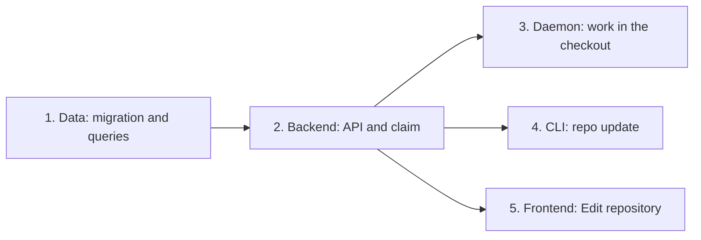

## At a glance

## 1. Data: migration and queries

- [ ] 1.1 `server/migrations/800_repository_work_in_checkout.up.sql` -- add `repository.work_in_checkout BOOLEAN NOT NULL DEFAULT false`, with the down file dropping it -- the setting, off for every repository from before.
- [ ] 1.2 `server/pkg/db/queries/repository.sql` -- add `UpdateRepositoryWorkInCheckout :one` -- writes the setting like the other fields.
- [ ] 1.3 `server/pkg/db/queries/worklane.sql` -- add `GetMainWorklane :one` by repository and workspace -- the claim routes to `main`.
- [ ] 1.4 `server/pkg/db/generated/` -- run `make sqlc` -- generated code.

## 2. Backend: API and claim

- [ ] 2.1 `server/internal/handler/repository.go` -- `work_in_checkout` in `RepositoryResponse` and `UpdateRepositoryRequest` (`*bool`), written in the update transaction -- read and write like other fields, published with `repository:updated`.
- [ ] 2.2 `server/pkg/protocol/messages.go` -- `ClaimWorklane.InCheckout bool` (`in_checkout,omitempty`) -- tells the daemon to stay in the checkout.
- [ ] 2.3 `server/internal/handler/worklane_branch.go` -- `claimWorklane` gives every issue of a repository with the setting on the `main` block with `InCheckout`, for an issue in no worklane only on the checkout's machine -- the routing decision.
- [ ] 2.4 `server/internal/handler/worklane_branch.go` -- `ReportWorklaneBranch` takes `worklane_id` and accepts the issue's worklane or the `main` worklane of a repository with the setting on in the issue's project -- `main` shows the switched branch.
- [ ] 2.5 `server/internal/handler/worklane_branch_test.go` and `repository_test.go` -- claim with the setting on (no lane, other lane, PR, other machine) and off, report acceptance and refusal, update round trip -- the business logic.

## 3. Daemon: work in the checkout

- [ ] 3.1 `server/internal/daemon/execenv/pull_request_worktree.go` -- extract the PR branch fetch and add `SwitchPullRequestBranch` -- switch the checkout to a PR branch that may exist only on origin.
- [ ] 3.2 `server/internal/daemon/worklane_task.go` -- with `InCheckout`, `worklaneTaskPath` returns the checkout and `prepareWorklaneTask` switches it to the issue or PR branch -- no pull-request worktree.
- [ ] 3.3 `server/internal/daemon/client.go` -- `ReportWorklaneBranch` sends `worklane_id` -- the server knows which worklane moved.
- [ ] 3.4 `server/internal/daemon/worklane_task_test.go` -- in-checkout task on issue branch, on PR branch only on origin, serialised with a second task, refused on uncommitted and unpushed work -- the daemon behaviour.

## 4. CLI: repo update

- [ ] 4.1 `server/cmd/multica/cmd_repo.go` -- `repo update <owner/name> --work-in-project-folder=<bool>` through `GET` and `PUT /api/repositories` -- turn the setting on and off in the CLI.
- [ ] 4.2 `server/cmd/multica/cmd_repo_test.go` -- update sends the field, unknown repository fails with its name -- the command behaviour.

## 5. Frontend: Edit repository

- [ ] 5.1 `packages/core/types/repository.ts` and `packages/core/api/schemas.ts` -- `work_in_checkout` (default `false`) in `Repository`, `RepositorySchema`, `EMPTY_REPOSITORY` and `UpdateRepositoryRequest`, with a malformed-response test -- API compatibility.
- [ ] 5.2 `packages/views/repositories/components/edit-repository-dialog.tsx` -- a Switch "Work in the project folder" that enables Save on change and sends `work_in_checkout` -- turn it on and off in the app.
- [ ] 5.3 `packages/views/locales/{en,fr,ja,ko,zh-Hans}/repositories.json` -- `edit.work_in_checkout` -- the label in every language.
- [ ] 5.4 `packages/views/repositories/components/edit-repository-dialog.test.tsx` -- toggling and saving sends the field -- the wiring.

## Implementation Notes

## Plan Change Log
