## At a glance

```mermaid
flowchart LR
  classDef work fill:#d9f2d9,stroke:#2e7d32,color:#172117
  classDef skip fill:#eeeeee,stroke:#9e9e9e,color:#424242
  P5[P5 Technical design] --> J1[J1 Project structure<br/>Skip: J1]:::skip --> J2[J2 Data models<br/>groups 1-3]:::work --> J3[J3 Data-flow prototype<br/>group 4]:::work --> J4[J4 Design system<br/>Skip: J4]:::skip --> J5[J5 Components<br/>group 5]:::work --> J6[J6 Screens<br/>group 6]:::work --> J7[J7 Live prototype<br/>group 7]:::work --> J8[J8 Backend and agent tooling<br/>groups 8-11]:::work --> J9[J9 Frontend<br/>groups 12-14]:::work --> J10[J10 Agent tooling for UI<br/>Skip: J10]:::skip --> J11[J11 Acceptance test and archive<br/>group 15]:::work
```

| Step | Groups | Builder |
|---|---|---|
| J1 Project structure | none: `Skip: J1` | - |
| J2 Data models | 1 model change, 2 DTO, 3 action names | `madspec-model-builder`, `madspec-dto-builder` |
| J3 Data-flow prototype | 4 | `madspec-prototype-builder` |
| J4 Design system | none: `Skip: J4` | - |
| J5 Components | 5 | `madspec-design-system-designer` |
| J6 Screens | 6 | `madspec-screen-designer` |
| J7 Live prototype | 7 | `madspec-prototype-builder` |
| J8 Backend and agent tooling | 8 util, 9 endpoint, 10 integration, 11 integration | `madspec-util-builder`, `madspec-api-builder` |
| J9 Frontend | 12 flow, 13 component, 14 screen | `madspec-api-builder`, `madspec-component-builder`, `madspec-view-builder` |
| J10 Agent tooling for UI | none: `Skip: J10` | - |
| J11 Acceptance test and archive | 15 | Sarkout |

This change builds on UJ-5 (`issues-from-templates`, DAS-456), which builds on UJ-4 (`release-line-of-a-repository`, DAS-455), UJ-3 (`worklanes-of-a-repository`, DAS-452) and UJ-2 (`repositories-of-a-project`, DAS-451). It uses:

- from UJ-5: `issue.type`, `issue.worklane_id`, `issue.release_id`, `idx_issue_worklane`, `ListOpenIssuesOfWorklane`, `GET /api/worklanes/{id}/issues` with `worklaneIssueKeys`, `releaseProgressKeys`, `openedFrom` and `defaultStatus` in `packages/core/issues/placement/defaults.ts`, `type-icon.tsx`, `release-issue-row.tsx` and `no-release-column.tsx`;
- from UJ-4: the `release` table with `position`, `releaseKeys.list(wsId)` and `lineStates`, `release-column.tsx`, `release-menu.tsx` and `release_line:updated`;
- from UJ-3: `worklane.path` and `daemon_id`, the worklane response's `state`, `worklane-page.tsx` and `worklane-timeline.tsx`, `worklane:updated`, worklane activity in `activity_log`, `WorklaneRequestStore` with `PendingWorkKindWorklaneRequest` and its progress endpoint, `server/internal/daemon/worklane_request.go` and `execenv/worklane_worktree.go`;
- from UJ-2: worklane `main` on the repository's checkout, the claim's `repositories` block, the issue branch named after the issue key, `server/internal/daemon/issue_worktree.go` and `LocalPathLocker`.

## 1. J2 Data models: model change

- [x] 1.1 `server/migrations/592_worklane_branch_and_issue_done_at.up.sql`, `.down.sql` -- `worklane.branch text` and `issue.done_at timestamptz`, both nullable, the backfill of `done_at`, the function `issue_done_at()` and the trigger `trg_issue_done_at` -- design.md decisions 1 and 4. The down migration drops the trigger, the function and both columns, and deletes the `worklane_switched` and `worklane_kept` entries. When `main` has taken 592, take the next free number.
- [x] 1.2 `server/pkg/db/queries/worklane.sql` -- `SetWorklaneBranch` (`branch`, `updated_at`, `RETURNING *`) and `ListOpenWorklaneIssues` (`workspace_id`, `worklane_ids`: the open issues with `release.position`, the status category with built-ins by their fixed category, and the workspace's issue prefix) -- design.md decision 2. Every worklane read selects `branch`.
- [x] 1.3 `server/pkg/db/queries/issue.sql`, `server/internal/handler/issue_table_query.go` -- select `done_at` wherever issue columns are named for a response.
- [x] 1.4 `server/pkg/db/generated/` -- run `make sqlc` and commit the output.

## 2. J2 Data models: DTO

- [x] 2.1 `packages/core/types/issue.ts` -- `done_at: string | null` on `Issue`.
- [x] 2.2 `packages/core/types/worklane.ts` -- `branch: string | null`, `active_issue` and `next_issue` as `WorklaneIssueRef | null` (`{id, identifier, title}`), and the request kind `switch` with its step keys `check`, `fetch` and `switch` and the refusal codes `uncommitted` and `unpushed`.
- [x] 2.3 `packages/core/types/api.ts` -- `IssueTableScope` gains `{kind: "worklane", worklane_id}`, and `IssueTableFilters` gains `types?: (IssueType | "none")[]`.
- [x] 2.4 `packages/core/types/activity.ts` -- the details of `worklane_switched` `{from, to, issue_id}` and `worklane_kept` `{branch, reason, count}`.
- [x] 2.5 `packages/core/api/schemas.ts` -- `IssueSchema` gains `done_at` (default `null`). The worklane schema gains `branch`, `active_issue` and `next_issue` (default `null`), and `busy` now comes from the server. The request schema takes kind `switch`, its steps and codes, with UJ-3's `unknown` fallbacks.
- [ ] 2.6 `packages/core/api/schemas.test.ts` -- malformed-response cases: an issue without `done_at`, a worklane without the three fields, an `active_issue` without `title`, a switch request with an unknown step and an unknown refusal code.

## 3. J2 Data models: action names

- [x] 3.1 `server/internal/handler/worklane_branch.go` -- the constants `worklaneActionSwitched` and `worklaneActionKept` -- design.md decisions 6 and 7.
- [x] 3.2 `server/pkg/taskfailure/failure.go` -- `ReasonWorklaneElsewhere = "worklane_elsewhere"` and `ReasonWorklaneBranchHeld = "worklane_branch_held"` among the platform-side reasons and in `AllReasons()`.
- [x] 3.3 `server/pkg/protocol/messages.go`, `server/internal/daemon/types.go` -- the claim's `worklane` block per repository (`id`, `name`, `path`, `daemon_id`, `daemon_name`, `branch`, `default_branch`), and the worklane request's kind `switch` with `from_branch` and `to_branch`.
- [x] 3.4 `server/pkg/protocol/events.go` -- document `branch`, `state`, `active_issue` and `next_issue` in the `worklane:updated` payload. No new event.

## 4. J3 Data-flow prototype: data-flow prototype

- [ ] 4.1 `prototypes/web/worklane-board-and-list/data-flow/` -- an interactive prototype without UI that runs design.md "Journey sequence and data flow". It covers:
  - Busy and Free with now and next: an active issue on the branch, In Progress without the branch, Blocked on the branch, a workspace's own started status, next in release order and creation order, every issue done or cancelled.
  - The Board's columns with counts and Cancelled hidden, a drag with its toast, a refused drag, + opening New issue with the status, worklane and next release.
  - The done date: reaching Done, leaving it, moving between two done statuses.
  - The List's sections with progress, "Set by hand" and "No issues of this worklane", "No release", and the two empty states.
  - The Type filter across Timeline, Board and List, with No type.
  - The preview's header for an issue with and without a worklane and a release.
  - A task on a worklane's issue: the switch, the branch held by uncommitted and by unpushed work, two tasks one after the other, the refusal from another runtime, an issue of `main` in the checkout.
  - The pull request merge: the switch to the next issue's branch, the worktree kept with its reason, no issue left.
- [ ] 4.2 `prototypes/web/worklane-board-and-list/data-flow/README.md`, PNG exports -- how to run it, and one PNG per step -- J3's contract.

## 5. J5 Components: component design

- [ ] 5.1 `designs/systems/multica.lib.pen` -- built from the library's existing tokens -- J5's contract:
  - `Release chip/Issue`: version in the colour of next, planned and shipped.
  - `Board card/With release`: Multica's card with the type icon and the release chip.
  - `Issue row/With release`: Multica's list row with the type icon and the release chip.
  - `List section/Release`: state, title, "Set by hand", "{done} of {total} done", menu and description, and `List section/No release`.
  - `Worklane state`: Busy with "now: {ID} {title}" and Free with "next: {ID} {title}".
  - `Filter menu/Type`: the eight types and No type with their icons.
  - `Issue preview/Header`: type icon and type, ID, title, status menu, worklane link, release chip, assignee, and "Open issue".
- [ ] 5.2 `designs/exports/library-components.png` -- the refreshed components export.

## 6. J6 Screens: screen design

- [ ] 6.1 `designs/screens/steer-all-work.pen` -- the screens of the journey's states, built from the library's components and tokens -- J6's contract:
  - Screen 3 Worklane timeline with the header showing Free and "next: REBL-21 A fan changes their display name", the Type filter, New issue, and Timeline, Board and List.
  - A new screen 3c Worklane board: a column per workspace status with its count and +, Blocked, the hidden columns panel with Cancelled, cards with type icon and release chip, the toast "REBL-76 moved to In Review", and the header Busy with "now: REBL-21 ...".
  - A new screen 3d Worklane list: v1.0.0 First production release with "1 of 2 done" and its rows, v1.1.0 Account and profile with "Set by hand" and "No issues of this worklane", then "No release" with 2 issues, and the two empty states.
  - A new screen 3e Issue preview over the Board, with the header of design.md decision 5 and "Open issue".
  - The Type filter open with Bug picked, on Board.
- [ ] 6.2 `designs/exports/` -- one PNG per new or changed screen -- J6's contract.

## 7. J7 Live prototype: prototype change

- [ ] 7.1 `prototypes/web/src/components/generated/` -- bring the worklane parts in line with group 6's screens, as the live prototype of the journey:
  - `laneNow` and `laneNextIdx` in `model.ts` by design.md decision 2: Busy only with the active issue on the worklane's branch, next in release order and creation order, no pick.
  - `StatusBoard` with a column per status of the prototype's catalogue including Blocked and Cancelled, Cancelled hidden until shown, counts, + opening New issue with the status, and the move toast.
  - `LanePage` List with the release sections and "No release", and the Type filter applying to Timeline, Board and List.
  - `IssuePeek` with the header of design.md decision 5, opened from all three views.
  - The done date set on Done and dropped when an issue leaves it.
- [ ] 7.2 `prototypes/web/` -- one PNG per changed prototype screen, beside the existing exports -- J7's contract.

## 8. J8 Backend and agent tooling: util

- [x] 8.1 `server/internal/worklanehead/head.go` -- `Head(branch, issues)` returning `{state, active, next}` -- design.md decision 2.
- [ ] 8.2 `server/internal/worklanehead/head_test.go` -- table tests: the active issue on the branch in In Progress, In Review and a workspace's own started status; Blocked on the branch; the branch of a Todo issue; a detached worktree; next across two releases and No release; two issues in one release by `created_at`; every issue done or cancelled; a skipped issue for the switch after a merge.

## 9. J8 Backend and agent tooling: endpoint

- [x] 9.1 `server/internal/handler/worklane.go` -- one response function that loads `ListOpenWorklaneIssues` for the worklanes it answers and fills `branch`, `state`, `active_issue` and `next_issue` through `worklanehead.Head`. `GET /api/worklanes`, `GET /api/worklanes/{id}` and every `worklane:updated` use it -- design.md decision 2.
- [x] 9.2 `server/internal/handler/issue_table_query.go` -- scope kind `worklane` with `worklane_id` parsed by `parseIssueTableUUIDList`'s rules, and `filters.types` with `none`, refusing an unknown type with 400 -- design.md decision 3.
- [x] 9.3 `server/internal/handler/worklane_branch.go` -- `ReportWorklaneBranch` for `POST /api/daemon/tasks/{taskId}/worklane-branch`: the task belongs to the calling daemon, its issue is in a worklane, then `SetWorklaneBranch`, `worklane_switched` when it changed, and `worklane:updated` -- design.md decision 6.
- [x] 9.4 `server/internal/handler/daemon.go` -- the claim fills the `worklane` block for the repository of the issue's worklane, with the checkout's path and machine for `main`. A runtime on another machine fails the task through `failClaimedTaskBeforeLaunch` with `worklane_elsewhere` and "{agent} runs on {machine}; {worklane} lives on {machine}" -- design.md decision 6.
- [x] 9.5 `server/internal/handler/worklane_request.go` -- kind `switch`: the progress report `completed` sets the branch and writes `worklane_switched`, `refused` writes `worklane_kept` with the reason and count, both publish `worklane:updated` -- design.md decision 7.
- [x] 9.6 `server/cmd/server/router.go` -- `POST /api/daemon/tasks/{taskId}/worklane-branch` behind the daemon auth.
- [ ] 9.7 `server/internal/handler/worklane_test.go`, `issue_table_query_test.go`, `worklane_branch_test.go`, `daemon_test.go`, `worklane_request_test.go` -- with `testutil` fixtures and `testutil.Call`:
  - A worklane Busy with its active issue, Free with next, Free after the active issue moves to Done.
  - The worklane table read with its count per status, a type filter, `none`, and an unknown type.
  - The branch report from the wrong daemon refused, from the right one setting the branch and its entry.
  - The claim on the worklane's machine with the block, on another machine failed with `worklane_elsewhere` and the message.
  - A switch completed and a switch refused with their entries.
- [ ] 9.8 `server/internal/handler/issue_done_at_test.go` -- the trigger through `UpdateIssue`, the batch update and PR auto-complete: Done sets the date, a second done status keeps it, Todo clears it, a custom done status sets it.

## 10. J8 Backend and agent tooling: integration

- [x] 10.1 `server/internal/daemon/execenv/worklane_worktree.go` -- `CanLeave(path)` from `worktreeIsDirty` and the unpushed count, and `SwitchBranch(path, branch, defaultBranch)`: fetch, `git switch` to an existing branch, `git switch -c` from `origin/{default_branch}`, or `git switch --detach origin/{default_branch}` without a branch -- design.md decision 6.
- [x] 10.2 `server/internal/daemon/daemon.go`, `server/internal/daemon/issue_worktree.go` -- an issue task with a `worklane` block takes `LocalPathLocker` on the worklane's path, switches when the branch differs and `CanLeave` passes, fails with `worklane_branch_held` and its message otherwise, starts the agent in the worktree, and makes no issue worktree for that repository.
- [x] 10.3 `server/internal/daemon/client.go` -- `ReportWorklaneBranch(taskID, branch)` after a switch.
- [x] 10.4 `server/internal/daemon/worklane_request.go` -- kind `switch` with the steps `check`, `fetch` and `switch` under the same path lock, reporting `completed` with the branch or `refused` with `uncommitted` or `unpushed` and the count -- design.md decision 7.
- [ ] 10.5 `server/internal/daemon/execenv/worklane_worktree_test.go`, `server/internal/daemon/worklane_request_test.go` -- on a temporary repository with a bare remote: a switch to a new branch from `origin/main`, to an existing branch, to detached; held by an uncommitted file; held by a commit not pushed; a second task waiting on the path lock.

## 11. J8 Backend and agent tooling: integration

- [x] 11.1 `server/internal/handler/github.go` -- `ghPullRequestPayload` reads `base.ref`. A pull request merged into its repository's default branch calls `SwitchAfterMerge` after `maybeAutoCompleteIssue` with its linked issue ids and `head.ref` -- design.md decision 7.
- [x] 11.2 `server/internal/service/worklane_switch.go` -- `SwitchAfterMerge`: for each linked issue whose worklane's `branch` is the head ref, the next issue by `worklanehead.Head` skipping the merged issue, and a worklane request of kind `switch` to its branch or to detached.
- [ ] 11.3 `server/internal/handler/github_test.go`, `server/internal/service/worklane_switch_test.go` -- a merge into the default branch enqueues the switch to the next issue, a merge into another branch and a merge of a branch the worklane is not on enqueue nothing, and no issue left enqueues detached.

## 12. J9 Frontend: flow

- [x] 12.1 `packages/core/issues/surface/scope.ts`, `query-plan.ts`, `membership.ts` -- the scope `{type: "worklane", worklaneId, issueTypes}`, its key `worklane:{id}` without the types, its query spec with `filters.types`, and membership by `worklane_id` and type -- design.md decision 3.
- [ ] 12.2 `packages/core/issues/surface/scope.test.ts`, `membership.test.ts` -- the key, the spec with and without types, and membership of an issue of another worklane, of a type not picked, and without a type under No type.
- [ ] 12.3 `packages/core/worklanes/list-sections.ts`, `type-filter.ts`, `index.ts` -- `listSections(line, issues)` and `typeFilter(types)` -- design.md decision 3.
- [ ] 12.4 `packages/core/worklanes/list-sections.test.ts`, `type-filter.test.ts` (`// @vitest-environment node`) -- sections in line order with progress and "Set by hand", a release without the worklane's issues, issues of other worklanes left out, "No release" only with issues; the filter with types, No type and nothing picked.
- [ ] 12.5 `packages/core/realtime/use-realtime-sync.ts` -- `worklane:updated` invalidates `worklaneKeys.detail` and `worklaneKeys.list`. `issue:created` and `issue:updated` of an issue with a `worklane_id` invalidate that worklane's detail and the list, and `issue:deleted` invalidates the workspace's worklane keys, so now and next follow status changes made anywhere -- design.md decision 8.

## 13. J9 Frontend: component

- [ ] 13.1 `packages/views/releases/components/issue-release-chip.tsx` -- the release's version in its state's colour from `lineStates` -- design.md decision 5.
- [ ] 13.2 `packages/views/issues/components/board-card.tsx`, `list-row.tsx` -- the release chip after the type icon when `release_id` is set.
- [ ] 13.3 `packages/views/issues/components/issue-peek-summary.tsx`, `issue-detail.tsx` -- the preview's header of design.md decision 5 at the top of `variant="peek"`.
- [x] 13.4 `packages/views/issues/surface/peek-context.tsx`, `packages/views/issues/components/issue-peek.tsx` -- `openMode` on `IssuePeekHost` read by `useIssuePeekClick`, and the open button labelled "Open issue".
- [x] 13.5 `packages/views/issues/surface/issue-surface.tsx`, `types.ts`, `use-issue-surface-actions.ts` -- `openMode` passed to the surface's peek host, and `announceMoves` with the toast "{identifier} moved to {status}" after the server accepts a status change.
- [ ] 13.6 `packages/views/worklanes/components/worklane-type-filter.tsx` -- the Type filter with the eight types and No type, their icons and counts.
- [ ] 13.7 `packages/views/worklanes/components/worklane-state.tsx` -- Busy or Free with "now: {ID} {title}" or "next: {ID} {title}", the issue opening its preview.
- [ ] 13.8 `packages/views/issues/components/issue-peek-summary.test.tsx`, `packages/views/issues/surface/issue-surface.test.tsx` -- the header with and without a worklane and a release, the status menu changing the status, the worklane link; the move toast with `announceMoves` and none without it; a click opening the preview with `openMode` `peek` while the device's mode is `page`.

## 14. J9 Frontend: screen

- [ ] 14.1 `packages/views/worklanes/components/worklane-page.tsx` -- the header's Timeline, Board and List switch opening on Timeline, the Type filter held across views, `worklane-state.tsx`, and an `IssuePeekHost` with `openMode` `peek` around the views -- the `worklane-views` and `worklane-state` spec deltas.
- [ ] 14.2 `packages/views/worklanes/components/worklane-board.tsx` -- `IssueSurface` with the worklane scope, `modes: ["board"]`, `surfaceKey` `worklane:{id}`, `createDefaults` from `openedFrom`, `announceMoves` and `openMode` `peek` -- the `worklane-board` spec delta.
- [ ] 14.3 `packages/views/worklanes/components/worklane-list.tsx` -- the sections of `listSections` with UJ-4's release menu and description, `ListRow` rows in a `ViewStoreProvider` of the `worklane:{id}` store, "No issues of this worklane", "No release", and the two empty states -- the `worklane-list` spec delta.
- [ ] 14.4 `packages/views/worklanes/components/worklane-timeline.tsx`, `packages/views/releases/components/release-issue-row.tsx` -- the Type filter on the Timeline's issues, and rows opening the preview -- the `worklane-views` and `issue-preview` spec deltas.
- [ ] 14.5 `packages/views/worklanes/components/worklane-activity.tsx` -- "The worktree switched from {from} to {to}" and "The worktree stayed on {branch} because it holds uncommitted changes" or "... {count} commits that are not pushed".
- [x] 14.6 `packages/views/agents/components/tabs/task-failure.ts` -- `worklane_elsewhere` and `worklane_branch_held` as actionable, with their labels.
- [ ] 14.7 `packages/views/locales/{en,zh-Hans,ko,ja,fr}/` -- `issues` (the move toast, Open issue, No worklane), `worklanes` (the views, Type, No type, Busy, Free, now, next, the List's empty states, the two activity sentences), `agents` (the two failure labels) -- design.md decision 9.
- [ ] 14.8 `packages/views/worklanes/components/worklane-page.test.tsx`, `worklane-list.test.tsx` -- the page opening on Timeline, switching views keeping the Type filter, the header Busy and Free; the List's sections, "No release" and the empty states.
- [ ] 14.9 `apps/docs/content/docs/projects.mdx`, `projects.zh.mdx`, `projects.ko.mdx`, `projects.ja.mdx`, `projects.fr.mdx` -- a worklane's views, the Type filter, Busy and Free with now and next, and how agents work a worklane's issues in its worktree.

## 15. J11 Acceptance test and archive: acceptance test and archive

- [ ] 15.1 `e2e/worklane-board-and-list.spec.ts` -- the journey's acceptance test through `TestApiClient`, on appboypov/rebl with worklanes `main` and Fan accounts and push, the releases v1.0.0 First production release and v1.1.0 Account and profile set by hand, and the issues REBL-21 (story, Todo, v1.0.0), REBL-22 (story, Done, v1.0.0), REBL-24 (bug, In Progress, no release), REBL-27 (no type, Todo, no release) and REBL-76 (story, Blocked, v1.0.0):
  - Board shows the columns with their counts and Cancelled hidden. Brian drags REBL-76 to In Review and sees "REBL-76 moved to In Review". A + on In Review opens New issue with In Review, Fan accounts and push and v1.0.0.
  - List shows v1.0.0 with "1 of 3 done", v1.1.0 with "Set by hand" and "No issues of this worklane", then "No release" with 2 issues.
  - Bug picked in the Type filter on Board shows REBL-24 and not REBL-21, and keeps its pick on List and Timeline. No type shows REBL-27 only.
  - Clicking REBL-21 on each view opens its preview with Story, REBL-21, Todo, Fan accounts and push and v1.0.0. Its worklane link opens the Timeline, and "Open issue" opens the page.
  - The header shows Free with "next: REBL-21 A fan changes their display name". After the daemon reports `rebl-21` and REBL-21 moves to In Progress, it shows Busy with "now: REBL-21 ...".
  - REBL-76 dragged to Done gets a done date, and dragged back to In Review loses it.
- [ ] 15.2 The worklane on Brian's Mac -- on the local release, an agent's task on an issue of Fan accounts and push in its worktree on the issue's branch, its pull request merged and the worktree switched to the next issue's branch, and the Board, List and preview recorded in the J11 pull request -- the PRD's success signal.
- [ ] 15.3 `specs/openspec/changes/worklane-board-and-list/` -- run `openspec validate worklane-board-and-list --type change --strict`, sync the specs and archive the change -- the journey closes on its J11 pull request.

## Implementation Notes

## Plan Change Log
