## At a glance

```mermaid
flowchart LR
  classDef work fill:#d9f2d9,stroke:#2e7d32,color:#172117
  classDef skip fill:#eeeeee,stroke:#9e9e9e,color:#424242
  P5[P5 Technical design] --> J1[J1 Project structure<br/>Skip: J1]:::skip --> J2[J2 Data models<br/>groups 1-2]:::work --> J3[J3 Data-flow prototype<br/>group 3]:::work --> J4[J4 Design system<br/>Skip: J4]:::skip --> J5[J5 Components<br/>group 4]:::work --> J6[J6 Screens<br/>group 5]:::work --> J7[J7 Live prototype<br/>Skip: J7]:::skip --> J8[J8 Backend and agent tooling<br/>group 6]:::work --> J9[J9 Frontend<br/>groups 7-9]:::work --> J10[J10 Agent tooling for UI<br/>Skip: J10]:::skip --> J11[J11 Acceptance test and archive<br/>group 10]:::work
```

| Step | Groups | Builder |
|---|---|---|
| J1 Project structure | none: `Skip: J1` | - |
| J2 Data models | 1 model change, 2 DTO | `madspec-model-builder`, `madspec-dto-builder` |
| J3 Data-flow prototype | 3 | `madspec-prototype-builder` |
| J4 Design system | none: `Skip: J4` | - |
| J5 Components | 4 | `madspec-design-system-designer` |
| J6 Screens | 5 | `madspec-screen-designer` |
| J7 Live prototype | none: `Skip: J7` | - |
| J8 Backend and agent tooling | 6 endpoint | `madspec-api-builder` |
| J9 Frontend | 7 flow, 8 component, 9 screen | `madspec-api-builder`, `madspec-component-builder`, `madspec-view-builder` |
| J10 Agent tooling for UI | none: `Skip: J10` | - |
| J11 Acceptance test and archive | 10 | Sarkout |

This change builds on UJ-6 (`worklane-board-and-list`, DAS-459), which builds on UJ-5 (`issues-from-templates`, DAS-456), UJ-4 (`release-line-of-a-repository`, DAS-455), UJ-3 (`worklanes-of-a-repository`, DAS-452), UJ-2 (`repositories-of-a-project`, DAS-451) and UJ-1 (`projects-by-organisation`, DAS-450). It uses:

- from UJ-6: `server/internal/worklanehead` with `Head`, the worklane response's `state`, `active_issue` and `next_issue` from one function in `handler/worklane.go`, `WorklaneIssueRef` and the realtime invalidation of `worklaneKeys.list` on issue changes;
- from UJ-5: `ListReleaseProgress` in `server/pkg/db/queries/issue_placement.sql` and `handler/issue_placement.go`, `GET /api/release-progress` and `releaseProgressKeys`;
- from UJ-4: `GET /api/releases`, `releaseKeys.list(wsId)`, `selectLine` and `lineStates`, `release-chips.tsx`, and `?release={id}` on the worklane page;
- from UJ-3: `GET /api/worklanes`, `worklaneKeys.list(wsId)`, `sortWorklanes`, `paths.worklaneDetail(id)`, the `worklanes/[id]` routes, the worklane rows of `repository-card.tsx` and `project-table.tsx`, and the `new-worklane` modal;
- from UJ-2: `GET /api/repositories` with `version_policy` and `repositoryKeys.list(wsId)`;
- from UJ-1: `GET /api/organisations`, `organisationKeys.list(wsId)`, `groupProjectsByOrganisation`, `project-table.tsx` and Organisations in the sidebar.

## 1. J2 Data models: model change

- [x] 1.1 `server/pkg/db/queries/issue_placement.sql` -- `ListReleaseTotals(workspace_id)`: the workspace's issues with a `release_id` grouped by `release_id`, `total` every issue and `done` by the terminal status rule of `ListReleaseProgress` -- design.md decision 3.
- [x] 1.2 `server/pkg/db/generated/` -- run `make sqlc` and commit the output.

## 2. J2 Data models: DTO

- [x] 2.1 `packages/core/types/worklane.ts` -- `WorklaneIssueRef` gains `status: string`.
- [x] 2.2 `packages/core/issues/placement/` (the release progress type) -- the response gains `releases: ReleaseTotal[]` with `ReleaseTotal` `{release_id, done, total}`.
- [x] 2.3 `packages/core/api/schemas.ts` -- the worklane issue ref's `status` defaults to `""`, and the release progress schema's `releases` defaults to `[]`.
- [ ] 2.4 `packages/core/api/schemas.test.ts` -- malformed-response cases: an `active_issue` without `status`, a release progress response without `releases`, and a `releases` entry without `done`.

## 3. J3 Data-flow prototype: data-flow prototype

- [ ] 3.1 `prototypes/web/worklanes-and-releases-pages/data-flow/` -- an interactive prototype without UI that runs design.md "Journey sequence and data flow". It covers:
  - Worklanes: two organisations in name order, a project without repositories left out, "No organisation" last, projects in Projects' order, repositories by `full_name`, `main` first, the counts, and "No worklanes yet.".
  - Releases: unshipped releases in line order with Next release and Planned, "Set by hand", progress from the totals with a closed issue of a removed worklane counted, the worklanes of a release, "No issues yet", a repository that does not release, a repository without releases left out, the counts, and "No releases yet.".
  - A release row's target: the first worklane in order that holds issues in it, else `main`.
  - Now or next with status: Busy, Free with next, Nothing queued, and the active issue becoming Done.
  - A status change refreshing a release's progress.
- [ ] 3.2 `prototypes/web/worklanes-and-releases-pages/data-flow/README.md`, PNG exports -- how to run it, and one PNG per step -- J3's contract.

## 4. J5 Components: component design

- [ ] 4.1 `designs/systems/multica.lib.pen` -- built from the library's existing tokens -- J5's contract:
  - `Release row`: the `Release/Next` or `Release/Planned` chip, title, `Set by hand`, `Progress bar` with "{done}/{total}", `Worklane chip`s or "No issues yet", and the chevron, at the 4d columns Name, Issues and Worklanes.
  - `Worklane row`: its now row in three states, Busy with the status icon and "{ID} {title}", Free with the status icon and "Next: {ID} {title}", and "Nothing queued".
  - `Tree row/Repository` with and without "+ Worklane".
- [ ] 4.2 `designs/exports/library-components.png` -- the refreshed components export.

## 5. J6 Screens: screen design

- [ ] 5.1 `designs/screens/steer-all-work.pen` -- the screens of the journey's states, built from the library's components and tokens -- J6's contract:
  - Screen 4c Worklanes with Rebl Records and appboypov/rebl as the spec examples have them: Fan accounts and push Busy with In Progress "REBL-21 A fan changes their display name", `main` with "Next: REBL-27 ...", Agenda and publication with "Nothing queued", and an organisation folded closed.
  - Screen 4d Releases rebuilt from `Release row`: v1.0.0 First production release as Next release with "1/3", `main` and Fan accounts and push, v1.0.1 Membership hardening with "No issues yet", v1.2.0 Notifications with "Set by hand", and appboypov/rebl-site with "This repository does not release".
  - A new screen 4e with the two empty states: "No worklanes yet." and "No releases yet.".
- [ ] 5.2 `designs/exports/` -- one PNG per new or changed screen -- J6's contract.

## 6. J8 Backend and agent tooling: endpoint

- [x] 6.1 `server/internal/worklanehead/head.go`, `head_test.go` -- the active and next issue keep their status key; the table tests assert it -- design.md decision 2.
- [x] 6.2 `server/internal/handler/worklane.go` -- the one worklane response function writes `status` into `active_issue` and `next_issue` -- design.md decision 2.
- [x] 6.3 `server/internal/handler/issue_placement.go` -- `ListReleaseProgress` also runs `ListReleaseTotals` and answers `{rows, releases}` -- design.md decision 3.
- [x] 6.4 `server/internal/handler/reserved_slugs.json`, `packages/core/paths/reserved-slugs.ts` -- reserve `worklanes` and `releases` among the workspace route segments, then run `pnpm generate:reserved-slugs` -- a workspace can't take the routes' slugs (AGENTS.md).
- [ ] 6.5 `server/internal/handler/worklane_test.go`, `issue_placement_test.go` -- DB tests with `testutil` fixtures:
  - A Busy worklane's `active_issue` with status `in_progress`, a Free worklane's `next_issue` with status `todo`, and a workspace's own started status.
  - `releases` counting issues of two worklanes, a closed issue whose worklane was removed, and done over terminal statuses; another workspace's issues left out; a release without issues absent.

## 7. J9 Frontend: flow

- [x] 7.1 `packages/core/projects/sort.ts`, `index.ts`, `packages/views/projects/components/projects-page.tsx` -- `sortProjects(projects, sortField, sortDirection)`, the comparator moved out of `projects-page.tsx`, which calls it -- design.md decision 1.
- [x] 7.2 `packages/core/worklanes/overview.ts`, `index.ts` -- `worklaneOverview` -- design.md decision 1.
- [x] 7.3 `packages/core/releases/overview.ts`, `index.ts` -- `releaseOverview` with each row's `state`, `setByHand`, `done`, `total`, `worklanes` and `target`, and `doesNotRelease` -- design.md decision 1.
- [ ] 7.4 `packages/core/projects/sort.test.ts`, `packages/core/worklanes/overview.test.ts`, `packages/core/releases/overview.test.ts` (`// @vitest-environment node`) -- each sort field and direction; organisation, project, repository and worklane order; groups with nothing to list left out; "No organisation" last; the counts; shipped releases left out; a release's worklanes and target with and without issues; totals with a worklane-less issue; a repository that does not release; no repositories at all.
- [x] 7.5 `packages/core/paths/paths.ts`, `route-icons.ts`, `tab-subject.ts`, `consistency.test.ts`, `paths.test.ts`, `packages/views/editor/utils/link-handler.ts` -- `paths.worklanes()`, `paths.releases()`, `WORKSPACE_PAGES.worklanes` (`GitBranch`) and `.releases` (`Tag`), the page subjects `worklanes` and `releases` beside UJ-3's worklane subject, and both segments -- design.md decision 5.

## 8. J9 Frontend: component

- [x] 8.1 `packages/views/worklanes/components/worklane-row-work.tsx` -- Busy with the status icon and "{identifier} {title}", Free with the status icon and "Next: {identifier} {title}", else "Nothing queued", truncated to one line -- the `worklane-row-work` spec delta.
- [ ] 8.2 `packages/views/worklanes/components/worklane-tree-row.tsx`, `packages/views/projects/components/project-table.tsx` -- the worklane row moved out of `project-table.tsx`, with `worklane-row-work.tsx` under the name and `release-chips.tsx`, opening the worklane page; `project-table.tsx` renders it -- design.md decision 4.
- [x] 8.3 `packages/views/repositories/components/repository-card.tsx` -- `worklane-row-work.tsx` under each worklane's name -- the `worklane-row-work` spec delta.
- [x] 8.4 `packages/views/projects/components/work-tree.tsx` -- the header row, organisation, project and repository rows with chevrons, links, meta and the repository action slot, folding through the page's closed keys -- design.md decision 4.
- [x] 8.5 `packages/views/releases/components/release-row.tsx` -- chip, title, "Set by hand", progress "{done}/{total}", worklane chips or "No issues yet", the row a link to the target's Timeline with `?release={id}`, no menu -- design.md decision 4.
- [x] 8.6 `packages/views/layout/route-icon-components.tsx`, `route-icon-components.test.tsx` -- the `GitBranch` and `Tag` icons.
- [ ] 8.7 `packages/views/worklanes/components/worklane-row-work.test.tsx`, `packages/views/releases/components/release-row.test.tsx` -- the three states of the line with a workspace's own status; a release row's parts, its link with `?release`, and no release actions.

## 9. J9 Frontend: screen

- [x] 9.1 `packages/views/worklanes/components/worklanes-page.tsx` -- header with the total, columns Name and "Last · Next · Planned releases", `work-tree.tsx` with `worklaneOverview`, "+ Worklane" opening `new-worklane` for the repository, `worklane-tree-row.tsx` rows, every group open, and "No worklanes yet." -- the `worklanes-page` spec delta.
- [x] 9.2 `packages/views/releases/components/releases-page.tsx` -- header with the total, columns Name, Issues and Worklanes, `work-tree.tsx` with `releaseOverview`, `release-row.tsx` rows or "This repository does not release", every group open, and "No releases yet." -- the `releases-page` spec delta.
- [x] 9.3 `packages/views/layout/app-sidebar.tsx` -- Worklanes and Releases in `workNav` after Organisations.
- [x] 9.4 `apps/web/app/[workspaceSlug]/(dashboard)/worklanes/page.tsx`, `releases/page.tsx`, `apps/web/proxy.ts`, `apps/desktop/src/renderer/src/routes.tsx` -- thin routes to the shared pages, as squads has them, with the titles "Worklanes" and "Releases" -- wired into both apps.
- [x] 9.5 `packages/views/locales/{en,zh-Hans,ko,ja,fr}/worklanes.json`, `releases.json`, `layout.json`, `packages/views/i18n/resources-types.ts` -- the sidebar labels, the page titles and columns, the meta counts, "Next:", "Nothing queued", "No issues yet", "This repository does not release", "No worklanes yet." and "No releases yet." in all five languages.
- [ ] 9.6 `packages/views/worklanes/components/worklanes-page.test.tsx`, `packages/views/releases/components/releases-page.test.tsx`, `packages/views/projects/components/projects-page.test.tsx`, `packages/views/organisations/components/*.test.tsx` -- the `worklanes-page`, `releases-page` and `worklane-row-work` scenarios that belong to pages: the counts and order, folding, the links, the empty states, no release actions, and the now or next line on Projects and an organisation's page.
- [ ] 9.7 `apps/docs/content/docs/projects.mdx`, `projects.zh.mdx`, `projects.ko.mdx`, `projects.ja.mdx`, `projects.fr.mdx` -- the Worklanes and Releases pages and the now or next line on worklane rows.

## 10. J11 Acceptance test and archive: acceptance test and archive

- [ ] 10.1 `e2e/worklanes-and-releases-pages.spec.ts` -- the journey's acceptance test through `TestApiClient`, with Rebl Records holding Rebl with appboypov/rebl and its worklanes `main`, Fan accounts and push and Agenda and publication, De App Specialist holding Multica with appboypov/multica, and Mijn Shine with LuxiLamps without repositories. The line of appboypov/rebl is v1.0.0 First production release (REBL-76 of `main` In Review, REBL-21 Todo and REBL-22 Done of Fan accounts and push), v1.0.1 Membership hardening without issues, v1.1.0 Account and profile (REBL-24 of Fan accounts and push) and v1.2.0 Notifications set by hand (REBL-27 Todo of Fan accounts and push). Every issue of Agenda and publication is Done:
  - Worklanes and Releases sit under Work after Organisations.
  - Worklanes counts 4 worklanes, De App Specialist first, Rebl "1 repository · 3 worklanes", the rows in order, Mijn Shine absent. Fan accounts and push shows "Next: REBL-21 ...", "nothing shipped" and v1.0.0 with "1/2"; `main` shows "Next: REBL-76 ..."; Agenda and publication shows "Nothing queued".
  - After the daemon reports `rebl-21` and REBL-21 moves to In Progress, as UJ-6's acceptance test does, the row shows In Progress and "REBL-21 ...".
  - Folding Rebl Records and appboypov/rebl keeps their rows. Clicking Fan accounts and push opens its Timeline.
  - Releases counts 4 releases with v1.0.0 as Next release with "1/3", `main` and Fan accounts and push, v1.0.1 with "No issues yet", and v1.2.0 with "Set by hand", "0/1" and Fan accounts and push.
  - After appboypov/rebl-site joins Rebl set to "This repository does not release", its row `main` shows "Does not release" on Worklanes, and Releases shows "This repository does not release" under it.
  - Moving REBL-21 to Done on the Board makes v1.0.0 show "2/3" and Fan accounts and push show "Next: REBL-24 ...".
  - Clicking v1.1.0 opens the Timeline of Fan accounts and push with v1.1.0 in view, and v1.0.1 the Timeline of `main`.
  - Neither page offers a release action.
- [ ] 10.2 The pages on Brian's Mac -- on the local release, open Worklanes and Releases on the De App Specialist workspace and record both, with a status change showing on each, in the J11 pull request -- the PRD's success signal.
- [ ] 10.3 `specs/openspec/changes/worklanes-and-releases-pages/` -- run `openspec validate worklanes-and-releases-pages --type change --strict`, sync the specs and archive the change -- the journey closes on its J11 pull request.

## Implementation Notes

## Plan Change Log
