## At a glance

```mermaid
flowchart LR
  classDef work fill:#d9f2d9,stroke:#2e7d32,color:#172117
  classDef skip fill:#eeeeee,stroke:#9e9e9e,color:#424242
  P5[P5 Technical design] --> J1
  J1[J1 Project structure<br/>Skip: J1]:::skip --> J2
  J2[J2 Data models<br/>groups 1-3]:::work --> J3
  J3[J3 Data-flow prototype<br/>group 4]:::work --> J4
  J4[J4 Design system<br/>Skip: J4]:::skip --> J5
  J5[J5 Components<br/>group 5]:::work --> J6
  J6[J6 Screens<br/>group 6]:::work --> J7
  J7[J7 Live prototype<br/>group 7]:::work --> J8
  J8[J8 Backend and agent tooling<br/>groups 8-10]:::work --> J9
  J9[J9 Frontend<br/>groups 11-13]:::work --> J10
  J10[J10 Agent tooling for UI<br/>Skip: J10]:::skip --> J11
  J11[J11 Acceptance test and archive<br/>group 14]:::work
```

| Step | Groups | Builder |
|---|---|---|
| J1 Project structure | none: `Skip: J1` | - |
| J2 Data models | 1 model change, 2 model change, 3 action names | `madspec-model-builder`, `madspec-dto-builder` |
| J3 Data-flow prototype | 4 | `madspec-prototype-builder` |
| J4 Design system | none: `Skip: J4` | - |
| J5 Components | 5 | `madspec-design-system-designer` |
| J6 Screens | 6 | `madspec-screen-designer` |
| J7 Live prototype | 7 | `madspec-prototype-builder` |
| J8 Backend and agent tooling | 8 endpoint, 9 integration, 10 integration | `madspec-api-builder` |
| J9 Frontend | 11 flow, 12 component, 13 screen | `madspec-api-builder`, `madspec-component-builder`, `madspec-view-builder` |
| J10 Agent tooling for UI | none: `Skip: J10` | - |
| J11 Acceptance test and archive | 14 | Sarkout |

This change builds on UJ-2 (`repositories-of-a-project`, DAS-451): its `repository`, `worklane` and `issue_worktree` tables, migrations 575 to 582, the checkout check round trip, `issue_worktree.go`, the repository card and dialogs, `packages/core/repositories/` and `packages/core/worklanes/`. Its J2 starts once UJ-2's J2 is merged.

## 1. J2 Data models: model change

- [x] 1.1 `server/migrations/583_worklane_worktrees.up.sql`, `.down.sql` -- add the nullable columns `repository.install_command text`, `worklane.path text`, `activity_log.worklane_id uuid` and `activity_log.repository_id uuid`, without defaults or foreign keys -- design.md decision 1. The down migration drops the four columns.
- [x] 1.2 `server/migrations/584_worklane_folder_index.up.sql`, `.down.sql` -- `CREATE UNIQUE INDEX CONCURRENTLY worklane_repository_folder_unique ON worklane (repository_id, folder) WHERE folder IS NOT NULL`.
- [x] 1.3 `server/migrations/585_activity_log_worklane_index.up.sql`, `.down.sql` -- `CREATE INDEX CONCURRENTLY activity_log_worklane_keyset_idx ON activity_log (worklane_id, created_at DESC, id DESC) WHERE worklane_id IS NOT NULL`.
- [x] 1.4 `server/migrations/586_activity_log_repository_index.up.sql`, `.down.sql` -- `CREATE INDEX CONCURRENTLY activity_log_repository_keyset_idx ON activity_log (repository_id, created_at DESC, id DESC) WHERE repository_id IS NOT NULL AND worklane_id IS NULL`.
- [x] 1.5 `server/cmd/migrate/main.go` -- add 584 to 586 to the concurrent index cleanups -- `TestEveryConcurrentUpBuildHasCleanup` requires it. When `main` has taken any of 583 to 586, take the next free numbers and rename every reference.
- [x] 1.6 `server/pkg/db/queries/worklane.sql` -- `GetWorklaneInWorkspace`, `CreateWorklaneWithPath` (taking `path`, `daemon_id`, `folder` and the next `position` in one statement), `RenameWorklane`, `DeleteWorklane`, `ListWorklanePathsForDaemon` (by repository and daemon, `path IS NOT NULL`), `CountOtherWorklanes` (by repository, `NOT is_main`), each filtered by `workspace_id`.
- [x] 1.7 `server/pkg/db/queries/repository.sql` -- `install_command` in `CreateRepository` and `UpdateRepository*`; `BackfillRepositoryInstallCommand` (workspace, `LOWER(full_name)`, checkout daemon and path, `install_command IS NULL`).
- [x] 1.8 `server/pkg/db/queries/activity.sql` -- `CreateWorklaneActivity`; `ListActivitiesForWorklane` (`worklane_id = $1 OR (repository_id = $2 AND worklane_id IS NULL)`, newest 200 in keyset order, re-sorted ascending as `ListActivitiesForIssue`); `DeleteActivitiesByWorklane`; `DeleteActivitiesByRepository` and `DeleteActivitiesByProject` (through `repository`), each with `issue_id IS NULL`.
- [x] 1.9 `server/pkg/db/generated/` -- run `make sqlc` and commit the output.

## 2. J2 Data models: model change

- [x] 2.1 `packages/core/types/worklane.ts` -- `Worklane` gains `path` and `state: "free" | "busy"`; `WorklaneRequest`, `WorklaneRequestStep`, `WorklaneRequestStepKey`, `WorklaneRequestStepState`, `WorklaneRequestStatus`, `WorklaneRequestReason`, `CreateWorklaneRequest`, `RenameWorklaneRequest`, `WorklaneActivityEntry` and `WorklaneActivityAction` -- design.md decisions 2 and 6.
- [x] 2.2 `packages/core/types/repository.ts` -- `Repository.install_command: string | null`; `install_command` on create and update; `install_commands: {file, command}[]` on the check result.
- [x] 2.3 `packages/core/api/schemas.ts` -- `WorklaneSchema` with `state` falling back to `free`; `WorklaneRequestSchema` with unknown step keys, states, statuses and reason codes kept as `unknown`; `WorklaneActivityResponseSchema` with an unknown action kept as `unknown`; `install_command` nullable with default null and `install_commands` defaulting to `[]` -- AGENTS.md "API Compatibility".
- [ ] 2.4 `packages/core/api/schemas.test.ts` -- malformed-response cases: a worklane without `state` or `path`, a request with an unknown step key and state, a request without `steps`, an activity entry with an unknown action, a repository without `install_command`, a check result without `install_commands`.

## 3. J2 Data models: action names

- [x] 3.1 `server/pkg/protocol/events.go` -- `EventWorklaneUpdated` with the worklane's id and repository id.
- [x] 3.2 `server/pkg/protocol/messages.go` -- `PendingWorkKindWorklaneRequest`; `DaemonHeartbeatPendingWorklaneRequest` and the heartbeat response's `pending_worklane_request`; `DaemonCapabilityWorklaneWorktreeV1 = "worklane-worktree-v1"`; the claim's `worklane_paths` per repository; the check result's `install_commands`.
- [x] 3.3 `server/internal/handler/worklane.go` -- the constants `worklaneActionCreated = "worklane_created"` and `worklaneActionRenamed = "worklane_renamed"`; issue actions stay string literals in their listeners.
- [x] 3.4 `packages/core/modals/store.ts` -- `"new-worklane"`, `"rename-worklane"` and `"remove-worklane"` in `ModalType`.

## 4. J3 Data-flow prototype: data-flow prototype

- [ ] 4.1 `prototypes/web/worklanes-of-a-repository/data-flow/` -- an interactive prototype without UI that runs design.md "Journey sequence and data flow". It covers:
  - The create checks with each refusal code, and the path with and without an organisation.
  - The steps passing; a folder already holding the repository's worktree; a folder holding something else; an issue worktree's path.
  - An install failing and Try again from that step; Cancel; the `lost` timeout.
  - `open` saving the worklane with its activity entry.
  - Rename and its entry; Remove clean, uncommitted, unpushed, offline and `main`; Remove repository refused with worklanes.
  - The install command found, set, None and backfilled; the brain sync's posted command.
  - An issue's claim that meets a worklane's folder.
  - Each step shows its input, output and store -- J3's contract.
- [ ] 4.2 `prototypes/web/worklanes-of-a-repository/data-flow/README.md`, PNG exports -- how to run it, and one PNG per step -- J3's contract.

## 5. J5 Components: component design

- [ ] 5.1 `designs/systems/multica.lib.pen` -- `Check/Skipped` beside `Check/Done`, `/Running`, `/Pending` and `/Failed`, with a detail line; `Activity entry` (avatar, sentence, time); `Worklane row` with an optional trailing menu button. Built from the library's existing tokens -- J5's contract.
- [ ] 5.2 `designs/exports/library-components.png` -- the refreshed components export.

## 6. J6 Screens: screen design

- [ ] 6.1 `designs/screens/steer-all-work.pen` -- the screens of the journey's states, built from the library's components and tokens -- J6's contract:
  - Screens 7, 7b and 7c New worklane with the path `~/Worktrees/rebl/rebl/fan-app`.
  - New worklane's states: a taken name, `main` taken, a folder breaking a rule, a folder in use, the Runtime list with "No checkout", "Offline" and "Cannot make worktrees", a project without an organisation, an install command of None with Install skipped, "Uses the worktree that is there", something else at the path, and Finding the install command.
  - Screen 3 Worklane timeline for a new worklane: breadcrumb, Free, "No releases yet" and its activity.
  - The worklane menu on a row and on the page; Rename with a taken name; Remove with its confirmation and each refusal; `main` without a menu.
  - Screen 2 Project's repository card with three worklanes and Add worklane, and Remove repository refused.
  - Screens 1 Projects and 4b Organisation with a repository folded open to worklane rows and + Worklane, and the worklane counts.
  - Screen 6 Add repository and Edit repository with the Install field: one file, two files, none, typed by hand, None.
- [ ] 6.2 `designs/creation-flows.md` -- "New worklane" and "Add repository" brought in line with the spec deltas and the screens, with an At a glance flowchart where each arrow names its action -- J6's contract.
- [ ] 6.3 `designs/exports/` -- one PNG per new or changed screen -- J6's contract.

## 7. J7 Live prototype: prototype change

- [ ] 7.1 `prototypes/web/src/components/generated/` -- bring `NewWorklaneDialog`, `laneFolder` and the worktree path in line with group 6's screens: the folder and name errors, the Runtime list, the skipped install, Try again from the failed step, Cancel. Add the worklane page's activity, the worklane menu with Rename and Remove, the Install field in Add and Edit repository, and the worklane rows and counts -- the live prototype of the journey.
- [ ] 7.2 `prototypes/web/` -- one PNG per changed prototype screen, beside the existing exports -- J7's contract.

## 8. J8 Backend and agent tooling: endpoint

- [x] 8.1 `server/internal/handler/worklane_request.go` -- `WorklaneRequestStore` (in memory and Redis, as UJ-2's `RepositoryCheckoutStore`), `CreateWorklaneRequest`, `GetWorklaneRequest`, `RetryWorklaneRequest`, the daemon's `ReportWorklaneRequestProgress`, as design.md decisions 2 and 3 set out:
  - The create checks in table order with their codes; `requireRuntimeLocalSkillAccess` on the checkout machine's runtime.
  - The path from the organisation key, read now; `base` `origin/{default_branch}`; the repository's issue worktree paths on that daemon.
  - `requestDaemonPendingWork` with `PendingWorkKindWorklaneRequest`; finished requests kept 30 minutes; `lost` after 15 minutes without progress.
  - Retry only on a failed request, from the failed step; a failed `open` reruns on the server.
  - Progress from another daemon or for an unknown request: 404.
- [x] 8.2 `server/internal/handler/worklane_open.go` -- on `install` done or skipped: in one transaction, check name and folder again, insert the worklane with the resolved path, next position and daemon, and the `worklane_created` entry with `runtime_name`; publish `worklane:created`; complete the request with `worklane_id`. A unique violation fails `open` with `name_taken` or `folder_taken`.
- [x] 8.3 `server/internal/handler/worklane.go` -- `GetWorklane` with `state` `free`; `RenameWorklane` (refuses `main` and a taken name; name and `worklane_renamed` in one transaction; `worklane:updated`); `RemoveWorklane` (refuses `main` and an offline machine; enqueues a remove request; on `removed` deletes the worklane and its activity in one transaction and publishes `worklane:deleted`; on a refusal marks the request `refused` with its reason); `ListWorklaneActivity` -- design.md decisions 4 and 6.
- [x] 8.4 `server/internal/handler/repository.go` -- `install_command` on create (absent: the check's first command, or `''`) and update; `DeleteRepository` refuses with 409 `has_worklanes` naming them while the repository has a worklane besides `main`, and deletes the repository's activity rows -- the `manage-worklanes` and `repository-install-command` spec deltas.
- [x] 8.5 `server/internal/handler/runtime_repository_checkout.go` -- carry `install_commands` in the check result; on a passed check, run `BackfillRepositoryInstallCommand` and publish `repository:updated` -- design.md decision 7.
- [x] 8.6 `server/internal/handler/claim_repositories.go` -- `worklane_paths` per repository for the claiming daemon -- ADR-0009.
- [x] 8.7 `server/internal/handler/daemon.go`, `handler.go` -- the heartbeat pops one pending worklane request per runtime into `pending_worklane_request`; the handler holds `WorklaneRequestStore`.
- [x] 8.8 `server/internal/handler/project.go` -- project delete also deletes the activity rows of its repositories and worklanes in its transaction.
- [x] 8.9 `server/cmd/server/router.go`, `server/cmd/server/listeners.go` -- register `/api/worklane-requests`, `/api/worklane-requests/{id}`, `/api/worklane-requests/{id}/retry`, `/api/worklanes/{id}` (GET, PATCH, DELETE) and `/api/worklanes/{id}/activity` in the workspace-member group, the daemon's progress route, and broadcast `worklane:updated` to the workspace.
- [ ] 8.10 `server/internal/handler/worklane_request_test.go`, `worklane_test.go`, `repository_test.go` -- DB tests with `testutil` fixtures and a fake daemon reporting progress:
  - Each create refusal with its code; a member who does not own the runtime is refused.
  - The path with and without an organisation, and after a key change.
  - Progress to done saves one worklane with one `worklane_created` entry; a failed install saves nothing; retry runs from the failed step; a unique violation at `open` fails it.
  - Rename: `main` refused, a taken name ignoring case refused, the entry written.
  - Remove: offline refused at once, `removed` deletes the worklane and its activity, `uncommitted` keeps it with the reason.
  - Activity in order, with a repository-wide row showing on both worklanes.
  - Remove repository refused with worklanes and allowed after.
  - The install command defaulted, set, set to None, and backfilled only when NULL.
  - The spec scenarios at their canonical layer.

## 9. J8 Backend and agent tooling: integration

- [x] 9.1 `server/internal/daemon/worklane_request.go`, `daemon.go` `handleHeartbeatActions`, `client.go` -- claim `pending_worklane_request` and run it in a goroutine from `from_step`, posting the whole step list after each change -- design.md decisions 3 and 4. `daemonCommonCapabilities` adds `worklane-worktree-v1`.
- [x] 9.2 `server/internal/daemon/execenv/worklane_worktree.go` -- design.md decision 3 steps 1 to 3:
  - `FetchDefaultBranch` resolves the commit and its duration.
  - `AddWorklaneWorktree` takes the checkout's repo lock, refuses an issue worktree's path, runs `worktree add --detach` for a missing path or an empty folder, uses a checkout of the repository that is there as it is, and refuses anything else, touching nothing.
  - `RunInstall` runs `sh -c` in the worktree under its path lock, with a 20-minute limit and the last 8 KB of output.
- [x] 9.3 `server/internal/daemon/execenv/worklane_worktree.go` -- `RemoveWorklaneWorktree` -- design.md decision 4: a held lock refuses with `busy`; a missing path is removed; otherwise uncommitted, unpushed and, for a standalone clone, stashed are refused; else the worktree is removed without deleting a branch.
- [x] 9.4 `server/internal/daemon/repository_checkout.go` -- the install commands of the spec's table on `refs/heads/{default_branch}`, in table order.
- [x] 9.5 `server/internal/daemon/issue_worktree.go`, `execenv/issue_worktree.go` -- when an issue's default path is one of the claim's `worklane_paths`, use `{issue key}-issue` and record it -- ADR-0009.
- [ ] 9.6 Daemon tests beside the code, on a fake git repository with a bare `origin`:
  - Fetch, add, install and the reported steps.
  - An empty folder; the repository's worktree used as it is with its branch and uncommitted change kept; something else at the path untouched; an issue worktree's path refused.
  - Install failing with its exit code and output; None skipped; retry from install.
  - Remove clean, uncommitted, unpushed, missing, held lock, and a stashed standalone clone.
  - The install commands for one, two and none of the files.
  - An issue meeting a worklane's folder.

## 10. J8 Backend and agent tooling: integration

- [x] 10.1 `madspec-sync/multica_projects.py` -- send `install_command` from the check's first found command, or `''`, when it adds a repository; never update a repository that exists -- the `repository-install-command` spec delta.
- [ ] 10.2 `madspec-sync/tests/test_multica_projects.py` -- `plan()` and write cases: appboypov/plannotator added with `npm ci`, appboypov/madspec set to None in Multica unchanged.
- [x] 10.3 `madspec-sync/specs/multica-projects.md`, `madspec-sync/README.md` -- the install command rule -- `madspec-sync/README.md` says the spec is the sync's contract.

## 11. J9 Frontend: flow

- [ ] 11.1 `packages/core/api/client.ts` -- `createWorklaneRequest`, `getWorklaneRequest`, `retryWorklaneRequest`, `getWorklane`, `renameWorklane`, `removeWorklane`, `listWorklaneActivity`, and `install_command` on the repository calls, each through `parseWithFallback`.
- [ ] 11.2 `packages/core/worklanes/` (`queries.ts`, `mutations.ts`, `requests.ts`, `folder.ts`, `counts.ts`, `index.ts`) -- design.md decision 8:
  - `worklaneKeys.detail` and `.activity`, and `worklaneRequestKeys.detail`.
  - `worklaneRequestOptions`, polling every second while `running`.
  - The create, retry, rename and remove mutations, each awaiting the server and invalidating on settle.
  - `folderFromName`, `folderProblem`, `sortWorklanes`, `countWorklanes` and `worklanePath(organisationKey, repo, folder)`.
- [ ] 11.3 `packages/core/repositories/` -- `install_command` on create and update.
- [ ] 11.4 `packages/core/realtime/use-realtime-sync.ts` -- `worklane:created`, `worklane:updated` and `worklane:deleted` invalidate the list, the detail and the activity.
- [ ] 11.5 `packages/core/runtimes/cli-version.ts` -- `WORKLANE_WORKTREE_CAPABILITY` and `runtimeAdvertisesWorklaneWorktrees(runtimes, daemonId)`, reading the newest row.
- [ ] 11.6 `packages/core/projects/stores/view-store.ts`, `view-store.test.ts` -- persisted `expandedRepositories`; a payload without it loads.
- [ ] 11.7 `packages/core/paths/paths.ts`, `paths.test.ts` -- `worklaneDetail(id)`.
- [ ] 11.8 `packages/core/worklanes/*.test.ts` -- `folderFromName` (spaces, symbols, leading and trailing dashes, digits), `folderProblem` (invalid, in use, free), `sortWorklanes`, `countWorklanes`, `worklanePath` with and without an organisation, and the request polling (running, failed, completed).

## 12. J9 Frontend: component

- [ ] 12.1 `packages/views/worklanes/components/new-worklane-dialog.tsx` -- the `new-worklane` spec deltas:
  - The title "New worklane · {owner/name}".
  - Name with the taken-name error; Folder filled in until edited, with its rule errors.
  - The Runtime list from `buildRuntimeMachines` with each machine's reason; Worktree read only, with Finding the install command.
  - The steps with pending, running, done, skipped and failed, and the fetch time.
  - Cancel, Create and closing disabled while it runs; the failure with "No worklane is saved until every step passes.", Cancel and Try again; on completion, navigation to the worklane page.
- [ ] 12.2 `packages/views/worklanes/components/worklane-menu.tsx`, `rename-worklane-dialog.tsx`, `remove-worklane-dialog.tsx` -- Rename and Remove for every worklane but `main`; Rename's taken-name error; Remove names the folder it deletes, awaits the request and shows a refusal's reason -- the `manage-worklanes` spec delta.
- [ ] 12.3 `packages/views/repositories/components/install-field.tsx` -- the found commands with the first preselected, None, and a typed command. `add-repository-dialog.tsx` and `edit-repository-dialog.tsx` carry it and send `install_command`; Edit shows the saved command and starts the check while it is null.
- [ ] 12.4 `packages/views/repositories/components/repository-card.tsx` -- "{n} worklanes", Add worklane in the header, rows by `sortWorklanes` with their state and menu, each opening the worklane page; Remove repository shows the `has_worklanes` refusal.
- [ ] 12.5 `packages/views/modals/registry.tsx` -- register the three worklane dialogs.
- [ ] 12.6 Component tests beside them:
  - New worklane: the errors, the Runtime list, the steps, Try again, and Cancel disabled while running.
  - Rename and Remove, including each refusal; no menu on `main`.
  - The Install field's options and None.
  - The card's rows, count and Add worklane.

## 13. J9 Frontend: screen

- [ ] 13.1 `packages/views/worklanes/components/worklane-page.tsx`, `worklane-timeline.tsx`, `worklane-activity.tsx`, `index.ts` -- the breadcrumb Projects > {project} > {owner/name} > {worklane}, the repository, the state, "No releases yet", the activity entries with avatar, sentence and time, and the menu -- the `worklane-page` spec delta.
- [ ] 13.2 `apps/web/app/[workspaceSlug]/(dashboard)/worklanes/[id]/page.tsx`, `apps/desktop/src/renderer/src/routes.tsx`, `apps/desktop/src/renderer/src/pages/worklane-detail-page.tsx` -- the route `worklanes/:id` with the title "Worklane" on both.
- [ ] 13.3 `packages/views/projects/components/project-table.tsx` -- a repository row folds open through `expandedRepositories` to worklane rows with name and state, `main` first, and shows + Worklane; project and organisation rows show "{n} worklanes" -- the `repository-worklanes` spec delta.
- [ ] 13.4 `packages/views/projects/components/project-detail.tsx`, `packages/views/organisations/components/` -- the worklane count in the project header and on an organisation's page.
- [ ] 13.5 `packages/views/locales/{en,zh-Hans,ko,ja,fr}/` -- a `worklanes` namespace for the dialog, steps, errors, menu, page and activity sentences, and the Install copy in `repositories` -- `locales/parity.test.ts` stays green.
- [ ] 13.6 `packages/views/worklanes/components/worklane-page.test.tsx`, `packages/views/projects/components/projects-page.test.tsx`, `project-detail.test.tsx`, `packages/views/organisations/components/*.test.tsx` -- the `worklane-page` and `repository-worklanes` spec scenarios that belong to pages: a new worklane's page, the activity after a rename, the fold rows, + Worklane, and the counts before and after a create.
- [ ] 13.7 `apps/docs/content/docs/projects.mdx`, `projects.zh.mdx`, `projects.ko.mdx`, `projects.ja.mdx`, `projects.fr.mdx` -- worklanes: creating one, its page, Rename and Remove, and the Install field.

## 14. J11 Acceptance test and archive: acceptance test and archive

- [ ] 14.1 `e2e/worklanes.spec.ts` -- the journey's acceptance test through `TestApiClient`, with a runtime that answers checks and worklane requests:
  - Add worklane on appboypov/rebl shows `~/Worktrees/rebl/rebl/fan-app`, from origin/main, and `pnpm install`.
  - Creating "Fan app" shows each step and opens its page on the timeline, Free, with "Brian created Fan app on Brian's Mac".
  - Rebl shows "3 worklanes".
  - A failed install keeps the error with Try again and saves no worklane.
  - Rename shows its entry; Remove removes the row; Projects folds appboypov/rebl open to its worklanes.
- [ ] 14.2 A worklane on Brian's Mac -- on the local release, create "Fan app" on appboypov/rebl, see `~/Worktrees/rebl/rebl/fan-app` at `origin/main` with `pnpm install` done and `~/Repos/rebl` untouched, then remove it; record both in the J11 pull request -- the PRD's success signal.
- [ ] 14.3 `specs/openspec/changes/worklanes-of-a-repository/` -- run `openspec validate worklanes-of-a-repository --type change --strict`, sync the specs and archive the change -- the journey closes on its J11 pull request.

## Implementation Notes

## Plan Change Log
